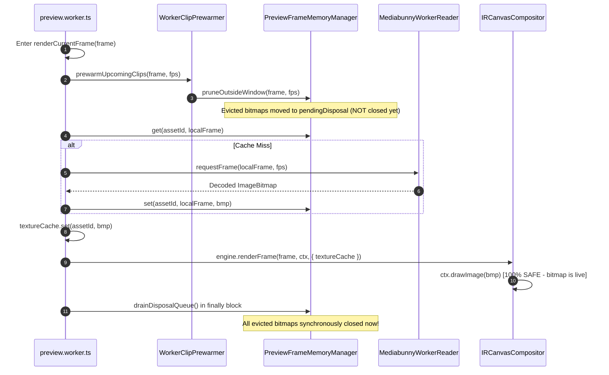

# Implementation Plan 29: Pure Single-Owner Cache & Post-Render Drain in Studio Preview

## Goal Description
Permanently eliminate the `InvalidStateError: The image source is detached` exception during video canvas rendering in `apps/studio/src/workers/preview.worker.ts` and `IRCanvasCompositor.ts`. 

Based on the `/grill-me` design alignment:
1. **Eliminate Dual-Ownership**: Convert [`MediabunnyWorkerReader`](file:///c:/Users/Admin/workspace/git/acc/apps/studio/src/workers/MediabunnyWorkerReader.ts) into a pure, stateless decoder by removing its internal `ringBuffer` and all internal `.close()` calls.
2. **Single Authority for Frame Lifecycle**: [`PreviewFrameMemoryManager`](file:///c:/Users/Admin/workspace/git/acc/apps/studio/src/workers/PreviewFrameMemoryManager.ts) becomes the **exclusive** owner of decoded `ImageBitmap` memory and lifecycle.
3. **Deterministic Post-Render Drain Queue**: When `PreviewFrameMemoryManager` prunes or evicts frames, it adds them to a pending disposal list. `preview.worker.ts` drains and synchronously calls `bitmap.close()` strictly inside a `finally` block **after** `IRCanvasCompositor.renderFrame()` has finished drawing the frame.
4. **Remove All Timers**: Completely delete `setTimeout(..., 50)` hacks.

---

## User Review Required

> [!IMPORTANT]
> **Pure Deterministic Memory Model**:
> - `MediabunnyWorkerReader` will no longer hold an independent `ringBuffer` of `ImageBitmap`s or close them. It only fetches/decodes from WebCodecs and returns the bitmap.
> - Evicted bitmaps in `PreviewFrameMemoryManager` are staged in a `pendingDisposal: ImageBitmap[]` queue during prewarming or pruning.
> - At the end of `renderCurrentFrame()`, inside `finally { memoryManager.drainDisposalQueue(); }`, all unneeded bitmaps are synchronously closed.
> - This guarantees that no `ImageBitmap` can ever be detached or closed while `ctx.drawImage()` is executing.

---

## Architectural Flow

---

## Proposed Changes

### Component: `@acc/studio` Workers & Memory Engine

#### [MODIFY] `apps/studio/src/workers/MediabunnyWorkerReader.ts`
- Remove `ringBuffer: Map<number, ImageBitmap>` and `ringBufferSize`.
- Remove `evictFrame`, `pruneOutsideWindow`, and `getRingBufferFrames`.
- Remove `setTimeout(..., 50)` and direct `bmp.close()` calls on decoded frames.
- Streamline `requestFrame(frame, fps, isScrubbing)` to decode directly from `this.canvasSink` via `CanvasSink.getCanvas()`, convert to `ImageBitmap`, and return it.
- Keep `dispose()` to clean up the underlying Mediabunny `Input` and `CanvasSink` instances when the reader itself is destroyed.

#### [MODIFY] `apps/studio/src/workers/PreviewFrameMemoryManager.ts`
- Remove `setTimeout(..., 50)` from `closeBitmap`.
- Introduce `private pendingDisposal: ImageBitmap[] = []`.
- When `evictLeastRecentlyUsed()` or `pruneOutsideWindow()` removes an entry from `frameMap`, push `entry.bitmap` into `pendingDisposal`.
- Add `public drainDisposalQueue(protectedBitmaps?: Set<ImageBitmap>): void`:
  - Iterates over `pendingDisposal`.
  - If a bitmap is in `protectedBitmaps` (e.g. currently actively drawn), it is retained for the next drain.
  - Otherwise, synchronously invokes `bitmap.close()`.
  - Clears the disposed items.

#### [MODIFY] `apps/studio/src/workers/preview.worker.ts`
- In `renderCurrentFrame()`:
  - Populate `textureCache` for active sequences at the current frame.
  - Wrap `engine.renderFrame(...)` in a `try ... finally` block.
  - In `finally`:
    - Collect active bitmaps from `textureCache`: `const activeBitmaps = new Set<ImageBitmap>(textureCache.values());`
    - Call `memoryManager.drainDisposalQueue(activeBitmaps);`.
- In `stopPlayback()` or timeline reload:
  - Clear `textureCache`.
  - Call `memoryManager.drainDisposalQueue()`.

#### [MODIFY] `packages/ir/src/renderer/shared/IRCanvasCompositor.ts`
- Retain the defensive check `isAssetValid = rawAsset && (rawAsset.width > 0 && rawAsset.height > 0)` and `try/catch` fallback around `ctx.drawImage` as a permanent defense-in-depth invariant against external canvas/browser anomalies.

---

## Verification Plan

### Automated Tests
1. **New Unit Test**: `autogenerated-tests/preview_frame_memory_manager_drain.test.ts`
   - Verify `PreviewFrameMemoryManager` holds frames up to `MAX_GLOBAL_FRAMES`.
   - Verify `pruneOutsideWindow()` does not close bitmaps immediately, but stages them in `pendingDisposal`.
   - Verify `drainDisposalQueue()` closes staged bitmaps, but spares any bitmap passed in `protectedBitmaps`.
2. **Worker Parity Test**: `bun test autogenerated-tests/studio_offscreen_worker_parity.test.ts`
3. **Phase 9 Test**: `bun test autogenerated-tests/studio_phase9_dnd_kit_architecture.test.ts`
4. **Vite Production Build**: `pnpm --filter @acc/studio build`

### Manual Verification
- Scrub back and forth across multiple video clips in the studio timeline.
- Verify zero `InvalidStateError: The image source is detached` warnings or placeholder flashes.
- Confirm frame memory remains bounded under 64 frames (~150MB) without memory leaks.
