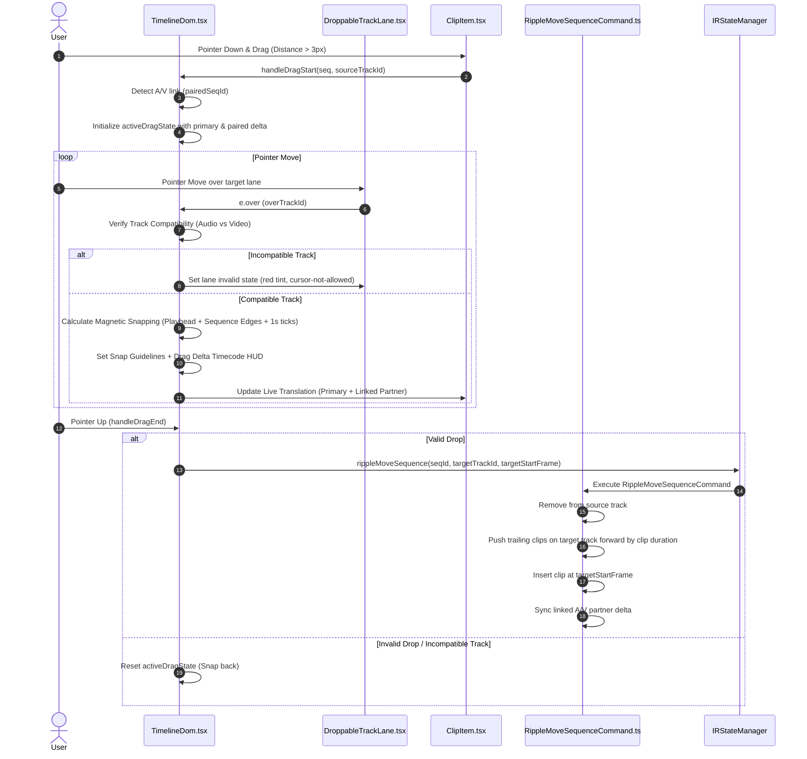

# Implementation Plan 30: Robust Timeline DOM Sequence Moving & Interaction Hardening (with Track-Scoped Ripple Push)

## Goal Description
During detailed inspection of [TimelineDom.tsx](file:///c:/Users/Admin/workspace/git/acc/apps/studio/src/components/timeline/TimelineDom.tsx), [ClipItem.tsx](file:///c:/Users/Admin/workspace/git/acc/apps/studio/src/components/timeline/ClipItem.tsx), [DroppableTrackLane.tsx](file:///c:/Users/Admin/workspace/git/acc/apps/studio/src/components/timeline/DroppableTrackLane.tsx), and [MoveSequenceCommand.ts](file:///c:/Users/Admin/workspace/git/acc/apps/studio/src/lib/commands/MoveSequenceCommand.ts), multiple functional bugs, edge-case regressions, and UI/UX friction points were uncovered in the DOM sequence moving interaction:

1. **Incompatible Cross-Track Drops**: Video sequences can be dropped onto audio tracks (and vice versa), corrupting the timeline data structure and crashing audio/video preview workers.
2. **Linked A/V Visual Desynchronization**: While `MoveSequenceCommand` shifts linked A/V partner sequences on commit, `TimelineDom` only drags the primary clip during mouse movement. The partner clip remains stationary until release, breaking visual feedback.
3. **Collision & Ripple Push (Insert)**: When a clip is moved or dropped onto an occupied area, it currently attempts a flawed clamp calculation that causes visual jumping or clip overlap. Based on the grill-me design alignment:
   - **Track-Scoped Ripple Push / Insert**: Dropping a clip pushes all downstream clips on that target track forward by the incoming clip's duration, creating an exact opening without overwriting existing work or disrupting other tracks.
4. **Horizontal Virtualization Clip Pruning During Drag**: Dragged clips or their snap target boundaries can be unmounted when scrolled near viewport edges.
5. **Lack of Drag Affordance & Collision Feedback**: In-lane dragging suffers from track clipping (`overflow-hidden`) without an elevated drag preview (`DragOverlay`), delta timecode pill, or red collision indicators.

---

## User Review Required

> [!IMPORTANT]
> **Track Type Strict Typing**:
> - Video sequences will only be droppable onto `video` (and compatible overlay/vfx) tracks.
> - Audio sequences will strictly only be droppable onto `audio` tracks.
> - Attempting to hover or drop across incompatible track types will render a destructive/forbidden drop target state (`cursor-not-allowed`, red highlight border) and cancel the move if dropped.

> [!IMPORTANT]
> **Track-Scoped Ripple Push / Insert Mechanics**:
> - When a sequence is dropped at frame `T` with duration `D` onto a track where downstream clips exist (`clip.startFrame >= T` or intersecting `T`), all clips on that track starting at or after `T` are pushed forward by `D` frames.
> - Other tracks remain untouched, maintaining independent track timing.
> - Both execute and undo cleanly handle the ripple shift.

> [!TIP]
> **Linked A/V Pair Motion**:
> - When dragging an A/V linked sequence, `TimelineDom` will track and visually translate both the video clip and its linked audio partner in real-time, matching professional NLE behavior (Premiere, Resolve, Final Cut).

---

## Architecture & Interaction Workflow



---

## Proposed Changes

### `apps/studio/src/components/timeline/`

#### [MODIFY] [DroppableTrackLane.tsx](file:///c:/Users/Admin/workspace/git/acc/apps/studio/src/components/timeline/DroppableTrackLane.tsx)
- Add `trackType` prop to `DroppableTrackLaneProps`.
- Pass `trackType` in dnd-kit `data`:
  ```ts
  data: {
    type: 'track',
    trackId: track.id,
    trackType: track.type,
  }
  ```
- Receive `isInvalidDrop?: boolean` to render clear destructive feedback:
  - Valid drop: `bg-accent-theme/10 border-accent-theme/40 ring-1 ring-accent-theme/30`
  - Incompatible / locked drop: `bg-destructive/10 border-destructive/50 ring-1 ring-destructive/40 cursor-not-allowed`

#### [MODIFY] [ClipItem.tsx](file:///c:/Users/Admin/workspace/git/acc/apps/studio/src/components/timeline/ClipItem.tsx)
- Support rendering linked partner displacement when its paired clip is being dragged:
  - Check if `activeDragState?.pairedSeqId === seq.id`.
  - Shift `displayStartFrame` using `activeDragState.deltaFrames` in sync with the primary clip.
- Render dynamic Dragging Micro-Pill HUD during active drag:
  - Displays relative delta frames (e.g. `+00:01:14` / `-00:00:20`).
  - Displays snapping magnet badge when snapped to playhead or abutting clip.
- Add elevation styling when dragged: `z-30 shadow-2xl scale-[1.01] ring-2 ring-accent-theme`.

#### [MODIFY] [TimelineDom.tsx](file:///c:/Users/Admin/workspace/git/acc/apps/studio/src/components/timeline/TimelineDom.tsx)
- **Track Type Guard**:
  - In `handleDragMove`: inspect source clip type (`audio` vs `video`/`image`/`text`) against `overTrack.type`.
  - Set `isValidTrackType: boolean`. If incompatible, show invalid drop state and abort drop on `handleDragEnd`.
- **Linked A/V Drag Pairing**:
  - In `handleDragStart`: inspect `seq.modifiers` for `editorial/av_link`.
  - If present and enabled, resolve `linkedSequenceId` and store in `activeDragState.pairedSeqId`.
- **Horizontal Virtualization Safety**:
  - Ensure both the primary dragged clip AND its paired sequence ID are preserved from being culled during drag.
- **Pass drag states & indicators to `DroppableTrackLane` and `ClipItem`**.

---

### `apps/studio/src/lib/commands/` & `apps/studio/src/lib/ir/`

#### [NEW] [RippleMoveSequenceCommand.ts](file:///c:/Users/Admin/workspace/git/acc/apps/studio/src/lib/commands/RippleMoveSequenceCommand.ts)
- Moves target sequence from `sourceTrack` to `targetTrack` at `targetStartFrame`.
- Pushes all downstream sequences on `targetTrack` whose `startFrame >= targetStartFrame` forward by the moved sequence's duration.
- Synchronizes linked A/V partner sequence start time by the same delta.
- Fully undoable and redoable (records displaced downstream clip offsets and reverses them on undo).

#### [MODIFY] [irState.ts](file:///c:/Users/Admin/workspace/git/acc/apps/studio/src/lib/ir/irState.ts)
- Add `rippleMoveSequence(sequenceId: string, targetTrackId: string, targetStartFrame: number)` invoking `RippleMoveSequenceCommand`.

---

## Verification Plan

### Automated Verification
- Run `pnpm --filter @acc/studio exec vite build --mode development` to verify zero compile or typing regressions.

### Manual Verification
1. **Track Type Compatibility**:
   - Drag a video clip toward an audio track. Observe the red invalid drop lane styling and verify dropping is prevented.
   - Drag an audio clip toward a video track. Verify it is also rejected.
   - Drag video between `V1`, `V2`, etc. Verify smooth transfer.
2. **Linked A/V Pair Synchronization**:
   - Click and drag a linked video clip horizontally. Observe the paired audio clip on the audio track sliding synchronously in real-time.
   - Release mouse: verify both clips lock into their aligned frames.
3. **Ripple Push / Insert Verification**:
   - Drop a 60-frame clip at frame 30 on a track that already has a clip starting at frame 40.
   - Verify the clip at frame 40 is automatically pushed forward to frame 100 (`40 + 60`).
   - Click Undo (`Ctrl+Z`): verify all clips restore to their exact original positions.
4. **Visual HUD**:
   - Verify floating delta timecode badge (`+15 frames`) appears on the dragged clip.
