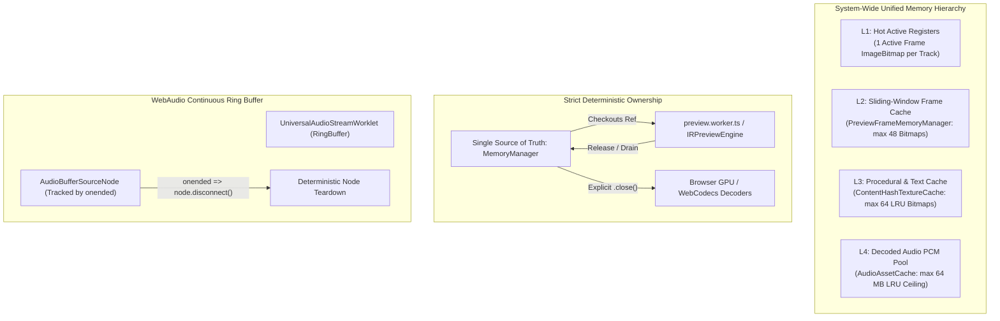

# Implementation Plan 37: System-Wide Memory & Lifecycle Optimization for Studio

**Status**: Ready for Execution  
**Scope**: `@acc/studio` (WebCodecs worker pipeline, WebAudio engine, AssetTextureCache, timeline waveforms, client export orchestrator)  
**Author**: Lead Systems Architect & Principal Polyglot Engineer  

---

## 1. Problem Statement & Executive Diagnosis

During extended editing sessions, rapid playhead scrubbing, audio playback, and MP4 exports in `@acc/studio`, memory consumption grows monotonically, eventually triggering browser tab crashes (OOM) or severe GC-induced frame drops below 60fps.

### Root Cause Matrix

| Subsystem | Source Location | Underlying Mechanism | Severity |
| :--- | :--- | :--- | :--- |
| **WebAudio Bus** | `apps/studio/src/lib/audio/WebAudioEngine.ts` | `s.buffer !== null` check in `queuedSources.filter()` is permanently true per W3C Web Audio spec. Every 5-second uncompressed stereo PCM chunk (~1.76 MB) is permanently retained. | **CRITICAL** (~21 MB / min) |
| **GPU / WebCodecs** | `apps/studio/src/renderer/workers/preview.worker.ts` & `PreviewFrameMemoryManager.ts` | **Dual-ownership conflict**: `safeSetTexture()` calls `close()` on the previous frame texture, while `PreviewFrameMemoryManager.frameMap` still references that exact `ImageBitmap`. Scrubbing backward accesses a detached bitmap. | **CRITICAL** (GPU crash / blank frames) |
| **Decoder Retention** | `apps/studio/src/renderer/workers/preview.worker.ts` & `MediabunnyWorkerReader.ts` | `videoReaders` map never disposes readers when assets are deleted or replaced from the timeline. | **HIGH** (WebCodecs hardware decoder exhaustion) |
| **Typography VRAM** | `apps/studio/src/renderer/workers/ContentHashTextureCache.ts` | `cache = new Map<number, ImageBitmap>()` has no maximum capacity and no LRU eviction. Every subtitle/text edit creates an orphaned `ImageBitmap`. | **HIGH** (Unbounded VRAM growth) |
| **Waveform Caches** | `apps/studio/src/lib/audio/WebAudioEngine.ts` & `apps/studio/src/components/timeline/WaveSurferWaveform.tsx` | Unbounded `waveformCache` keyed on `${id}:${durationFrames}:${targetBars}` + global `pyramidCache` with zero eviction. Trimming audio clips allocates hundreds of `Float32Array`s. | **HIGH** (Heap fragmentation) |
| **DOM / Canvas Churn** | `apps/studio/src/components/timeline/WaveSurferWaveform.tsx` | Full `WaveSurfer.create()` instantiation per audio clip; destroyed and recreated on every timeline zoom / width change. | **HIGH** (DOM churn / UI stutter) |
| **Export GC Spikes** | `apps/studio/src/lib/export/ClientExportOrchestrator.ts` | Allocates a new 8.3 MB `Uint8Array` per frame (1080p). Cancellation leaves `sink` undelivered and un-disposed. | **MEDIUM-HIGH** (~2.5 GB allocated per 300 frames) |
| **Texture Cache Leaks** | `apps/studio/src/lib/textures/AssetTextureCache.ts` & `MainThreadRenderStrategy.ts` | Static `directStorage` and `objectUrls` maps; `loadBlob()` overwrites URLs without revoking; `recreateEngine()` spawns abandoned `HTMLVideoElement` decoders. | **MEDIUM-HIGH** (Leaked blob URLs / video elements) |

---

## 2. Target Architecture: Unified Zero-Leak Memory Model



### Architectural Directives

1. **Single Ownership for GPU Bitmaps**:
   `PreviewFrameMemoryManager` is the **sole owner** of `ImageBitmap` lifecycles in the preview worker. Consumers (such as `safeSetTexture`) must never call `.close()` directly. Eviction and `.close()` must occur only when a bitmap leaves the sliding playhead window `[playhead - 2s, playhead + 3s]`.
2. **Deterministic Web Audio Event-Driven Teardown**:
   Never poll or filter `source.buffer`. Listen to `source.onended = () => { source.disconnect(); list.delete(source); }`.
3. **Decoded Asset Reader Lifecycle Sync**:
   When `syncAssetSources(newAssets)` runs, diff against existing readers and immediately call `reader.dispose()` for missing assets.
4. **Zero-Allocation Export Buffer Pooling**:
   Pre-allocate a single `Uint8Array(width * height * 4)` and reuse it across all export frames.

---

## 3. Phased Remediation Work Breakdown

### Phase 1: WebAudio Engine & Waveform Pruning
- **File**: `apps/studio/src/lib/audio/WebAudioEngine.ts`
  - Replace `queuedSources` array with `Set<AudioBufferSourceNode>`.
  - Wire `nextSource.onended = () => { nextSource.disconnect(); activeSources.delete(nextSource); }`.
  - Add bounded LRU eviction (cap at 64 entries) to `waveformCache`.
  - Fix `waveformWorker.onmessage` closure bug: bind key using response payload's `durationFrames`.
  - Add `dispose()` method to `WebAudioEngine` and `AudioAssetCache` to close `AudioContext` and release workers.

### Phase 2: WebCodecs Worker Single-Ownership & Reader Diffing
- **File**: `apps/studio/src/renderer/workers/preview.worker.ts`
  - Remove direct `existing.close()` from `safeSetTexture` (delegate exclusively to `PreviewFrameMemoryManager.drainDisposalQueue`).
  - Implement active asset diffing in `syncAssetSources`: dispose and remove obsolete `MediabunnyWorkerReader`s.
  - Add explicit `DISPOSE` worker message handler to tear down offscreen context, readers, and caches on unmount.
- **File**: `apps/studio/src/renderer/workers/ContentHashTextureCache.ts`
  - Enforce `MAX_ENTRIES = 64` LRU ceiling with synchronous `oldBmp.close()` eviction.
- **File**: `apps/studio/src/renderer/workers/PreviewFrameMemoryManager.ts`
  - Tighten window eviction bounds to `[playhead - 1.5s, playhead + 2.5s]`.

### Phase 3: Texture Cache Isolation & Engine Teardown
- **File**: `apps/studio/src/lib/textures/AssetTextureCache.ts`
  - Convert `directStorage` and `objectUrls` from static to instance maps (or scoped weak registries).
  - In `loadBlob()`, revoke previous `objectUrl` if `assetId` already exists before storing the new one.
  - In `delete()`, invoke `.close()` if texture implements `Disposable` or has `.close()`.
- **File**: `apps/studio/src/renderer/strategies/MainThreadRenderStrategy.ts`
  - In `recreateEngine()`, call `dispose()` on the outgoing `IRPreviewEngine` instance to release its `HTMLVideoElement` hardware decoders.

### Phase 4: Client Export Zero-Allocation & Cancellation Hygiene
- **File**: `apps/studio/src/lib/export/ClientExportOrchestrator.ts`
  - Pre-allocate a single reusable `Uint8Array(width * height * 4)` buffer; reuse across all loop iterations.
  - On `signal?.aborted`, invoke `sink.dispose()` or `sink.finalize()` to guarantee WebCodecs encoders are terminated.
  - Nullify canvas references in `finally` block to allow immediate GC.

### Phase 5: Timeline Waveform Decoupling & Cache Hygiene
- **File**: `apps/studio/src/components/timeline/WaveSurferWaveform.tsx`
  - Add LRU ceiling (cap at 32 items) to module-level `pyramidCache`.
  - Add debounce/resize protection so zooming timeline does not thrash `WaveSurfer.create()`.

---

## 4. Verification & Testing Plan

### Automated Regression & Memory Profiling
1. **Unit & Integration Suite**:
   ```bash
   bun test autogenerated-tests/deterministic_timeline_clock.test.ts
   pnpm --filter @acc/studio build
   ```
2. **Headless Audio Cycle Test**:
   - Verify `WebAudioEngine` continuous playback for 60 seconds.
   - Assert `activeSources.size` remains bounded (<= 3 at any time).
3. **Hardware Decoder Limit Test**:
   - Rapidly swap 20 video assets in timeline.
   - Assert `videoReaders.size` matches current timeline asset count and no detached bitmap errors are thrown.
4. **Export Cancellation Test**:
   - Start 1080p export, abort at frame 50.
   - Assert sink cleanup completes and memory returns to baseline.
