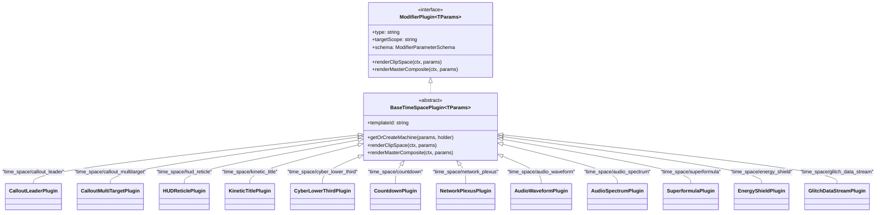

# Studio Implementation Plan 47: Discrete `time_space/*` Motion Graphic Plugins & Studio Showcase

**Document Status:** Complete, Aligned & Ready for Execution  
**Companion Master Plan:** [`docs/iterations/master_implementation_plan_iteration_53.md`](file:///mnt/c/Users/Admin/workspace/git/acc/docs/iterations/master_implementation_plan_iteration_53.md)  
**Target:** `packages/ir/src/plugins/time-space/`, `apps/studio` (`modifierCatalog.ts`, `Titlebar.tsx`, `irState.ts`, demo IRs), `packages/ir/src/types/modifiers.ts`, `packages/ir/src/schema/VideoIRSchemaValidator.ts`  
**Standards:** Principal Systems Architect, Enterprise Clean Coder, Zero-Stub Prohibition, WAI-ARIA / Liquid Glass UI  

---

## 1. Executive Summary & Problem Formulation

The monorepo's virtual-clock procedural motion graphics system was originally centralized inside a monolithic plugin `TimeSpaceModifierPlugin.ts` (`type = 'time_space'`). While mathematically robust (powered by GSAP timelines, `DeterministicPtsEngine`, and `StatelessHashNoise`), this monolithic architecture presented three major friction points:
1. **Schema & UI Bloat**: All 11+ motion graphic templates shared a single static schema definition with dynamic `visibleIf` filtering, exposing irrelevant controls in the Studio Inspector.
2. **Duplication Risk**: Parallel ad-hoc implementations across packages (`TrackingCalloutEngine`, `HologramHUDPlugin`, `LowerThirdFactory`).
3. **Studio Showcase Limitations**: Studio only offered 2 demo projects (`defaultDemoIR` and `complexSciFiDemoIR`), lacking dedicated showcase compositions for procedural broadcast graphics and real-time audio visualizers.

### Solution Topology
1. Deconstruct `TimeSpaceModifierPlugin` into **12 discrete, strongly-typed 1:1 plugins** prefixed with `time_space/*` residing in `packages/ir/src/plugins/time-space/`.
2. Abstract common seek, state-machine instantiation, cache-invalidation, and canvas rendering logic into `BaseTimeSpacePlugin<TParams>`.
3. Provide bespoke parameter interfaces in `packages/ir/src/types/modifiers.ts` and runtime validation in `packages/ir/src/schema/VideoIRSchemaValidator.ts`.
4. Register all 12 plugins in `apps/studio/src/components/inspector/modifierCatalog.ts` under category `'motion'`.
5. Expand Studio with **4 production demo projects** selectable from the Titlebar:
   - `defaultDemoIR`: Cinematic 5-track showcase.
   - `complexSciFiDemoIR`: 9-track cyberpunk tactical telemetry showcase.
   - `broadcastNewsDemoIR`: Broadcast news layout with specular cyber lower-thirds and launch countdown.
   - `cyberAudioVisualizerDemoIR`: High-energy audio visualizer with radial waveform rings and gravitational equalizer spectrum bars.

---

## 2. Technical Architecture & Class Hierarchy

---

## 3. Implementation Phases & Roadmap

### Phase 1: Base Architecture & Core Abstraction (`@acc/ir`)
- Implement `packages/ir/src/plugins/time-space/BaseTimeSpacePlugin.ts`:
  - Abstract class implementing `ModifierPlugin<TParams>`.
  - Encapsulate `getOrCreateMachine(params, holder)` with state-machine cache invalidation signature.
  - Implement isomorphic clip-space and master-composite rendering pipelines.

### Phase 2: 12 Discrete Plugins (`packages/ir/src/plugins/time-space/`)
- Implement discrete plugin files with bespoke schemas:
  1. `CalloutLeaderPlugin.ts` (`time_space/callout_leader`, template: `callout_leader`)
  2. `CalloutMultiTargetPlugin.ts` (`time_space/callout_multitarget`, template: `callout_multitarget`)
  3. `HUDReticlePlugin.ts` (`time_space/hud_reticle`, template: `hud_tactical_reticle`)
  4. `KineticTitlePlugin.ts` (`time_space/kinetic_title`, template: `kinetic_title`)
  5. `CyberLowerThirdPlugin.ts` (`time_space/cyber_lower_third`, template: `cyber_lower_third`)
  6. `CountdownPlugin.ts` (`time_space/countdown`, template: `dynamic_countdown`)
  7. `NetworkPlexusPlugin.ts` (`time_space/network_plexus`, template: `network_plexus`)
  8. `AudioWaveformPlugin.ts` (`time_space/audio_waveform`, template: `audio_waveform_ring`)
  9. `AudioSpectrumPlugin.ts` (`time_space/audio_spectrum`, template: `audio_equalizer_spectrum`)
  10. `SuperformulaPlugin.ts` (`time_space/superformula`, template: `parametric_superformula`)
  11. `EnergyShieldPlugin.ts` (`time_space/energy_shield`, template: `energy_shield_hex`)
  12. `GlitchDataStreamPlugin.ts` (`time_space/glitch_data_stream`, template: `glitch_data_stream`)
- Create barrel export `packages/ir/src/plugins/time-space/index.ts`.
- Register all 12 plugins in `registerCoreModifierPlugins` in `packages/ir/src/plugins/index.ts`.
- Deprecate / remove monolithic `TimeSpaceModifierPlugin.ts` or retain backward-compatibility alias if required.

### Phase 3: VideoIR Types & Schema Validation Synchronization
- Update `packages/ir/src/types/modifiers.ts`:
  - Declare dedicated interfaces (`CalloutLeaderModifierParams`, `HUDReticleModifierParams`, etc.).
  - Expand `StandardModifierNode` union with all 12 `'time_space/*'` string literal types.
- Update `packages/ir/src/schema/VideoIRSchemaValidator.ts`:
  - Add schema validation clauses for all 12 `'time_space/*'` modifier types.
  - Retain backwards-compatibility validation for legacy `'time_space'` documents.

### Phase 4: Studio Catalog & 4 Rich Production Demos (`apps/studio`)
- In `apps/studio/src/components/inspector/modifierCatalog.ts`:
  - Register all 12 discrete plugins under category `'motion'` with dedicated icons and clean default parameters.
- Update `defaultDemoIR.ts` and `complexSciFiDemoIR.ts` to utilize `'time_space/callout_leader'`.
- Create `apps/studio/src/lib/ir/broadcastNewsDemoIR.ts`:
  - 1080p 30fps multi-track broadcast project featuring `'time_space/cyber_lower_third'` and `'time_space/countdown'`.
- Create `apps/studio/src/lib/ir/cyberAudioVisualizerDemoIR.ts`:
  - 1080p 30fps audio visualization project featuring `'time_space/audio_waveform'` and `'time_space/audio_spectrum'`.
- Update `apps/studio/src/lib/ir/irState.ts`:
  - Support template type: `'scifi' | 'default' | 'broadcast' | 'visualizer'`.
- Update `apps/studio/src/components/Titlebar.tsx`:
  - Add SelectItems for Broadcast News Matrix and Cyber Audio Visualizer.

### Phase 5: Verification & Formal Testing
- Implement `autogenerated-tests/discrete_timespace_plugins.test.ts`.
- Verify registration, schema isolation, and frame evaluation across all 12 plugins.
- Verify template switching across all 4 production demos.

---

## 4. Verification Matrix

| Verification Vector | Target Component | Success Assertion |
| :--- | :--- | :--- |
| **Plugin Registration** | `ModifierPluginRegistry` | All 12 `time_space/*` plugins registered and queryable |
| **Schema Isolation** | `modifierCatalog.ts` & Plugin schemas | Non-text visualizers (audio, plexus, superformula) have zero text fields |
| **Rendering Pipeline** | `BaseTimeSpacePlugin` | Evaluates clip-space and composite renders cleanly at local frames 0, 15, 30 |
| **Studio Showcase** | `irState.ts` & `Titlebar.tsx` | All 4 demo IRs (`default`, `scifi`, `broadcast`, `visualizer`) load, validate, and compile without schema errors |
