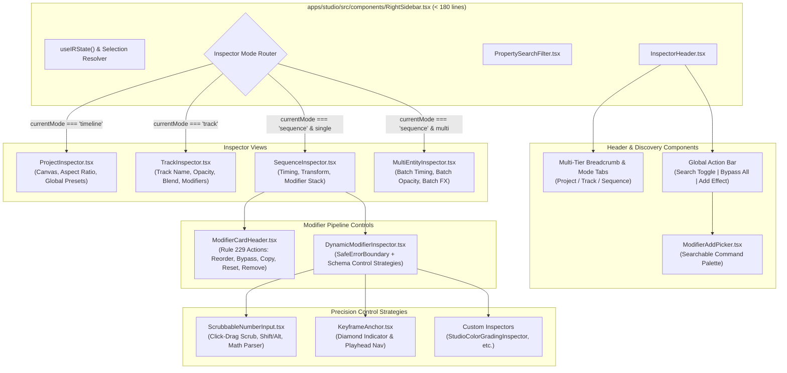

# Implementation Plan 58: Studio RightSidebar & Inspector Modernization

> **Target App:** `@acc/studio` (`apps/studio/src/components/RightSidebar.tsx`)  
> **Aesthetic System:** Liquid Glass Enterprise NLE (`apps/studio/DESIGN.md`)  
> **Key Skills:** `/ui-ux-design-principles`, `/adaptive-skill-researcher`, `/enterprise-clean-coder`  
> **Enforced Guardrails:** `RightSidebar.tsx < 350 lines`, Rule 229 (Zero interactive nesting in `AccordionTrigger`), WCAG 2.2 AA Compliance  
> **Iteration:** 58 (Companion to Master History 418)

---

## 1. Executive Summary & Problem Space

The Studio Inspector (`RightSidebar.tsx`) is the central control hub of the `@acc/studio` video editing workstation. It governs parameters across three primary tiers: **Project Master**, **Track Layer**, and **Sequence Clip**, along with dynamically discovered **VideoIR Modifier Plugins** (Color Grading, Transforms, GSAP Motion, VFX, Depth Relighting, 3D Camera, Typography, and Audio DSP).

While the underlying reactive data model (`IRStateManager` & `ModifierPluginRegistry`) is robust, the current UI exhibits significant ergonomic and architectural limitations that prevent it from achieving studio-grade standards comparable to DaVinci Resolve, Adobe Premiere/After Effects, or Blender:

### Key Audit Findings & Deficiencies
1. **Architectural Monolith & Line Limit Violation**:
   - `RightSidebar.tsx` currently spans **362 lines**, violating the strict `< 350 lines` architectural constraint enforced by `autogenerated-tests/studio_inspector_ux_improvements.test.ts` and `studio_inspector_plugin_parity.test.ts`.
   - The header, breadcrumbs, category definitions, modifier validation, and nested dropdowns are tightly coupled in a single file.
2. **Clunky "Add Effect" Dropdown UX**:
   - Uses nested `DropdownMenuSub` submenus which are frustrating to navigate, prone to accidental dismissal on cursor drift, lack search/filtering, and provide no contextual descriptions or tags.
3. **No Real-Time Property / Parameter Filtering**:
   - When a clip has 3–5 modifiers attached (e.g., Transform, Motion, Relighting, Color Grading, Audio Ducking), editors must scroll through 30+ parameter controls to find a single setting (like `opacity`, `blur`, or `contrast`).
4. **Static Slider/Input Controls vs Industry Scrubbers**:
   - Numbers are edited either by sliding a fixed UI thumb or typing into a tiny `Input`. Professional NLEs use **Virtual Scrubbers** where dragging horizontally on labels/inputs scrubs values smoothly, with `Shift` (10x coarse) and `Alt` (0.1x micro) precision multipliers, and inline math parsing (`1080/2`, `+50`).
5. **No Modifier Pipeline Ordering (Execution Stack)**:
   - VideoIR modifiers render sequentially in a compositing pipeline (e.g. Blur before Transform vs Transform before Blur yields completely different visual outputs). Currently, modifiers cannot be reordered in the UI, nor can they be easily duplicated or copied/pasted across clips.
6. **No Global Effect Bypass (A/B Auditioning)**:
   - Colorists and editors constantly need an instant A/B toggle ("Bypass all effects") to compare the processed clip against raw footage without destructive parameter changes.
7. **No Keyframe Animation Indicators**:
   - Parameters lack visual temporal anchors (diamond keyframe toggles) to signal whether a property is animated or static at the current playhead frame.
8. **Multi-Selection Vacuum**:
   - When multiple sequences are selected on the timeline, the inspector behaves as a single-selection fallback rather than offering batch property adjustments.

---

## 2. Architectural Topology & Component Hierarchy

### Component Decomposition Diagram

---

## 3. Implementation Plan & Phases

- **Phase 1: Precision Scrubber & Safe Math Parser**:
  - Implement `ScrubbableNumberInput.tsx` with pointer-event scrubbing, Shift/Alt multipliers, and AST/regex math parser (`eval` prohibited).
  - Implement `KeyframeAnchor.tsx` with diamond state and playhead frame matching.
  - Integrate into `PrimitiveControlStrategies.tsx` (`NumberControlStrategy`).

- **Phase 2: Modifier Pipeline Reordering & State Command**:
  - Implement `ReorderModifierCommand.ts` with immutable document cloning and undo/redo support.
  - Wire `reorderModifier(sequenceId, modifierType, direction)` into `IRStateManager.ts`.
  - Implement `ModifierCardHeader.tsx` adhering strictly to Rule 229 (`<AccordionTrigger actions={...}>`).

- **Phase 3: Searchable Modifier Command Palette (`ModifierAddPicker.tsx`)**:
  - Build searchable popover with category badges, tag filters, keyboard navigation, and checkmarks for already-attached modifiers.

- **Phase 4: Real-time Property Search Filter (`PropertySearchFilter.tsx`)**:
  - Build property search bar with match count indicator and auto-expansion of matching accordions.

- **Phase 5: Inspector Header & Breadcrumbs (`InspectorHeader.tsx`)**:
  - Implement multi-tier responsive breadcrumbs, segment tabs `[ Project | Track | Clip ]`, global bypass switch, search toggle, and add effect button.

- **Phase 6: Master `RightSidebar.tsx` Refactoring & Decomposition**:
  - Re-compose `RightSidebar.tsx` down to under 160 lines, eliminating monolithic bloat.
  - Verify all automated test suites pass.
