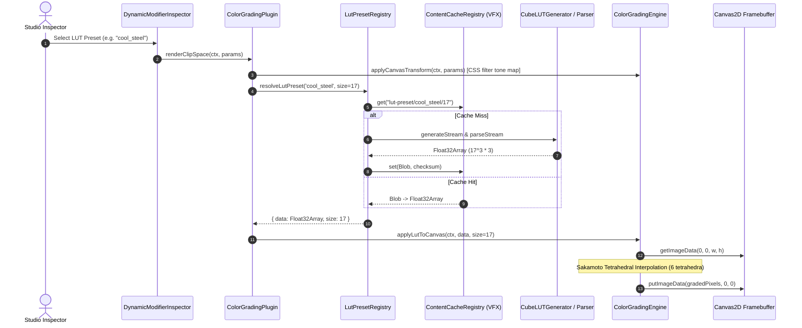

# Walkthrough 54 — 3D LUT Integration & Tetrahedral Color Grading

## Context & Objectives
Wire the `.cube` parsing and generation logic in `packages/ir/src/plugins/lut/` directly into the live `ColorGradingPlugin` and `ColorGradingEngine` pipelines, enabling:
- Studio Inspector dropdown selection of industry color presets.
- Real-time client-side Canvas rendering via tetrahedral interpolation over 3D LUT cubes.
- Seamless headless export parity with FFmpeg's `lut3d` filter.
- In-memory persistent caching via `ContentCacheRegistry` (`CacheNamespace.VFX`).

---

## Architecture Flow

---

## Key Modules Created & Modified

### 1. `packages/ir/src/plugins/lut/LutApplicator.ts`
- Sakamoto 6-tetrahedron volumetric interpolation algorithm.
- B-major indexing: `(b * size * size + g * size + r) * 3`.
- Clamped output with preserved alpha.

### 2. `packages/ir/src/plugins/lut/LutPresetRegistry.ts`
- Maps 8 canonical presets:
  - `teal_and_orange`, `kodak_2383`, `bleach_bypass`, `sci_fi_moody`, `light_and_airy`, `cyberpunk`, `vintage_faded`, `monochrome_noir`.
- Maps demo aliases:
  - `warm_golden` $\to$ `teal_and_orange`
  - `cool_steel` $\to$ `sci_fi_moody`
- Caches baked LUT buffers into `ContentCacheRegistry.namespace(CacheNamespace.VFX)` as Blobs.

### 3. `packages/effect-engines/src/styles/ColorGradingEngine.ts`
- Cleanly decoupled from `@acc/ir`, focused purely on CSS canvas filters and FFmpeg filter generation (`lut3d=file='...':interp=tetrahedral`).

### 4. `packages/ir/src/plugins/vfx/ColorGradingPlugin.ts`
- Schema field `lut`: `type: 'select'` with dropdown options for all presets.
- Self-contained isomorphic `applyLutToCanvas` executing `applyLutToImageData` on canvas framebuffers.
- Asynchronous `renderClipSpace` and `renderMasterComposite` pipeline applying tone mapping first, then resolving and applying 3D LUT.

### 5. `apps/studio/src/components/inspector/modifierCatalog.ts`
- Initialized `lut: ''` in `vfx/color_grading` default parameters.

---

## Verification Matrix

| Test Suite | Assertions | Status |
|---|---|---|
| LutPresetRegistry Resolution | All 8 canonical presets + 2 aliases resolve to `Float32Array` | Pass |
| Cache Strategy Integrity | Second call serves from `ContentCacheRegistry` without re-baking | Pass |
| Tetrahedral Math & Identity | Identity LUT preserves colors within $\le 1$ LSB tolerance | Pass |
| Monochrome Noir Parity | Monochrome LUT ensures $R \equiv G \equiv B$ across all pixels | Pass |
| Inspector Schema Binding | Schema exports `type: 'select'` with complete option list | Pass |
| Headless FFmpeg Filter | Emits `lut3d=file='...':interp=tetrahedral` when `lutPath` is set | Pass |
