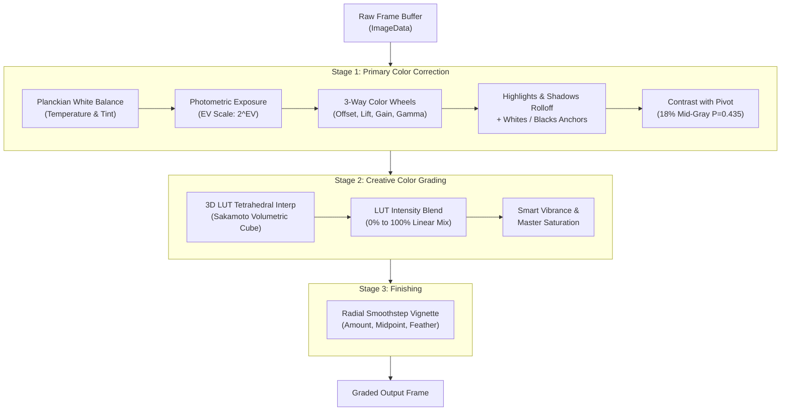

# Walkthrough 55 — Studio-Grade Color Correction Stage & Multi-Tab Color Inspector

## Context & Objectives
Upgrade the color processing architecture in `@acc/ir` and `@acc/studio` so that **Primary Color Correction** strictly precedes **Creative Color Grading**, and replace the flat inspector parameter inputs with an industry-grade, 4-tab studio color workspace featuring interactive 3-Way Color Wheels (Lift, Gamma, Gain, Offset).

---

## Architecture Flow

---

## Studio-Grade Inspector Workspace

The Studio Inspector for `vfx/color_grading` features 4 specialized tabs:

### 1. `[Correction]` Tab
- **White Balance**:
  - Temperature: Bipolar Ice Blue $\leftrightarrow$ Amber slider with real-time visual gradient.
  - Tint: Bipolar Leaf Green $\leftrightarrow$ Magenta slider with real-time visual gradient.
- **Tonal Dynamic Range**:
  - Photometric Exposure (EV: $-3.00$ to $+3.00$ EV).
  - Contrast & 18% Photographic Mid-Gray Pivot ($P = 0.435$).
  - Dual-column Highlights & Shadows soft rolloff sliders.
  - Dual-column Specular Whites & Deep Blacks anchor sliders.

### 2. `[Wheels]` Tab
- **4 Interactive Color Wheels**:
  - **Lift** (Shadows)
  - **Gamma** (Midtones)
  - **Gain** (Highlights)
  - **Offset** (Master Global)
- Each wheel includes:
  - 76px diameter SVG conic chromaticity disc with radial saturation gradient.
  - Draggable puck with real-time polar-to-cartesian chromatic balance vector.
  - Master luminance slider below the wheel.
  - Double-click or reset icon to return to neutral `(0, 0, 0, 0)`.

### 3. `[Creative LUT]` Tab
- **3D LUT Look Selector**:
  - Preset select with 10 industry looks (Teal & Orange, Kodak 2383, Bleach Bypass, Sci-Fi Moody, Cyberpunk, etc.).
- **LUT Look Intensity Slider ($0\% - 100\%$)**:
  - Allows the colorist to dial in the look strength subtly without dynamic range clipping.
- **Color Richness**:
  - Master Saturation ($0\% - 300\%$).
  - Smart Vibrance (boosts desaturated tones while protecting already-saturated skin tones).

### 4. `[Vignette]` Tab
- Lens vignette controls: Amount, Midpoint, and Feather.

---

## Verification Matrix

| Test Suite | Assertions | Status |
|---|---|---|
| White Balance Shift | Warm temperature increases Red, decreases Blue; preserves Alpha | Pass |
| Photometric Exposure | $+1.0$ EV exactly doubles pixel values ($2^1 = 2$) | Pass |
| 3D LUT Intensity Blend | $50\%$ intensity creates an exact linear blend between corrected input and 100% LUT output | Pass |
| Studio Schema Completeness | Declarative `schema.fields` covers all 12 primary and creative grading fields | Pass |
| Inspector Integration | `DynamicModifierInspector` automatically mounts `StudioColorGradingInspector` for `vfx/color_grading` | Pass |
