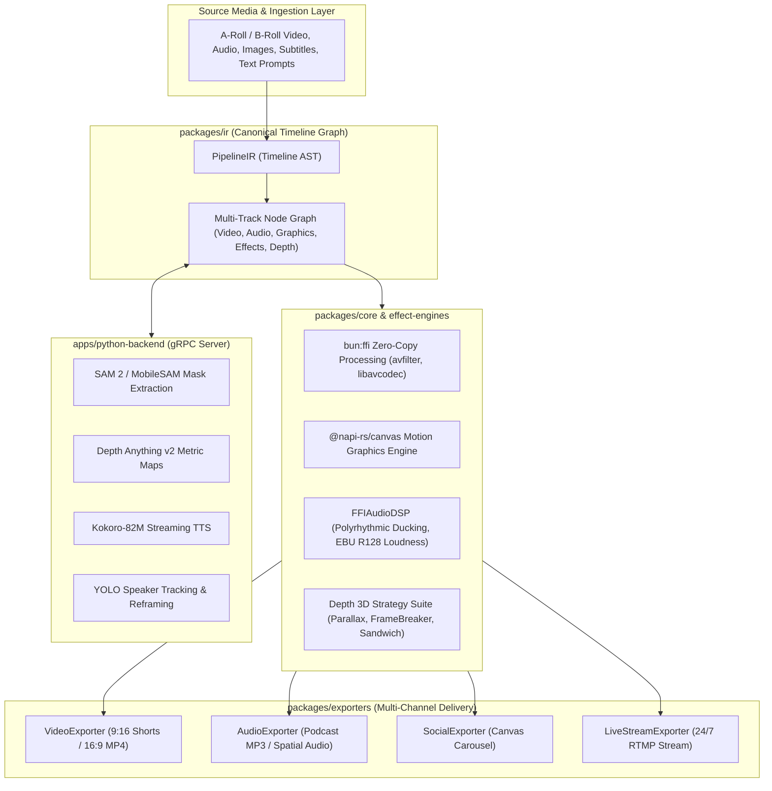
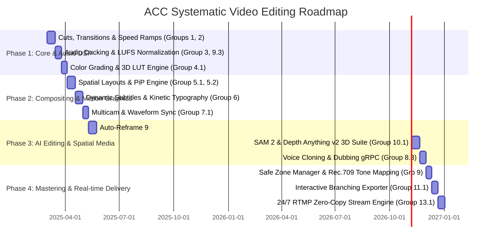

# Systematic Design of Video Editing Techniques: Architecture & Implementation Plan

> **Document Status**: Architectural Specification & Engineering Plan
> **Target System**: ACC (Automated Content Creator) Monorepo
> **Reference Context**: `docs/video-editing-core.en.md`

---

## 1. Executive Summary & System Vision

Modern video production relies on a taxonomy of 13 foundational technical groups ranging from simple hard cuts to complex spatial computing and real-time virtual production. The primary goal of the **ACC (Automated Content Creator)** system is to codify these human editing techniques into a **programmatic, deterministic, high-performance video engine**.

By integrating **Bun Workspaces**, **`bun:ffi` Zero-Copy FFmpeg C-Bindings**, `@napi-rs/canvas` procedural graphics, and an **isolated Python gRPC AI Subsystem** (SAM 2, Depth Anything v2, Kokoro TTS, Qwen 2.5), ACC elevates video editing from manual non-linear editor (NLE) timeline clicking to an automated, code-driven pipeline orchestrated by a canonical Intermediate Representation (`PipelineIR`).

This document provides a systematic design, algorithmic mapping, schema specification, and implementation roadmap to bring all 13 core video editing groups into ACC's engine.

---

## 2. Architectural Framework & Core Abstractions

To support all 13 video editing groups systematically, ACC utilizes a multi-layer Directed Acyclic Graph (DAG) timeline model and specialized strategy patterns across workspace packages.



### Key Engineering Strategy Patterns:
1. **`ITransitionStrategy`**: Encapsulates `xfade` and custom GLSL/Canvas scene transitions.
2. **`IVisualCompositorStrategy`**: Manages multi-layer spatial layouts (PiP, Split Screen, Chroma Key, Masking).
3. **`IAudioDSPStrategy`**: Handles polyrhythmic auto-ducking, LUFS normalization, and spatial audio pan.
4. **`IMotionGraphicsStrategy`**: Drives lower thirds, dynamic karaoke captions, kinetic typography, and call-outs.
5. **`IAIServiceStrategy`**: Interfaces with the Python gRPC daemon for AI segmentation, depth mapping, auto-reframing, and voice cloning.

---

## 3. Systematic Mapping of Video Editing Groups (Groups 1 – 13)

### PART I: CORE EDITING TECHNIQUES

#### ✂️ Group 1: Cuts & Transitions
Focuses on controlling temporal continuity and rhythm between consecutive shots.

*   **1.1 Standard Cut & Jump Cut**:
    *   *Concept*: Hard splicing of adjacent clips or skipping forward in time within the same shot to increase pacing.
    *   *Algorithmic Model*: Time-slice trim on video streams using FFmpeg `select='between(t,t1,t2)'` or frame packet slicing in `bun:ffi`.
    *   *IR Mapping*: `ContentChunk.visualAsset.trim = { startMs, endMs }`.
    *   *Engine Module*: `packages/core/src/ffmpeg-ffi/FFIConcatMuxer.ts`.
*   **1.2 Match Cut**:
    *   *Concept*: Transitioning between two scenes based on visual geometry, action vector, or audio pitch similarity.
    *   *Algorithmic Model*: Automated frame feature comparison using vision embeddings (CLIP/DINOv2 in Python AI backend) to detect structural or compositional match points.
    *   *IR Mapping*: `SceneTransition.matchCut = { autoAlign: true, featureSimilarityScore: number }`.
    *   *Engine Module*: `apps/python-backend/src/services/vision_service.py` & `packages/effect-engines/src/transitions`.
*   **1.3 J-Cut & L-Cut (Split Edits)**:
    *   *Concept*: Audio precedes video (J-Cut) or video precedes audio (L-Cut) across scene boundaries.
    *   *Algorithmic Model*: Asynchronous audio/video clip offset timing in timeline AST. Audio track offset $\Delta t_a \neq \Delta t_v$.
    *   *IR Mapping*: `ContentChunk.audioOffsetMs` and `ContentChunk.videoOffsetMs`.
    *   *Engine Module*: `packages/ir/src/AudioComposition.ts` & `FFIAudioMuxer`.
*   **1.4 Cross-Cutting / Cutaway**:
    *   *Concept*: Intercut secondary footage (B-roll) over primary dialogue (A-roll) while main audio continues uninterrupted.
    *   *Algorithmic Model*: Multi-track timeline overlay where B-roll visual track renders on Layer 1 while A-roll audio track plays on Layer 0.
    *   *IR Mapping*: `VisualAsset.brollOverlays: Array<{ source: string, startMs: number, durationMs: number }>`.
    *   *Engine Module*: `@acc/effect-engines/overlay-effects` & `@acc/exporters/video`.

---

#### ⏱️ Group 2: Pacing & Timing
Manipulates time perception, tempo, and dramatic tension.

*   **2.1 Montage**:
    *   *Concept*: Rapid sequence of short clips summarizing time or complex progression, rhythmically aligned with background music beats.
    *   *Algorithmic Model*: Beat-detection spectral analysis on BGM track using `libavfilter` `atempo`/`ebur128` or aubio beat markers, automatically cutting clips on beat timestamps $T_{beat}$.
    *   *IR Mapping*: `TimelineAST.montage = { beatSync: true, maxClipDurationMs: 800 }`.
    *   *Engine Module*: `@acc/effect-engines/sound-effects/BeatDetector.ts`.
*   **2.2 Speed Ramping & Freeze Frame**:
    *   *Concept*: Smooth speed transitions (e.g., $1\text{x} \to 0.25\text{x} \to 2\text{x}$) and pausing video on a single frame.
    *   *Algorithmic Model*: Polynomial or Bezier frame interpolation via `setpts` filter or optical flow motion estimation (`minterpolate` filter in `bun:ffi`).
    *   *IR Mapping*: `VisualAsset.speedRamp = { keyframes: [{ timeMs: 0, speed: 1.0 }, { timeMs: 1000, speed: 0.25 }, { timeMs: 2000, speed: 2.0 }] }`.
    *   *Engine Module*: `@acc/core/ffmpeg-ffi/FFIVideoEncoder.ts`.
*   **2.3 Smash Cut**:
    *   *Concept*: Jarring, abrupt transition between extreme visual/audio contrasts (e.g., quiet, slow scene to loud, fast scene).
    *   *Algorithmic Model*: Zero-crossfade hard clip boundary with instantaneous audio gain delta ($\Delta \text{LUFS} > 12\text{dB}$) and color spectrum shock.
    *   *IR Mapping*: `SceneTransition.type = 'smash_cut'`.
    *   *Engine Module*: `@acc/effect-engines/src/transitions/SmashCut.ts`.

---

#### 🎵 Group 3: Audio Editing
Ensures pristine voice clarity, dynamic sound design, and acoustic immersion.

*   **3.1 Audio Ducking**:
    *   *Concept*: Lowering background music volume whenever narration or primary dialogue is active.
    *   *Algorithmic Model*: Sidechain compressor DSP filter (`sidechaincompress` in `bun:ffi`) with configurable threshold, attack (e.g., 20ms), release (e.g., 250ms), and attenuation (-18dB).
    *   *IR Mapping*: `AudioComposition.ducking = { enabled: true, attenuationDb: -18, attackMs: 20, releaseMs: 250 }`.
    *   *Engine Module*: `packages/core/src/ffmpeg-ffi/FFIAudioDSP.ts`.
*   **3.2 Foley & Sound Design**:
    *   *Concept*: Adding diegetic and non-diegetic sound effects (swoshes, UI clicks, risers, impacts) timed with visual actions.
    *   *Algorithmic Model*: Multi-track PCM audio mixer overlaying time-stamped SFX buffers with sample-exact precision.
    *   *IR Mapping*: `AudioComposition.sfxMarkers: Array<{ id: string, offsetMs: number, audioPath: string, volume: number }>`.
    *   *Engine Module*: `packages/effect-engines/src/sound-effects/SoundEffectsRegistry.ts`.

---

#### 🎨 Group 4: Visual & Effects
Controls color palette, emotional mood, and spatial masking.

*   **4.1 Color Correction & Grading (3D LUTs)**:
    *   *Concept*: Fixing exposure/white balance and applying artistic color palettes (Cinematic, Cyberpunk, Vintage) via 3D Look-Up Tables (.cube).
    *   *Algorithmic Model*: Tetrahderal 3D LUT RGB color transformation filter (`lut3d` filter in `bun:ffi` or WebGL fragment shader).
    *   *IR Mapping*: `VisualAsset.colorGrading = { lutPath: string, intensity: number, saturation: number, contrast: number }`.
    *   *Engine Module*: `@acc/effect-engines/styles/ColorGradingEngine.ts`.
*   **4.2 Masking & Keyframing**:
    *   *Concept*: Isolating regions of a frame (vignettes, shape masks, gradient wipes) and animating transform properties over time.
    *   *Algorithmic Model*: Parametric 2D vector mask evaluation per frame combined with cubic Hermite keyframe interpolation for `(scale, position, opacity, rotation)`.
    *   *IR Mapping*: `VisualAsset.masks: Array<{ type: 'ellipse' | 'polygon' | 'path', keyframes: KeyframeMap }>`.
    *   *Engine Module*: `@napi-rs/canvas` compositor in `@acc/effect-engines`.

---

### PART II: ADVANCED POST-PRODUCTION & WORKFLOW

#### 🖼️ Group 5: Compositing & Spatial Layout
Organizes multi-layered spatial elements within a single frame.

*   **5.1 Picture-in-Picture (PiP) & Split Screen**:
    *   *Concept*: Scaling and positioning one or more video streams over a main background or dividing the frame into grid sections.
    *   *Algorithmic Model*: Multi-input FFmpeg `overlay` filter graph or `@napi-rs/canvas` multi-viewport draw ops with dynamic aspect ratio clipping.
    *   *IR Mapping*: `TimelineAST.layout = { mode: 'pip' | 'split_screen', viewports: [{ x, y, width, height, clipId }] }`.
    *   *Engine Module*: `@acc/effect-engines/src/compositing/SpatialLayoutEngine.ts`.
*   **5.2 Chroma Key / Green Screen**:
    *   *Concept*: Removing background key colors (green/blue) to integrate subjects into virtual environments.
    *   *Algorithmic Model*: `colorkey` / `chromakey` YUV color distance evaluation with spill suppression algorithm (`despill` filter in FFmpeg).
    *   *IR Mapping*: `VisualLayer.chromaKey = { color: '#00FF00', similarity: 0.15, blend: 0.05 }`.
    *   *Engine Module*: `packages/core/src/ffmpeg-ffi/avfilter_graph.ts`.
*   **5.3 Screen Replacement & Double Exposure**:
    *   *Concept*: Compositing footage onto planar device screens via corner-pinning, or blending two visual layers with Photoshop blend modes (`Screen`, `Multiply`, `Overlay`).
    *   *Algorithmic Model*: Perspective homography transformation matrix calculation ($3\times3$ planar transform) & RGBA pixel blend mode math.
    *   *IR Mapping*: `VisualLayer.blendMode = 'screen'` & `VisualLayer.perspectiveTransform = { srcPoints, dstPoints }`.
    *   *Engine Module*: `@napi-rs/canvas` & Python AI backend OpenCV homography worker.

---

#### 🔠 Group 6: Typography & Motion Graphics
Communicates information visually through animated text and graphic overlays.

*   **6.1 Lower Thirds**:
    *   *Concept*: Contextual graphics displaying speaker names, titles, or locations in the lower portion of the frame.
    *   *Algorithmic Model*: Animated SVG/Canvas templates with dynamic text layout, backdrop glassmorphic blur, and slide-in entry animation.
    *   *IR Mapping*: `ContentChunk.lowerThird = { name: string, title: string, style: 'cinematic' | 'minimal' }`.
    *   *Engine Module*: `@acc/effect-engines/src/styles/LowerThirdRenderer.ts`.
*   **6.2 Dynamic Captions & Karaoke Highlighting**:
    *   *Concept*: Word-by-word or phrase-by-phrase animated subtitles with synchronized active-word karaoke color/scale highlights.
    *   *Algorithmic Model*: High-precision timestamp matching against Whisper AI word tokens, rendering styled ASS/SSA subtitle scripts or zero-copy Canvas text frames.
    *   *IR Mapping*: `CaptionSettings = { preset: 'tiktok', activeWordHighlight: true, wordsPerPhrase: 4, highlightColor: '#00FFFF' }`.
    *   *Engine Module*: `@acc/effect-engines/src/subtitles/SubtitleGenerator.ts`.
*   **6.3 Kinetic Typography & Tracking Call-outs**:
    *   *Concept*: Expressive, spring-animated typography bouncing to music tempo, and call-out lines anchored to moving subjects in video.
    *   *Algorithmic Model*: Physics-based spring animation solver ($F = -kx - c v$) for text transform, combined with bounding box tracking coordinates from Python AI backend.
    *   *IR Mapping*: `VisualLayer.callouts: Array<{ targetTrackId: string, label: string, offset: { x, y } }>`.
    *   *Engine Module*: `@acc/effect-engines/src/overlay-effects/KineticTypography.ts`.

---

#### ⚙️ Group 7: Workflow & Multicam
Operational infrastructure for multi-angle sync and proxy editing.

*   **7.1 Multicam Editing**:
    *   *Concept*: Synchronizing multiple camera angles recording the same scene and switching angles during playback.
    *   *Algorithmic Model*: Cross-correlation audio waveform alignment across multi-track audio feeds, building a synchronized multi-angle stream switcher graph.
    *   *IR Mapping*: `MulticamTrack = { cameraAngles: [{ id: string, sourcePath: string, audioOffsetMs: number }], cuts: [{ timeMs, angleId }] }`.
    *   *Engine Module*: `packages/core/src/multicam/MulticamSynchronizer.ts`.
*   **7.2 Proxy Editing & Text-Based Editing**:
    *   *Concept*: Editing with lightweight low-res proxies (e.g., 720p ProRes Proxy) during timeline assembly, swapping back to 4K originals on export; and editing video by deleting transcript words.
    *   *Algorithmic Model*: Dual-path asset registry (`rawPath` vs `proxyPath`) in `AssetContext`, paired with transcript AST deletion mapping to clip boundary cuts.
    *   *IR Mapping*: `AssetContext.useProxies = true` & `TranscriptAST.editCut(wordRange)`.
    *   *Engine Module*: `packages/core/src/AssetContext.ts` & `@acc/ir/src/ContentChunk.ts`.

---

#### 🤖 Group 8: AI-Powered & Generative Editing
Automates tedious manual tasks and generates missing visual B-roll.

*   **8.1 Auto-Reframe (16:9 to 9:16)**:
    *   *Concept*: Converting horizontal video to vertical format while keeping the focal subject automatically centered in frame.
    *   *Algorithmic Model*: YOLOv8 / SAM 2 subject tracking in Python backend generating dynamic crop coordinates $(x_t, y_t, w, h)$ smoothed via Kalman Filter to eliminate camera jitter.
    *   *IR Mapping*: `VisualAsset.autoReframe = { targetAspectRatio: '9:16', subjectClass: 'person', smoothing: 0.8 }`.
    *   *Engine Module*: `apps/python-backend/src/services/vision_service.py` & `VideoExporter`.
*   **8.2 Generative Fill & AI B-roll**:
    *   *Concept*: Extending image borders or generating short B-roll video clips from text prompts using Generative Diffusion models.
    *   *Algorithmic Model*: Stable Diffusion / Flux Inpainting & AnimateDiff / LTX-Video inference worker in Python backend.
    *   *IR Mapping*: `VisualAsset.generativeFill = { prompt: string, fallbackStockQuery: string }`.
    *   *Engine Module*: `apps/python-backend/src/services/generative_service.py`.
*   **8.3 Voice Isolation, Voice Cloning & Dubbing**:
    *   *Concept*: Isolating human voice from background noise, and cloning voice samples (Kokoro/F5-TTS) to generate audio in different languages.
    *   *Algorithmic Model*: Deep complex UNet speech separation (Demucs / Voice Isolation) and zeroshot voice cloning model inference in gRPC Python backend.
    *   *IR Mapping*: `AudioComposition.narrationTrack = { voiceCloneId: string, targetLanguage: 'vi' | 'en' | 'ja' }`.
    *   *Engine Module*: `apps/python-backend/src/services/tts_service.py`.

---

#### 📤 Group 9: Mastering & Delivery
Technical validation and encoding for cross-platform distribution.

*   **9.1 Safe Zones Management**:
    *   *Concept*: Overlaying safety guides for UI elements (TikTok like/comment/share buttons, YouTube title bars) to ensure text and faces are never obscured.
    *   *Algorithmic Model*: Vector safe zone bounding box margin verification engine ($M_{top}, M_{bottom}, M_{right}$) preventing element overlap during layout pass.
    *   *IR Mapping*: `StorySettings.platform = 'tiktok'` $\to$ resolves safe margins `marginV: 120, marginH: 60`.
    *   *Engine Module*: `@acc/effect-engines/src/subtitles/SafeZoneManager.ts`.
*   **9.2 Color Space & HDR Workflow**:
    *   *Concept*: Converting SDR (Rec.709) and HDR (Rec.2020 / HLG / HDR10) color gamuts with correct tone mapping to prevent washed-out colors.
    *   *Algorithmic Model*: FFmpeg `zscale` / `tonemap` filter matrix in `bun:ffi` executing BT.2020 to BT.709 Hable/mobius tone mapping.
    *   *IR Mapping*: `StorySettings.colorSpace = 'rec709' | 'hdr10'`.
    *   *Engine Module*: `packages/core/src/ffmpeg-ffi/FFIVideoEncoder.ts`.
*   **9.3 Encoding & Loudness Normalization**:
    *   *Concept*: Exporting H.264/H.265/AV1 with `+faststart` moov atom placement and normalizing audio loudness to platform standards (-14 LUFS for YouTube, -16 LUFS for Apple Podcasts).
    *   *Algorithmic Model*: Two-pass integrated `ebur128` loudness measurement and gain normalization in `FFIAudioDSP`.
    *   *IR Mapping*: `StorySettings.loudnessLufs = -14` & `StorySettings.fastStart = true`.
    *   *Engine Module*: `packages/exporters/src/video/VideoExporter.ts`.

---

### PART III: VFX & FUTURE TECHNOLOGIES

#### 🐉 Group 10: VFX & CGI Integration
Manipulates 3D spatial dimensions and frame elements.

*   **10.1 Rotoscoping & 3D Depth Pop-Out**:
    *   *Concept*: Extracting foreground subjects without green screen and placing elements (text, particles, frame borders) behind or in front of them.
    *   *Algorithmic Model*: SAM 2 / MobileSAM alpha mask extraction combined with Depth Anything v2 16-bit metric depth map generation.
    *   *IR Mapping*: `VisualAsset.depth3d = { mode: 'frame_breaker', frameStyle: 'card', autoSegment: true, autoDepth: true }`.
    *   *Engine Module*: `packages/effect-engines/src/depth3d` & `apps/python-backend`.
*   **10.2 3D Camera Tracking / Matchmove & Clean Plate**:
    *   *Concept*: Reconstructing 3D camera trajectory to insert virtual 3D models or removing unwanted objects (wires, logos) via pixel-cloning clean plates.
    *   *Algorithmic Model*: Structure-from-Motion (SfM) feature point tracking and OpenCV LaMa inpainting for clean plate generation.
    *   *IR Mapping*: `VisualAsset.cleanPlate = { inpaintMaskPath: string }`.
    *   *Engine Module*: `apps/python-backend/src/services/vision_service.py`.

---

#### 🗄️ Group 11: Interactive Media & DAM
Audience interaction and enterprise asset preservation.

*   **11.1 Interactive / Branching Video**:
    *   *Concept*: Presenting interactive decision nodes that pause video playback and branch to different story timelines based on user choice.
    *   *Algorithmic Model*: Non-linear interactive state machine exported as JSON AST and HTML5 Web Components.
    *   *IR Mapping*: `TimelineAST.interactiveNodes: Array<{ timestampMs: number, choices: Array<{ label: string, targetChunkId: string }> }>`.
    *   *Engine Module*: `@acc/exporters/src/interactive-web/WidgetExporter.ts`.
*   **11.2 Metadata Tagging & LTO Archiving**:
    *   *Concept*: Embedding searchable semantic tags into MP4/MOV metadata containers and packaging source projects for long-term storage.
    *   *Algorithmic Model*: ExifTool / FFmpeg metadata atom writer (`-movflags use_metadata_tags`) and tarball consolidation with checksum verification.
    *   *IR Mapping*: `PipelineIR.metadata = { tags: string[], author: string, checksum: string }`.
    *   *Engine Module*: `@acc/exporters/src/base/BaseExporter.ts`.

---

#### 🥽 Group 12: Immersive & Spatial Media
Processes 360-degree VR spherical video and stereoscopic 3D depth.

*   **12.1 360 Video Stitching & Spatial Audio (Ambisonics)**:
    *   *Concept*: Blending dual fisheye lenses into seamless equirectangular spheres and panning audio in 3D binaural space.
    *   *Algorithmic Model*: Equirectangular remap transformation filter (`v360` in FFmpeg) & Higher-Order Ambisonics (HOA) audio matrix encoding.
    *   *IR Mapping*: `StorySettings.projection = 'equirectangular_360'` & `AudioComposition.spatialAudio = 'ambisonic_bformat'`.
    *   *Engine Module*: `packages/core/src/ffmpeg-ffi` & `@acc/effect-engines`.
*   **12.2 Spatial Video Formatting**:
    *   *Concept*: Processing dual stereoscopic left/right eye video streams formatted for Apple Vision Pro and Meta Quest headsets.
    *   *Algorithmic Model*: Side-by-side or MV-HEVC (Multiview HEVC) 3D stereoscopic encoding with metadata disparity tags.
    *   *IR Mapping*: `StorySettings.container = 'mov'` & `StorySettings.stereoscopic = 'side_by_side'`.
    *   *Engine Module*: `packages/exporters/src/video/SpatialVideoExporter.ts`.

---

#### 🎬 Group 13: Virtual Production & Real-time Compositing
Eliminates render wait times using low-latency real-time rendering engines.

*   **13.1 Real-Time Rendering & Zero-Copy Streaming**:
    *   *Concept*: Pushing procedural shader, WebGL, or Canvas frames directly into FFmpeg zero-copy encoder memory without disk intermediate files for 24/7 live broadcasts.
    *   *Algorithmic Model*: `bun:ffi` direct shared memory buffer pointer passing (`uint8array` RGBA buffer to `AVFrame->data[0]`) running at 60 FPS.
    *   *IR Mapping*: `PipelineId = 'ambient-loops'` & `DistributionHints = ['live-stream']`.
    *   *Engine Module*: `packages/exporters/src/live-stream/RTMPStreamExporter.ts`.
*   **13.2 Live Motion Capture & VTubing**:
    *   *Concept*: Mapping live actor face/pose landmark coordinates onto a 2D/3D avatar model in real time.
    *   *Algorithmic Model*: MediaPipe / OnnxRuntime facemesh landmark extraction sending OSC/gRPC packets to Canvas/Three.js renderer.
    *   *IR Mapping*: `VisualAsset.vtubeAvatar = { modelPath: string, faceTracking: true }`.
    *   *Engine Module*: `apps/python-backend` & `@acc/effect-engines`.

---

## 4. Master Data Schema Extensions (`PipelineIR` v3.1 Specification)

To support the complete range of techniques described above, ACC's `packages/ir/src/PipelineIR.ts` is expanded as follows:

```typescript
// packages/ir/src/PipelineIR.ts (Extended v3.1 Specification)

export type PlatformPreset =
  | 'tiktok' | 'shorts' | 'reels' | 'youtube' | 'youtube-4k'
  | 'facebook' | 'instagram' | 'spatial-vr';

export interface Keyframe<T> {
  timeMs: number;
  value: T;
  easing?: 'linear' | 'easeIn' | 'easeOut' | 'easeInOut' | 'cubicBezier';
}

export interface TransitionSpec {
  type: string;                      // 'fade' | 'wipeleft' | 'dissolve' | 'smash_cut' | 'match_cut'
  durationMs: number;
  audioBehavior: 'crossfade' | 'pad' | 'cut';
}

export interface SpatialTransform {
  position: { x: number; y: number; z?: number };
  scale: { x: number; y: number };
  rotationDeg: number;
  opacity: number;
  crop?: { top: number; bottom: number; left: number; right: number };
}

export interface VisualLayer {
  id: string;
  layerIndex: number;               // 0 = Background, 1 = Midground, 2 = Foreground, 3 = Overlay
  type: 'video' | 'image' | 'canvas' | 'text' | 'broll' | 'particle';
  sourcePathOrBuffer: string | Buffer;
  transform: SpatialTransform;
  transformKeyframes?: Keyframe<SpatialTransform>[];

  // Advanced Compositing & Effects (Groups 4, 5, 10)
  blendMode?: 'normal' | 'screen' | 'multiply' | 'overlay' | 'add';
  chromaKey?: { colorHex: string; similarity: number; blend: number };
  colorGrading?: { lutPath?: string; contrast: number; saturation: number; exposure: number };
  subjectMask?: {
    maskPathOrBuffer: string | Buffer;
    subjectClass: string;
  };
  depthMap?: {
    depthMapPathOrBuffer: string | Buffer;
    metricMinMeters?: number;
    metricMaxMeters?: number;
  };
}

export interface TypographyOverlay {
  id: string;
  type: 'lower_third' | 'dynamic_caption' | 'kinetic_text' | 'callout_tracking';
  text: string;
  startMs: number;
  durationMs: number;
  stylePreset: string;               // 'tiktok' | 'cinematic' | 'neon-glow'
  trackingTargetId?: string;          // Anchors text to moving object ID in Python AI
}

export interface AudioTrackSpec {
  id: string;
  type: 'narration' | 'bgm' | 'sfx' | 'foley';
  sourcePath: string;
  startMs: number;
  durationMs: number;
  volume: number;
  loudnessLufs?: number;
  spatialPan?: number;                // -1.0 (Left) to +1.0 (Right)
}

export interface ExtendedContentChunk {
  id: string;
  order: number;
  durationMs: number;
  visualLayers: VisualLayer[];
  typographyOverlays: TypographyOverlay[];
  transitionToNext?: TransitionSpec;
  speedRamp?: Keyframe<number>[];     // Group 2.2
}

export interface ExtendedPipelineIR {
  schemaVersion: '3.1.0';
  pipelineId: string;
  metadata: {
    jobId: string;
    title: string;
    tags: string[];
    author?: string;
  };
  settings: {
    resolution: { width: number; height: number };
    fps: number;
    platform: PlatformPreset;
    colorSpace: 'rec709' | 'hdr10';
    targetLoudnessLufs: number;        // e.g. -14 LUFS
  };
  chunks: ExtendedContentChunk[];
  audioComposition: {
    tracks: AudioTrackSpec[];
    ducking: {
      enabled: boolean;
      attenuationDb: number;
      attackMs: number;
      releaseMs: number;
    };
  };
  interactiveNodes?: Array<{
    timestampMs: number;
    options: Array<{ label: string; targetChunkId: string }>;
  }>;
}
```

---

## 5. Phased Implementation Roadmap



### Detailed Phase Objectives:

#### Phase 1: Core Editing, Speed Ramps & Audio DSP (Groups 1–4)
*   **Goal**: Establish solid non-linear editing primitives and audio loudness compliance.
*   **Deliverables**:
    1. Implement split edits (J/L-Cuts) and speed ramping filters in `FFIVideoEncoder`.
    2. Build polyrhythmic audio ducking sidechain and EBU R128 loudness normalizer in `FFIAudioDSP`.
    3. Add 3D LUT `.cube` color grading support in `@acc/effect-engines`.
*   **Verification**: Test audio ducking attenuation on speech-to-music audio tracks and verify output LUFS strictly hits -14.0 LUFS ±0.5 LUFS.

#### Phase 2: Spatial Compositing & Motion Graphics Engine (Groups 5–7)
*   **Goal**: Deliver rich spatial layering, dynamic captions, lower thirds, and multicam synchronization.
*   **Deliverables**:
    1. Implement PiP and Split-Screen layouts via `@napi-rs/canvas` compositor.
    2. Expand `SubtitleGenerator` with 10 caption presets, word-level active highlights, and kinetic typography.
    3. Build waveform cross-correlation multicam synchronizer in `@acc/core`.
*   **Verification**: Render 1080x1920 video with active karaoke captions and B-roll overlays, ensuring zero frame drops.

#### Phase 3: AI-Driven Automation & 3D Spatial Effects (Groups 8, 10, 12)
*   **Goal**: Leverage isolated Python gRPC AI backend for automated crop reframing, SAM 2 segmentation, and Depth 3D pop-outs.
*   **Deliverables**:
    1. Deploy YOLOv8 subject tracking in `vision_service.py` for automatic 16:9 to 9:16 reframing.
    2. Integrate SAM 2 alpha masks & Depth Anything v2 metric maps into `Parallax 2.0`, `FrameBreaker 2.0`, and `Sandwich 2.0` renderers.
    3. Connect Kokoro-82M TTS streaming voice cloning worker.
*   **Verification**: Execute `bun run cli.ts ./sample-story` with 3D Depth enabled; verify subject pops out cleanly over letterbox frame.

#### Phase 4: Mastering, Interactive Delivery & Zero-Copy Live Stream (Groups 9, 11, 13)
*   **Goal**: Finalize production mastering, interactive HTML widget exports, and continuous live streaming.
*   **Deliverables**:
    1. Enforce platform safe zone boundaries across TikTok, Reels, and YouTube Shorts layouts.
    2. Implement `WidgetExporter` for interactive choose-your-own-adventure branching videos.
    3. Optimize `RTMPStreamExporter` for 24/7 RTMP live streaming with zero-copy memory buffer passing.
*   **Verification**: Run continuous 24-hour RTMP stream simulation; verify system RAM stays strictly under 400MB without memory leaks.

---

## 6. Verification, Benchmarks & Quality Assurance

To maintain high visual quality and high-speed execution, all video editing implementations must satisfy the following strict quality gates:

1. **Zero Memory Copy Latency**: Frame buffer transfers between Canvas and FFmpeg encoder via `bun:ffi` must take $< 2.5\text{ ms}$ per 1080p frame.
2. **Audio-Visual Sync Accuracy**: Subtitle active word highlight timing must match spoken audio within $\pm 15\text{ ms}$.
3. **Loudness Compliance**: Final rendered videos must pass EBU R128 loudness check (Target: $-14\text{ LUFS}$, Max True Peak: $-1.0\text{ dBFS}$).
4. **Backward Compatibility**: `bun run cli.ts ./sample-story` and existing `story-config.json` specifications must continue to execute flawlessly without regressions.
