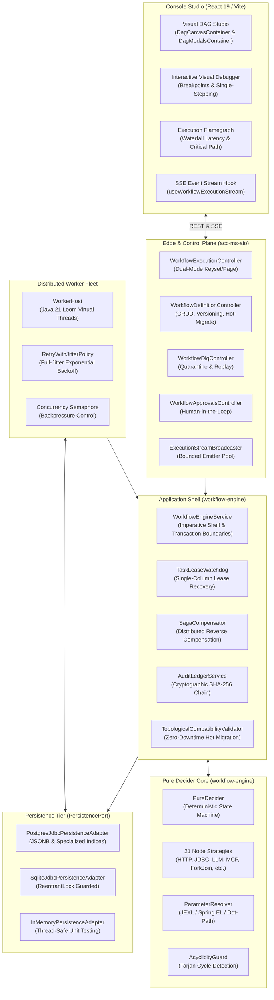
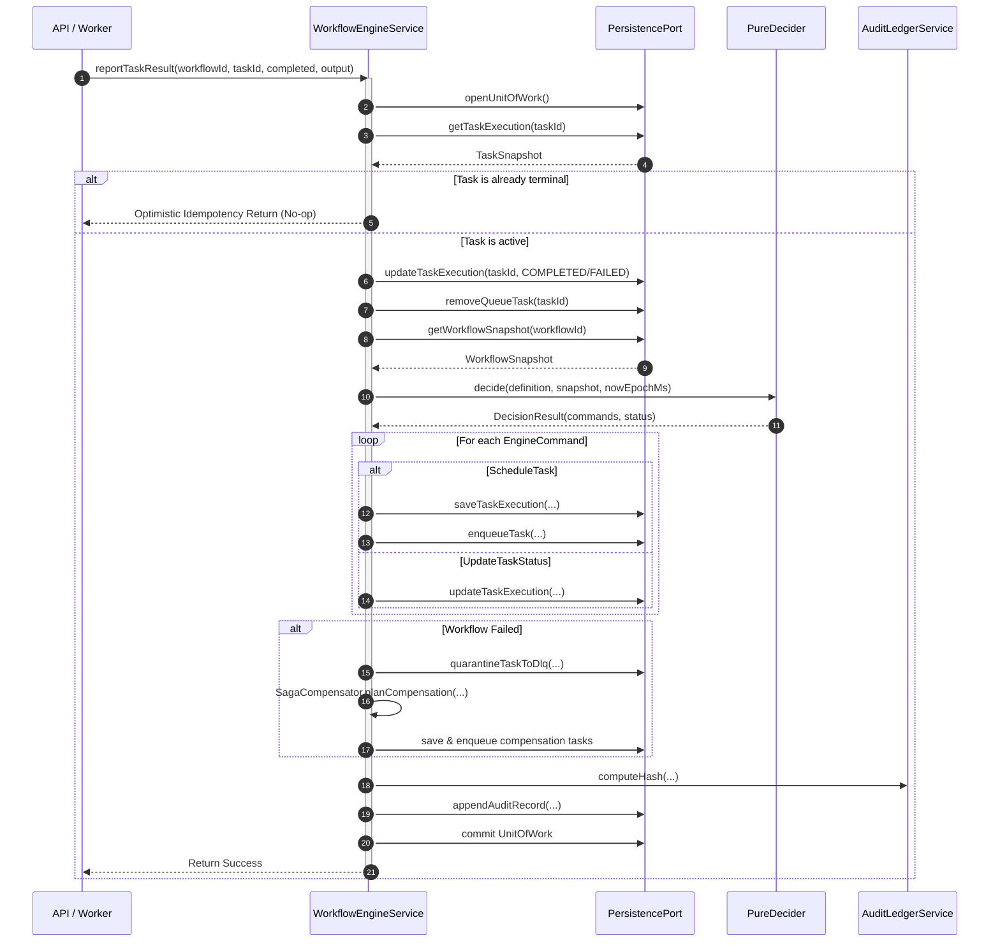
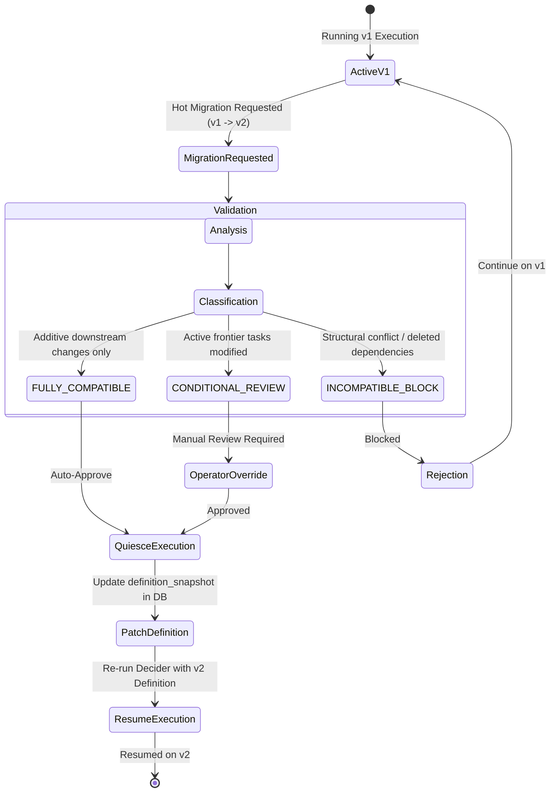
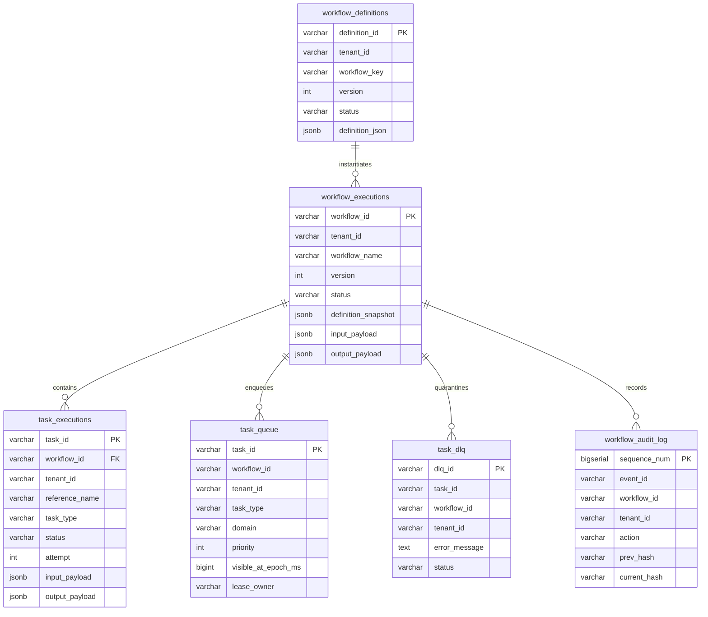

# Workflow Orchestration Engine: Architectural Analysis & Master Technical Specification

**Document Version:** 3.0.0 (Enterprise Resilient Edition)  
**Status:** Approved Architectural Baseline  
**Scope:** `@acc/backend` (`apps/backend/workflow-engine`, `apps/backend/acc-ms-aio`), `@acc/console` (`apps/console/src/features/workflows`, `apps/console/src/features/workflow-executions`), `packages/sandbox`  
**Classification:** Internal Core Architecture Specification

---

## 1. Executive Summary & Master Topology

The **Workflow Orchestration Engine** is a distributed, multi-tenant Directed Acyclic Graph (DAG) state machine platform built on the **Hexagonal Architecture (Ports and Adapters)** pattern combined with an **Imperative Shell / Pure Functional Core** model.

### Architectural Core Invariant
$$\text{decide}(\text{WorkflowDefinition}, \text{WorkflowSnapshot}, \text{nowEpochMs}) \longrightarrow \text{DecisionResult}$$

- **Zero-Side-Effect Pure Core**: Zero network calls, zero JDBC transactions, zero threads, and zero clock invocations occur inside the pure decider. Given the identical input tuple, the decider deterministically generates bit-for-bit identical `EngineCommand` directives.
- **Hexagonal Boundary Enforcement**: System connector nodes (`HTTP`, `JDBC`, `KAFKA_PUBLISH`, `LLM_CHAT_COMPLETE`, `CALL_MCP_TOOL`) never execute I/O inside `NodeEvaluatorStrategy`. Instead, they emit `EngineCommand.ScheduleTask` for execution by the asynchronous Worker Fleet or specialized System Task Executors in `WorkflowEngineService`.
- **Zero-Stub Unified Sandbox Parity**: The identical DAG schema, execution stream contract, and snapshot structures power production runtimes and the offline **Unified Sandbox Platform** (`packages/sandbox`), eliminating synthetic mock discrepancies.

---

## 2. Core Decider Engine & Graph Mathematics

### 2.1 Pure Decider Lifecycle (`PureDecider.java`)

The decider traverses the workflow's task definitions using topological readiness checks:
1. **DAG Prerequisite Validation (`isTaskReadyToStart`)**:
   - For every task in the workflow, verifies that all prerequisite tasks referenced in `taskDef.joinOn()` have reached `TaskStatus.COMPLETED`.
   - If explicit `joinOn` conditions are absent across the entire workflow, maintains sequential pipeline chaining where task $N$ starts only when task $N-1$ is complete.
2. **Concurrent Independent Branch Scheduling**:
   - When explicit DAG dependencies exist, independent root tasks or parallel DAG branches are evaluated and scheduled concurrently in the same decision pass.
3. **Prerequisite-Guarded Breakpoint Evaluation**:
   - Visual debugger breakpoints (`pausedAtBreakpoint`) are only triggered when the task's DAG prerequisites are fully satisfied, preventing breakpoints from halting out-of-order branches.
4. **Failure & Cancellation Propagation**:
   - If an active task reaches `FAILED` or `TIMED_OUT`, and its definition does not permit optional failure (`optional == false`), the decider halts progression, marks the workflow execution as `FAILED`, and triggers compensation.

### 2.2 Taxonomy of the 21 Node Evaluation Strategies

| Strategy | Node Type | Category | Core Semantics & Execution Model |
|---|---|---|---|
| `SimpleTaskStrategy` | `SIMPLE` | System | Schedules simple worker task to `task_queue` with domain and timeout. |
| `ForkJoinStrategy` | `FORK_JOIN` | Control Flow | Concurrently dispatches all branch roots; advances multi-task branches sequentially; enforces fan-in barrier on `joinOn`. |
| `SwitchNodeStrategy` | `SWITCH` | Control Flow | Resolves decision expression against snapshot context; advances sequential tasks in matching case branch. |
| `DoWhileStrategy` | `DO_WHILE` | Control Flow | Iterates through `loopOver` tasks per iteration attempt; evaluates `continueCondition` on boundary; updates iteration state. |
| `SubWorkflowStrategy` | `SUB_WORKFLOW` | Control Flow | Dispatches nested child workflow execution; awaits child completion and maps output payload back to parent. |
| `DynamicForkStrategy` | `DYNAMIC_FORK` | Control Flow | Generates dynamic subtask instances at runtime based on an array expression; enforces collective barrier. |
| `JoinNodeStrategy` | `JOIN` / `EXCLUSIVE_JOIN` | Control Flow | Explicit convergence barrier requiring all (`JOIN`) or at least one (`EXCLUSIVE_JOIN`) prerequisite to complete. |
| `HttpNodeStrategy` | `HTTP` | I/O Connector | Prepares HTTP request parameters; dispatches async worker task; polls or awaits external HTTP webhook response. |
| `JdbcNodeStrategy` | `JDBC` | I/O Connector | Prepares parameterized SQL query and binds parameters from context; routes to database worker executor. |
| `KafkaPublishStrategy` | `KAFKA_PUBLISH` | Messaging | Serializes payload and emits event message to Kafka topic; awaits delivery acknowledgment. |
| `EventBridgeStrategy` | `EVENT_BRIDGE` | Messaging | Routes enterprise domain events to event broker. |
| `LlmChatCompleteStrategy` | `LLM_CHAT_COMPLETE` | AI / Agent | Resolves prompt template, parameters, model name, and temperature; dispatches AI inference worker task. |
| `CallMcpToolStrategy` | `CALL_MCP_TOOL` | AI / Agent | Serializes tool arguments conforming to Model Context Protocol (MCP); dispatches tool execution worker task. |
| `PromptTemplateStrategy` | `PROMPT_TEMPLATE` | AI / Agent | Evaluates dynamic prompt template expressions without calling external models. |
| `HumanApprovalStrategy` | `HUMAN` / `APPROVAL` | Governance | Halts workflow progression; transitions task to `IN_PROGRESS`; registers task in approvals registry until resolved. |
| `WaitDurationStrategy` | `WAIT` | Governance | Calculates `visibleAtEpochMs = now + durationMs`; halts decider until duration expires. |
| `WebhookCallbackStrategy` | `WEBHOOK` | Governance | Halts progression until matched by an external webhook callback event. |
| `PassThroughStrategy` | `PASS_THROUGH` | Utility | Immediately completes, passing input parameters directly to output. |
| `FailNodeStrategy` | `FAIL` | Fault Handling | Explicitly fails the workflow execution with configured error code and message. |
| `TerminateStrategy` | `TERMINATE` | Fault Handling | Terminates workflow execution immediately without triggering compensation. |
| `InlineTransformStrategy` | `TRANSFORM` | Utility | Applies deterministic in-memory transformation (JSONPath, JSLT, or expression mapping). |

### 2.3 Graph Validation & Topological Acyclicity Guard (`AcyclicityGuard.java`)

Before a workflow definition can be saved or executed, [`AcyclicityGuard`](file:///c:/Users/Admin/workspace/git/acc/apps/backend/workflow-engine/src/main/java/com/acc/workflow/core/graph/AcyclicityGuard.java) validates structural integrity:
- **Depth-First Search (DFS) Cycle Detection**: Uses three-color recursion tracking (`WHITE` = unvisited, `GRAY` = active stack, `BLACK` = completed). Encountering a `GRAY` node indicates a cycle and throws `IllegalArgumentException`.
- **Implicit Edge Resolution**: When `joinOn` is empty across tasks, sequential dependencies are automatically inferred.
- **FORK/JOIN Pairing Verification**: Ensures every `FORK_JOIN` node has a matching convergence join barrier in the graph.

---

## 3. Imperative Application Shell (`WorkflowEngineService`)

The application layer coordinates transactions, persistence, watchdogs, compensators, and audit chains:

### 3.1 Distributed Saga Reverse Compensation
When a workflow fails:
1. [`SagaCompensator`](file:///c:/Users/Admin/workspace/git/acc/apps/backend/workflow-engine/src/main/java/com/acc/workflow/application/SagaCompensator.java) inspects all `COMPLETED` tasks in the workflow snapshot in reverse chronological and topological order.
2. If a completed task definition declares a `compensateTask`, a compensation task instance is scheduled (`taskId = originalTaskId + "_compensate"`).
3. The compensation tasks run sequentially or concurrently according to reverse dependencies to restore consistency across external services.

### 3.2 Cryptographic Audit Ledger (`AuditLedgerService.java`)
All lifecycle mutations produce an immutable audit entry in `workflow_audit_log`:
$$\text{hash}_n = \text{SHA256}(\text{hash}_{n-1} \parallel \text{eventId} \parallel \text{workflowId} \parallel \text{action} \parallel \text{payloadJson} \parallel \text{timestamp})$$
- Genesis entry begins with `GENESIS_HASH` (`0000000000000000000000000000000000000000000000000000000000000000`).
- Integrity is verified via `GET /v1/workflow/executions/{id}/audit/verify`, traversing the hash chain to detect unauthorized alterations.

---

## 4. Concurrency, Worker Fleet & Resilience

### 4.1 Loom Virtual Threads & Semaphore Backpressure (`WorkerHost.java`)
Worker concurrency is optimized for high-density I/O:
- **Virtual Thread Executor**: Uses `Executors.newVirtualThreadPerTaskExecutor()` dynamically with graceful cached thread pool fallback for older JVM environments.
- **Semaphore-Bounded Concurrency**: Each task handler instance enforces `Semaphore(maxConcurrency)`. If the worker host receives a burst of tasks, execution yields without blocking host memory.

### 4.2 Full-Jitter Exponential Backoff (`RetryWithJitterPolicy.java`)
To prevent the "thundering herd" problem during service degradation, retry delays use the **Full-Jitter Exponential Backoff** algorithm:
$$\text{sleepMs} = \text{ThreadLocalRandom}(0, \min(\text{maxBackoffMs}, \text{baseDelayMs} \cdot 2^{\text{attempt}}))$$
- Guarantees uniform spread of retries across temporal windows.
- Verified with unit tests covering jitter bounds and non-deterministic spacing.

### 4.3 Task Lease Watchdog (`TaskLeaseWatchdog.java`)
- Workers claim tasks from `task_queue` with a lease duration (`responseTimeoutMs`).
- `TaskLeaseWatchdog` scans for expired leases (`visible_at_epoch_ms < now`).
- Reclaims abandoned tasks, increments `attempt`, resets visibility, and re-triggers decider evaluation.

---

## 5. Zero-Downtime Hot Migration Engine

In-flight workflows with long execution times can be hot-migrated between workflow definition versions without dropping active state:

### Compatibility Tiers (`TopologicalCompatibilityValidator.java`)
1. **`FULLY_COMPATIBLE`**:
   - All previously completed tasks exist in target version with identical signatures.
   - All active frontier tasks remain valid.
   - All modifications are strictly additive and downstream.
2. **`CONDITIONAL_REQUIRES_MANUAL_REVIEW`**:
   - Tasks in the active frontier have changed input contracts or parameters.
   - Requires explicit operator override via console API.
3. **`INCOMPATIBLE_BLOCK`**:
   - Previously completed tasks were removed.
   - Prerequisite DAG dependencies of completed tasks were altered, creating semantic inconsistencies.

---

## 6. Multi-Tenant Database Persistence Model

The storage layer enforces multi-tenant isolation via tenant partitioning keys across all tables:

### Key Performance Indices
- `idx_task_queue_poll`: `(tenant_id, task_type, domain, visible_at_epoch_ms, priority DESC)` for high-throughput single-column lease polling.
- `idx_wf_def_key`: `(tenant_id, workflow_key, version DESC)` for version lookups.
- `idx_task_dlq_tenant`: `(tenant_id, isolated_at_ms DESC)` for DLQ monitoring.

---

## 7. Edge Control Plane & Real-Time SSE Streaming

### 7.1 Dual-Mode Pagination & API Contracts
[`WorkflowExecutionController`](file:///c:/Users/Admin/workspace/git/acc/apps/backend/acc-ms-aio/src/main/java/com/acc/aio/controller/workflow/WorkflowExecutionController.java) exposes dual-mode pagination:
- **Spring Page Envelope Mode**: For traditional data tables (`content`, `totalElements`, `totalPages`, `size`, `number`).
- **Keyset / Cursor Mode**: For high-volume log streams (`cursor`, `hasMore`).

### 7.2 Bounded SSE Broadcasting (`ExecutionStreamBroadcaster.java`)
- Emits real-time task transitions, status changes, and execution completions over Server-Sent Events (SSE).
- Enforces an upper limit of **100 emitters per workflow execution**, automatically pruning disconnected clients and preventing memory exhaustion during long-running workflows.

---

## 8. Frontend Studio Architecture (`apps/console`)

### 8.1 Decomposed Visual DAG Studio
- `visual-dag-studio.tsx` delegates rendering and modal lifecycles to:
  - `DagCanvasContainer`: Handles canvas zooming, panning, and node drag-and-drop.
  - `DagModalsContainer`: Isolates 6 specialized modal dialogs (dry-run, simulation, IR view, variables watch, DLQ inspection, and approvals).
- **Custom Memoization (`areDagNodePropsEqual`)**: Custom shallow comparator on DAG node components prevents full-canvas re-renders when SSE streams update individual task statuses.
- **WCAG 2.2 AA Compliance**: Semantic ARIA tags, `role="button"`, `tabIndex={0}`, keyboard navigation, and contrast validation.

### 8.2 Execution Flamegraph (`workflow-execution-flamegraph.tsx`)
Visualizes execution timing:
- **Task Durations**: Active execution runtime per task.
- **Queue Overhead**: Latency between `SCHEDULED` and worker claiming (`IN_PROGRESS`).
- **Critical Path Highlighting**: Identifies bottleneck tasks along the execution timeline.

---

## 9. Architectural Evaluation & Future Roadmap

### Enterprise Strengths
1. **Mathematical Determinism**: Zero side-effect decider core enables 100% reproducible testing and golden trace replays.
2. **Resilience by Default**: Distributed Saga reverse compensation, dead-letter queueing with payload replay, and full-jitter retries protect against cascade failures.
3. **High-Density Concurrency**: Java 21 Loom virtual threads provide high I/O throughput with minimal memory footprint.
4. **Developer Experience**: Visual debugging with breakpoints, single-stepping, execution flamegraphs, and offline sandbox parity.

### Strategic Roadmap

| Dimension | Near-Term (Current Iteration) | Mid-Term (Next Quarter) | Long-Term Target |
|---|---|---|---|
| **Consensus & Clustering** | Database-backed lease queue polling (`FOR UPDATE SKIP LOCKED`). | Distributed advisory locks (Postgres advisory lock / Redis Redlock) for lease sweeper deduplication. | Multi-region active-active partition routing with Raft-backed leader election. |
| **Throughput & Scale** | Single-column lease queue (PostgreSQL / SQLite). | Partitioned task queues segmented by tenant and domain. | Distributed event streaming integration (Kafka / Pulsar) exceeding 50,000 tasks/second. |
| **AI Orchestration** | Synchronous LLM chat and MCP tool execution strategies. | Dynamic streaming token processing with partial node completions. | Autonomous multi-agent self-healing workflows with dynamic DAG generation. |
| **Observability** | SSE execution streaming and SHA-256 cryptographic audit ledger. | OpenTelemetry trace propagation across worker boundaries. | Predictive critical-path latency forecasting and automated bottleneck remediation. |
