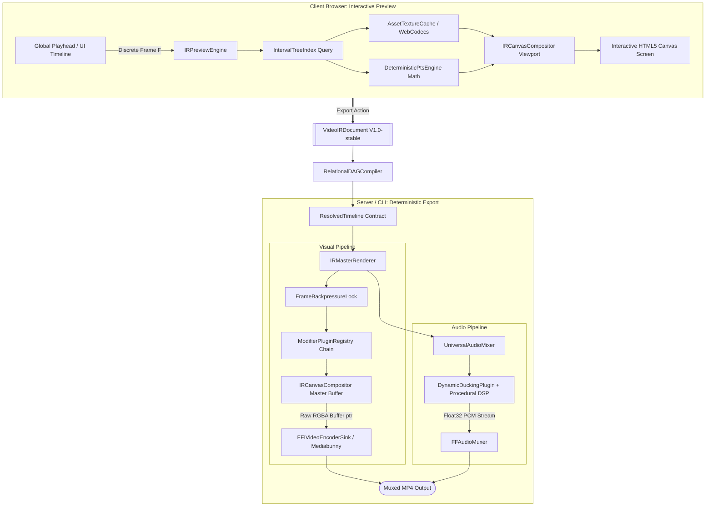

# Architecture Specification: Preview vs. Backend Export (Universal Video IR Engine)

This document specifies the current production architectural blueprint for our browser-based Non-Linear Editor (NLE) and headless rendering engine, standardizing visual effects, geometry, and timeline playback across preview and headless export pipelines.

The architecture is built upon a **Unified Tri-Pillar Parity Architecture** anchored by the **Video Intermediate Representation (IR) V1.0-stable**:
1. **Frontend Interactive Preview:** Powered by [`IRPreviewEngine`](file:///packages/ir/src/renderer/preview/IRPreviewEngine.ts), [`IntervalTreeIndex`](file:///packages/ir/src/compiler/IntervalTreeIndex.ts), and [`IRCanvasCompositor`](file:///packages/ir/src/renderer/shared/IRCanvasCompositor.ts) in browser/DOM runtimes (supporting dynamic LOD scaling, scrubbing, and sub-frame keyframe interpolation).
2. **Deterministic Backend Export:** Powered by [`IRMasterRenderer`](file:///packages/ir/src/renderer/IRMasterRenderer.ts), native [`bun:ffi`](file:///packages/core/src/ffmpeg-ffi/) or headless decoders/encoders, [`UniversalCanvasProvider`](file:///packages/core-isomorphic/src/canvas/UniversalCanvasProvider.ts), and zero-alloc frame loops decoupled from the real-time clock.
3. **Isomorphic Plugin & Math Core:** Cross-platform math, easing, and visual plugins executed identically in both environments via [`ModifierPluginRegistry`](file:///packages/ir/src/plugins/ModifierPluginRegistry.ts), [`DeterministicPtsEngine`](file:///packages/core-isomorphic/src/math/pts/DeterministicPtsEngine.ts), and Mediabunny / FFI media sinks.

---

## 1. Core Technology Stack

* **Timeline Representation:** Video Intermediate Representation ([`VideoIRDocument`](file:///packages/ir/src/types/VideoIR.ts), V1.0-stable schema) compiled into a topological DAG ([`RelationalDAGCompiler`](file:///packages/ir/src/compiler/RelationalDAGCompiler.ts)) and accelerated via [`IntervalTreeIndex`](file:///packages/ir/src/compiler/IntervalTreeIndex.ts).
* **Geometry & Procedural Motion:** Isomorphic [`DeterministicPtsEngine`](file:///packages/core-isomorphic/src/math/pts/DeterministicPtsEngine.ts) (`pts.js` abstraction) with deterministic noise and GSAP-compatible motion resolvers ([`GSAPMotionPlugin`](file:///packages/ir/src/plugins/motion/GSAPMotionPlugin.ts)).
* **Compositor & Canvas Abstraction:** [`UniversalCanvasProvider`](file:///packages/core-isomorphic/src/canvas/UniversalCanvasProvider.ts) bridging HTML5 Canvas in browsers and `@napi-rs/canvas` or native FFI buffers on server/CLI runtimes.
* **Shared Multi-Track Compositor:** [`IRCanvasCompositor`](file:///packages/ir/src/renderer/shared/IRCanvasCompositor.ts) implementing painter's algorithm, blend modes (`screen`, `multiply`, `overlay`, `color_dodge`, etc.), and scoped canvas isolation.
* **Audio Subsystem:** [`UniversalAudioMixer`](file:///packages/ir/src/renderer/audio/UniversalAudioMixer.ts) featuring sample-accurate mixing, dynamic ducking ([`DynamicDuckingPlugin`](file:///packages/ir/src/plugins/sfx/DynamicDuckingPlugin.ts)), and procedural sound synthesis.
* **Video Encoders & Sinks:**
  * **Browser Preview:** [`PreviewCanvasSink`](file:///packages/ir/src/renderer/sink/PreviewCanvasSink.ts) / [`MediabunnyClientSink`](file:///packages/core-web/src/media-engine/MediabunnyClientSink.ts).
  * **Headless Server:** Native [`FFIVideoEncoderSink`](file:///packages/core/src/media-engine/sinks/FFIVideoEncoderSink.ts) (via `bun:ffi`), [`MediabunnyServerSink`](file:///packages/core/src/media-engine/sinks/MediabunnyServerSink.ts), and [`FluentPipeVideoSink`](file:///packages/core/src/media-engine/sinks/FluentPipeVideoSink.ts).
* **Execution Runtimes:** Bun, Node.js, and Modern Browsers (React 19 / Vite).

---

## 2. Phase 1: The Web Editor Preview (Frontend)

**Goal:** Provide an interactive, scrubbable timeline where users can compose scenes, adjust modifier chains, preview multi-track audio/video, and experience real-time visual feedback without server round-trips.

### Layer & Canvas Architecture
Preview rendering converges on [`IRPreviewEngine`](file:///packages/ir/src/renderer/preview/IRPreviewEngine.ts) and [`IRCanvasCompositor`](file:///packages/ir/src/renderer/shared/IRCanvasCompositor.ts):
* **Single Canvas Multi-Track Pipeline:** Visual layers (video frames decoded via Mediabunny WebCodecs, image textures, procedural geometry from `pts.js`, and particle overlays) are composited onto a master canvas using standardized blend modes and strict track ordering.
* **Interactive UI & Overlay Elements:** Timeline controls, playheads, and bounding-box transform gizmos render as Liquid Glass React components directly over the preview viewport.
* **Texture Caching:** [`AssetTextureCache`](file:///packages/ir/src/renderer/preview/AssetTextureCache.ts) maintains pre-decoded bitmaps and video keyframes in memory to ensure fluid scrubbing.

### Discrete Frame Clock & Scrubbing
Instead of relying on wall-clock drift or unconstrained `requestAnimationFrame`, the playhead drives evaluation deterministically:
1. **Discrete Frame Math:** $timeSec = frame / fps$.
2. **Interval Tree Culling:** At frame $F$, [`IntervalTreeIndex`](file:///packages/ir/src/compiler/IntervalTreeIndex.ts) queries active sequences in $O(\log n + k)$ time.
3. **LOD (Level of Detail) Scaling:** Scrubbing automatically engages dynamic LOD (`engine.setLODScale(0.25 | 0.5 | 1.0)`), downscaling intermediate canvas dimensions during rapid scrubber movement to maintain 60 FPS UI responsiveness.

---

## 3. Phase 2: The Bridge (Video Intermediate Representation - IR)

**Goal:** Provide an unambiguous, declarative, multi-track contract between the UI timeline, persistent project files, and backend render workers.

The timeline serializes into **Video IR V1.0-stable** ([`VideoIRDocument`](file:///packages/ir/src/types/VideoIR.ts)), validated at boundaries by [`VideoIRSchemaValidator`](file:///packages/ir/src/schema/VideoIRSchemaValidator.ts).

### IR Document Structure
```json
{
  "version": "1.0.0-stable",
  "meta": {
    "contentId": "vfx-scene-01",
    "globalFps": 60,
    "canvasSize": { "w": 1920, "h": 1080 },
    "colorSpace": "srgb"
  },
  "assets": {
    "bg-video": {
      "type": "video",
      "src": "assets/background.mp4"
    },
    "hud-font": {
      "type": "font",
      "src": "fonts/Orbitron.ttf",
      "fontFamily": "Orbitron"
    }
  },
  "tracks": [
    {
      "id": "track-bg",
      "type": "video",
      "name": "Background Track",
      "sequences": [
        {
          "id": "seq-bg-1",
          "type": "video",
          "assetId": "bg-video",
          "time": { "start": 0, "duration": 300 },
          "modifiers": [
            {
              "type": "color_grading",
              "parameters": { "contrast": 1.15, "saturation": 0.9 }
            }
          ]
        }
      ]
    },
    {
      "id": "track-overlay",
      "type": "overlay",
      "name": "Procedural Motion & HUD",
      "blendMode": "screen",
      "sequences": [
        {
          "id": "seq-hud-1",
          "type": "overlay",
          "time": {
            "start": { "after": "seq-bg-1", "offsetFrames": -180 },
            "duration": 180
          },
          "modifiers": [
            {
              "type": "hologram_hud",
              "parameters": { "scanlineDensity": 4.0, "glitchIntensity": 0.15 }
            },
            {
              "type": "transform",
              "parameters": {
                "keyframes": [
                  { "frame": 0, "scale": 0.8, "opacity": 0.0 },
                  { "frame": 30, "scale": 1.0, "opacity": 1.0, "easing": "ease_out_cubic" }
                ]
              }
            }
          ]
        }
      ]
    }
  ]
}
```

### Relational DAG Compilation
Before rendering, [`RelationalDAGCompiler`](file:///packages/ir/src/compiler/RelationalDAGCompiler.ts) resolves all dynamic dependencies (`after`, `syncWith`, `matchLengthOf`, `offsetFrames`) into an immutable [`ResolvedTimeline`](file:///packages/ir/src/types/VideoIR.ts#L137-L145) with exact `startFrame`, `endFrame`, and `durationFrames`.

---

## 4. Phase 3: The Backend Export (Deterministic Rendering)

**Goal:** Execute frame-accurate headless rendering producing bit-identical exports across runs without wall-clock drift or dropped frames.

### Step 4.1: Deterministic Render Loop
[`IRMasterRenderer`](file:///packages/ir/src/renderer/IRMasterRenderer.ts) drives headless execution frame-by-frame:
1. **Backpressure Handshake:** Regulated via [`FrameBackpressureLock`](file:///packages/ir/src/renderer/handshake/FrameBackpressureLock.ts), ensuring the frame producer never overwhelms downstream FFI or encoder queues.
2. **Audio/Video Decoupling:** Video and audio are decoupled during synthesis:
   * **Visual Pipeline:** Evaluated discrete frame by frame ($0 \dots \text{totalFrames} - 1$).
   * **Audio Pipeline:** [`UniversalAudioMixer`](file:///packages/ir/src/renderer/audio/UniversalAudioMixer.ts) computes continuous 32-bit float PCM buffers with DSP ducking and procedural sound effects.
3. **Cumulative Bit-Parity Hash:** Each exported frame generates a deterministic hash (`cumulativeHash`), verifying cross-platform parity between development and CI/CD pipelines.

### Step 4.2: Modifier Plugin Architecture
Visual processing executes through [`ModifierPluginRegistry`](file:///packages/ir/src/plugins/ModifierPluginRegistry.ts) using 3 discrete evaluation phases:
* **`clip_space`**: Operations applied directly to raw asset sequences (transforms, crop, color grading).
* **`stream_space`**: Operations applied at track level (track blend modes, crossfades, split edits).
* **`master_composite`**: Operations applied to the aggregate canvas (global film grain, letterboxing, HDR tone-mapping).

### Step 4.3: Zero-Alloc Native Encoder Pipeline
For maximum throughput, the backend replaces slow IPC/Puppeteer screenshots with direct hardware-accelerated encoding:
* Native FFI memory pointers (`ptr(rgbaBuffer)`) flow straight into `FFIVideoEncoder` (Bun FFI wrapping `libavcodec`/`libavformat`) or `MediabunnyServerSink`.
* Zero intermediate disk write of PNG files; flattened RGBA pixel buffers stream directly to GPU or CPU encoders.

```typescript
// Production Headless Render Execution (IRMasterRenderer)
const renderer = new IRMasterRenderer(resolvedTimeline);

const result = await renderer.render({
  engine: 'bun-ffi',
  outputPath: 'output/final_render.mp4',
  sink: new FFIVideoEncoderSink(),
  generateFrameHash: true,
  onProgress: ({ currentFrame, totalFrames, percent }) => {
    console.log(`Render progress: ${percent.toFixed(1)}% (${currentFrame}/${totalFrames})`);
  }
});

console.log(`Render complete! Cumulative hash: ${result.cumulativeHash}`);
```

---

## 5. Architectural Data Flow


