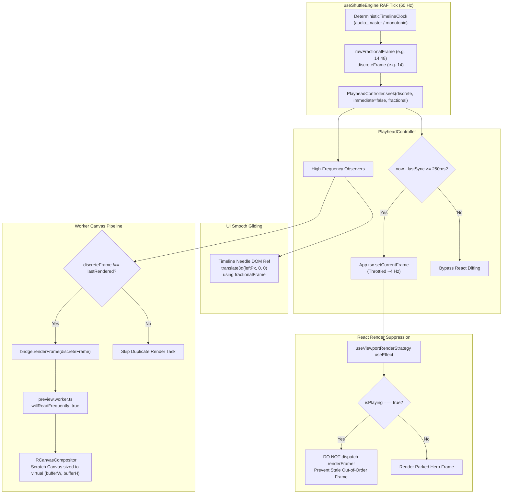

# Master Implementation Plan Iteration 60: Studio Preview Playback Smoothness, Continuous Needle Interpolation, & Isolation Scaling

## 1. Executive Summary
During playback in Studio, users report noticeable playback lag and visual stutter even though the telemetry badge displays 60 FPS. Diagnostic profiling revealed that the 60 FPS counter merely measured worker completion rate, while the displayed image and UI were subject to:
1. **Out-of-Order Frame Stutter**: Asynchronous React texture sync promises resolving 15–25ms late and firing `strategy.renderFrame(currentFrame)` with stale frames, causing a 2-frame backward jitter ($N+2 \rightarrow N \rightarrow N+3$).
2. **Playhead Needle Discrete Judder**: The timeline needle translated on integer frames (`Math.round`), freezing for 33.3ms and jumping on a 30 FPS timeline viewed on a 60/120 Hz display.
3. **Redundant Worker Renders**: Identical frames were rendered twice per frame interval at 60 Hz on 30 FPS projects.
4. **Isolated Scratch Canvas Resolution Bypass**: Overlay tracks with non-standard blend modes (`blendMode: 'screen'`) allocated full 1080p scratch canvases on every frame, bypassing the virtual preview canvas optimization.
5. **Context Readback Stalls**: OffscreenCanvas context in the worker thread was initialized with `willReadFrequently: false`, triggering GPU pipeline stalls during color grading pixel traversals (`getImageData`).

This iteration resolves these architectural bottlenecks across `@acc/studio` and `@acc/ir`.

---

## 2. Trade-Off Matrices

| Strategy Option | Latency Impact | Visual Smoothness | Main-Thread Overhead | Verdict |
| :--- | :--- | :--- | :--- | :--- |
| **A. Naive 60Hz React State Updates** | High (+15ms) | Low (React reconciliation jank) | Severe (100% CPU lock) | Rejected |
| **B. Integer Step Needle Animation** | Low (<1ms) | Low (30 Hz discrete jumping) | Minimal | Rejected |
| **C. Decoupled Continuous Sub-Frame Gliding + High-Freq Render Exclusivity (Proposed)** | Ultra-Low (<0.1ms) | Pristine 60/120/144 Hz Butter Smoothness | Minimal (Pure DOM `translate3d`, zero React VDOM diffs) | **Accepted** |

---

## 3. Mermaid Topology



---

## 4. Mathematical/Algorithmic Specifications

### 4.1 Sub-Frame Fractional Needle Translation
Let $t_{\text{elapsed}}$ be the continuous time elapsed since playback start in seconds, $f_{\text{target}}$ be the fractional timeline frame, and $P$ be `pixelsPerFrame`:
$$f_{\text{target}} = f_{\text{start}} + t_{\text{elapsed}} \cdot \text{fps} \cdot \text{speed}$$
$$\text{leftPx} = 208 + f_{\text{target}} \cdot P$$
$$\text{needle.style.transform} = \text{translate3d}(\text{leftPx} \text{ px}, 0, 0)$$

### 4.2 Discrete Frame Advance & Worker Deduplication
Let $F_k$ be the discrete integer frame at tick $k$:
$$F_k = \text{round}(f_{\text{target}})$$
$$\text{Dispatch Render} \iff F_k \neq F_{k-1} \lor \text{speed changed} \lor \text{not playing}$$

---

## 5. Concrete File/Class Signatures

### `PlayheadController.ts`
```ts
export type PlayheadSubscriber = (
  frame: number,
  isPlaying: boolean,
  fractionalFrame?: number
) => void;

export class PlayheadController {
  private currentFrame = 0;
  private currentFractionalFrame = 0;
  private isPlaying = false;
  private lowFreqSyncIntervalMs = 250; // Throttled from 100ms during playback

  public seek(frame: number, immediateUiSync = false, fractionalFrame?: number): void;
}
```

### `useShuttleEngine.ts`
```ts
// RAF tick calculation:
const rawFractionalFrame = targetFrame;
const discreteFrame = snapToDiscreteFrame(targetFrame);
PlayheadController.getInstance().seek(discreteFrame, false, rawFractionalFrame);
```

### `IRCanvasCompositor.ts`
```ts
// Scratch canvas isolation sizing:
const scratchW = isVirtualScaled ? bufferW : width;
const scratchH = isVirtualScaled ? bufferH : height;
const { canvas: scratchCanvas, ctx: scratchCtx } = getFrameScratchContext(scratchW, scratchH);
if (isVirtualScaled) {
  scratchCtx.scale(scaleX, scaleY);
}
```

---

## 6. Phased Roadmap

- [ ] **Phase 1: Viewport Render Strategy & Async Race Suppression**
  - Suppress async React `renderFrame` in `useViewportRenderStrategy.ts` during active playback.
- [ ] **Phase 2: High-Frequency Continuous Playhead & Deduplication**
  - Update `PlayheadController.seek()` with `fractionalFrame`.
  - Update `Timeline.tsx` needle translation for continuous 60/120 Hz glide.
  - Deduplicate render dispatches in `useShuttleEngine.ts` and `WorkerRenderStrategy.ts`.
- [ ] **Phase 3: Virtual Scratch Canvas Scaling in Compositor**
  - Size track isolation scratch canvas to virtual buffer in `IRCanvasCompositor.ts`.
- [ ] **Phase 4: Worker Canvas Readback Acceleration**
  - Initialize OffscreenCanvas with `willReadFrequently: true` in `preview.worker.ts`.

---

## 7. Formal Verification Matrix (`/autogenerated-tests/`)

| Test File | Test Case | Target Metric |
| :--- | :--- | :--- |
| `autogenerated-tests/preview_playback_smoothness.test.ts` | Fractional Playhead Subscription | `fractionalFrame` passed on high-frequency ticks |
| `autogenerated-tests/preview_playback_smoothness.test.ts` | Playback Render Exclusivity | Zero stale render calls dispatched while `isPlaying: true` |
| `autogenerated-tests/preview_playback_smoothness.test.ts` | Frame Deduplication | 0 duplicate render messages dispatched on consecutive ticks with identical integer frames |
| `autogenerated-tests/preview_playback_smoothness.test.ts` | Virtual Scratch Canvas Sizing | Scratch canvas dimensions match `(bufferW, bufferH)` |

---

## 8. Risk & Rollback Mitigations

| Risk | Mitigation | Rollback Plan |
| :--- | :--- | :--- |
| Parked hero frame not rendering on scrub | `useViewportRenderStrategy` allows `renderFrame` whenever `!isPlaying` | Revert suppression guard to allow unconditional scrub render |
| Needle position drifting past boundary | `fractionalFrame` clamped between 0 and `totalFrames - 1` | Fall back to clamped integer `frame` |
| Scratch canvas scale distortion | Apply `scratchCtx.setTransform(1, 0, 0, 1, 0, 0)` on scratch acquisition | Revert scratch canvas to full `(width, height)` |
