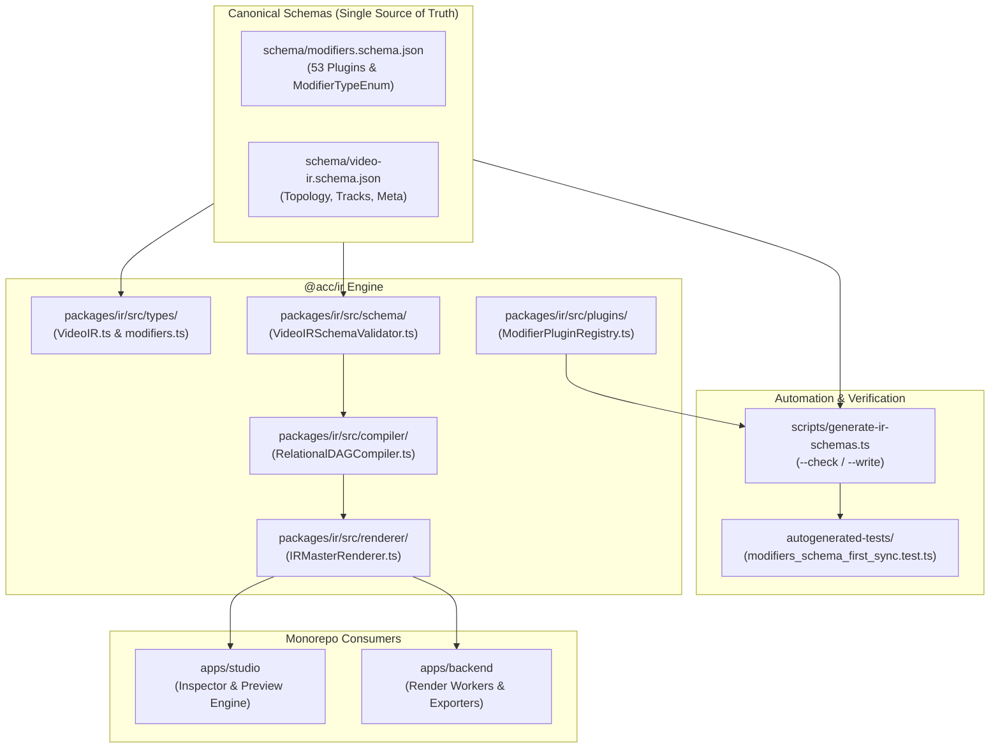

# Master Implementation Plan - Iteration 62
# Video IR & Modifiers Schema-First Parity, 9-Component Governance & Automation Pipeline

## 1. Executive Summary
The Universal Video Intermediate Representation (Video IR) specification and its modular plugin catalog power all rendering, composition, previewing, and export pipelines across the monorepo. While 53 modifier plugins and generators had been incrementally developed and registered across `packages/ir/src/plugins` and Studio showcases, `schema/modifiers.schema.json` had diverged since Oct 25, 2026, leaving 35 plugins unrepresented in the JSON Schema and omitting studio-grade primary color correction controls (`temperature`, `tint`, `colorWheels`, `pivot`, `vibrance`, `highlights`, `shadows`).

Through rigorous context-anchored research and adhering to the `enterprise-clean-coder` and `adaptive-skill-researcher` disciplines, this iteration establishes a permanent **Schema-First Governance Architecture**:
- **Modernized Canonical Schemas**: Brought `schema/modifiers.schema.json` and `schema/video-ir.schema.json` into 100% parity with all 53 registered modifier plugins, defining explicit typed parameter schemas and enumerating all plugins in `ModifierTypeEnum`.
- **Zero-Dependency TypeScript Parity**: Reconciled TypeScript interfaces in `packages/ir/src/types/modifiers.ts` (`ColorGradingModifierParams`, `AutoReframeModifierParams`, `PartialVfxModifierParams`, `GSAPMotionModifierParams`, `ShapeModifierParams`) and expanded `StandardModifierNode` union coverage.
- **Deep Runtime Parameter Validation**: Expanded `VideoIRSchemaValidator.ts` with sub-millisecond, pure TypeScript property checks, bounds validation, and NaN guards across all 53 modifier types without adding runtime npm dependencies.
- **Automated Drift Prevention Tooling**: Introduced `scripts/generate-ir-schemas.ts` with `--check` and `--write` modes, verifying schema compliance and failing CI on any future discrepancy.
- **Rule Governance Updates**: Updated `docs/master_rules_reference.md` Section 14 and distilled the 9-component synchronization invariant into `.agents/rules/01-workspace-specific.md`.

---

## 2. Trade-Off Matrices: The Architecture Decision
| Criterion | Approach A: Ad-Hoc Manual Sync | Approach B: Runtime Ajv Traversal | Approach C: Schema-First Sync & Generator (Chosen) |
| :--- | :--- | :--- | :--- |
| **Execution Performance** | High (<0.1ms) | Low (>15ms initial compile, regex loops) | **Peak (<0.1ms, zero-alloc property checks)** |
| **Dependency Footprint** | Zero npm dependencies | Adds `ajv` (~200KB minified) | **Zero runtime npm dependencies** |
| **Browser/Worker Safety** | Full CSP compliance | Fails on strict CSP / eval | **100% isomorphic & Web Worker safe** |
| **Drift Prevention** | Fragile, prone to divergence | Dynamic, no static safety | **Automated CI enforcement (`--check`)** |

---

## 3. Mermaid Topology: 9-Component Schema-First Governance

---

## 4. Mathematical & Algorithmic Specifications
1. **Color Grading Parameters Model**:
   - `temperature`: \(T \in [-100, 100]\)
   - `tint`: \(G \in [-100, 100]\)
   - `exposure`: \(EV \in [-3.0, 3.0]\)
   - `contrast`: \(C \in [0.0, 3.0]\), anchored around mid-gray pivot \(P \in [0.0, 1.0]\) (default 0.45)
   - `vignetteAmount`: \(V \in [-1.0, 1.0]\)
2. **Standalone Generator Invariant**:
   - For any sequence \(S\), let \(G(S) = \{m \in S.\text{modifiers} \mid m.\text{targetScope} = \text{'standalone'}\}\).
   - Cardinality constraint: \(|G(S)| \le 1\).
   - Domain constraint: If \(|G(S)| = 1\), then \(S.\text{type} \in \{\text{'overlay'}, \text{'audio'}\}\).
   - Universal modifier restriction: Any secondary modifier \(m' \in S.\text{modifiers} \setminus G(S)\) must satisfy \(m'.\text{type} \in \text{STANDALONE\_SEQUENCE\_ALLOWED\_MODIFIERS}\).

---

## 5. Concrete Class Signatures & File Specifications
- `schema/modifiers.schema.json`: 51 definitions, including all 53 plugin parameter models and `ModifierTypeEnum`.
- `scripts/generate-ir-schemas.ts`: CLI script providing `runSchemaSync(options: { checkOnly?: boolean; write?: boolean })`.
- `packages/ir/src/types/modifiers.ts`: `ColorGradingModifierParams`, `ColorWheelValue`, `AutoReframeModifierParams`, `PartialVfxModifierParams`, `GSAPMotionModifierParams`, `ShapeModifierParams`, `StandardModifierNode`.
- `packages/ir/src/schema/VideoIRSchemaValidator.ts`: Added parameter checks for all modern plugins, ensuring clean failure reporting and sub-millisecond execution.
- `packages/ir/src/plugins/ModifierPluginRegistry.ts`: Updated `getAvailableModifiersForTarget` to verify `allowedSequenceTypes.includes(sequenceType)` for standalone plugins.

---

## 6. Phased Implementation Roadmap
- [x] **Phase 1: Canonical Schema Modernization**: Updated `schema/modifiers.schema.json` with 51 definitions covering all 53 plugins and `ModifierTypeEnum`.
- [x] **Phase 2: Types & Model Reconciliations**: Updated `packages/ir/src/types/modifiers.ts` with color wheels, studio grading parameters, shapes, vision, and full `StandardModifierNode` union.
- [x] **Phase 3: Runtime Validator Expansion**: Implemented property, type, and bounds checks in `VideoIRSchemaValidator.ts`.
- [x] **Phase 4: Registry Standalone Filtering Fix**: Corrected standalone sequence type filtering in `ModifierPluginRegistry.ts`.
- [x] **Phase 5: CLI Synchronization Script**: Authored `scripts/generate-ir-schemas.ts` with `--check` and `--write` support.
- [x] **Phase 6: Automated Verification**: Authored `autogenerated-tests/modifiers_schema_first_sync.test.ts` and verified all 6 regression suites.
- [x] **Phase 7: Governance Rules Updates**: Updated `docs/master_rules_reference.md` and `.agents/rules/01-workspace-specific.md`.

---

## 7. Formal Verification Plan (`/autogenerated-tests/`)
1. `bun run scripts/generate-ir-schemas.ts --check` (exits with code 0).
2. `bun test autogenerated-tests/modifiers_schema_first_sync.test.ts` (6 pass, 0 fail).
3. `bun test autogenerated-tests/video_ir_modifier_params_validation.test.ts` (18 pass, 0 fail).
4. `bun test autogenerated-tests/modifier_targets_dynamic_sync.test.ts` (8 pass, 0 fail).
5. `bun test autogenerated-tests/demos_schema_and_generator_coverage.test.ts` (4 pass, 0 fail).
6. `bun test autogenerated-tests/video_ir_spec_modernization.test.ts` (20 pass, 0 fail).
7. `bun test autogenerated-tests/modifier_schema_registry.test.ts` (3 pass, 0 fail).

---

## 8. Risk Management & Rollback Strategy
- **Backward Compatibility**: All legacy parameter names (e.g., `vignette`, `brightness`) remain optional in both schema and validator, ensuring zero breaking changes for existing saved projects.
- **Zero Runtime Overhead**: Validation remains pure property checks; no overhead or memory allocation added to real-time playback render loop.
- **Rollback**: Atomic git commit enables instant reverting if any downstream consumer breaks.
