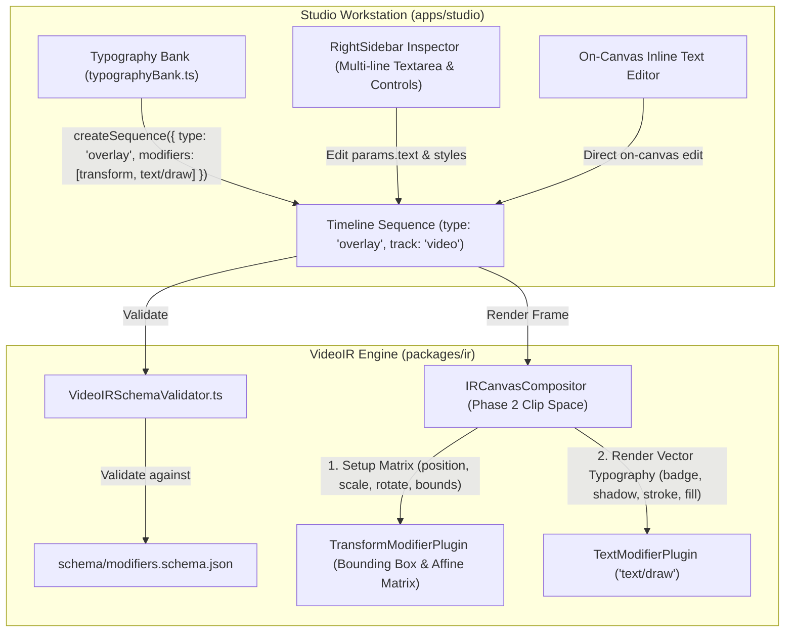

# Master Implementation Plan — Iteration 63

# Standalone Text Overlay Modifier & Plugin Architecture (`text/draw`)

## 1. Executive Summary
This master plan specifies the creation of `text/draw` (with alias `text/overlay`), a dedicated, enterprise-grade standalone modifier plugin for rendering graphic text objects (cinematic titles, lower-thirds, badges, headers, callouts, and watermarks) on standard video and overlay tracks. It formally decouples graphic text objects from `timed_text/style` (which is reserved exclusively for subtitles and captions), synchronizes all 9 canonical VideoIR schema components with zero drift, introduces studio inspector controls, and migrates all 16 presets in `typographyBank.ts`.

## 2. Trade-Off Matrices
| Architectural Dimension | Option A: Overload `timed_text/style` | Option B: Procedural `time_space` | Option C: Dedicated `text/draw` (Selected) |
| :--- | :--- | :--- | :--- |
| **Separation of Concerns** | Low (Captions & Titles mixed) | Low (Coupled to fixed animation engines) | High (Clean single responsibility) |
| **Track Flexibility** | Restricted to `timed_text` track | Requires video/overlay track | Unrestricted (`video`, `overlay`, `image`) |
| **Styling Capabilities** | Limited to subtitle styles | Limited to template parameters | Multi-line, letter spacing, gradients, strokes, glow, drop shadows, badge cards |
| **Affine Interoperability** | Fragmented with transforms | Self-contained matrix | 100% interoperable with `transform` and `motion/gsap` |
| **Scaling Invariant** | Unscaled pixels or margins | Fixed template units | 1080p Reference Scaling (calibrated to 1920x1080; zero 4K/720p drift) |

## 3. Mermaid Topology

## 4. Mathematical & Algorithmic Specifications
- **1080p Reference Scaling**:
  $$\text{scaleX} = \frac{\text{canvasWidth}}{1920}, \quad \text{scaleY} = \frac{\text{canvasHeight}}{1080}, \quad \text{scaleBase} = \min(\text{scaleX}, \text{scaleY})$$
  $$\text{renderedFontSize} = \max(8, \text{round}(\text{fontSize} \times \text{scaleBase}))$$
  $$\text{renderedStrokeWidth} = \text{strokeWidth} \times \text{scaleBase}$$
- **Anchor Offset**:
  $$\text{originX} = \text{width} \times \text{normX} + x \times \text{scaleX}$$
  $$\text{originY} = \text{height} \times \text{normY} + y \times \text{scaleY}$$
- **Multi-line Advance**:
  $$\text{lineAdvance} = \text{renderedFontSize} \times (\text{lineHeight} \mathbin{?} \text{lineHeight} : 1.25)$$
- **Letter Spacing Advance**:
  $$x_{\text{advance}} = \text{measureText}(\text{char}).\text{width} + \text{letterSpacing} \times \text{scaleBase}$$
- **Bounding Box for Background Plate**:
  $$\text{plateW} = w_{\text{max}} + 2 \times \text{paddingX} \times \text{scaleX}$$
  $$\text{plateH} = (N_{\text{lines}} - 1) \times \text{lineAdvance} + \text{renderedFontSize} + 2 \times \text{paddingY} \times \text{scaleY}$$

## 5. Concrete File & Class Signatures
- `packages/ir/src/types/modifiers.ts`: `TextDrawModifierParams` (strictly requires `text: string`)
- `packages/ir/src/plugins/text/TextModifierPlugin.ts`: `TextModifierPlugin implements ModifierPlugin<TextDrawModifierParams>`
- `schema/modifiers.schema.json`: `TextDrawModifierParams`
- `packages/ir/src/schema/VideoIRSchemaValidator.ts`: `case 'text/draw': case 'text/overlay':`
- `apps/studio/src/components/inspector/modifierCatalog.ts`: Catalog entry for `text/draw`
- `apps/studio/src/components/inspector/ModifierControlStrategies.tsx`: Visual property control strategy
- `apps/studio/src/lib/library/typographyBank.ts`: Updated presets with `overlay` sequences and `transform` + `text/draw`

## 6. Phased Roadmap
- **Phase 1**: Schema Definitions & Tooling Generation (`schema/modifiers.schema.json`, `scripts/generate-ir-schemas.ts`).
- **Phase 2**: Core Plugin Implementation & Validation (`TextModifierPlugin.ts`, `VideoIRSchemaValidator.ts`).
- **Phase 3**: Studio Inspector UI & In-Canvas Editing Controls (`modifierCatalog.ts`, `ModifierControlStrategies.tsx`).
- **Phase 4**: Typography Bank Migration (`typographyBank.ts`).
- **Phase 5**: Formal Verification Matrix (`text_draw_modifier_plugin.test.ts`).

## 7. Formal Verification Matrix
- `bun run scripts/generate-ir-schemas.ts --check` (0 drift)
- `bun test autogenerated-tests/text_draw_modifier_plugin.test.ts` (100% green)
- `bun test autogenerated-tests/studio*`
- `pnpm --filter studio exec vite build`

## 8. Risk & Rollback Mitigations
- Full backward compatibility for `timed_text/style` on subtitle tracks.
- Fallback font stacks ensure robust typography rendering across Windows, macOS, and Linux.
