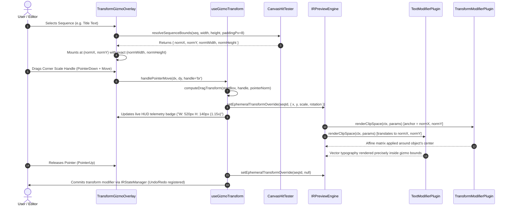

# Master Implementation Plan - Iteration 64: Studio-Grade On-Canvas Transform Gizmo Architecture

## 1. Executive Summary
In professional non-linear video editing software (NLEs such as DaVinci Resolve, Adobe After Effects, and Figma), the on-canvas direct manipulation gizmo is the primary point of physical contact between the editor and the visual composition. Currently in `@acc/studio`, `TransformGizmoOverlay.tsx` suffers from two critical usability defects:
1. **Target Boundary Blindness**: The visual bounding box and drag physics are hardcoded to a fixed `50%` $\times$ `50%` normalized box (`baseW = 0.5, baseH = 0.5`), disregarding whether the selected asset is a 320x180 shape, an 80px-high title line, or a 1920x1080 video sequence.
2. **Origin & Centering Desynchronization**: Text objects rendered via `TextModifierPlugin` skip coordinate translation when a preceding transform modifier exists, leaving text drawn at $(0, 0)$ in clip space while the gizmo is positioned at $(\text{normX}, \text{normY})$. Furthermore, `TransformModifierPlugin` defaults its rotation and scaling anchor point to screen center $(0.5, 0.5)$ rather than the object's authored center, causing lower thirds and chapter headers to orbit awkwardly.

Iteration 64 elevates `TransformGizmoOverlay`, `useGizmoTransform`, and the underlying VideoIR clip-space renderers to studio-grade quality. It provides dynamic bounding box calculation across all sequence archetypes with configurable 8px breathing padding, bit-identical object centering, a local center pivot reticle crosshair, directional edge-stretch handles, magnetic degree snapping, live HUD telemetry readouts, and 1px/10px keyboard arrow nudging.

---

## 2. Trade-Off Matrices

| Architectural Approach | Pros | Cons | Decision |
|---|---|---|---|
| **Option A: Static 50% Bounding Box (Status Quo)** | Simple, constant handle sizing, zero per-frame bounding box math. | Disconnected from actual content; handles float far outside small text and inside large video frames; confusing user experience. | **Rejected** |
| **Option B: DOM `getBoundingClientRect` on Canvas Elements** | Reads rendered pixels directly from DOM. | Viewport canvas is a single 2D raster; individual sequences are not discrete DOM elements; violates worker decoupling. | **Rejected** |
| **Option C: Algorithmic Geometry Engine (`CanvasHitTester.resolveSequenceBounds`)** | 100% decoupled; pure math from modifier parameters; zero DOM inspection; works identically in preview, headless tests, and workers; microsecond evaluation; supports configurable padding. | Requires maintaining geometric calculations for text, shapes, and media. | **Selected (Architectural Standard)** |

---

## 3. Mermaid Topology & Lifecycle



---

## 4. Mathematical & Algorithmic Specifications

### 4.1 Normalized Boundary Calculation with Configurable Breathing Room
Given a canvas of width $W_c$ and height $H_c$, and visual breathing padding $P_{\text{px}}$ (default 8px):
$$\text{scaleBase} = \min\left(\frac{W_c}{1920}, \frac{H_c}{1080}\right)$$

1. **Standalone Text (`text/draw`, `text/overlay`)**:
   $$F_s = \max(8, \text{fontSize} \cdot \text{scaleBase})$$
   $$W_{\text{raw}} = \text{maxLineWidth} + 2 \cdot (\text{paddingX} \cdot \text{scaleBase}) + 2 \cdot P_{\text{px}}$$
   $$H_{\text{raw}} = (N_{\text{lines}} - 1) \cdot (\text{lineHeight} \cdot F_s) + F_s + 2 \cdot (\text{paddingY} \cdot \text{scaleBase}) + 2 \cdot P_{\text{px}}$$
   $$W_0 = \min\left(1.0, \max\left(0.06, \frac{W_{\text{raw}}}{W_c}\right)\right), \quad H_0 = \min\left(1.0, \max\left(0.04, \frac{H_{\text{raw}}}{H_c}\right)\right)$$

2. **Vector Shapes (`shape/draw`, `shape/vector`)**:
   $$W_0 = \min\left(1.0, \max\left(0.04, \frac{\text{width} + 2 \cdot P_{\text{px}}}{1920}\right)\right), \quad H_0 = \min\left(1.0, \max\left(0.04, \frac{\text{height} + 2 \cdot P_{\text{px}}}{1080}\right)\right)$$

3. **Subtitles & Timed Text (`timed_text/style`, `text/style`, cues)**:
   $$W_0 = \min\left(0.85, \max\left(0.25, \frac{\text{textLength} \cdot 18 + 2 \cdot P_{\text{px}}}{1920}\right)\right), \quad H_0 = 0.08$$

4. **Visual Media & Video Tracks**:
   $$W_0 = 1.0, \quad H_0 = 1.0$$

### 4.2 Affine Matrix Invariance
To eliminate clipping and top-left drifting:
$$\text{Anchor}_X = W_c \cdot X_0, \quad \text{Anchor}_Y = H_c \cdot Y_0$$
The matrix stack is:
$$\mathbf{M} = \mathbf{T}(\text{Anchor} + \Delta\mathbf{p}) \cdot \mathbf{R}(\theta) \cdot \mathbf{S}(s) \cdot \mathbf{T}(-\text{Anchor})$$
When the child plugin translates to $\text{Anchor}$:
$$\mathbf{M} \cdot \mathbf{T}(\text{Anchor}) = \mathbf{T}(\text{Anchor} + \Delta\mathbf{p}) \cdot \mathbf{R}(\theta) \cdot \mathbf{S}(s)$$
The child object rotates and scales strictly around its own local center $(\text{Anchor}_X, \text{Anchor}_Y)$ and translates to $(\text{Anchor}_X + \Delta x, \text{Anchor}_Y + \Delta y)$.

---

## 5. Concrete File & Class Signatures

### 5.1 `apps/studio/src/lib/hit-test/CanvasHitTester.ts`
```ts
export interface SequenceBounds {
  readonly normX: number;
  readonly normY: number;
  readonly normWidth: number;
  readonly normHeight: number;
  readonly label: string;
}

export class CanvasHitTester {
  public static resolveSequenceBounds(
    seq: ResolvedSequence,
    canvasWidth?: number,
    canvasHeight?: number,
    paddingPx?: number
  ): SequenceBounds;
}
```

### 5.2 `apps/studio/src/components/preview/useGizmoTransform.ts`
```ts
export interface UseGizmoTransformOptions {
  selectedSeqId: string | null;
  width: number;
  height: number;
  isLocked: boolean;
  timeline?: ResolvedTimeline | null;
  doc?: VideoIRDocument | null;
  previewEngine?: {
    setEphemeralTransformOverride?: (sequenceId: string, override: any) => void;
  } | null;
  onRenderFrame?: () => void;
}

export interface UseGizmoTransformReturn {
  transform: TransformState;
  isDragging: boolean;
  activeHandle: TransformHandleType | null;
  dragMode: 'move' | 'scale' | 'rotate' | null;
  telemetry: {
    deltaX: number;
    deltaY: number;
    widthPx: number;
    heightPx: number;
    scale: number;
    rotation: number;
  } | null;
  handleKeyDown: (e: React.KeyboardEvent) => void;
  // ... handlers
}
```

### 5.3 `apps/studio/src/components/preview/TransformGizmoOverlay.tsx`
```tsx
export interface TransformGizmoOverlayProps {
  selectedSeqId: string | null;
  activeSequences: StudioSequence[];
  currentFrame: number;
  width?: number;
  height?: number;
  isLocked: boolean;
  transform: TransformState;
  isDragging: boolean;
  previewEngine?: any;
  onHandlePointerDown?: (handleType: TransformHandleType, e: React.PointerEvent) => void;
  onHandlePointerMove?: (e: React.PointerEvent) => void;
  onHandlePointerUp?: (e: React.PointerEvent) => void;
  onHandlePointerCancel?: (e: React.PointerEvent) => void;
  onSetTransform: (t: TransformState) => void;
  onToggleLock: () => void;
  onStartEditingCue?: (cue: { sequenceId: string; cueIndex: number; text: string }) => void;
}
```

---

## 6. Phased Roadmap

- [ ] **Phase 1: Coordinate System & Plugin Centering**
  - Fix `packages/ir/src/plugins/text/TextModifierPlugin.ts` origin translation.
  - Fix `packages/ir/src/plugins/transform/TransformModifierPlugin.ts` anchor point resolution from `params.normX` and `params.normY`.
- [ ] **Phase 2: Sequence Bounding Box Resolution**
  - Add `CanvasHitTester.resolveSequenceBounds` in `apps/studio/src/lib/hit-test/CanvasHitTester.ts` with configurable 8px padding.
- [ ] **Phase 3: useGizmoTransform Dynamic Box & Telemetry**
  - Update `apps/studio/src/components/preview/useGizmoTransform.ts` to use `resolveSequenceBounds`.
  - Expose live drag telemetry metrics and Pro NLE handle interaction logic (Shift to free-scale, Alt from center).
  - Add 1px/10px keyboard arrow nudging.
- [ ] **Phase 4: TransformGizmoOverlay Studio-Grade Polish**
  - Wire dynamic `bounds.normWidth * 100%` and `bounds.normHeight * 100%`.
  - Implement Center Pivot Crosshair Reticle (`+`).
  - Implement Floating Live Telemetry HUD Badge.
  - Refine Liquid Glass specular borders and handle micro-interactions.
- [ ] **Phase 5: Verification & Testing**
  - Write `autogenerated-tests/studio_transform_gizmo_bounds.test.ts`.
  - Run regression tests and clean Vite build.

---

## 7. Formal Verification Matrix (`/autogenerated-tests/`)

| Test Suite | Purpose | Target Criteria |
|---|---|---|
| `studio_transform_gizmo_bounds.test.ts` | Unit tests for `resolveSequenceBounds` across text, shapes, videos, and subtitles with 8px padding. | 100% green assertions; accurate `normWidth`/`normHeight`. |
| `universal_canvas_hit_tester.test.ts` | Verifies hit region calculation backwards compatibility. | 100% green assertions. |
| `text_draw_modifier_plugin.test.ts` | Verifies text modifier rendering and schema validation. | 100% green assertions. |
| `preset_schema_compatibility.test.ts` | Verifies all 16 typography and shape staging presets. | 100% green assertions (1211 assertions). |
| `pnpm --filter studio exec vite build` | Verifies production bundle compilation without errors. | Exit code 0, 0 TS errors. |

---

## 8. Risk & Rollback Mitigations

| Risk | Impact | Mitigation |
|---|---|---|
| **Text with missing font metrics throwing error** | High | `TextModifierPlugin` and `CanvasHitTester` provide graceful fallback bounds based on string length and default 72px font size. |
| **Old sequences without `normX`/`normY`** | Low | Defaults cleanly to `0.5` center anchor, preserving full backward compatibility with existing project files. |
| **Performance overhead during handle drag** | Medium | Calculations are purely analytical float operations (no DOM queries, no canvas redraws on the React tree); ephemeral overrides bypass React reconciliation via worker bridge. |
