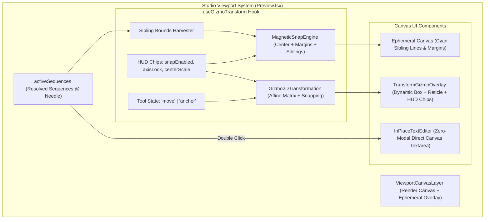

# Master Implementation Plan - Iteration 65: Studio Viewport In-Place Text Editing, Sibling Smart Guides & HUD Anchor Tool

## 1. Executive Summary
Iteration 65 establishes a unified, studio-grade direct-manipulation interaction model within the Studio Viewport. Based on the `/grill-me` alignment, we retire modal-based text input (`InlineTextEditorModal.tsx`) in favor of direct in-place canvas text editing, bridge the smart guide gap by extending `MagneticSnapEngine` to compute snap lines across all visible sibling sequences, introduce an on-canvas Anchor Point Tool with tether line visualization via a dedicated HUD toggle, and provide discoverable HUD status chips that eliminate reliance on obscure hotkeys.

## 2. Trade-off Matrices

| Dimension | Option A: Status Quo (Center Modal + Viewport-Only Snap) | Option B: Full Hotkey Heavy Pro Model (Adobe AE) | Option C: Unified In-Place + HUD Chips Model (Selected) |
|---|---|---|---|
| **Text Editing UX** | Context-breaking modal blocking canvas view | ContentEditable overlay with complex rich text engine | High-performance zero-backdrop styled `textarea` matching exact sequence affine transform |
| **Discoverability** | Low (obscure shortcuts needed) | Very low (memorize Alt/Shift/Ctrl key combinations) | High: Interactive HUD chips with visual toggles + optional hotkey accelerators |
| **Snapping Capability** | Viewport center & safe margins only | Full vector math engine requiring external geometry workers | Pure closed-form dynamic sibling boundary harvesting & magnetic snapping |
| **Anchor Manipulation** | Impossible (reticle is static decoration) | Dedicated Pan Behind tool requiring tool selector toolbar | Contextual `[Tool: Move \| Anchor]` toggle directly on floating HUD badge |

## 3. Mermaid Topology



## 4. Mathematical & Algorithmic Specifications

### 4.1 Sibling Boundary Snapping Math
Given selected bounding box $B_0 = (x_0, y_0, w_0, h_0)$ and sibling boxes $\{B_i = (x_i, y_i, w_i, h_i)\}_{i=1}^N$:
$$\text{Vertical Sibling Guides}: V_i = \{ x_i - w_i/2, \, x_i, \, x_i + w_i/2 \}$$
$$\text{Horizontal Sibling Guides}: H_i = \{ y_i - h_i/2, \, y_i, \, y_i + h_i/2 \}$$
Magnetic snapping threshold $\tau = 0.015$ ($\sim 1.5\%$ of normalized viewport).
For proposed coordinate $x'$, if $\min_{g \in V_i} |x' - g| < \tau$, snap:
$$x_{snapped} = \arg\min_{g \in V_i} |x' - g|$$

### 4.2 Anchor Point / Pivot Displacement
Given normalized object bounding box center $(x_{box}, y_{box})$ and custom anchor $(a_x, a_y)$ where default is $(0.5, 0.5)$:
$$x_{pivot} = x_{box} + (a_x - 0.5) \cdot w_{box}$$
$$y_{pivot} = y_{box} + (a_y - 0.5) \cdot h_{box}$$
Rotation and scaling transformations in `TransformModifierPlugin` evaluate around $(x_{pivot}, y_{pivot})$.

### 4.3 Symmetrical Center Scaling Math
When `centerScale` is active:
$$w_{new} = w_{start} + 2 \cdot \Delta x_{local}$$
$$h_{new} = h_{start} + 2 \cdot \Delta y_{local}$$
The center position $(x_0, y_0)$ remains strictly invariant during scaling.

## 5. Concrete File & Class Signatures

### 5.1 `apps/studio/src/components/preview/InPlaceTextEditor.tsx` [NEW]
```tsx
export interface InPlaceTextEditorProps {
  editingCue: {
    sequenceId: string;
    cueIndex: number;
    text: string;
  } | null;
  selectedSeq: StudioSequence | null;
  bounds: SequenceBounds;
  transform: TransformState;
  canvasWidth: number;
  canvasHeight: number;
  onUpdateText: (text: string) => void;
  onCommit: () => void;
  onCancel: () => void;
}
```

### 5.2 `apps/studio/src/lib/gizmo/Gizmo2DTransformation.ts` [MODIFY]
```typescript
export interface SiblingGuideBox {
  id: string;
  label: string;
  x: number;
  y: number;
  width: number;
  height: number;
}

export class MagneticSnapEngine {
  public static snapWithSiblings(
    x: number,
    y: number,
    width: number,
    height: number,
    siblings: SiblingGuideBox[],
    threshold?: number,
    disabled?: boolean
  ): SnapResult;
}
```

### 5.3 `apps/studio/src/components/preview/useGizmoTransform.ts` [MODIFY]
```typescript
export interface GizmoHUDControls {
  tool: 'move' | 'anchor';
  snapEnabled: boolean;
  axisLock: boolean;
  centerScale: boolean;
  setTool: (t: 'move' | 'anchor') => void;
  setSnapEnabled: (s: boolean) => void;
  setAxisLock: (l: boolean) => void;
  setCenterScale: (c: boolean) => void;
}
```

## 6. Phased Roadmap
- **Phase 1: In-Place On-Canvas Text Editor**: Build `InPlaceTextEditor.tsx`, style multi-line textarea with exact typography, wire into `Preview.tsx`, and retire `InlineTextEditorModal.tsx`.
- **Phase 2: Sibling Smart Guides Math & Snapping**: Extend `MagneticSnapEngine` with `snapWithSiblings`, harvest visible sibling bounds in `useGizmoTransform.ts`, and render dynamic cyan guide lines in `renderGuides`.
- **Phase 3: Interactive Anchor Tool & Tether**: Add anchor drag handle and tether line in `TransformGizmoOverlay.tsx`, wire `anchorPoint` persistence in `useGizmoTransform.ts`.
- **Phase 4: Discoverable HUD Status Chips**: Add `[Tool: Move | Anchor]`, `[Snap: ON/OFF]`, `[Axis: Free/Lock]`, and `[Scale: Corner/Center]` chips to the floating HUD badge.
- **Phase 5: Formal Verification & Testing**: Create `autogenerated-tests/studio_canvas_interaction_suite.test.ts`, verify 0 schema drift, and run production Vite build.

## 7. Formal Verification Matrix (`/autogenerated-tests/`)
- `autogenerated-tests/studio_canvas_interaction_suite.test.ts`:
  - `Sibling Smart Snapping`: verifies snapping against left, center, right of visible sibling.
  - `Anchor Point Pivot Math`: verifies displaced anchor point rotation math.
  - `In-Place Text Editor Commit`: verifies newline preservation and state commit to `IRStateManager`.
  - `HUD Controls & Toggles`: verifies toggle effects on snap and axis constraint.

## 8. Risk & Rollback Mitigations
- **Textarea Focus Bleed**: Ensure `e.stopPropagation()` on the in-place textarea so timeline spacebar or hotkeys do not conflict with text typing.
- **Performance with Many Siblings**: Limit sibling snapping candidate pool to top 20 active visual sequences sorted by z-index to maintain 60 FPS viewport drag fluidity.
- **Zero Schema Drift**: Changes are strictly frontend viewport and gizmo interaction logic; schemas remain 100% compliant.
