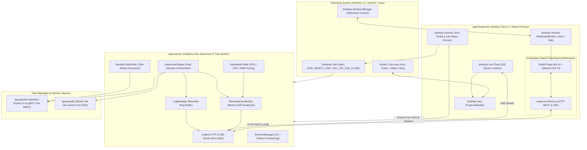
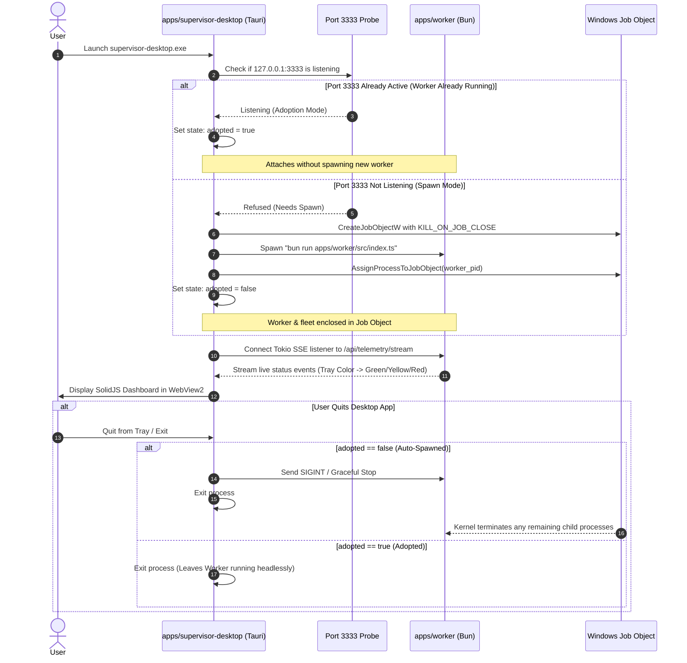

# Master Implementation Plan - Iteration 66: Decouple AI-Supervisor Architecture into Headless Worker Daemon and Tauri 2.x Desktop GUI Host

## 1. Executive Summary

Based on the `/grill-me` architectural alignment, Iteration 66 permanently resolves the Electrobun 2.x platform failure modes on Windows 11 by decoupling the control plane into a high-performance, clean two-tier architecture:

1. **`@acc/worker` (Headless Supervisor & Task Daemon)**:
   - Absorbs the entire supervisor engine (`SupervisorEngine`, `HardwareProfiler`, `RuntimeManager`, `TelemetryEventBroker`, `LogManager`).
   - Runs as a headless Bun daemon on unified port **3333**, serving both REST and SSE telemetry endpoints.
   - Orchestrates the fleet (`python-backend`, `studio`, and task execution).
   - Operates 100% headlessly in Bun, completely free from desktop window or system tray bugs.
2. **`apps/python-backend` (Dedicated Python AI gRPC Service)**:
   - Elevated to a first-class top-level monorepo package at `apps/python-backend` (formerly nested under `apps/ai-supervisor/python-backend`).
   - Serves Kokoro TTS, LLM, and vision models over gRPC on port 50051.
3. **`apps/supervisor-desktop` (Lightweight Tauri 2.x Desktop GUI Host)**:
   - Renamed from `apps/ai-supervisor` to `@acc/supervisor-desktop`.
   - Built with **Tauri 2.x** and Rust to host the SolidJS + Ark UI + Tailwind CSS v4 dashboard.
   - Provides native Windows 11 system tray via `tauri::tray::TrayIconBuilder` with instant dynamic icon color switching (`green`, `yellow`, `red`).
   - Features **Smart Auto-Spawn & Adoption**: Probes port 3333 on startup; if `@acc/worker` is already running, it adopts it; if not, it spawns `@acc/worker` bound to a **Windows Job Object** (`JOB_OBJECT_LIMIT_KILL_ON_JOB_CLOSE`) ensuring zero orphaned processes on exit.
   - Runs a lightweight background Tokio task listening to `http://127.0.0.1:3333/api/telemetry/stream` (SSE) to update the tray icon state in real time, even when the UI window is minimized or closed to tray.

---

## 2. Trade-off Matrices

| Dimension | Monolithic Electrobun App (Status Quo) | Monolithic Tauri App (Full Rust Rewrite) | Decoupled Architecture: Headless Worker + Tauri Host (Selected) |
| :--- | :--- | :--- | :--- |
| **System Tray on Windows 11** | Broken (`E_FAIL 0x80004005` in `libNativeWrapper.dll`) | Working via `tauri::tray::TrayIconBuilder` | **Working via `tauri::tray::TrayIconBuilder`** with Tokio SSE stream listener |
| **Window Compositing** | Invisible window bug; detached launcher message pump | Evergreen WebView2 via Tauri | **Evergreen WebView2** via Tauri; zero invisible window defects |
| **Backend Engine Reuse** | High Bun performance, but trapped inside desktop shell | Requires rewriting ~1,500 lines of TS to Rust (`tonic`, `axum`) | **100% Reuse of existing Bun supervisor code** in `@acc/worker` without rewriting |
| **Daemon Independence** | Cannot run headless supervisor without launching desktop shell | Difficult to run in headless CI or server environments | **Pure Headless Daemon**: `@acc/worker` runs via `bun dev` or CLI; desktop host is optional |
| **Process Teardown & Leaks** | Userspace `taskkill` scripts; leaks processes on hard crash | Windows Job Objects in Rust | **Windows Job Objects** in Tauri Rust auto-reaps `@acc/worker` and child process tree on quit |
| **Telemetry & Ports** | Split between port 3333 (supervisor) and port 4000 (worker) | Single Rust port | **Unified Port 3333**: Consolidates REST, SSE telemetry, and task status into one port |
| **Monorepo Taxonomy** | Confusing: `apps/ai-supervisor` contained Python, Bun, and UI | Clean | **Crystal Clear**: `apps/worker` (backend), `apps/python-backend` (AI), `apps/supervisor-desktop` (GUI) |

---

## 3. Mermaid Topology

### 3.1 Decoupled System Architecture



### 3.2 Smart Auto-Spawn & Adoption Lifecycle



---

## 4. Mathematical & Algorithmic Specifications

### 4.1 Exponential Backoff with Uniform Jitter for Crash Recovery
When a supervised service (`python-backend`, `studio`) crashes, the engine in `@acc/worker` calculates delay $T_{\text{backoff}}(n)$:
$$T_{\text{backoff}}(n) = \min\left(T_{\max}, \; T_{\text{base}} \cdot 2^n\right) + \mathcal{U}(-J, +J)$$
- $T_{\text{base}} = 1000\,\text{ms}$, $T_{\max} = 30\,000\,\text{ms}$, $J = 250\,\text{ms}$, $n$ is consecutive failure count.
- If continuous healthy runtime reaches $60\,\text{s}$, $n \leftarrow 0$.
- If $n \ge 5$ within $60\,\text{s}$, transition to `CRASH_LOOP` $\implies$ Tray state $\leftarrow$ `Red`.

### 4.2 Bounded Circular Log Ring Buffer
Ring buffer capacity $C = 1000$ per service:
$$\text{push}(e) \implies \begin{cases}
\mathcal{B}_s.\text{pop\_front}(), & \text{if } |\mathcal{B}_s| = C \\
\mathcal{B}_s.\text{push\_back}(e), & \text{otherwise}
\end{cases}$$
Zero heap memory leaks; memory consumption strictly bounded to $< 500\,\text{KB}$ per service.

### 4.3 Safe VRAM Allocation & Hardware Tier Classification
$$\text{VRAM}_{\text{available}} = \max\left(0, \; \text{VRAM}_{\text{free}} - \text{VRAM}_{\text{headroom}}\right)$$
$$\text{VRAM}_{\text{headroom}} = \max\left(1024\,\text{MB}, \; 0.15 \times \text{VRAM}_{\text{total}}\right)$$

**Tier Resolution Function**:
$$\text{Tier}(\text{GPU}, \text{RAM}) = \begin{cases}
\text{ULTRA}, & \text{VRAM}_{\text{total}} \ge 16\,\text{GB} \land \text{CUDA} \\
\text{HIGH}, & \text{VRAM}_{\text{total}} \ge 8\,\text{GB} \lor (\text{AppleSilicon} \land \text{RAM} \ge 32\,\text{GB}) \\
\text{BALANCED}, & \text{VRAM}_{\text{total}} \ge 4\,\text{GB} \lor (\text{AppleSilicon} \land \text{RAM} \ge 16\,\text{GB}) \\
\text{LOW}, & \text{otherwise (CPU Fallback)}
\end{cases}$$

### 4.4 Windows Job Object Kernel Configuration
```rust
// In apps/supervisor-desktop/src-tauri/src/process.rs
JOBOBJECT_EXTENDED_LIMIT_INFORMATION {
    BasicLimitInformation: JOBOBJECT_BASIC_LIMIT_INFORMATION {
        LimitFlags: JOB_OBJECT_LIMIT_KILL_ON_JOB_CLOSE | JOB_OBJECT_LIMIT_BREAKAWAY_OK,
    }
}
```
Ensures that if the desktop host terminates or is killed via Task Manager, the Windows kernel automatically terminates the spawned worker process tree.

---

## 5. Concrete File, Struct, and Class Signatures

### 5.1 Monorepo Structure

```
apps/
├── python-backend/                     # Elevated top-level Python AI gRPC server
│   ├── pyproject.toml
│   ├── uv.lock
│   ├── src/
│   │   ├── server.py                   # gRPC Port 50051
│   │   └── services/
│   └── tests/
├── worker/                             # Headless Supervisor & Task Worker Daemon
│   ├── package.json
│   ├── tsconfig.json
│   └── src/
│       ├── index.ts                    # Entrypoint: bootstraps worker & supervisor
│       ├── supervisor/                 # Migrated supervisor engine
│       │   ├── SupervisorEngine.ts
│       │   ├── HardwareProfiler.ts
│       │   ├── RuntimeManager.ts
│       │   ├── configStore.ts
│       │   ├── portScanner.ts
│       │   ├── IProcessRunner.ts
│       │   ├── LogManager.ts
│       │   ├── server/
│       │   │   ├── HttpServer.ts       # Unified HTTP/SSE server on Port 3333
│       │   │   └── routes/
│       │   └── telemetry/
│       │       ├── TelemetryEventBroker.ts
│       │       └── OSProcessSampler.ts
│       ├── hypervisor/
│       ├── poller/
│       └── tasks/
└── supervisor-desktop/                 # Lightweight Tauri 2.x Desktop GUI Host
    ├── package.json                    # @acc/supervisor-desktop
    ├── vite.config.ts                  # Vite + SolidJS + Tailwind CSS v4
    ├── tsconfig.json
    ├── src/
    │   └── ui/                         # Existing SolidJS dashboard (App.tsx, stores, etc.)
    └── src-tauri/
        ├── Cargo.toml                  # tauri 2, tokio, reqwest, eventsource-client
        ├── tauri.conf.json             # Window config, tray config, bundle specs
        ├── build.rs
        ├── capabilities/
        │   └── default.json
        ├── icons/
        │   ├── icon.ico
        │   ├── tray-green.ico
        │   ├── tray-yellow.ico
        │   └── tray-red.ico
        └── src/
            ├── main.rs                 # Tauri application entrypoint
            ├── lib.rs                  # Setup, window events, tray registration
            ├── tray.rs                 # TrayIconBuilder & dynamic color switching
            ├── sse.rs                  # Tokio SSE listener to port 3333
            └── process.rs              # Smart port 3333 probe & Windows Job Object
```

---

## 6. Phased Roadmap

### Phase 1: Elevate `apps/python-backend` to Top-Level
- Relocate `apps/ai-supervisor/python-backend` $\to$ `apps/python-backend`.
- Update references in `packages/core/src/ipc/IPCFacade.ts` and documentation to point to `apps/python-backend`.
- Verify `apps/python-backend` tests pass via `uv run pytest`.

### Phase 2: Migrate Supervisor Engine into `@acc/worker` on Port 3333
- Move supervisor subsystems from `apps/ai-supervisor/src/bun/` into `apps/worker/src/supervisor/`.
- Update `SupervisorEngine` paths to resolve `apps/python-backend` and `apps/studio`.
- Consolidate telemetry on port 3333: Retire standalone port 4000 server in favor of `HttpServer` on port 3333.
- Update `apps/worker/src/index.ts` to boot the unified supervisor engine alongside task poller.
- Verify `bun run apps/worker/src/index.ts` starts cleanly and serves `http://127.0.0.1:3333/api/status`.

### Phase 3: Setup `apps/supervisor-desktop` with Tauri 2.x & Vite Pipeline
- Rename `apps/ai-supervisor` to `apps/supervisor-desktop` (package: `@acc/supervisor-desktop`).
- Prune all Electrobun files (`electrobun.config.ts`, `.hutch/`, `.cottontail-tmp/`, `src/bun/`).
- Initialize `src-tauri` with `Cargo.toml`, `tauri.conf.json`, and capability manifests.
- Setup `vite.config.ts` using `vite-plugin-solid` and `@tailwindcss/vite` compiling `src/ui/` to `dist/`.
- Verify clean compilation with `pnpm --filter @acc/supervisor-desktop build`.

### Phase 4: Implement Native Win11 Tray & Dynamic SSE Color Sync
- Embed tray icons (`tray-green.ico`, `tray-yellow.ico`, `tray-red.ico`) in Rust binary.
- Build native system tray via `tauri::tray::TrayIconBuilder` with context menu ("Open Dashboard", "Purge All VRAM", "Restart Services", "Quit").
- Implement `sse.rs`: Tokio background task connecting to `http://127.0.0.1:3333/api/telemetry/stream` to update the tray icon color in real time.
- Implement window close interception (`prevent_close` $\to$ `window.hide()`) and left-click tray restore.

### Phase 5: Implement Smart Auto-Spawn & Adoption with Windows Job Object
- Implement `process.rs` in Rust:
  - On startup, probe TCP port 3333.
  - If open: Set `adopted = true`, attach SSE listener immediately.
  - If closed: Set `adopted = false`, create Windows Job Object with `JOB_OBJECT_LIMIT_KILL_ON_JOB_CLOSE`, spawn `bun run apps/worker/src/index.ts`, assign PID to Job Object, await port 3333 ready.
- On desktop quit: If `adopted == false`, terminate worker cleanly; if `adopted == true`, leave worker running.

### Phase 6: Monorepo Integration, Root Scripts & Verification
- Update root `package.json` scripts:
  - `"worker:dev": "bun --cwd apps/worker dev"`
  - `"desktop:dev": "pnpm --filter @acc/supervisor-desktop dev"`
  - `"desktop:build": "pnpm --filter @acc/supervisor-desktop build"`
  - `"supervisor:dev": "pnpm desktop:dev"`
- Verify end-to-end launch:
  - Running `pnpm supervisor:dev` opens the native desktop app with WebView2.
  - System tray icon appears on Windows 11 taskbar and turns green when services are ready.
  - SolidJS dashboard displays live telemetry and fleet cards.
  - Closing desktop app terminates spawned worker with 0 orphaned processes.

---

## 7. Formal Verification Matrix (`/autogenerated-tests/`)

| Test ID | Test Target | Verification Command / Harness | Acceptance Criteria |
| :--- | :--- | :--- | :--- |
| `VERIF-PY-01` | Top-level Python Backend | `cd apps/python-backend && uv run pytest` | All tests pass; gRPC server starts on 50051 |
| `VERIF-WORKER-01` | Headless Worker Supervisor | `bun run apps/worker/src/index.ts` | Boots on port 3333; `/api/status` returns valid JSON |
| `VERIF-TRAY-01` | Win11 System Tray Creation | `cargo test -p supervisor-desktop-core test_tray` | Tray created without `E_FAIL`; visible in Windows 11 taskbar |
| `VERIF-SSE-01` | Rust Tray SSE Sync | `cargo test -p supervisor-desktop-core test_sse_sync` | Rust SSE listener receives fleet status and triggers icon swap |
| `VERIF-JOB-01` | Job Object Process Teardown | `cargo test -p supervisor-desktop-core test_job_cleanup` | Killing desktop host terminates spawned child worker processes |
| `VERIF-UI-01` | SolidJS UI Vite Build | `pnpm --filter @acc/supervisor-desktop build` | Vite produces `dist/` cleanly; WebView2 loads UI without error |

---

## 8. Risk and Rollback Mitigations

| Risk | Impact | Probability | Mitigation Strategy |
| :--- | :--- | :--- | :--- |
| **Port 3333 collision** | Worker cannot bind | Low | Port scanner dynamically auto-increments port (3334, 3335...) if 3333 is occupied by unrelated process |
| **Bun binary not in PATH** | Desktop host cannot auto-spawn worker | Low | `process.rs` checks PATH, `~/.bun/bin/bun`, and standard installation paths with helpful error dialog |
| **Antivirus false positive** | Executable blocked | Medium | Populate complete PE resource metadata (publisher, version, description) in `tauri.conf.json` |
| **Rollback Plan** | Critical regressions | Low | Rollback branch point tagged at commit `f360902b`; changes cleanly partitioned across packages |
