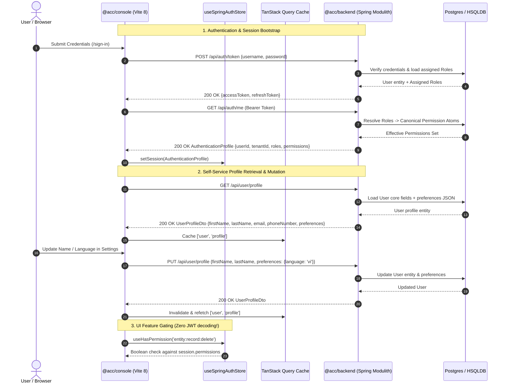

# Master Implementation Plan - Iteration 67
# Clean Cross-Stack Authorization, AuthenticationProfile & User Profile Architecture

## 1. Executive Summary

### 1.1 Problem Statement & Redesign Mandate
The existing authorization implementations across `@acc/console` (React 19 / Vite 8) and `@acc/backend` (Java 21 / Spring Modulith) suffer from architectural fragmentation, legacy aliases, and client-side anti-patterns:
1. **Ad-Hoc Naming & Legacy Aliases**: The backend mixes uppercase underscore tokens (`METADATA_RECORD_READ`), domain strings (`metadata:record:read`), and legacy SpEL expressions, while the console uses colon-delimited atoms (`entity:record:read`).
2. **Coupling Roles to Endpoints**: Endpoints frequently check `hasRole('ADMIN')` or `hasRole('SYSTEM_ROOT')` rather than granular permission capabilities. This violates NIST RBAC Level 2 standards and prevents the dynamic creation of custom roles.
3. **Client-Side JWT Decoding Anti-Pattern**: The browser decodes raw Base64 JWT payloads to inspect roles, coupling the client to token serialization internals, bloating HTTP request headers, and failing under `HttpOnly` cookie deployments.
4. **Dual Auth Stores & Missing User Profile API**: Console maintains both a dormant `useAuthStore` and an active `useSpringAuthStore`. The user profile form (`profile-form.tsx`) is mock-only without real backend persistence.
5. **Outdated Sandbox Roles**: `@acc/sandbox` emits outdated roles (`ROLE_USER`, `ROLE_ADMIN`, `ROLE_CREATOR`) and lacks session and profile mock handlers.

### 1.2 Target Architectural Vision (Agreed Design Tree)
- **Separated Auth & Profile Contracts**:
  - `GET /api/auth/me`: Returns `AuthenticationProfile` (security credentials: `userId`, `username`, `tenantId`, `roles`, `permissions`, `activeFeatures`).
  - `GET /api/user/profile` & `PUT /api/user/profile`: Self-service personal profile management (`firstName`, `lastName`, `email`, `phoneNumber`, `preferences`).
- **Clean Canonical Taxonomy (Zero Legacy Aliases)**:
  - Purge all legacy string constants (`METADATA_RECORD_READ`, `METADATA_SCHEMA_WRITE`, `metadata:record:read`) across all controllers and services.
  - Endpoints evaluate canonical `<plane>:<resource>:<action>` atoms only via `@PreAuthorize("hasAuthority(...)")`.
- **Strict Role vs. Permission Separation (NIST RBAC Level 2)**:
  - **Roles** represent *identity groups*:
    - Sovereign: `ROLE_SYSTEM_ROOT`, `ROLE_SYSTEM_SUPPORT`.
    - Tenant: `ROLE_WORKSPACE_OWNER`, `ROLE_OPERATIONS_MANAGER`, `ROLE_STANDARD_MEMBER`, `ROLE_AUDITOR`.
  - **Permissions** represent *atomic actions* (`entity:record:create`, `platform:fleet:read`).
  - API endpoints and UI action gates evaluate Permissions exclusively (`hasAuthority(...)`). Roles only bundle permissions in the database/RBAC matrix.
- **Quorum Streamlined**: "Quorum" two-person approval roles and permissions are completely eliminated, simplifying sovereign administration.
- **Opaque Token & Reactive Session Hydration**:
  - Browser treats access token as an opaque credential (zero `atob` JWT cracking).
  - Hydrates `AuthenticationProfile` into `useSpringAuthStore`.
  - Legacy `useAuthStore` is completely deleted.
  - Role modifications in RBAC Matrix Studio trigger reactive React Query invalidation of `['auth', 'me']`.
- **100% Offline Sandbox Parity**: `@acc/sandbox` serves identical `AuthenticationProfile` and `UserProfileDto` mock contracts.

---

## 2. System-Wide Canonical Permission Atom Catalog

All permissions adhere strictly to the format: `<plane>:<resource>:<action>` (7 orthogonal planes):

| Plane | Canonical Atom | Description | Default Clearance |
| :--- | :--- | :--- | :--- |
| **Platform** | `platform:fleet:read` | Read sovereign fleet registry and tenant diagnostics | Sovereign Tier 2 |
| | `platform:fleet:mutate` | Provision, suspend, or update fleet tenant configuration | Sovereign Tier 4 |
| | `platform:fleet:trip_circuit` | Emergency systemic circuit breaker trip | Sovereign Tier 4 (Dangerous) |
| | `platform:tenant:assume` | Ephemeral Assume-Tenant session delegation | Sovereign Tier 3 (Dangerous) |
| | `platform:tenant:purge` | Permanent cryptographic tenant data purge | Sovereign Tier 4 (Dangerous) |
| | `platform:quotas:manage` | Override tenant quota dials (schemas, records, burst) | Sovereign Tier 3 |
| | `platform:roles:manage` | Create, modify, and assign global RBAC roles and matrices | Sovereign Tier 4 |
| | `platform:users:manage` | Cross-tenant user directory lookup and credential lockdown | Sovereign Tier 4 |
| | `platform:dlq:manage` | Inspect, replay, and discard dead-letter queue records | Sovereign Tier 3 |
| | `platform:workers:manage` | Scale and manage distributed media worker pool | Sovereign Tier 3 |
| **Metadata** | `metadata:schema:read` | Read dynamic entity types and attribute definitions | Community / All |
| | `metadata:schema:write` | Author, edit, reorder, and archive entity types and attributes | Operations / Owner |
| | `metadata:blueprint:package` | Package catalog blueprint manifests | Sovereign Tier 4 |
| | `metadata:blueprint:provision` | Provision catalog blueprint into tenant workspace | Operations / Owner |
| | `metadata:cache:evict` | Invalidate distributed L1/L2 metadata schema caches | Sovereign Tier 3 |
| **Entity Records** | `entity:record:read` | Query, filter, and seek dynamic entity records | Community / All |
| | `entity:record:create` | Insert new dynamic entity record | Standard / Operator |
| | `entity:record:update` | Update existing dynamic entity record | Standard / Operator |
| | `entity:record:delete` | Soft-delete dynamic entity record | Standard / Operator |
| | `entity:record:export` | Bulk export dynamic entity records | Operations / Owner |
| **Workspace** | `workspace:settings:read` | View workspace profile and settings | Community / All |
| | `workspace:settings:manage` | Update workspace branding, quotas, integrations | Workspace Owner |
| | `workspace:members:read` | View workspace members and assigned roles | Community / All |
| | `workspace:members:manage` | Invite members, revoke access, delegate tenant roles | Workspace Owner |
| **Workflow** | `workflow:definition:read` | Inspect workflow definitions and step DAGs | Community / All |
| | `workflow:definition:manage` | Author and publish workflow definitions | Operations / Owner |
| | `workflow:execution:read` | View execution runs, step states, and trace logs | Community / All |
| | `workflow:execution:submit` | Trigger or submit workflow execution | Standard / Operator |
| | `workflow:approval:execute` | Approve or reject pending workflow task approval | Standard / Operator |
| **Audit** | `audit:log:read` | Read tenant record change deltas and timeline | Auditor / Owner |
| | `audit:hash:verify` | Verify cryptographic SHA-256 forward hash chains | Auditor / Sovereign |
| | `audit:compliance:export` | Export signed tamper-evident compliance bundles | Auditor / Sovereign |
| **Billing** | `billing:subscription:read` | View subscription plan, usage, and invoices | Workspace Owner |
| | `billing:subscription:upgrade` | Upgrade plan tier and manage payment methods | Workspace Owner |
| | `billing:tier:override` | Sovereign manual tier override and feature flags | Sovereign Tier 4 |
| | `billing:invoice:adjust` | Issue manual credits and dispute adjustments | Sovereign Tier 3 |

---

## 3. Trade-Off Matrices & Architectural Decisions

| Decision Dimension | Evaluated Approaches | Selected Approach & Rationale |
| :--- | :--- | :--- |
| **Auth vs. Profile Boundary** | A) Monolithic `/api/auth/me`<br/>B) Separated `/api/auth/me` + `/api/user/profile` | **Option B (Separated)**: Single Responsibility Principle. Session credentials update on role changes; profile data updates on user edits. Zero payload bloat. |
| **Role vs. Permission Enforcement** | A) `@PreAuthorize("hasRole('ADMIN')")`<br/>B) `@PreAuthorize("hasAuthority('entity:record:read')")` | **Option B (Permissions only)**: NIST RBAC Level 2. Endpoints require functional capabilities. Roles are never hardcoded into business logic. Custom roles work automatically. |
| **Quorum Governance** | A) Keep Quorum plane & roles<br/>B) Remove Quorum entirely | **Option B (Remove Quorum)**: Streamlines the governance model. Removes unnecessary complexity and dead roles (`ROLE_SYSTEM_VERIFIER`, `ROLE_SYSTEM_APPROVER`). |
| **Client Session Hydration** | A) Decode JWT in Browser (`atob`)<br/>B) `GET /api/auth/me` AuthenticationProfile | **Option B (`/api/auth/me`)**: Clean enterprise architecture. Zero JWT bloat in HTTP headers. Compatible with `HttpOnly` secure cookies. |
| **Profile Data Model** | A) Columns only<br/>B) Core columns + JSON preferences | **Option B (Core + JSON)**: High flexibility. Core identity (`firstName`, `lastName`, `email`, `phoneNumber`) strongly typed in SQL; UI preferences (`language`, `avatarUrl`, `bio`) stored flexibly. |

---

## 4. Mermaid Topology & Data Flow



---

## 5. Mathematical & Algorithmic Specifications

### 5.1 RBAC Assignment & Effective Permission Closure
Let $R$ be the set of canonical roles:
$$R = \{ \text{ROLE\_SYSTEM\_ROOT}, \text{ROLE\_SYSTEM\_SUPPORT}, \text{ROLE\_WORKSPACE\_OWNER}, \text{ROLE\_OPERATIONS\_MANAGER}, \text{ROLE\_STANDARD\_MEMBER}, \text{ROLE\_AUDITOR} \}$$

Let $P$ be the universe of canonical permission atoms across the 7 planes:
$$P = P_{platform} \cup P_{metadata} \cup P_{entity} \cup P_{workspace} \cup P_{workflow} \cup P_{audit} \cup P_{billing}$$

The assignment function $f_{perm}: R \to \mathcal{P}(P)$ maps each role to its discrete set of permissions:
$$f_{perm}(\text{ROLE\_STANDARD\_MEMBER}) = \{ \text{metadata:schema:read}, \text{entity:record:read}, \text{entity:record:create}, \text{entity:record:update}, \text{workspace:settings:read}, \text{workflow:execution:submit} \}$$

For subject $S$ with assigned roles $R_S \subseteq R$:
$$\text{EffectivePermissions}(S) = \bigcup_{r \in R_S} f_{perm}(r) \cup \text{DirectGrants}(S)$$

### 5.2 Deterministic Permission Check
The evaluation predicate for a required atom $p \in P$ is:
$$\text{Authorized}(S, p) \iff p \in \text{EffectivePermissions}(S)$$
Zero magic bypasses, zero implicit wildcards, full audit traceability.

---

## 6. Concrete File & Class Signatures

### 6.1 Shared Contracts (`packages/client/src/contracts/auth.ts` & `users.ts`)
```typescript
export type CanonicalRole =
  | 'ROLE_SYSTEM_ROOT'
  | 'ROLE_SYSTEM_SUPPORT'
  | 'ROLE_WORKSPACE_OWNER'
  | 'ROLE_OPERATIONS_MANAGER'
  | 'ROLE_STANDARD_MEMBER'
  | 'ROLE_AUDITOR';

export interface AuthenticationProfile {
  userId: string;
  username: string;
  tenantId: string;
  isSovereign: boolean;
  roles: CanonicalRole[];
  permissions: string[];
  activeFeatures: string[];
}

export interface UserPreferences {
  language?: string;
  avatarUrl?: string;
  bio?: string;
  theme?: 'light' | 'dark' | 'system';
  [key: string]: unknown;
}

export interface UserProfileDto {
  userId: string;
  username: string;
  firstName: string;
  lastName: string;
  email: string;
  phoneNumber?: string;
  preferences: UserPreferences;
}

export interface UpdateUserProfileRequest {
  firstName: string;
  lastName: string;
  email: string;
  phoneNumber?: string;
  preferences?: UserPreferences;
}
```

### 6.2 Backend Session & Profile Controllers (`apps/backend/acc-fw`)
```java
// AuthenticationController.java
@GetMapping("/me")
@PreAuthorize("isAuthenticated()")
public ResponseEntity<ResponseWrapper<ContextHeader, AuthenticationProfileDto>> getCurrentSession(
        @AuthenticationPrincipal UserDetailsImpl userDetails);

// UserProfileController.java
@RestController
@RequestMapping("/api/v1/user/profile")
public class UserProfileController {
    @GetMapping
    @PreAuthorize("isAuthenticated()")
    public ResponseEntity<ResponseWrapper<ContextHeader, UserProfileDto>> getProfile(
            @AuthenticationPrincipal UserDetailsImpl userDetails);

    @PutMapping
    @PreAuthorize("isAuthenticated()")
    public ResponseEntity<ResponseWrapper<ContextHeader, UserProfileDto>> updateProfile(
            @Valid @RequestBody UpdateUserProfileRequest request,
            @AuthenticationPrincipal UserDetailsImpl userDetails);
}
```

### 6.3 Backend Canonical Permissions Enum (`com.acc.core.constant.CanonicalPermissions`)
```java
package com.acc.core.constant;

public final class CanonicalPermissions {
    private CanonicalPermissions() {}

    // Platform
    public static final String PLATFORM_FLEET_READ = "platform:fleet:read";
    public static final String PLATFORM_FLEET_MUTATE = "platform:fleet:mutate";
    public static final String PLATFORM_TENANT_ASSUME = "platform:tenant:assume";
    public static final String PLATFORM_QUOTAS_MANAGE = "platform:quotas:manage";
    public static final String PLATFORM_ROLES_MANAGE = "platform:roles:manage";
    public static final String PLATFORM_USERS_MANAGE = "platform:users:manage";
    public static final String PLATFORM_DLQ_MANAGE = "platform:dlq:manage";

    // Metadata
    public static final String METADATA_SCHEMA_READ = "metadata:schema:read";
    public static final String METADATA_SCHEMA_WRITE = "metadata:schema:write";

    // Entity Records
    public static final String ENTITY_RECORD_READ = "entity:record:read";
    public static final String ENTITY_RECORD_CREATE = "entity:record:create";
    public static final String ENTITY_RECORD_UPDATE = "entity:record:update";
    public static final String ENTITY_RECORD_DELETE = "entity:record:delete";
    public static final String ENTITY_RECORD_EXPORT = "entity:record:export";

    // Workspace, Workflow, Audit, Billing...
}
```

### 6.4 Console Session Store (`apps/console/src/features/spring-auth/store.ts`)
```typescript
export interface AuthState {
  accessToken: string | null;
  refreshToken: string | null;
  session: AuthenticationProfile | null;
  currentTenantId: string | null;
  isAuthenticated: boolean;
  isHydrating: boolean;
  setSession: (session: AuthenticationProfile) => void;
  setTokens: (accessToken: string, refreshToken: string) => void;
  clearTokens: () => void;
}
```

---

## 7. Phased Roadmap

### Phase 1: Shared Canonical Contracts (`packages/client` & `acc-core`)
- Define `CanonicalPermissions` and `CanonicalRoles` in `com.acc.core.constant`.
- Export `AuthenticationProfile`, `UserProfileDto`, and `CanonicalRole` in `packages/client`.

### Phase 2: Backend Session & Profile APIs
- In `AuthenticationController.java`: Implement `GET /api/auth/me` returning `AuthenticationProfileDto`.
- In `acc-fw`: Create `UserProfileController.java` (`GET /api/v1/user/profile`, `PUT /api/v1/user/profile`) and backing `UserProfileService`.
- In `User.java`: Support JSON preferences column/field mapping.

### Phase 3: Backend Controller Normalization (Clean Canonical Atoms)
- Purge legacy string constants (`METADATA_RECORD_READ`, `METADATA_SCHEMA_WRITE`, `metadata:record:read`).
- Update `CompositeEntityController.java` to `@PreAuthorize("hasAuthority('entity:record:read')")`.
- Update `MetadataController.java` to `@PreAuthorize("hasAuthority('metadata:schema:read')")` and `@PreAuthorize("hasAuthority('metadata:schema:write')")`.
- Update `WorkspaceController.java` to `@PreAuthorize("hasAuthority('workspace:settings:manage')")`.
- Remove Quorum roles (`ROLE_SYSTEM_VERIFIER`, `ROLE_SYSTEM_APPROVER`) from `SystemFleetService.java`.

### Phase 4: Console Session Hydration & User Profile Integration
- In `apps/console/src/features/spring-auth/store.ts`: Store `session: AuthenticationProfile`.
- In `apps/console/src/features/spring-auth/hooks/use-auth-hydration.ts`: Hydrate `session` on launch via `GET /api/auth/me`.
- In `apps/console/src/features/system/hooks/use-has-permission.ts`: Read `session` directly from `useSpringAuthStore`.
- Delete `apps/console/src/stores/auth-store.ts` and refactor all lingering callers.
- Wire `apps/console/src/features/settings/profile/profile-form.tsx` to `GET` and `PUT /api/v1/user/profile`.

### Phase 5: Unified Sandbox Platform Alignment
- In `packages/sandbox/src/handlers/auth-sandbox-handler.ts`:
  - Implement `/auth/me` handler returning canonical `AuthenticationProfile` for active persona.
  - Implement `/user/profile` handler returning mock `UserProfileDto`.
- Align `apps/console/src/core/sandbox/store/sandbox-store.ts` personas with canonical catalog.

### Phase 6: Verification & Zero-Regression Testing
- Backend unit and Spring security sliced integration tests in `apps/backend/acc-fw`.
- Console Vitest suites verifying reactive permission checks in both live and sandbox modes.
- Autogenerated integration test in `/autogenerated-tests/`.

---

## 8. Formal Verification Matrix

| Test Suite / Target | Verification Scope | Assertions / Invariants |
| :--- | :--- | :--- |
| `AuthenticationControllerTest.java` | Session profile endpoint (`/api/auth/me`) | Asserts authenticated caller receives valid `AuthenticationProfileDto` with roles and canonical atoms. |
| `UserProfileControllerTest.java` | Profile read & mutation (`/api/v1/user/profile`) | Verifies user can read and update their own name, email, and preferences. |
| `CompositeEntityControllerSecurityTest.java` | Entity record PreAuthorize gates | Verifies `entity:record:read` allows read, `entity:record:delete` allows delete; non-permitted callers receive 403. |
| `MetadataControllerSecurityTest.java` | Metadata schema PreAuthorize gates | Verifies `metadata:schema:read` and `metadata:schema:write` enforce strict method security. |
| `use-has-permission.test.ts` | Console reactive permission resolution | Asserts `useHasPermission` checks against `session.permissions`; tests sandbox persona switching. |
| `auth-sandbox-handler.test.ts` | Sandbox mock engine | Asserts `/auth/me` and `/user/profile` return canonical profiles matching production structure. |

---

## 9. Risk & Rollback Mitigations

- **Risk 1: Client Startup Latency (Extra `/api/auth/me` Call)**:
  - *Mitigation*: Login response returns `user: AuthenticationProfile` immediately, avoiding the extra network hop on initial sign-in. The `/me` call is only used during page reloads/hydration and is cached via React Query.
- **Risk 2: Profile Update Form Invalidation**:
  - *Mitigation*: Updating `PUT /api/v1/user/profile` immediately updates the TanStack Query cache key `['user', 'profile']`, propagating instantly to topbar and settings.
