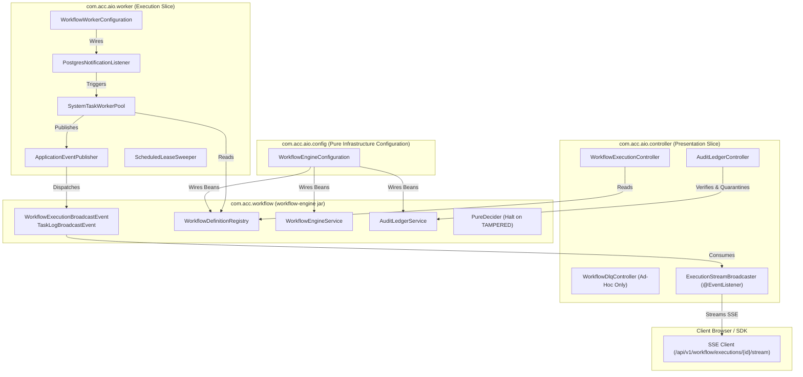

# Master Implementation Plan - Iteration 69
# Backend Hardening: Spring Modulith Boundary Enforcement, Workflow Engine Durability & Complete Canonical Authorization

## 1. Executive Summary

### 1.1 Problem Statement & Background
Following the completion of client-side authorization safeguards and sandbox persona synchronization across `@acc/console` and `@acc/sandbox`, the backend (`apps/api`) has three foundational architectural challenges:
1. **Spring Modulith Boundary Violations (Track 1)**:
   - Running `pnpm --filter @acc/api test:modulith` fails with `org.springframework.modulith.core.Violations`.
   - Cyclic dependency between slices: `com.acc.aio.config` <-> `com.acc.aio.worker` <-> `com.acc.aio.controller`.
   - `SystemTaskWorkerPool` directly couples to `ExecutionStreamBroadcaster` in the presentation/controller slice.
   - `WorkflowDefinitionRegistry` and `ScheduledLeaseSweeper` are defined as nested static inner classes inside `@Configuration WorkflowEngineConfiguration`, creating an inverted dependency where workers and controllers depend on configuration.
   - `WorkflowEngineConfiguration` instantiates `PostgresNotificationListener`, creating a reverse dependency on the worker slice.
2. **Workflow Engine Durability & Strict Audit Quarantine (Track 2)**:
   - `AuditLedgerService` was not declared as a `@Bean` in `WorkflowEngineConfiguration`, and lacks an exposed REST verification endpoint (`/api/v1/workflow/audit/{workflowId}/verify`).
   - Broken audit chains must strictly enforce tamper quarantine: marking workflow status as `TAMPERED` in `WorkflowExecutionStatus`, immediately halting all active execution, canceling in-flight task leases, and returning HTTP 409 Conflict.
   - Rename `WorkflowStatus` to `WorkflowExecutionStatus` to clearly distinguish execution instance statuses from definition version statuses (`WorkflowVersionStatus`).
   - Bulk DLQ operations are completely eliminated: dead-letter handling remains strictly ad-hoc per task (`/{id}/replay` and `DELETE /{id}`) to enforce deliberate operator scrutiny.
3. **Canonical RBAC/ReBAC Controller Incomplete Migration (Track 3)**:
   - Despite Iteration 67 establishing NIST RBAC Level 2 canonical `<plane>:<resource>:<action>` permissions, multiple controllers across `acc-fw` and `acc-ms-aio` retain hardcoded `or hasRole('ADMIN')`, `ROLE_SYSTEM_ROOT`, `ROLE_SYSTEM_SUPPORT`, and `ROLE_SYSTEM_CUSTODIAN` in `@PreAuthorize`.
   - In `TenantProvisioningController`, `@PreAuthorize` annotations are commented out entirely.
   - Redundant aliases (`platform:quotas:override`, `platform:users:lock`) remain in `SystemFleetController`.

### 1.2 Target Architectural Vision
1. **Zero-Violation Spring Modulith**:
   - Relocate `WorkflowDefinitionRegistry` into the clean domain layer (`com.acc.workflow.application.WorkflowDefinitionRegistry` in `workflow-engine`).
   - Extract `ScheduledLeaseSweeper` into `com.acc.aio.worker.ScheduledLeaseSweeper`.
   - Configure worker components (`PostgresNotificationListener`) directly within the worker slice via `WorkflowWorkerConfiguration`, freeing `com.acc.aio.config` from any worker dependencies.
   - Decouple `SystemTaskWorkerPool` from `ExecutionStreamBroadcaster` via in-memory Spring domain events (`WorkflowExecutionBroadcastEvent`, `TaskLogBroadcastEvent`), consumed via `@EventListener` using Java 21 Loom virtual threads.
2. **Hardened Workflow Decider & Immediate Execution Freeze**:
   - Rename `WorkflowStatus` $\to$ `WorkflowExecutionStatus` and add `TAMPERED`.
   - Declare `@Bean public AuditLedgerService auditLedgerService()` in `WorkflowEngineConfiguration`.
   - Implement `AuditLedgerController` exposing `/api/v1/workflow/audit/{workflowId}/verify` with SHA-256 chain validation. On failure, quarantine workflow status to `TAMPERED`, cancel in-flight tasks, and return HTTP 409 Conflict.
   - In `PureDecider`, immediately halt execution if `status == TAMPERED`.
   - Maintain ad-hoc only DLQ operations (`replay` and `discard` per single ID) protected by `platform:dlq:manage`.
3. **100% Canonical Method Security**:
   - Purge all `hasRole('ADMIN')` and hardcoded role checks from `@PreAuthorize` in all backend controllers.
   - Purge legacy aliases (`platform:quotas:override`, `platform:users:lock`) in favor of canonical `platform:quotas:manage` and `platform:users:manage`.
   - Wire `metadata:schema:read` on blueprint catalog lookup and `metadata:blueprint:provision` on tenant provisioning in `TenantProvisioningController`.
   - Rely solely on the database RBAC matrix and `CustomUserDetailsService` / `SandboxUserSeeder` for role-to-permission resolution.

---

## 2. Trade-Off Matrices

| Dimension | Option A: In-Place Package Bypasses (`@NamedInterface` / Suppress) | Option B: Event-Driven Decoupling + Domain Registry Extraction (Selected) | Option C: Monolithic Merge (Single Package) |
| :--- | :--- | :--- | :--- |
| **Architectural Purity** | Low (masks coupling) | **High (strict hexagonal & Spring Modulith boundaries)** | Very Low (destroys modularity) |
| **Coupling** | Worker remains coupled to SSE presentation | **Zero coupling (worker publishes domain events; controller listens)** | Maximum coupling |
| **Testability** | Unit tests must mock complex UI emitter classes | **Unit tests pass standard `ApplicationEventPublisher` (lambda/mock)** | Monolithic context required |
| **Modulith Verification** | Fragile suppression | **100% Green with zero violations** | Bypasses modulith rules |

| Dimension | Option A: Hardcoded `hasRole('ADMIN')` & Aliases | Option B: NIST RBAC Level 2 Canonical Atoms Only (Selected) | Option C: Dynamic SpEL Expressions |
| :--- | :--- | :--- | :--- |
| **Security Standards** | Violates NIST RBAC Level 2; breaks custom roles | **Strict NIST Level 2; endpoints check canonical permissions only** | High runtime overhead, error-prone |
| **Custom Role Support** | Impossible without code modifications | **Fully supported via database RBAC matrix** | Supported but complex |
| **Audit Compliance** | Poor (role creep & redundant alias confusion) | **Exceptional (every endpoint maps to single clean capability)** | Moderate |

| Dimension | Option A: Bulk DLQ Batch Operations | Option B: Ad-Hoc Only DLQ Operations (Selected per /grill-me) | Option C: Auto-Eviction DLQ |
| :--- | :--- | :--- | :--- |
| **Operator Deliberation** | Low (mass replay risks cascading poison floods) | **High (every poisoned unit inspected and acted upon individually)** | Zero (uncontrolled data loss) |
| **Audit Integrity** | Complex multi-status batch reporting | **Deterministic per-task audit record and status transition** | Poor |
| **Failure Isolation** | Partial batch failures complicate client UI | **Clean single-item HTTP 200/404 responses** | N/A |

---

## 3. Mermaid Topology

### 3.1 Spring Modulith Decoupled Event Architecture

---

## 4. Mathematical & Algorithmic Specifications

### 4.1 Tamper-Evident SHA-256 Audit Ledger Chaining & Quarantine Trigger
Every workflow state transition produces an immutable `WorkflowAuditRecord` with cryptographic hash linkage:
$$H_0 = \text{"0000000000000000000000000000000000000000000000000000000000000000"}$$
$$H_i = \text{SHA-256}\left(H_{i-1} \parallel E_i \parallel W_i \parallel A_i \parallel \text{canonicalJSON}(P_i) \parallel T_i\right)$$
Where:
- $H_{i-1}$: Previous record hash (`prevHash`).
- $E_i$: Event UUID (`eventId`).
- $W_i$: Workflow instance ID (`workflowId`).
- $A_i$: Action identifier (e.g. `WORKFLOW_STARTED`, `TASK_COMPLETED`).
- $\text{canonicalJSON}(P_i)$: Deterministically serialized JSON snapshot of payload.
- $T_i$: Millisecond epoch timestamp (`createdAtMs`).

Verification and Quarantine algorithm:
1. Initialize $\hat{H} = H_0$.
2. For each record $i \in [0, N-1]$ in ascending sequence order:
   - If $\text{prevHash}_i \neq \hat{H}$: Trigger Quarantine(`brokenLink(seq = i)`), set workflow status $\to$ `WorkflowExecutionStatus.TAMPERED`, cancel in-flight tasks, return HTTP 409 Conflict.
   - Compute $H^* = \text{SHA-256}\left(\hat{H} \parallel E_i \parallel W_i \parallel A_i \parallel \text{canonicalJSON}(P_i) \parallel T_i\right)$.
   - If $\text{currentHash}_i \neq H^*$: Trigger Quarantine(`tampered(seq = i)`), set workflow status $\to$ `WorkflowExecutionStatus.TAMPERED`, cancel in-flight tasks, return HTTP 409 Conflict.
   - Set $\hat{H} = H^*$.
3. Return `verified(recordCount = N)` with HTTP 200 OK.

---

## 5. Concrete File & Class Signatures

### 5.1 Track 1: Modulith Event & Registry Extraction
1. **`com.acc.workflow.application.WorkflowDefinitionRegistry`**:
   - Moved from `WorkflowEngineConfiguration$WorkflowDefinitionRegistry` to `workflow-engine/src/main/java/com/acc/workflow/application/WorkflowDefinitionRegistry.java`.
2. **`com.acc.workflow.events.WorkflowExecutionBroadcastEvent`**:
   - `public record WorkflowExecutionBroadcastEvent(String workflowId, String eventType, Map<String, Object> payload) {}`
3. **`com.acc.workflow.events.TaskLogBroadcastEvent`**:
   - `public record TaskLogBroadcastEvent(String executionId, String taskId, String taskReferenceName, String level, String message, Object raw, long timestamp) {}`
4. **`ExecutionStreamBroadcaster` Listener**:
   - `@EventListener public void onWorkflowExecutionEvent(WorkflowExecutionBroadcastEvent event)`
   - `@EventListener public void onTaskLogEvent(TaskLogBroadcastEvent event)`
5. **`SystemTaskWorkerPool`**:
   - Replaces `ExecutionStreamBroadcaster broadcaster` with `ApplicationEventPublisher eventPublisher`.
6. **`ScheduledLeaseSweeper`**:
   - Moved to `com.acc.aio.worker.ScheduledLeaseSweeper`.
7. **`WorkflowWorkerConfiguration`**:
   - Configures `PostgresNotificationListener` within `com.acc.aio.worker`.

### 5.2 Track 2: Workflow Audit REST & Ad-Hoc DLQ Operations
1. **`WorkflowEngineConfiguration`**:
   - `@Bean @ConditionalOnMissingBean(AuditLedgerService.class) public AuditLedgerService auditLedgerService()`
2. **`WorkflowExecutionStatus`**:
   - Renamed from `WorkflowStatus` with `TAMPERED` status added (`isTerminal() == true`).
3. **`WorkflowEngineService`**:
   - `quarantineTamperedWorkflow(String workflowId, String reason)`: updates status to `TAMPERED` and cancels in-flight tasks.
4. **`PureDecider`**:
   - Immediately returns terminal halt if `snapshot.status() == WorkflowExecutionStatus.TAMPERED`.
5. **`AuditLedgerController`**:
   - `GET /api/v1/workflow/audit/{workflowId}/verify` -> returns `AuditVerificationResult`.
   - On mismatch, quarantines workflow, halts execution, and returns HTTP 409 Conflict.
   - `@PreAuthorize("hasAuthority('workflow:execution:read')")`.
6. **`WorkflowDlqController`**:
   - Replay: `POST /api/v1/workflow/dlq/{id}/replay`
   - Discard: `DELETE /api/v1/workflow/dlq/{id}`
   - Protected strictly by `@PreAuthorize("hasAuthority('platform:dlq:manage')")`. Bulk operations eliminated.

### 5.3 Track 3: Canonical Authorization Purge
Purge all `or hasRole('ADMIN')`, `ROLE_SYSTEM_ROOT`, and redundant aliases from:
- `TaskWorkerController.java` (`platform:workers:manage`)
- `WorkerFleetController.java` (`platform:workers:manage`)
- `WorkflowApprovalsController.java` (`workflow:execution:read`, `workflow:approval:execute`)
- `WorkflowDefinitionController.java` (`workflow:definition:manage`, `workflow:definition:read`)
- `WorkflowExecutionController.java` (`workflow:execution:submit`, `workflow:execution:read`)
- `WorkflowDlqController.java` (`platform:dlq:manage`)
- `SystemFleetController.java`:
  - `platform:fleet:read`
  - `platform:fleet:mutate`
  - `platform:quotas:manage` (purged `platform:quotas:override`)
  - `platform:tenant:assume`
  - `platform:roles:manage`
  - `platform:users:manage` (purged `platform:users:lock`)
- `AuditController.java`:
  - `platform:audit:verify`
  - `platform:compliance:export`
  - `org:audit:read`
- `TenantProvisioningController.java`:
  - `metadata:schema:read` (catalog listing & details)
  - `metadata:blueprint:provision` (tenant provisioning)
- `SandboxPersonaRegistry.java`:
  - Aligned custodian authorities to include `platform:quotas:manage` and `platform:users:manage`.

---

## 6. Phased Roadmap

### Phase 1: Spring Modulith Decoupling & Boundary Verification (Track 1)
- Extract `WorkflowDefinitionRegistry` to `workflow-engine`.
- Extract `ScheduledLeaseSweeper` and `WorkflowWorkerConfiguration` to `com.acc.aio.worker`.
- Create domain events `WorkflowExecutionBroadcastEvent` and `TaskLogBroadcastEvent`.
- Refactor `SystemTaskWorkerPool` to use `ApplicationEventPublisher`.
- Annotate `ExecutionStreamBroadcaster` with `@EventListener`.
- Update all 8 test files importing definition registry.
- Verify: `pnpm --filter @acc/api test:modulith` passes with 0 violations.

### Phase 2: Workflow Engine Durability, Renaming & Audit Quarantine (Track 2)
- Rename `WorkflowStatus` to `WorkflowExecutionStatus` across all domain, engine, and controller files.
- Declare `AuditLedgerService` bean in `WorkflowEngineConfiguration`.
- Add `TAMPERED` status and `quarantineTamperedWorkflow` in `WorkflowEngineService`.
- Expose `/api/v1/workflow/audit/{workflowId}/verify` via `AuditLedgerController` with 409 quarantine response on failure.
- Ensure `WorkflowDlqController` uses ad-hoc operations protected by `platform:dlq:manage`.
- Verify with unit tests in `AuditLedgerServiceTest` and `WorkflowDlqRestApiTest`.

### Phase 3: Canonical RBAC/ReBAC Controller Security Enforcement (Track 3)
- Audit and purge all `hasRole('ADMIN')`, `ROLE_SYSTEM_ROOT`, and aliases across all controllers in `acc-fw` and `acc-ms-aio`.
- Wire canonical permissions on `TenantProvisioningController` (`metadata:schema:read` and `metadata:blueprint:provision`).
- Align `SandboxPersonaRegistry` custodian authorities with `platform:quotas:manage` and `platform:users:manage`.
- Execute full backend test suite (`node mvnw.cjs test`).

---

## 7. Formal Verification Matrix

| Test Suite / Target | Command | Verification Scope | Success Criteria |
| :--- | :--- | :--- | :--- |
| **Spring Modulith Boundaries** | `pnpm --filter @acc/api test:modulith` | `ModularityTests.createsApplicationModules` | 0 violations; 100% clean slice boundaries |
| **Worker Event Publishing** | `node mvnw.cjs -pl acc-ms-aio test -Dtest=SystemTaskWorkerPoolTest` | Virtual thread execution & event publication | All tests pass without direct broadcaster mock |
| **Audit Ledger Verification & Quarantine** | `node mvnw.cjs -pl workflow-engine test -Dtest=AuditLedgerServiceTest,PureDeciderTest` | SHA-256 chain verification & TAMPERED status | 100% pass |
| **Ad-Hoc DLQ Operations** | `node mvnw.cjs -pl acc-ms-aio test -Dtest=WorkflowDlqRestApiTest` | Replay, discard & platform:dlq:manage | 100% pass |
| **Controller Method Security** | `node mvnw.cjs -pl acc-fw test -Dtest=*ControllerTest` | Canonical permissions & 403 Forbidden enforcement | Zero role-based bypasses; 100% pass |
| **Sandbox Parity** | `pnpm --filter @acc/api test:sandbox` | PostgreSQL embedded & persona integration | 53/53 tests pass |

---

## 8. Risk & Rollback Mitigations

| Risk | Impact | Mitigation Strategy |
| :--- | :--- | :--- |
| **Non-Transactional Virtual Thread Events** | Missed events if using `@TransactionalEventListener` | Explicitly use Spring's `@EventListener`, which works immediately on virtual thread dispatch without requiring an active transaction. |
| **Broken Modulith Context in Slice Tests** | Sliced `@WebMvcTest` failing | Keep event listeners decoupled from MVC controllers; test configurations supply mock event publishers where appropriate. |
| **Permission Denied for Admin Personas** | Admin users blocked by removed `hasRole('ADMIN')` | Sandbox persona seeder (`SandboxUserSeeder.java`) and production RBAC matrix assign the comprehensive canonical permission set to admin and system roles. |
