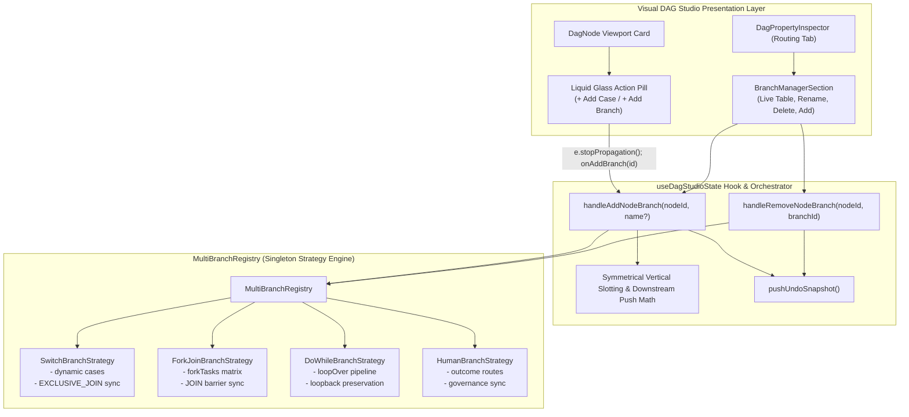

# Master Implementation Plan - Iteration 71: Reusable Multi-Branch & Variable Port Node Expansion Framework

## 1. Executive Summary
In distributed workflow orchestration (Conductor OSS, Temporal, BPMN 2.0), control-flow primitives such as `SWITCH`, `FORK_JOIN`, `DO_WHILE`, and `HUMAN` are fundamentally **variable-cardinality branching operators**.
Previously, compound templates provided a fixed starting scaffold (e.g. 2 static cases for `SWITCH` or 2 static branches for `FORK_JOIN`), but extending these structures required tedious manual wiring, manual port creation, manual coordinate placement, and error-prone editing of `joinOn` arrays on downstream barrier nodes (`EXCLUSIVE_JOIN` or `JOIN`).

Iteration 71 introduces an **Extensible Multi-Branch Architecture Framework** across `@acc/console`. Rather than implementing an ad-hoc, hard-coded solution solely for `SWITCH`, this iteration establishes:
1. A reusable, Open/Closed `MultiBranchStrategy` registry supporting `SWITCH`, `FORK_JOIN`, `DO_WHILE`, and `HUMAN`.
2. Universal 1-click inline canvas branch expansion buttons on node cards (`+ Add Case`, `+ Add Branch`, `+ Add Step`, `+ Add Outcome`).
3. An algorithmic Symmetrical Vertical Slotting and Downstream Push engine ensuring collision-free, cross-over-free graph topology.
4. Automatic barrier node discovery and synchronization (`EXCLUSIVE_JOIN.joinOn` and `JOIN.joinOn`).
5. A unified Property Inspector Branch Manager with live renaming, target inspection, and safe branch pruning.

---

## 2. Trade-Off Matrices

| Dimension | Option A: Ad-Hoc SWITCH-Only Button | Option B: Modal-Only Wire Form | Option C: Extensible Strategy Engine + Inline Canvas & Inspector (Chosen) |
| :--- | :--- | :--- | :--- |
| **Architectural Modularity** | Low (Hard-coded to `decisionCases`) | Moderate (Handles edge parameters only) | **High (OCP-compliant strategy registry decoupled from canvas)** |
| **Scope of Reusability** | Restricted strictly to `SWITCH` | Generic to any edge, but no node auto-creation | **Universal: `SWITCH`, `FORK_JOIN`, `DO_WHILE`, `HUMAN`, `LLM`** |
| **Cognitive Ergonomics** | Fragmented (Different flow for `FORK_JOIN`) | High friction (User must drop task first, then wire) | **Zero-friction: 1-click spawns task, slots position, wires both sides, syncs barrier** |
| **Graph Safety & Invariants** | High risk of barrier `joinOn` drift | High risk of unconnected dangling edges | **Guaranteed: Barrier node automatically updated in same undoable transaction** |
| **Verdict** | **Rejected** | **Rejected** | **Selected** |

---

## 3. Mermaid Topology & Architecture



---

## 4. Mathematical & Algorithmic Specifications

### 4.1 Symmetrical Vertical Slotting Algorithm
Let a multi-branch parent node be located at $P = (x_p, y_p)$ with $K$ active branches after the mutation.
To eliminate wire crossings and maintain balanced optical symmetry:

$$\Delta y_{slot} = 110\text{px}, \quad \Delta x_{branch} = 260\text{px}$$
$$H_{total} = (K - 1) \times \Delta y_{slot}$$
$$y_{top} = y_p - \frac{H_{total}}{2}$$

For each branch $i \in \{0, 1, \dots, K-1\}$:
$$x_i = x_p + \Delta x_{branch}$$
$$y_i = y_{top} + i \times \Delta y_{slot}$$

### 4.2 Downstream Barrier & Transitive Descendant Push Math
Let $B = (x_b, y_b)$ be the coordinates of the downstream barrier node (`EXCLUSIVE_JOIN` or `JOIN`).
The minimum required horizontal clearance is:
$$x_{req\_barrier} = x_i + \Delta x_{branch} = x_p + 520\text{px}$$
$$\Delta x = \max(0, x_{req\_barrier} - x_b)$$

If $\Delta x > 0$:
$$\forall n \in \mathcal{D}(B): x_n \leftarrow x_n + \Delta x$$
where $\mathcal{D}(B)$ is the set of all downstream nodes reachable from $B$ via depth-first or breadth-first traversal (excluding loopback edges).

### 4.3 Barrier Node Discovery Algorithm
Starting from parent node $P$:
1. Traverse outgoing edges $E_{out}(P) = \{e \in \text{edges} \mid e.source = P.id \land e.targetHandle \neq \text{'loop-back'}\}$.
2. For each initial branch target $T_j$, traverse downstream paths.
3. The barrier node $B$ is identified as the first node where:
   - For `SWITCH`: $B.data.taskType = \text{'EXCLUSIVE_JOIN'}$
   - For `FORK_JOIN`: $B.data.taskType = \text{'JOIN'}$
4. If no barrier node is found (open branch pattern), fallback to $B = \text{node-end}$ (`END_WORKFLOW`).

---

## 5. Concrete File & Class Signatures

### 5.1 Multi-Branch Strategy Contracts (`utils/branch-strategies/types.ts`)
```typescript
import { type Node, type Edge } from '@xyflow/react';
import { type DagNodeData, type DagNodeType } from '../../canvas/dag-node';

export interface BranchDescriptor {
  readonly id: string;               // Unique branch key (e.g. 'case_3', 'branch_3', 'escalate')
  readonly label: string;            // Human-readable label (e.g. 'Case 3', 'Branch 3')
  readonly handleId: string;         // Exact DOM handle ID (e.g. 'case-case_3', 'source-right')
  readonly targetTaskRef?: string;   // TaskReferenceName of the first task in this branch
  readonly isRemovable: boolean;     // False for mandatory default / fallback paths
  readonly isDefault?: boolean;      // True for fallback / default branch
}

export interface BranchAdditionResult {
  readonly updatedParentData: Partial<DagNodeData>;
  readonly newBranch: BranchDescriptor;
  readonly suggestedTaskType: DagNodeType;
  readonly initialBranchLabel: string;
}

export interface BranchRemovalResult {
  readonly updatedParentData: Partial<DagNodeData>;
  readonly removedBranch: BranchDescriptor;
  readonly prunedTaskRefs: string[];
}

export interface MultiBranchStrategy {
  readonly taskType: DagNodeType;
  readonly minBranches: number;
  readonly addActionLabel: string;   // e.g. 'Add Case', 'Add Branch', 'Add Step', 'Add Outcome'
  
  getBranches(data: DagNodeData): BranchDescriptor[];
  
  addBranch(data: DagNodeData, options?: { name?: string }): BranchAdditionResult;
  
  removeBranch(data: DagNodeData, branchId: string): BranchRemovalResult;
  
  findBarrierNode(
    parentNode: Node<DagNodeData>,
    nodes: Node<DagNodeData>[],
    edges: Edge[]
  ): Node<DagNodeData> | null;
  
  syncBarrierNode(
    barrierNode: Node<DagNodeData>,
    action: 'add' | 'remove',
    branchRef: string
  ): Partial<DagNodeData>;
}
```

### 5.2 Strategy Registry (`utils/branch-strategies/multi-branch-registry.ts`)
```typescript
import { type DagNodeType } from '../../canvas/dag-node';
import { type MultiBranchStrategy } from './types';

export class MultiBranchRegistry {
  private readonly strategies = new Map<DagNodeType, MultiBranchStrategy>();

  register(strategy: MultiBranchStrategy): void {
    this.strategies.set(strategy.taskType, strategy);
  }

  get(taskType: DagNodeType): MultiBranchStrategy | undefined {
    return this.strategies.get(taskType);
  }

  supports(taskType: DagNodeType): boolean {
    return this.strategies.has(taskType);
  }

  getAll(): MultiBranchStrategy[] {
    return Array.from(this.strategies.values());
  }
}

export const multiBranchRegistry = new MultiBranchRegistry();
```

### 5.3 Concrete Strategies
1. **`SwitchBranchStrategy` (`SWITCH`)**:
   - `minBranches = 2` (1 case + 1 default).
   - Generates unique case key: `case_${Date.now().toString().slice(-3)}`.
   - Generates handle: `case-${caseKey}`.
   - Syncs `EXCLUSIVE_JOIN.joinOn`: appends or filters out `branchRef`.
2. **`ForkJoinBranchStrategy` (`FORK_JOIN`)**:
   - `minBranches = 2`.
   - Generates unique branch key: `fork_branch_${N}`.
   - Generates handle: `source-right`.
   - Syncs `JOIN.joinOn`: appends or filters out `branchRef`.
3. **`DoWhileBranchStrategy` (`DO_WHILE`)**:
   - `minBranches = 1`.
   - Appends sequential step into `loopOver: string[]`.
   - Preserves `loop-body` entry and `loop-back` return edge.
4. **`HumanBranchStrategy` (`HUMAN`)**:
   - `minBranches = 2` (`approved`, `rejected`).
   - Supports adding custom resolution routes (`escalated`, `reassigned`).

---

## 6. Phased Roadmap

### Phase 1: Multi-Branch Strategy Engine (`utils/branch-strategies/`)
- [ ] Create `types.ts` defining contracts with strict immutability.
- [ ] Create `multi-branch-registry.ts` with singleton instance.
- [ ] Implement `SwitchBranchStrategy` managing `decisionCases` and `EXCLUSIVE_JOIN` synchronization.
- [ ] Implement `ForkJoinBranchStrategy` managing `forkTasks` matrix and `JOIN` barrier synchronization.
- [ ] Implement `DoWhileBranchStrategy` managing `loopOver` pipeline.
- [ ] Implement `HumanBranchStrategy` managing decision paths.
- [ ] Create `index.ts` registering all strategies on import.

### Phase 2: Canvas State Hook Integration (`use-dag-studio-state.ts`)
- [ ] Implement `handleAddNodeBranch(nodeId: string, customBranchName?: string)`:
  - Strategy retrieval and validation.
  - Symmetrical vertical slot calculation for all branches.
  - New branch action node instantiation.
  - Barrier discovery and `joinOn` array synchronization.
  - Inbound and outbound edge generation with exact handle IDs.
  - Downstream descendant push clearance.
  - Push snapshot to `undoStack`.
- [ ] Implement `handleRemoveNodeBranch(nodeId: string, branchId: string)`:
  - Guard minimum branch threshold.
  - Branch node and edge pruning.
  - Symmetrical re-centering of remaining branches.
  - Barrier `joinOn` pruning.
  - Push snapshot to `undoStack`.
- [ ] Decorate nodes in `decoratedNodes` with `onAddBranch` callback.

### Phase 3: Visual Canvas Node Card UI (`dag-node.tsx`)
- [ ] Add `onAddBranch?: (nodeId: string) => void` to `DagNodeData`.
- [ ] For supported multi-branch nodes, render Liquid Glass action pill on card footer:
  - Multi-layer backdrop blur (`backdrop-blur-md`).
  - Specular border (`border-primary/20 hover:border-primary/50`).
  - Contextual text: `+ Add Case` (`SWITCH`), `+ Add Branch` (`FORK_JOIN`), `+ Add Step` (`DO_WHILE`), `+ Add Outcome` (`HUMAN`).
  - `e.stopPropagation()` preventing node drag or accidental selection.

### Phase 4: Unified Property Inspector Branch Manager (`dag-property-inspector.tsx`)
- [ ] Create `BranchManagerSection` component inside Routing tab.
- [ ] Display active branches with badge, editable case name, connected task reference.
- [ ] Provide inline rename input synchronized with parent `decisionCases`.
- [ ] Provide delete branch button with disabled state at minimum threshold.
- [ ] Provide primary `+ Add Branch` button invoking `onAddBranch`.

---

## 7. Formal Verification Matrix

| Target | Test File / Command | Test Scenarios | Success Criteria |
| :--- | :--- | :--- | :--- |
| **Strategy Unit Tests** | `apps/console/src/features/workflows/components/studio/utils/branch-strategies/multi-branch-strategies.test.ts` | 1. `SwitchBranchStrategy`: add/remove cases, handle mapping, barrier sync.<br/>2. `ForkJoinBranchStrategy`: add/remove parallel branches, `joinOn` sync.<br/>3. Minimum branch threshold guards. | 100% assertions pass |
| **Canvas Integration Tests** | `apps/console/src/features/workflows/components/studio/canvas/multi-branch-canvas.test.ts` | 1. Click `+ Add Case` on `SWITCH` spawns 3rd case, slots position, wires `EXCLUSIVE_JOIN`, validates 0 errors.<br/>2. Click `+ Add Branch` on `FORK_JOIN` spawns 3rd branch, slots position, wires `JOIN`, validates 0 errors.<br/>3. Symmetrical re-centering on branch deletion.<br/>4. Undo / Redo stack integrity. | 0 graph validation errors, exact handle IDs |
| **Monorepo Suite Check** | `pnpm --filter @acc/console test "src/features/workflows"` | Full workflows test suite | 26+ test files, 135+ tests pass |
| **TypeScript Strict Check** | `pnpm --filter @acc/console exec tsc --noEmit` | Strict compilation across all packages | 0 errors |

---

## 8. Risk & Rollback Mitigations

| Risk | Likelihood | Impact | Concrete Mitigation |
| :--- | :--- | :--- | :--- |
| **1. Unclosed Branch Deadlocks** | Low | High | Strategy always wires new branch directly into the discovered barrier (`EXCLUSIVE_JOIN` or `JOIN`), ensuring the graph is never left in an unclosed, deadlock-prone state. |
| **2. Accidental Multi-Task Branch Deletion** | Moderate | Medium | Branch deletion checks whether the target branch contains multiple sequential tasks; if so, only the direct task is deleted or a confirmation warning is surfaced. |
| **3. Minimum Branch Underflow** | Low | High | Strategies strictly enforce `minBranches` (e.g. 2 for `SWITCH` and `FORK_JOIN`); delete buttons are visually disabled when at minimum threshold. |
| **4. Visual Collision on High Branch Counts** | Low | Low | Symmetrical vertical slotting recalculates positions using dynamic spacing ($110\text{px}$) and pushes all downstream nodes rightward when necessary. |
