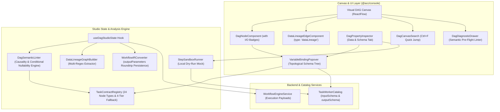

# Master Implementation Plan - Iteration 72
# Visual DAG Studio 2.0: Enterprise DAG Workflow Designer & Data Pipeline Studio

## 1. Executive Summary
Visual DAG Studio 1.0 provides robust structural sequence editing, compound constructs (`FORK_JOIN`, `SWITCH`, `DO_WHILE`), and execution telemetry playback. However, it operates primarily as a control-flow editor rather than a full **DAG Workflow Designer**. In production workflow engineering (comparable to n8n, Temporal UI, Retool Workflows, Airflow 3, and Conductor Cloud), workflows are fundamentally **Data Pipelines** where each step consumes upstream output schemas, applies transformations, and emits structured outputs.

Iteration 72 elevates Visual DAG Studio to **Visual DAG Studio 2.0** by delivering a cohesive 6-pillar data architecture:
1. **First-Class Node I/O Schemas & Canvas Data Badges**: Standardized input/output contracts across all 24 node types, with in-canvas badges and mini-popovers.
2. **Smart Variable Picker & `(fx)` Expression Autocomplete**: Interactive, topologically filtered upstream JSON schema tree with real-time value evaluation previews.
3. **Dual-Mode Graph Topology (Control Flow vs. Data Flow Lineage)**: Native ReactFlow `dataLineage` edge plane visualizing where outputs flow into downstream inputs with zero canvas coordinate drift.
4. **Dedicated Node Data & Schema Inspector**: Revamped inspector with Inputs table, declared Outputs schema tree, editable Mock Output payloads, and side-by-side live execution payload diffs.
5. **Pre-Flight Semantic DAG Linter**: Static analysis detecting broken upstream references (`UNRESOLVED_VARIABLE`), temporal causality violations (`TEMPORAL_ORDER_VIOLATION`), and `SWITCH` conditional nullability hazards before deployment.
6. **Canvas Ergonomics & Step Sandbox Runner**: Floating node search (`Ctrl+F`), canvas density modes (`Compact`, `Standard`, `Data Flow`), and isolated single-step dry-run testing.

---

## 2. Trade-Off Matrices

| Architectural Decision | Option A (Adopted) | Option B (Discarded) | Trade-Off Rationale |
| :--- | :--- | :--- | :--- |
| **Data Flow Representation** | **Native ReactFlow Virtual Lineage Edges**: Render `dataLineage` custom edges inside ReactFlow's edge plane with animated dashed gradient; toggle via toolbar. | **Detached Floating SVG Overlay Layer**: Draw SVG overlay atop the canvas using `useViewport()` coordinate math. | External floating SVGs suffer from noticeable coordinate lag and jitter during rapid zoom/pan gestures. Native ReactFlow custom edges inherit canvas matrix transforms with sub-pixel precision and zero performance penalty. |
| **Workflow IR Persistence** | **Formal Schema Fields in `WorkflowTaskIR`**: Add `outputParameters`, `outputSchema`, and `mockOutputPayload` directly to IR serialization. | **Opaque `layoutMetadata` Stash**: Hide schemas inside arbitrary untyped layout metadata objects. | Placing schemas in `layoutMetadata` risks data loss during backend synchronization and prevents backend workers or test runners from reading declared node contracts. |
| **Variable Autocomplete Source** | **4-Tier Schema Resolution Hierarchy**: Manual Override $\rightarrow$ Mock Payload $\rightarrow$ Worker Catalog $\rightarrow$ Static Contract Defaults. | **Runtime Execution Telemetry Only**: Only populate schema trees if the workflow has been executed at least once. | Runtime-only autocomplete forces users to deploy/run incomplete or broken workflows before they can bind variables. The 4-tier hierarchy empowers rich, zero-execution authoring. |
| **Expression Syntax Scope** | **Strict Conductor JSONPath**: `${taskRef.output.path.to.field}` and `${workflow.input.param}`. | **Ad-Hoc Inline JQ String Transforms**: `${taskRef.output \| .items[0]}`. | Supporting client-side ad-hoc JQ transforms inside input string templates creates behavioral divergence with the backend Java `WorkflowEngineService`. Complex transforms belong in dedicated `JSON_JQ_TRANSFORM` nodes. |

---

## 3. Mermaid Topology & Architecture



---

## 4. Mathematical & Algorithmic Specifications

### 4.1 Data Lineage Graph Invariant ($G_{data}$)
Let $G_{control} = (V, E_{control})$ be the directed control flow graph where $V$ is the set of workflow tasks and $E_{control}$ represents sequence and branching edges.

The Data Flow Graph $G_{data} = (V, E_{data})$ is an induced directed multigraph where an edge exists from task $u$ to task $v$ if and only if $v$ consumes an output variable emitted by $u$:
$$E_{data} = \left\{ (u, v, \text{paramKey}, \text{path}) \mid u, v \in V, \, \exists (k, \text{expr}) \in v.\text{inputParameters} \text{ such that } \text{expr} \text{ matches } \$\{u.\text{output}(\text{path})?\} \lor (u = \text{START} \land \text{expr} \text{ matches } \$\{\text{workflow}.\text{input}(\text{path})?\}) \right\}$$

### 4.2 Topological Predecessor Causality & Conditional Nullability
For any variable binding in task $v$ referencing task $u$ ($\$\{u.\text{output}.\dots\}$):
$$\text{Ancestors}(v) = \left\{ u \in V \mid \text{Path}(u \rightarrow v) \text{ exists in } G_{control} \right\}$$
$$\text{DeterministicAncestors}(v) = \left\{ u \in \text{Ancestors}(v) \mid \text{All valid paths from START to } v \text{ contain } u \right\}$$
$$\text{ConditionalAncestors}(v) = \text{Ancestors}(v) \setminus \text{DeterministicAncestors}(v)$$

- If $u \notin \text{Ancestors}(v) \land u.\text{taskType} \ne \text{'START\_WORKFLOW'}$, the linter emits an `error`: `TEMPORAL_CAUSALITY_VIOLATION`.
- If $u \in \text{ConditionalAncestors}(v)$ (e.g. $u$ is located inside an alternate `SWITCH` case branch), the linter emits a `warning`: `CONDITIONAL_BRANCH_NULLABILITY` advising the user that the task output will evaluate to `null` if an alternate execution path is taken.

---

## 5. Concrete File & Class Signatures

### 5.1 `WorkflowTaskIR` & IR Converter (`apps/console/src/features/workflows/components/studio/utils/workflow-ir-converter.ts`)
```typescript
export interface WorkflowTaskIR {
  taskReferenceName: string;
  taskType: DagNodeType;
  domain?: string;
  timeoutSeconds?: number;
  retryCount?: number;
  retryDelaySeconds?: number;
  backoffRate?: number;
  inputParameters?: Record<string, unknown>;
  outputParameters?: Record<string, unknown>; // Preserved on roundtrip
  outputSchema?: Record<string, unknown>;     // Preserved on roundtrip
  mockOutputPayload?: Record<string, unknown>;// Preserved on roundtrip
  compensateHandlerRef?: string;
  decisionCases?: Record<string, string[]>;
  defaultCase?: string[];
  forkTasks?: string[][];
  joinOn?: string[];
  loopCondition?: string;
  loopOver?: string[];
  // Specialized parameters...
}
```

### 5.2 `TaskContractRegistry` (`apps/console/src/features/workflows/components/studio/utils/contracts/task-contract-registry.ts`)
```typescript
export interface ParameterSchema {
  key: string;
  label: string;
  type: 'string' | 'number' | 'boolean' | 'object' | 'array';
  required?: boolean;
  description?: string;
  defaultValue?: unknown;
  exampleValue?: unknown;
}

export interface NodeDataContract {
  taskType: DagNodeType;
  inputParameters: ParameterSchema[];
  outputSchema: Record<string, unknown>;
  defaultMockOutput: Record<string, unknown>;
}

export class TaskContractRegistry {
  register(contract: NodeDataContract): void;
  getContract(type: DagNodeType, workerDescriptor?: TaskWorkerDescriptor): NodeDataContract;
  resolveOutputSchema(
    nodeData: DagNodeData,
    workerDescriptor?: TaskWorkerDescriptor
  ): Record<string, unknown>;
}
```

### 5.3 `DataLineageEdgeComponent` (`apps/console/src/features/workflows/components/studio/canvas/data-lineage-edge.tsx`)
```typescript
export interface DataLineageEdgeData {
  sourceTaskRef: string;
  targetTaskRef: string;
  paramKey: string;
  expression: string;
  isHighlighted?: boolean;
}

export const DataLineageEdgeComponent: React.FC<EdgeProps<DataLineageEdgeData>>;
```

### 5.4 `DagSemanticLinter` (`apps/console/src/features/workflows/components/studio/utils/validation/dag-semantic-linter.ts`)
```typescript
export interface SemanticDiagnostic {
  id: string;
  severity: 'error' | 'warning' | 'info';
  code:
    | 'UNRESOLVED_VARIABLE'
    | 'TEMPORAL_ORDER_VIOLATION'
    | 'CONDITIONAL_BRANCH_NULLABILITY'
    | 'MISSING_REQUIRED_INPUT'
    | 'UNCONSUMED_TERMINAL_DATA';
  nodeId: string;
  taskReferenceName: string;
  paramKey?: string;
  message: string;
  suggestedFix?: string;
}

export function lintDagSemantics(
  nodes: Node<DagNodeData>[],
  edges: Edge[],
  workerCatalog?: TaskWorkerDescriptor[]
): SemanticDiagnostic[];
```

---

## 6. Phased Roadmap & Implementation Milestones

- **Phase 1: Contracts, Schema Engine & IR Persistence** (`utils/contracts/` & `utils/workflow-ir-converter.ts`):
  - Author `TaskContractRegistry` with comprehensive I/O schemas for all 24 node types and the 4-tier fallback hierarchy.
  - Extend `WorkflowTaskIR` and `DagNodeData` with `outputParameters`, `outputSchema`, and `mockOutputPayload`.
  - Update `exportToWorkflowIR` and `importFromWorkflowIR` to guarantee 100% roundtrip fidelity.
- **Phase 2: Smart Variable Picker & Expression Autocomplete** (`canvas/variable-binding-popover.tsx`):
  - Implement topologically filtered upstream variable tree.
  - Implement real-time expression evaluation preview (`↳ sampleValue`).
- **Phase 3: Dedicated Node Data & Schema Inspector** (`inspectors/dag-property-inspector.tsx`):
  - Build redesigned `Data & Schema (I/O)` tab with Inputs Table, Output Contract viewer, editable Mock Output payload, and side-by-side Live Execution Payloads.
- **Phase 4: Canvas Badges & Native ReactFlow Lineage Edges** (`canvas/dag-node.tsx` & `canvas/data-lineage-edge.tsx`):
  - Render interactive in-canvas `📥 in` and `📤 out` badges on node cards.
  - Register `DataLineageEdgeComponent` (`type: 'dataLineage'`) natively in ReactFlow `edgeTypes`.
  - Add "Show Data Lineage" toggle in `dag-header-command-bar.tsx`.
- **Phase 5: Pre-Flight Semantic DAG Linter & Diagnostic Drawer** (`utils/validation/dag-semantic-linter.ts` & `toolbar/dag-diagnostic-drawer.tsx`):
  - Implement static analysis for broken references, temporal causality, and `SWITCH` conditional nullability.
  - Add diagnostic drawer with 1-click "Jump to Node".
- **Phase 6: Search, Density Modes & Step Sandbox Runner** (`toolbar/dag-canvas-search.tsx` & `sandbox/dag-step-sandbox-runner.ts`):
  - Build floating `Ctrl+F` quick search and viewport jump.
  - Implement canvas density modes (`Compact`, `Standard`, `Data Flow`).
  - Wire the isolated "Test Step" sandbox runner.

---

## 7. Formal Verification Matrix (`/autogenerated-tests/`)

| Test File | Target Scope | Verification Criteria |
| :--- | :--- | :--- |
| `task-contract-registry.test.ts` | Unit | Verifies input and output schemas for all 24 node types, 4-tier hierarchy, and worker overrides. |
| `workflow-ir-converter.test.ts` | Unit | Verifies roundtrip persistence of `outputParameters`, `outputSchema`, and `mockOutputPayload`. |
| `variable-binding-popover.test.tsx` | Component | Verifies topological predecessor filtering, JSON tree expansion, and expression insertion. |
| `data-lineage-edge.test.tsx` | Component | Verifies native ReactFlow edge rendering, animated gradient, and toggle illumination. |
| `dag-semantic-linter.test.ts` | Unit | Verifies detection of broken references, forward/parallel reference causality violations, and `SWITCH` nullability. |
| `dag-canvas-search.test.tsx` | Component | Verifies `Ctrl+F` shortcut, search filtering, and camera panning. |
| `visual-dag-studio-2.test.ts` | Integration | End-to-end authoring session testing I/O binding, lineage overlay toggle, and pre-flight linting. |

---

## 8. Risk & Rollback Mitigations

- **Performance Risk (Large DAGs)**: Computing real-time data lineage wires and semantic linting on every keystroke could impact frame rate on 50+ node graphs.
  - *Mitigation*: Memoize the topological sort and data lineage graph with `useMemo`. Debounce semantic linting by 150ms. Native ReactFlow edges avoid layout drift and leverage GPU canvas compositing.
- **Backward Compatibility Risk**: Existing saved workflows without explicit `outputSchema` or `mockOutputPayload`.
  - *Mitigation*: Fallback transparently to `TaskContractRegistry` defaults or wildcards (`${task.output.*}`). Workflows load seamlessly with zero breaking changes.
- **Isolation Invariant**: Pure additive enhancement within `@acc/console` workflows feature module. Zero disruption to backend Spring Boot endpoints.
