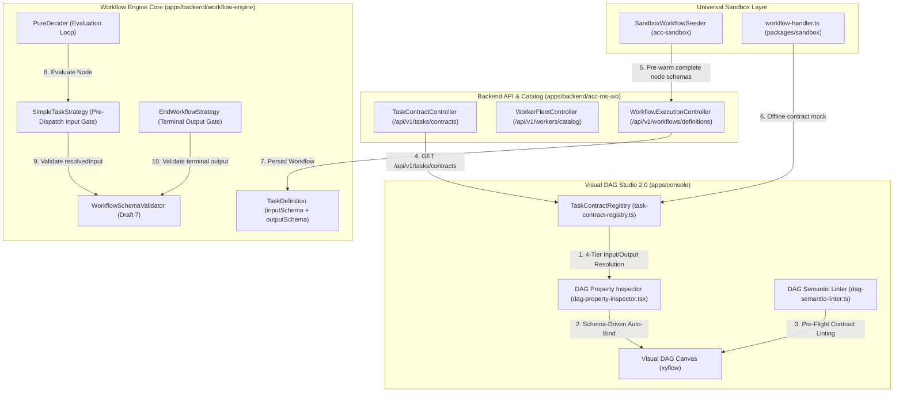

# Master Implementation Plan - Iteration 74
# Predefined Task Node Input/Output Schemas Across Backend Engine and Visual DAG Studio

## 1. Executive Summary

In modern enterprise workflow engines, a fundamental axiom is the **Unaware Unit of Work**: a Task is an isolated, reusable function that knows nothing about workflow context, upstream nodes, or variable resolution expressions (`${...}`). To enable zero-guesswork DAG authoring, pre-flight semantic linting, automatic parameter binding, and strict runtime contract enforcement, **every node type (both built-in system nodes and custom domain workers) must have a predefined, deterministic input and output schema (JSON Schema Draft 7)**.

Currently, several architectural gaps prevent predefined node schemas from being visible or enforced:
1. **Data Model Omission**: [`TaskDefinition.java`](../../apps/backend/workflow-engine/src/main/java/com/acc/workflow/core/model/TaskDefinition.java) and [`WorkflowTaskIR`](../../apps/console/src/features/workflows/components/studio/utils/workflow-ir-converter.ts) only contain `outputSchema` and `inputParameters`, omitting a first-class `inputSchema` property.
2. **Visual DAG Studio Inspector Blind Spot**: [`dag-property-inspector.tsx`](../../apps/console/src/features/workflows/components/studio/inspectors/dag-property-inspector.tsx) hardcodes its input requirement checklist to `matchedWorkerDescriptor?.inputSchema`. For all 20+ built-in system node types (`HTTP`, `LLM_CHAT_COMPLETE`, `SWITCH`, etc.) and unlinked `SIMPLE` nodes, `matchedWorkerDescriptor` is `undefined`, causing the inspector to return `null` and show zero predefined requirements.
3. **Missing Public Task Contract Catalog API**: While [`WorkerFleetController.java`](../../apps/backend/acc-ms-aio/src/main/java/com/acc/aio/controller/workflow/WorkerFleetController.java) provides worker capabilities via `/api/v1/workers/catalog`, there is no unified endpoint serving canonical Draft 7 schemas for all 24 built-in and worker task types.
4. **Decider Input Contract Gate**: [`SimpleTaskStrategy.java`](../../apps/backend/workflow-engine/src/main/java/com/acc/workflow/core/decider/strategy/SimpleTaskStrategy.java) resolves `inputParameters` but does not validate them against `taskDef.inputSchema()` prior to emitting `ScheduleTask`.

Iteration 74 delivers end-to-end parity for predefined node input and output schemas across the backend execution engine, REST APIs, and Visual DAG Studio 2.0.

---

## 2. Trade-Off Matrices

| Architectural Vector | Option A: Adopted 4-Tier Contract Resolution | Option B: Static Hardcoded UI Forms | Option C: Free-Form Unconstrained Key-Values | Trade-Off & Rationale |
| :--- | :--- | :--- | :--- | :--- |
| **Node Contract Architecture** | **4-Tier Schema Resolution Hierarchy**: (1) Explicit Node Override -> (2) Worker Fleet Catalog -> (3) Static Built-in Type Contract -> (4) Permissive Fallback. | **Hardcoded React Forms per Node Type**: Dedicated static JSX components for each of the 24 node types. | **Raw Unconstrained Key-Value Maps**: Allow arbitrary input/output properties without schema validation. | The 4-tier hierarchy enables dynamic extensibility (new workers register their schemas via Spring beans or REST) while guaranteeing rock-solid defaults for all 24 built-in system nodes without maintaining 24 bespoke React forms. |
| **TaskDefinition Schema Representation** | **First-Class `inputSchema` & `outputSchema` on `TaskDefinition`**: Standalone Draft 7 JSON Schemas embedded on every task node. | **Workflow-Level Only**: Store schemas solely on `WorkflowDefinition.inputSchema/outputSchema`. | **External Schema Registry Lookup Only**: Nodes only store a `schemaRef` pointer to Hazelcast/PostgreSQL. | Storing `inputSchema` on `TaskDefinition` ensures self-contained workflow definitions that can be validated, serialized, exported, and executed offline in sandbox mode without external database lookups. |
| **Decider Contract Enforcement** | **Pre-Dispatch Validation in Decider Strategy**: `SimpleTaskStrategy` validates `resolvedInput` against `taskDef.inputSchema()` before emitting `ScheduleTask`. | **Worker-Side Validation Only**: Worker rejects input upon receiving poll result. | **No Pre-Dispatch Validation**: Trust resolved input blindly. | Validating in the decider prevents malformed tasks from polluting the worker queue, saving compute and network bandwidth, while emitting immediate `FAILED` events with detailed JSON schema violation reasons. |
| **Visual Studio Schema UI** | **Dual Predefined Contract Viewer & Auto-Bind Checklist**: Inspector renders both input requirements (with 1-click Auto-Bind) and interactive Draft 7 JSON schema viewers for both inputs and outputs. | **Raw Textarea JSON Only**: Developers manually edit raw JSON schema strings. | **Hidden Schema**: Schemas only evaluated in background without user visibility. | Visual schema viewers paired with 1-click `Auto-Bind Missing` provide high-signal developer ergonomics, making contracts transparent and actionable. |

---

## 3. Mermaid Topology & Architecture



---

## 4. Mathematical & Algorithmic Specifications

### 4.1 4-Tier Node Input Schema Resolution Hierarchy ($\mathcal{R}_{input}$)
For any node $v \in V$ with task type $T(v) \in \text{TaskType}$, its effective input schema $S_{in}(v)$ is determined by:
$$
S_{in}(v) = \begin{cases}
v.\text{declaredInputSchema} & \text{if } v.\text{declaredInputSchema} \neq \emptyset \\
W(v).\text{inputSchema} & \text{if } T(v) = \text{SIMPLE} \land W(v) \text{ registered in fleet catalog} \\
\text{ContractRegistry}[T(v)].\text{inputSchema} & \text{if } \text{ContractRegistry}[T(v)] \neq \emptyset \\
\text{Draft7DefaultObject}() & \text{otherwise}
\end{cases}
$$

### 4.2 Parameter Auto-Binding Invariant
For a required property $p_k \in S_{in}(v).\text{required}$:
If $p_k \notin \text{dom}(v.\text{inputParameters})$ or $v.\text{inputParameters}[p_k] = \text{null}$:
$$
v.\text{inputParameters}[p_k] \leftarrow \begin{cases}
\texttt{"\$\{workflow.input."} + p_k + \texttt{"\}"} & \text{if } p_k \in \text{workflow}.\text{inputSchema}.\text{properties} \\
\texttt{"\$\{ancestor.output."} + p_k + \texttt{"\}"} & \text{if } \exists u \in \text{Ancestors}(v): p_k \in S_{out}(u).\text{properties} \\
\texttt{""} & \text{otherwise}
\end{cases}
$$

### 4.3 Pre-Dispatch Decider Gate
Given task definition $\tau$, current execution snapshot $\sigma$, and parameter resolver $\rho$:
$$
\text{Payload}_{in} = \rho.\text{resolve}(\tau.\text{inputParameters}, \sigma)
$$
$$
\text{Errors} = \text{WorkflowSchemaValidator}.\text{validate}(\text{Payload}_{in}, \tau.\text{inputSchema})
$$
If $\text{Errors} \neq \emptyset$:
$$
\text{Result} = \text{NodeEvaluationResult}.\text{failed}(\tau.\text{refName}, \text{FAILED}, \text{Errors}[0].\text{message})
$$

---

## 5. Concrete File & Class Signatures

### 5.1 Backend: `TaskDefinition.java`
```java
package com.acc.workflow.core.model;

public record TaskDefinition(
    String taskReferenceName,
    TaskType taskType,
    String domain,
    Integer timeoutSeconds,
    Integer retryCount,
    Integer retryDelaySeconds,
    Double backoffRate,
    Map<String, Object> inputParameters,
    Map<String, Object> inputSchema,
    Map<String, Object> outputSchema,
    String compensateHandlerRef,
    Map<String, List<TaskDefinition>> decisionCases,
    List<TaskDefinition> defaultCase,
    List<List<TaskDefinition>> forkTasks,
    List<String> joinOn,
    String loopCondition,
    List<TaskDefinition> loopOver
) {
    // Canonical builder with inputSchema(Map<String, Object>)
}
```

### 5.2 Backend: `TaskContractCatalogService.java` & `TaskContractController.java`
```java
package com.acc.workflow.core.schema;

public record TaskTypeContract(
    String taskType,
    String category, // BOUNDARY | SYSTEM | WORKER
    String description,
    Map<String, Object> inputSchema,
    Map<String, Object> outputSchema,
    List<Map<String, Object>> parameterDescriptors
) {}

@RestController
@RequestMapping("/api/v1/tasks")
public class TaskContractController {
    @GetMapping("/contracts")
    public ResponseEntity<List<TaskTypeContract>> getAllContracts();
}
```

### 5.3 Frontend: `TaskContractRegistry.ts`
```typescript
export class TaskContractRegistry {
  resolveInputSchema(nodeData: DagNodeData, workerDescriptor?: TaskWorkerDescriptor): Record<string, unknown>;
  resolveOutputSchema(nodeData: DagNodeData, workerDescriptor?: TaskWorkerDescriptor): Record<string, unknown>;
  getInputParameters(nodeData: DagNodeData, workerDescriptor?: TaskWorkerDescriptor): ParameterSchema[];
  convertParamsToJsonSchema(params: ParameterSchema[]): Record<string, unknown>;
}
```

---

## 6. Phased Roadmap

- **Phase 1: Backend Data Model & Decider Contract Gate**
  - Add `inputSchema` to `TaskDefinition.java` with builder and backward-compatible constructors.
  - Implement input validation gate in `SimpleTaskStrategy.java` prior to `ScheduleTask`.
  - Add unit tests in `TaskDefinitionTest.java` and `SimpleTaskStrategyTest.java`.
- **Phase 2: Backend Task Contract Catalog API**
  - Implement `TaskContractRegistry` in `apps/backend/workflow-engine` with canonical Draft 7 schemas for all 24 `TaskType` values.
  - Expose `GET /api/v1/tasks/contracts` in `apps/backend/acc-ms-aio`.
  - Enrich `SandboxWorkflowSeeder.java` to seed complete node-level `inputSchema` and `outputSchema`.
- **Phase 3: Universal Sandbox Synchronization**
  - Update `packages/sandbox/src/handlers/workflow-handler.ts` to support `inputSchema` on `WorkflowTaskIR`.
  - Register sandbox route handler for `/api/v1/tasks/contracts`.
  - Synchronize default pipeline definitions with explicit node schemas.
- **Phase 4: Visual DAG Studio 2.0 Property Inspector Upgrade**
  - Add `resolveInputSchema` and `getInputParameters` to `task-contract-registry.ts`.
  - Upgrade `dag-property-inspector.tsx` to display the unified requirement checklist and Auto-Bind for all 24 node types.
  - Add a dedicated **Contract Schemas** view in the inspector showing syntax-highlighted Draft 7 `inputSchema` and `outputSchema` with type badges.
  - Update `workflow-ir-converter.ts` and `dag-semantic-linter.ts` to round-trip and lint against `inputSchema`.
- **Phase 5: Full End-to-End Verification & Commit**
  - Run all backend unit and REST integration tests.
  - Run `@acc/sandbox` vitest suite.
  - Create history entry `457_predefined_node_schemas_and_contract_inspector.md` and commit.

---

## 7. Formal Verification Matrix

| Verification ID | Scope | Test File / Command | Target Invariant Verified |
| :--- | :--- | :--- | :--- |
| `VERIF-BACKEND-01` | Backend Unit | `TaskDefinitionTest` | `inputSchema` builder, serialization, non-null guarantees |
| `VERIF-BACKEND-02` | Backend Unit | `SimpleTaskStrategyTest` | Decider rejects tasks whose resolved input violates `inputSchema` |
| `VERIF-BACKEND-03` | Backend REST | `TaskContractControllerTest` | `GET /api/v1/tasks/contracts` returns all 24 node types + worker contracts |
| `VERIF-BACKEND-04` | Backend E2E | `WorkflowEngineRestApiTest` | Full pipeline execution with node-level input/output schemas |
| `VERIF-SANDBOX-01` | Frontend Sandbox | `pnpm --filter @acc/sandbox test` | Offline contract mock and definition synchronization |
| `VERIF-CONSOLE-01` | Studio Contracts | `task-contract-registry.test.ts` | 4-tier input and output schema resolution across all 24 types |
| `VERIF-CONSOLE-02` | Studio Linter | `dag-semantic-linter.test.ts` | Required input parameters validation against resolved input schema |

---

## 8. Risk & Rollback Mitigations

- **Risk 1: Backward Compatibility with Existing Workflows**: Existing workflows in production or tests lack explicit `inputSchema` on task nodes.
  - *Mitigation*: When `taskDef.inputSchema()` is null or empty, the decider bypasses input schema validation, maintaining 100% backward compatibility.
- **Risk 2: Studio Performance on Large DAGs**: Rendering complex JSON schemas in the property inspector on every node click.
  - *Mitigation*: Memoize resolved schemas with `useMemo` based on `nodeData.taskType` and `nodeData.taskReferenceName`. Lazy-render expandable JSON schema trees.
- **Risk 3: Dynamic Worker Catalog Latency**: Worker fleet catalog may take 100-200ms to load asynchronously on initial render.
  - *Mitigation*: `taskContractRegistry` provides instant static fallback contracts for all node types so the UI never blocks or shows empty forms while the worker catalog loads.
