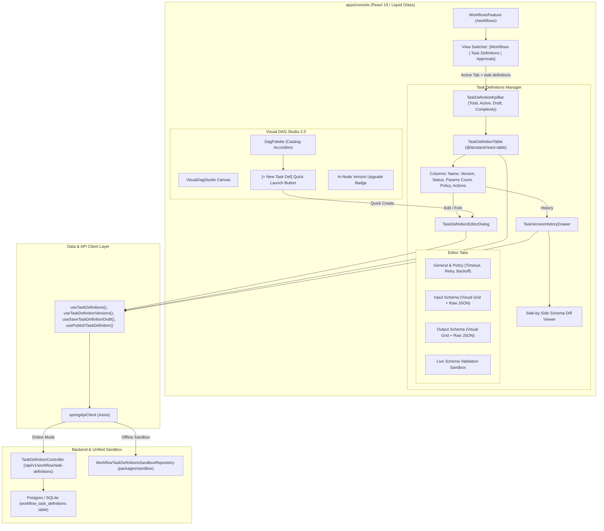

# Master Implementation Plan - Iteration 76
# Dedicated Task Definitions Manager: Visual Schema Designer, Lifecycle Ledger & Studio Hub

## 1. Executive Summary

### 1.1 Problem Statement
In Iteration 75, we successfully decoupled Task Definitions from Task Workers, introducing the append-only `workflow_task_definitions` table, `TaskDefinitionRegistry`, REST endpoints (`/api/v1/workflow/task-definitions`), and offline sandbox handlers. However, workflow engineers and schema architects currently lack a dedicated visual UI to discover, create, edit, test, and manage the lifecycle of Task Definitions.
Currently:
1. Authoring new custom task definitions requires manual HTTP calls or code seeding.
2. Workflow designers in Visual DAG Studio cannot quickly define a new task schema inline when they realize a required task is missing from the palette.
3. Teams cannot visually inspect the version progression, audit changelog notes, or preview side-by-side schema diffs between `v1` and `v2`.
4. There is no interactive JSON Schema property builder or live client-side validation tester for verifying task payloads prior to publishing to production.

### 1.2 Proposed Architectural Solution
We propose introducing the **Dedicated Task Definitions Manager**:
- **First-Class Workflow Hub Tab (`/workflows?tab=task-definitions`)**: Integrated into the primary Workflows landing page alongside `Workflow Definitions` and `Approvals Inbox`, featuring a 4-metric Liquid Glass KPI strip, searchable/sortable `@tanstack/react-table` catalog, status filtering (`ALL`, `ACTIVE`, `DRAFT`, `DEPRECATED`), and action dropdowns.
- **Visual Task Definition Designer (`TaskDefinitionEditorDialog`)**: A multi-tabbed, modal/drawer editor combining metadata policy configuration (timeouts, retries, backoff), a dual-mode visual property grid + Monaco/JSON Schema editor with instant two-way synchronization, preset schema templates, and live payload validation tester.
- **Version Ledger & Schema Diff Drawer (`TaskVersionHistoryDrawer`)**: A sliding audit drawer illustrating the complete immutable version lineage (`ACTIVE`, `DRAFT`, `DEPRECATED`, `ARCHIVED`), publisher metadata, changelogs, and side-by-side JSON Schema diff inspection.
- **Studio In-Canvas Quick-Action**: An authoring shortcut directly in the Visual DAG Studio palette (`dag-palette.tsx`) allowing users to create and publish a new task definition on the fly, immediately refreshing the drag-and-drop catalog without leaving their canvas session.
- **Zero-Stub Offline Parity**: Full offline sandbox support in `packages/sandbox` maintaining tenant isolation and stateful lifecycle operations.

---

## 2. Trade-Off Matrices

| Dimension | Option A: Standalone `/task-definitions` Route | Option B: Unified Tab in `/workflows` (Selected) | Option C: Studio-Only Modal |
| :--- | :--- | :--- | :--- |
| **Information Architecture** | Fragmented top-level navigation; separates workflows from their constituent task blocks | Cohesive Workflow Hub; groups Workflow DAGs, Task Definitions, and Approvals into a single operational center | Obscures catalog management from team members who are not actively editing a DAG |
| **Canvas Workflow Continuity** | Requires navigating away from studio, losing unsaved DAG drafts | Seamless tab switcher + in-canvas palette launch button for inline creation | Good inside studio, but inaccessible from catalog navigation |
| **Maintainability** | Requires new top-level sidebar items, breadcrumb changes, and permission routes | Reuses existing `/_authenticated/workflows` route structure and permissions | Ad-hoc modal state scattered across studio subcomponents |
| **Design Consistency** | Diverges from adjacent entity tables | Directly mirrors `WorkflowCatalogTable` and `MetadataTable` patterns | Inconsistent drawer ergonomics |

---

## 3. Mermaid Topology & Architecture



---

## 4. Mathematical & Algorithmic Specifications

### 4.1 Schema Complexity Metric Calculation
To provide instant situational awareness in the catalog table and KPI bar, we compute a normalized **Schema Complexity Index ($C_{td}$)**:
$$C_{td} = |P_{in}| + 2 \cdot |R_{in}| + |P_{out}| + 2 \cdot |R_{out}|$$
Where:
- $|P_{in}|$: Number of defined properties in `inputSchema.properties`
- $|R_{in}|$: Number of required properties in `inputSchema.required`
- $|P_{out}|$: Number of defined properties in `outputSchema.properties`
- $|R_{out}|$: Number of required properties in `outputSchema.required`

### 4.2 Visual Property Grid $\leftrightarrow$ JSON Schema Two-Way Synchronizer
When editing in visual mode or raw JSON mode, bidirectional transformation must remain strictly lossless and deterministic:
1. **Property to Schema AST ($f: \text{FieldList} \to \text{JsonSchema}$)**:
   $$\text{Properties} = \bigcup_{i} \{ \text{field}_i.\text{name}: \{ \text{type}: \text{field}_i.\text{type}, \text{description}: \text{field}_i.\text{description}, \text{default}: \text{field}_i.\text{default} \} \}$$
   $$\text{Required} = \{ \text{field}_i.\text{name} \mid \text{field}_i.\text{isRequired} = \text{true} \}$$
2. **Schema AST to Property ($g: \text{JsonSchema} \to \text{FieldList}$)**:
   Extracts top-level properties while preserving nested object/array representations as raw JSON string definitions, ensuring non-breaking round-trips.

### 4.3 Version Progression Invariants
Given a task name $T$ and tenant $K$:
$$\text{version}_{\text{next}} = \begin{cases} 
\max(\text{versions}) & \text{if } \text{status}(\max) = \text{DRAFT} \\ 
\max(\text{versions}) + 1 & \text{if } \text{status}(\max) \in \{\text{ACTIVE}, \text{DEPRECATED}, \text{ARCHIVED}\} 
\end{cases}$$
- State Transitions:
  - $\text{DRAFT} \xrightarrow{\text{publish}} \text{ACTIVE}$
  - $\text{ACTIVE}_{\text{prev}} \xrightarrow{\text{superseded}} \text{DEPRECATED}$
  - $\text{DRAFT} \xrightarrow{\text{delete}} \emptyset$
  - $\text{ACTIVE} \xrightarrow{\text{delete}} \text{REJECTED (HTTP 400)}$

---

## 5. Concrete File & Class Signatures

### 5.1 Console Catalog Components (`apps/console/src/features/workflows/components/task-definitions/`)
```typescript
// 1. Catalog KPI Bar
export interface TaskDefinitionKpiBarProps {
  definitions: TaskDefinitionRecord[];
}
export const TaskDefinitionKpiBar: React.FC<TaskDefinitionKpiBarProps>;

// 2. Catalog Table & Columns
export interface TaskDefinitionTableProps {
  data: TaskDefinitionRecord[];
  isLoading: boolean;
  onEditTaskDef: (taskDef: TaskDefinitionRecord) => void;
  onViewHistory: (taskName: string) => void;
  onPublishTaskDef: (name: string, version: number) => void;
  onDeleteDraft: (name: string, version: number) => void;
  onCreateNew: () => void;
}
export const TaskDefinitionTable: React.FC<TaskDefinitionTableProps>;

// 3. Visual Designer Dialog
export interface TaskDefinitionEditorDialogProps {
  open: boolean;
  onOpenChange: (open: boolean) => void;
  initialData?: TaskDefinitionRecord | null;
  onSaved?: (taskDef: TaskDefinitionRecord) => void;
}
export const TaskDefinitionEditorDialog: React.FC<TaskDefinitionEditorDialogProps>;

// 4. Version History & Diff Drawer
export interface TaskVersionHistoryDrawerProps {
  open: boolean;
  onOpenChange: (open: boolean) => void;
  taskName: string | null;
  onForkDraft?: (taskDef: TaskDefinitionRecord) => void;
}
export const TaskVersionHistoryDrawer: React.FC<TaskVersionHistoryDrawerProps>;
```

### 5.2 Studio Integration (`dag-palette.tsx`)
```typescript
// Enhanced DagPalette with quick-action header
export interface DagPaletteProps {
  className?: string;
  style?: React.CSSProperties;
  defaultCollapsed?: boolean;
  isCollapsed?: boolean;
  onCollapsedChange?: (collapsed: boolean) => void;
  onInsertNode?: (type: DagNodeType, defaultData?: Partial<DagNodeData>) => void;
  onManageTaskDefinitions?: () => void;
  onCreateTaskDefinition?: () => void;
}
```

---

## 6. Phased Implementation Roadmap

### Phase 1: Core Catalog Table & KPI Components
- **Goal**: Implement `TaskDefinitionKpiBar`, `TaskDefinitionColumns`, and `TaskDefinitionTable` adhering to Liquid Glass design specs and `@tanstack/react-table` conventions.
- **Files**:
  - `[NEW] apps/console/src/features/workflows/components/task-definitions/task-definition-kpi-bar.tsx`
  - `[NEW] apps/console/src/features/workflows/components/task-definitions/task-definition-columns.tsx`
  - `[NEW] apps/console/src/features/workflows/components/task-definitions/task-definition-table.tsx`
  - `[NEW] apps/console/src/features/workflows/components/task-definitions/index.ts`

### Phase 2: Visual Schema & Policy Editor Dialog
- **Goal**: Implement `TaskDefinitionEditorDialog` with multi-tab structure (General/Policy, Input Schema Grid, Output Schema Grid, Raw JSON Editor with live syntax check, and Schema Tester Sandbox).
- **Files**:
  - `[NEW] apps/console/src/features/workflows/components/task-definitions/task-definition-editor-dialog.tsx`
  - `[NEW] apps/console/src/features/workflows/components/task-definitions/schema-property-grid.tsx`
  - `[NEW] apps/console/src/features/workflows/components/task-definitions/schema-test-sandbox.tsx`
  - `[NEW] apps/console/src/features/workflows/components/task-definitions/schema-templates.ts`

### Phase 3: Version History & Schema Diff Drawer
- **Goal**: Implement `TaskVersionHistoryDrawer` rendering the append-only version ledger timeline, publisher details, changelog notes, and side-by-side JSON diff between versions.
- **Files**:
  - `[NEW] apps/console/src/features/workflows/components/task-definitions/task-version-history-drawer.tsx`
  - `[MODIFY] apps/console/src/features/workflows/api/task-definition-api.ts` (add `useDeleteTaskDefinitionDraft` mutation)

### Phase 4: Hub Navigation & View Switcher Integration
- **Goal**: Wire the Task Definitions Manager into the main `/workflows` page switcher (`Definitions Catalog` | `Task Definitions` | `Approvals Inbox`).
- **Files**:
  - `[MODIFY] apps/console/src/features/workflows/index.tsx`
  - `[MODIFY] apps/console/ROUTE.md`
  - `[MODIFY] apps/console/src/locales/en/console.json` & `vi/console.json`

### Phase 5: Studio Palette Quick-Launch Integration
- **Goal**: Add "+ New Definition" quick-action button in `dag-palette.tsx` and connect `TaskDefinitionEditorDialog` inside `VisualDagStudio` for inline authoring.
- **Files**:
  - `[MODIFY] apps/console/src/features/workflows/components/studio/palette/dag-palette.tsx`
  - `[MODIFY] apps/console/src/features/workflows/components/studio/visual-dag-studio.tsx`

### Phase 6: Automated Verification & Test Coverage
- **Goal**: Write unit tests for table rendering, schema property grid transformations, editor dialog validation, and studio palette quick-actions.
- **Files**:
  - `[NEW] apps/console/src/features/workflows/components/task-definitions/__tests__/task-definition-table.test.tsx`
  - `[NEW] apps/console/src/features/workflows/components/task-definitions/__tests__/task-definition-editor.test.tsx`

---

## 7. Formal Verification Matrix (`/autogenerated-tests/` & Vitest)

| Test ID | Test Target | Verification Criteria | Expected Outcome |
| :--- | :--- | :--- | :--- |
| **VT-TDM-01** | `TaskDefinitionTable` | Renders latest task definitions, filters by search keyword and status pill (`ALL`, `ACTIVE`, `DRAFT`) | Table updates dynamically; zero render crashes |
| **VT-TDM-02** | `TaskDefinitionKpiBar` | Computes correct aggregates for Total Definitions, Active, Draft, and Avg Timeout | Displays accurate KPI cards with matching counts |
| **VT-TDM-03** | `SchemaPropertyGrid` | Two-way synchronization between visual field rows and compiled Draft-07 JSON Schema | Adding a property updates raw JSON immediately; lossless round-trip |
| **VT-TDM-04** | `TaskDefinitionEditorDialog` | Validates slugified name, prevents blank fields, supports saving DRAFT and publishing to ACTIVE | In-memory mutations fire with proper tenant payload; toasts appear |
| **VT-TDM-05** | `TaskVersionHistoryDrawer` | Queries version history list, displays timeline badges, and diffs schemas between two selected versions | Shows accurate version cards and colored diff view |
| **VT-TDM-06** | `WorkflowsFeature Hub` | Tab switcher transitions cleanly between `catalog`, `task-definitions`, and `approvals` without unmounting state | Smooth transition with 0 layout shift or URL breakage |
| **VT-TDM-07** | `DagPalette Quick-Action` | Clicking `+ New Definition` in studio palette opens editor dialog; saving updates catalog immediately | Newly saved definition appears in palette items ready to drag |

---

## 8. Risk & Rollback Mitigations

| Risk | Impact | Preventative Architecture & Mitigation |
| :--- | :--- | :--- |
| **Invalid JSON Schema input by user** | High: Could break engine validation during workflow execution | Client-side validation using JSON Schema validator before allowing Publish; backend rejects malformed schema syntax with HTTP 400. |
| **Accidental deletion of active task definition** | High: Breaks workflows currently bound to that version | Deletion is strictly prohibited for non-DRAFT statuses; backend and sandbox enforce `WorkflowVersionStatus.DRAFT` check. |
| **State collision in Studio Palette** | Medium: New task created while editing a DAG might reset canvas | Query invalidation updates palette items via React Query cache without triggering a remount of the `@xyflow/react` canvas instance. |
| **Offline Sandbox Desync** | Low: Discrepancy between live and offline dev | `WorkflowTaskDefinitionsSandboxRepository` implements identical methods as `TaskDefinitionRegistry`. |
