# Master Implementation Plan - Iteration 78
# Complete Fix for Studio RightSidebar Property Modification and Timeline Sequence Preview Popup Positioning

## 1. Executive Summary
During the React-to-SolidJS migration of `@acc/studio`, two critical UI/UX regressions were introduced:
1. **Property Modification in RightSidebar**:
   In `SequenceInspector.tsx` and `DynamicModifierInspector.tsx`, parameter updates trigger `IRStateManager.dispatch(UpdateModifierCommand)` which performs immutable deep document cloning (`JSON.parse(JSON.stringify(doc))`). Solid's `<For each={filteredModifiers()}>` compares items strictly by referential equality (`item === prevItem`). As a result, every parameter change creates brand-new modifier and sequence object references, forcing `<For>` to tear down and reconstruct the entire accordion item and parameter control subtree. This unmounting immediately drops DOM focus and cancels active pointer capture on sliders and inputs, freezing interactions mid-drag and preventing continuous user input.
2. **Timeline Sequence Preview Popup Mispositioning**:
   In `apps/studio/src/components/ui/hover-card.tsx`, `HoverCardTrigger` enforced `display: contents` via `class="contents"`. In standard CSS box layout, an element with `display: contents` generates no box in the formatting structure, causing `getBoundingClientRect()` to evaluate to `{ x: 0, y: 0, width: 0, height: 0, top: 0, left: 0 }`. Kobalte's Floating UI engine consequently anchors the `HoverCardContent` (the rich `ClipInsightCard` sequence preview popup) at `(0, 0)`—the top-left corner of the viewport—rather than attaching to the hovered clip on the timeline.

This plan establishes a zero-stub, high-performance solution that restores fine-grained SolidJS reactivity to `RightSidebar` using `<Index>` and stable schema memoization, and transforms `ClipHoverHUD` into a single polymorphic anchor element directly bound to the clip's physical bounding rect.

---

## 2. Trade-Off Matrices

| Strategy | Pros | Cons | Verdict |
|---|---|---|---|
| **A. `<For>` with Mutable Document Patches** | Retains existing `<For>` component | Violates state immutability invariant, breaks undo/redo history snapshots | **REJECTED** |
| **B. `<Index>` with Reactive Accessor Mapping** | Zero DOM churn during document cloning; inputs and sliders stay permanently mounted while values update reactively via accessors | Requires accessor unwrapping in child inspector | **ACCEPTED (Optimal for Solid)** |
| **C. `HoverCard` Wrapper with `position: relative`** | Retains nested wrapper `div` | Creates unnecessary DOM nesting, interferes with absolute clip offsets in track lanes | **REJECTED** |
| **D. Polymorphic `HoverCardTrigger` as Clip Container** | Zero wrapper overhead; `triggerRef.getBoundingClientRect()` matches exact clip dimensions; 100% Floating UI accuracy | Requires merging DnD draggable ref and Kobalte trigger ref | **ACCEPTED (Clean & Idiomatic)** |

---

## 3. Mermaid Topology

```mermaid
graph TD
  subgraph Timeline Rendering Pipeline
    DroppableTrackLane["DroppableTrackLane (Track Container)"] --> ClipItem["ClipItem (Sequential Node)"]
    ClipItem --> HoverCardRoot["HoverCard (Kobalte Root)"]
    HoverCardRoot --> HoverCardTrigger["HoverCardTrigger as='div' (Absolute Clip Container)"]
    HoverCardTrigger --> ClipContent["Filmstrip / Waveforms / Handles"]
    HoverCardRoot --> HoverCardContent["HoverCardContent (Portal Popover)"]
    HoverCardContent --> ClipInsightCard["ClipInsightCard (Live Inspector Popup)"]
  end

  subgraph RightSidebar Inspector Pipeline
    RightSidebar["RightSidebar"] --> SwitchRouting["Switch (timeline | track | sequence)"]
    SwitchRouting --> SequenceInspector["SequenceInspector"]
    SequenceInspector --> IndexEngine["<Index each={filteredModifiers()}>"]
    IndexEngine --> AccordionItem["AccordionItem (Keyed by mod().type)"]
    AccordionItem --> DynamicInspector["DynamicModifierInspector"]
    DynamicInspector --> MemoizedFields["Memoized Schema Field Descriptors"]
    MemoizedFields --> ControlStrategies["Primitive & Composite Control Strategies"]
    ControlStrategies --> IRStateManager["IRStateManager.updateModifier / updateSequenceProps"]
    IRStateManager --> ReactiveStore["useIRState Signal Notification (No DOM Tearing)"]
  end
```

---

## 4. Mathematical & Algorithmic Specifications

### 4.1 Floating UI Anchor Coordinate Calculation
For an absolute clip positioned at frame $F_{start}$ with frame duration $D_{frames}$ and scale $P_{px/frame}$:
$$\text{leftPx} = F_{start} \times P_{px/frame}$$
$$\text{widthPx} = \max(16, D_{frames} \times P_{px/frame})$$

When `HoverCardTrigger` is the physical clip `
`, its DOM rectangle is:
$$\text{Rect}_{trigger} = \begin{bmatrix} x_{viewport} + \text{leftPx} - \text{scrollLeft} \\ y_{track} \\ \text{widthPx} \\ H_{track} - 8 \end{bmatrix}$$

Floating UI evaluates the popover position:
$$Y_{popover} = y_{track} - H_{popover} - \text{offset}$$
$$X_{popover} = \text{clamp}\left(X_{min}, x_{viewport} + \text{leftPx} - \text{scrollLeft} + \frac{\text{widthPx} - W_{popover}}{2}, X_{max}\right)$$

Removing `display: contents` guarantees $\text{Rect}_{trigger} \neq \mathbf{0}$, ensuring exact spatial alignment.

### 4.2 SolidJS `<Index>` vs `<For>` Reconciliation Complexity
Given $N$ modifiers where parameter update changes $\text{params}$ for modifier $k$:
- `<For>` with deep cloning: Reconciles $N$ items $\implies O(N)$ DOM node disposes and $O(N)$ DOM node creations $\implies$ drops active input focus.
- `<Index>` with deep cloning: Reconciles $N$ indices $\implies 0$ DOM node disposes, 1 signal update on index $k$ $\implies O(1)$ property patch $\implies$ preserves active input focus and pointer capture.

---

## 5. Concrete File & Class Signatures

### 5.1 `apps/studio/src/components/ui/hover-card.tsx`
- Remove `local.asChild && "contents"` from `HoverCardTrigger`.
- Forward `ref`, `class`, `style`, and HTML attributes directly to `HoverCardPrimitive.Trigger`.

### 5.2 `apps/studio/src/components/timeline/ClipHoverHUD.tsx`
- Transform `ClipHoverHUD` into a flexible polymorphic container that passes through trigger props to the clip element or wraps cleanly without `contents`.

### 5.3 `apps/studio/src/components/timeline/ClipItem.tsx`
- Bind `draggable.ref` and Kobalte `HoverCardTrigger` to the primary clip container.

### 5.4 `apps/studio/src/components/inspector/SequenceInspector.tsx`
- Replace `<For each={filteredModifiers()}>` with `<Index each={filteredModifiers()}>`.
- Bind `mod().params` reactively into `DynamicModifierInspector`.
- Ensure timing inputs read `seq().time` directly to avoid stale async DAG timeline reads.

### 5.5 `apps/studio/src/components/inspector/DynamicModifierInspector.tsx`
- Memoize schema field entries to eliminate tuple allocations on parameter updates.

---

## 6. Phased Roadmap
- **Phase 1**: Fix HoverCard Trigger & Sequence Preview Popup Positioning in `hover-card.tsx`, `ClipHoverHUD.tsx`, and `ClipItem.tsx`.
- **Phase 2**: Fix Modifier List DOM Churn in `SequenceInspector.tsx` using `<Index>`.
- **Phase 3**: Fix Field Tuple Churn in `DynamicModifierInspector.tsx`.
- **Phase 4**: Fix Timing Synchronization and Stale DAG Frame Reads in `SequenceInspector.tsx`.
- **Phase 5**: Formal Verification Tests (`bun test`) & Production Build (`pnpm --filter @acc/studio build`).

---

## 7. Formal Verification Matrix
- `autogenerated-tests/studio_right_sidebar_properties_and_popup.test.ts`:
  1. Test that `HoverCardTrigger` renders valid geometry without `contents`.
  2. Test that updating modifier params does not tear down or desync modifier list.
  3. Test that updating sequence timing preserves reactive state in `IRStateManager`.
  4. Test that `ClipInsightCard` receives correct clip metadata.
- Full studio test suite verification (`bun test`).
- Production bundle verification (`pnpm --filter @acc/studio build`).

---

## 8. Risk & Rollback Mitigations
- **Risk**: Ref merging conflict between `@dnd-kit/solid` draggable ref and `@kobalte/core` trigger ref.
  - *Mitigation*: Use callback ref `(el) => { draggable.ref(el); if (typeof props.ref === 'function') props.ref(el); }`.
- **Risk**: Accordion key collision if duplicate modifier types exist on a sequence.
  - *Mitigation*: Combine modifier `id` (or fall back to `type_idx`) as stable value in `AccordionItem`.
