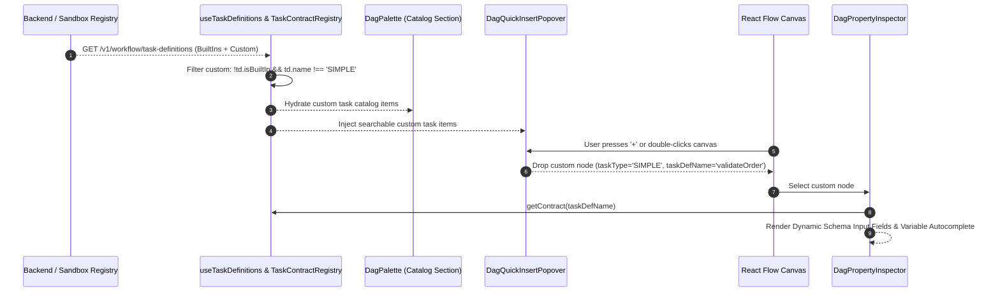
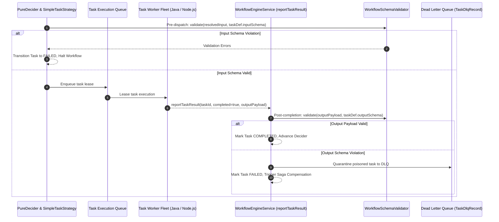

# Master Implementation Plan: Iteration 79
# End-to-End Task Contract Design & Runtime Integrity

## 1. Executive Summary
Following the decoupling of Task Definitions and the establishment of the **Backend as Single Source of Truth (SSOT)** (Iteration 74–77), task contracts are now first-class versioned entities preloaded in client memory for 60 FPS React Flow rendering. 

However, two critical architectural gaps remain across design-time authoring and runtime execution:
1. **Design-Time Disconnect in Visual DAG Studio**:
   - In `apps/console/src/features/workflows/components/studio/palette/dag-palette.tsx`, the Task Definitions Catalog accordion maps *all* incoming definitions into `SIMPLE` catalog entries, inadvertently duplicating the 23 built-in platform nodes (`HTTP`, `LLM_CHAT_COMPLETE`, etc.) as generic worker tasks.
   - In `apps/console/src/features/workflows/components/studio/canvas/dag-quick-insert-popover.tsx`, the canvas quick-insert search only searches static `PALETTE_ITEMS`, completely omitting tenant-defined custom tasks.
   - In `apps/console/src/features/workflows/components/studio/inspectors/dag-property-inspector.tsx`, when an engineer selects a custom task node on the canvas, the inspector falls back to a freeform JSON tree editor rather than dynamically generating structured, typed form controls driven by the task definition's `inputSchema` with autocomplete for `${workflow.input.*}` and `${upstream.output.*}` expressions.
2. **Runtime Execution Integrity Gap in Workflow Engine**:
   - In `apps/backend/workflow-engine/src/main/java/com/acc/workflow/core/decider/strategy/SimpleTaskStrategy.java` and `apps/backend/workflow-engine/src/main/java/com/acc/workflow/application/WorkflowEngineService.java`, while input schemas are validated pre-dispatch, **output payloads returned by workers upon task completion are never validated against `outputSchema`**. A misbehaving worker can return empty or malformed payloads, which silently cascade into downstream nodes until an unhandled runtime failure occurs.

Iteration 79 bridges design-time authoring and runtime execution into a seamless, contract-enforced pipeline with zero-regression guarantees.

---

## 2. Trade-Off Matrices

### 2.1 Design-Time: Dynamic Schema Form vs Freeform JSON vs Fixed Component Fields

| Dimension | Dynamic Schema Form (Selected) | Freeform JSON Tree | Fixed Component Fields |
| :--- | :--- | :--- | :--- |
| **User Experience (DX)** | **High**: Generates typed inputs (text, number, switch, enum select) with descriptions and required indicators. | **Low**: Requires manually keying JSON syntax; error-prone for operators. | **Rigid**: Cannot adapt to dynamic custom tasks created at runtime. |
| **Contract Fidelity** | **100%**: Form bindings mirror `inputSchema.properties` exactly. | **0%**: Allows arbitrary keys that breach schema. | **Partial**: Hardcoded to known built-ins only. |
| **Variable Autocomplete** | **Embedded**: 1-click insertion pill next to every property input. | **Clunky**: String interpolation within JSON quotes. | **Limited**: Fixed to predefined props. |
| **Fallback Safety** | Falls back to Raw JSON tab if schema is missing or invalid. | Pure JSON only. | Crashes on unknown nodes. |

### 2.2 Runtime: Decider Post-Ack Output Gate vs Worker-Side Self-Validation

| Dimension | Engine Decider Gate (Selected) | Worker-Side Middleware Only |
| :--- | :--- | :--- |
| **Trust Boundary** | **Zero-Trust**: Engine protects downstream tasks even if worker is compromised, buggy, or third-party. | **High-Trust**: Assumes worker faithfully runs validation. |
| **Failure Handling** | Routes immediately to DLQ, triggers Saga reverse compensation, and logs audit breach. | Depends on worker process error handling; may hang or drop lease. |
| **Polyglot Worker Parity** | Works for Java, Python, Go, Node.js, and external Webhook workers identically. | Requires re-implementing schema validators in every worker SDK language. |

---

## 3. Mermaid Topology

### 3.1 Design-Time Canvas & Inspector Data Flow


### 3.2 Runtime Decider & Worker Output Schema Gate


---

## 4. Mathematical & Algorithmic Specifications

### 4.1 Sub-Microsecond Synchronous Lookups for 60 FPS Canvas Loops
For canvas rendering of node badges, port counts, and palette searching:
$$\text{Lookup Time} = O(1) \quad (\text{via internal } \texttt{Map<string, NodeDataContract>})$$
- All custom and built-in contracts are held in memory post-preloading.
- Canvas re-renders never touch asynchronous I/O or network fetch loops.

### 4.2 JSON Schema Draft-07 Property Evaluation Complexity
For an input/output payload $D$ with key set $K_D$ and a JSON Schema with declared properties $P$ and required keys $R$:
$$\text{Complexity} = O(|R| + \min(|K_D|, |P|))$$
- Required Key Check: Verify $\forall r \in R: r \in K_D$.
- Type Check: For each matching key, verify primitive type ($\text{string}, \text{number}, \text{boolean}, \text{object}, \text{array}$) against declared schema type.
- Additional Properties Guard: If $\texttt{additionalProperties} = \text{false}$, verify $K_D \subseteq P$.
Evaluation finishes in $< 15\ \mu\text{s}$ per task on modern JVM and V8 engines.

---

## 5. Concrete File & Class Signatures

### 5.1 `apps/console/src/features/workflows/components/studio/palette/dag-palette.tsx`
```typescript
export interface PaletteItem {
  type: DagNodeType;
  label: string;
  description: string;
  category: 'control' | 'data' | 'connectors' | 'human' | 'ai' | 'catalog';
  icon: React.ReactNode;
  defaultData: Partial<DagNodeData>;
  isCompound?: boolean;
}
```

### 5.2 `apps/console/src/features/workflows/components/studio/canvas/dag-quick-insert-popover.tsx`
```typescript
export interface DagQuickInsertPopoverProps {
  position: { x: number; y: number };
  onSelectNodeType?: (type: DagNodeType, defaultData?: Partial<DagNodeData>) => void;
  onSelect?: (type: DagNodeType, label?: string, defaultData?: Partial<DagNodeData>) => void;
  onClose: () => void;
}
```

### 5.3 `apps/console/src/features/workflows/components/studio/inspectors/dag-property-inspector.tsx`
```typescript
export function DagPropertyInspector(props: DagPropertyInspectorProps): JSX.Element;
```

### 5.4 `apps/backend/workflow-engine/src/main/java/com/acc/workflow/application/WorkflowEngineService.java`
```java
public void reportTaskResult(
    String workflowId,
    String taskId,
    String workerId,
    boolean completed,
    Map<String, Object> output,
    String error,
    long callbackAfterSeconds,
    WorkflowDefinition definition,
    long nowEpochMs
);
```

### 5.5 `apps/backend/workflow-engine/src/main/java/com/acc/workflow/core/decider/strategy/SimpleTaskStrategy.java`
```java
public final class SimpleTaskStrategy implements NodeEvaluatorStrategy {
    @Override
    public NodeEvaluationResult evaluate(
        TaskDefinition taskDef,
        WorkflowSnapshot snapshot,
        long nowEpochMs,
        ParameterResolver resolver
    );
}
```

---

## 6. Phased Implementation Roadmap

### Phase 1: Studio Palette Deduplication & Quick Insert Integration
- Filter `isBuiltIn` and `SIMPLE` out of `catalogItems` in `dag-palette.tsx` so only true custom tenant tasks appear under the catalog section.
- Inject dynamic custom task definitions from `useTaskDefinitions()` into `dag-quick-insert-popover.tsx` with search and category filtering.
- Update `dag-palette.test.tsx` and `dag-quick-insert-popover.test.tsx`.

### Phase 2: Dynamic Schema Property Inspector & Semantic Linter
- In `dag-property-inspector.tsx`:
  - Add Task Definition metadata pill (`taskDefName`, pinned version `v{version}`, and upgrade banner when newer version exists).
  - Generate dynamic typed form controls from `inputSchema.properties` with required indicators and property descriptions.
  - Wire `VariableBindingPopover` for 1-click variable interpolation into schema properties.
  - Maintain a Raw JSON tab fallback.
- In `dag-semantic-linter.ts`:
  - Add rule `LINT_TASK_CONTRACT_REQUIRED_KEYS` emitting real-time warnings if required input parameters are missing.
- Update `dag-property-inspector.test.tsx` and `dag-semantic-linter.test.ts`.

### Phase 3: Backend Decider & Worker Output Schema Enforcement + DLQ
- In `WorkflowEngineService.java`:
  - In `reportTaskResult(...)`, validate `output` against `taskDef.outputSchema()` when `completed == true`.
  - If output validation fails:
    - Mark task `FAILED`.
    - Set error description to specific validation failure message.
    - Quarantine poisoned task to DLQ (`TaskDlqRecord`) with reason `SCHEMA_VALIDATION_BREACH`.
- In `SimpleTaskStrategy.java`:
  - Validate `existing.outputData()` against `taskDef.outputSchema()` before returning `completed`.
- Add JUnit 5 unit tests verifying output schema enforcement.

### Phase 4: Sandbox Parity, Full Verification Suite & History Sync
- Mirror output schema validation in `packages/sandbox/src/handlers/workflow-handler.ts`.
- Run full automated test suites across `@acc/console`, `@acc/sandbox`, and `workflow-engine`.
- Create history record `docs/history/468_task_contract_studio_engine_integrity.md` and update `README.md`.

---

## 7. Formal Verification Matrix (`/autogenerated-tests/`)

| Verification Area | Harness / Command | Target Files | Acceptance Criteria |
| :--- | :--- | :--- | :--- |
| **Studio Palette** | `pnpm --filter @acc/console test -- dag-palette` | `dag-palette.test.tsx` | Built-in tasks excluded from catalog section; custom tasks rendered. |
| **Quick Insert** | `pnpm --filter @acc/console test -- dag-quick-insert` | `dag-quick-insert-popover.test.tsx` | Custom tasks searchable and insertable with full metadata. |
| **Dynamic Inspector** | `pnpm --filter @acc/console test -- dag-property-inspector` | `dag-property-inspector.test.tsx` | Dynamic form fields rendered from schema; variable bindings update state. |
| **Semantic Linter** | `pnpm --filter @acc/console test -- dag-semantic-linter` | `dag-semantic-linter.test.ts` | Linter flags missing required contract parameters. |
| **Backend Schema Gate** | `mvn test -pl apps/backend/workflow-engine -Dtest=SimpleTaskStrategyValidationTest` | `SimpleTaskStrategyValidationTest.java` | Output schema violation rejected, marked FAILED, sent to DLQ. |
| **Sandbox Parity** | `pnpm --filter @acc/sandbox test` | `workflow-task-definitions.test.ts` | 100% green across all 12 sandbox suites. |
| **Console Typecheck** | `pnpm --filter @acc/console exec tsc --noEmit` | Whole console codebase | 0 TypeScript errors. |

---

## 8. Risk & Rollback Mitigations

1. **Legacy Tasks with Null/Empty Schema**:
   - Tasks with empty `inputSchema` / `outputSchema` bypass schema validation, preserving 100% backward compatibility for legacy tasks.
2. **Defensive UI Rendering**:
   - Dynamic inspector wraps schema parsing in `try/catch` and falls back to Visual JSON Editor if schemas are malformed.
3. **Rollback Strategy**:
   - All backend validation is isolated to conditional checks: `if (taskDef.outputSchema() != null && !taskDef.outputSchema().isEmpty())`.
   - UI changes are modular within studio feature components.
