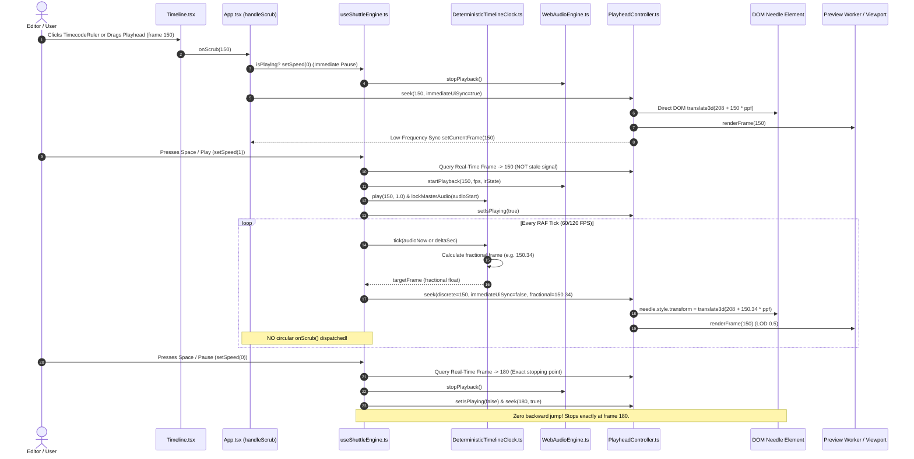

# Master Implementation Plan - Iteration 81: Studio Playhead Controller, Shuttle Engine & Deterministic Clock Unification

## 1. Executive Summary
In Studio video playback and timeline interaction, the playhead exhibited severe desynchronization, micro-stuttering, and backward jumps into incorrect timeframes. Detailed diagnostic review of `PlayheadController.ts`, `useShuttleEngine.ts`, `DeterministicTimelineClock.ts`, and `Timeline.tsx` identified five root causes:
1. **Split-Brain State**: `useShuttleEngine` relied on a 250ms/4Hz throttled SolidJS signal (`options.currentFrame`) rather than `PlayheadController.getFrame()`, causing pauses, resumes, and speed changes to jump backward by 8–15 frames.
2. **Circular Scrub Loop**: The 60fps RAF loop in `useShuttleEngine` invoked `options.onScrub(discreteFrame)` every 250ms, triggering `handleScrub()` in `App.tsx` which re-seeked `PlayheadController` without fractional frames, stripping sub-frame gliding and jerking the needle.
3. **Ghost Seeks During Playback**: Scrubbing or clicking markers while playing updated `PlayheadController`, but never notified or paused the running `DeterministicTimelineClock`, causing the RAF tick 16ms later to snap the playhead back to the old timeframe.
4. **Clock Sync Mode Discontinuity**: When `DeterministicTimelineClock` fell back from `'audio_master'` to `'monotonic_worker'`, `setSyncMode()` failed to re-anchor `playbackStartFrame` and `accumulatedElapsedSec`, causing an instant jump back to time 0.
5. **DOM Transform Collision**: `Timeline.tsx` maintained both a 60fps direct DOM subscription and a reactive JSX `style={{ transform: ... }}` bound to the 250ms throttled signal, causing SolidJS to periodically overwrite the needle position with stale coordinates.

Iteration 81 unifies the playhead architecture: establishes `PlayheadController` as the definitive SSOT for shuttle transport, introduces seamless clock mode re-anchoring, preserves floating-point fractional sub-frames throughout `DeterministicTimelineClock`, eliminates circular scrub dispatches, and decouples the timeline needle from SolidJS JSX style re-evaluations.

---

## 2. Architectural Trade-Off Matrices

| Dimension | Option A: Signal-Centric Reactive Binding | Option B: Unified PlayheadController SSOT & Decoupled High-Frequency Clock (Selected) |
|---|---|---|
| **Frame Accuracy** | Poor (throttled to 4Hz to prevent UI thrashing, leading to 250ms stale reads) | Absolute (60/120fps RAF continuous precision; zero stale read latency) |
| **Gliding Smoothness** | Broken (integer frame clamping and JSX transform fighting causes jitter) | Flawless floating-point sub-pixel needle gliding (`translate3d`) |
| **Interactive Scrub While Playing** | Glitchy snapback (running clock overrides scrub coordinates) | Deterministic (stops playback immediately on scrub or dynamically re-anchors clock) |
| **Audio-Video Clock Parity** | Discontinuous jumps on AudioContext mode fallback | Seamless $C^0$ continuity on sync mode transitions (`reanchorAudio`) |
| **DOM Reconciliation Cost** | High (frequent SolidJS JSX style re-evaluations on needle DOM node) | Zero (direct DOM mutation in high-frequency subscriber loop) |

---

## 3. Mermaid Topology & Event Flow



---

## 4. Mathematical & Algorithmic Specifications

### 4.1 Sub-Frame Fractional Frame Advancement
Given hardware audio reference time $t_{\text{now}}$, playback audio anchor $t_{\text{audioStart}}$, timeline frames-per-second $\text{fps}$, and shuttle speed multiplier $S \in \{-8, -4, -2, -1, 1, 2, 4, 8\}$:

$$t_{\text{elapsed}} = \max\left(0, t_{\text{now}} - t_{\text{audioStart}}\right)$$

$$\Delta f = t_{\text{elapsed}} \cdot \text{fps} \cdot S$$

$$f_{\text{target}} = \text{clamp}\left(f_{\text{playbackStart}} + \Delta f, 0, F_{\text{total}} - 1\right)$$

$$f_{\text{discrete}} = \text{round}\left(f_{\text{target}}\right)$$

$$f_{\text{fractional}} = f_{\text{target}}$$

*Crucial invariant*: $\Delta f$ must **not** be truncated via `Math.round()` inside `DeterministicTimelineClock`. Floating-point precision is preserved so that $f_{\text{fractional}}$ provides sub-pixel translation to the needle element:

$$x_{\text{needle}} = 208 + f_{\text{fractional}} \cdot \text{ppf}$$

### 4.2 Seamless Mode Switch Re-anchoring ($C^0$ Continuity)
When transitioning between `audio_master` and `monotonic_worker` at wall-clock moment $T_{\text{switch}}$:

$$f_{\text{playbackStart}} \leftarrow f_{\text{current}}$$

$$t_{\text{accumulatedElapsed}} \leftarrow 0$$

$$\text{needsAudioReanchor} \leftarrow \text{true}$$

$$\lim_{t \to T_{\text{switch}}^+} f(t) = \lim_{t \to T_{\text{switch}}^-} f(t)$$

This eliminates instantaneous leaps to frame 0 or future timestamps when the browser suspends or resumes `AudioContext`.

---

## 5. Concrete File & Class Signatures

### 5.1 `apps/studio/src/lib/shuttle/useShuttleEngine.ts`
```ts
// SSOT: Read current frame directly from PlayheadController, not 4Hz Solid signal
const getCurrentFrame = () => PlayheadController.getInstance().getFrame();

// Set speed stops at exact real-time playhead location
const setSpeed = (newSpeed: ShuttleSpeed) => {
  const cur = getCurrentFrame();
  const total = getTotalFrames();
  const maxBound = Math.max(0, total - 1);

  if (newSpeed > 0 && cur >= maxBound) {
    PlayheadController.getInstance().seek(0, true);
    options.onScrub(0);
  }

  setSpeedState(newSpeed);
  PlayheadController.getInstance().setIsPlaying(newSpeed !== 0);

  if (newSpeed === 0) {
    const exactFrame = snapToDiscreteFrame(getCurrentFrame());
    PlayheadController.getInstance().seek(exactFrame, true);
    options.onScrub(exactFrame);
    WebAudioEngine.getInstance().stopPlayback();
  } else {
    WebAudioEngine.getInstance().setShuttleSpeed(
      newSpeed,
      getCurrentFrame(),
      getFps(),
      getIrState()
    );
  }
};
```

### 5.2 `packages/core-isomorphic/src/math/clock/DeterministicTimelineClock.ts`
```ts
export class DeterministicTimelineClock {
  // Mode switch re-anchor
  public setSyncMode(mode: ClockSyncMode): void {
    if (this.mode !== mode) {
      this.playbackStartFrame = this.currentFrame;
      this.accumulatedElapsedSec = 0;
      this.needsAudioReanchor = true;
      this.mode = mode;
    }
  }

  // Fractional tick without integer quantization loss
  public tick(timeOrDeltaSec?: number): number {
    if (!this.isPlaying && this.mode !== 'manual_step') {
      return this.currentFrame;
    }

    let targetFrame = this.currentFrame;

    if (this.mode === 'audio_master') {
      if (this.needsAudioReanchor && timeOrDeltaSec !== undefined) {
        this.audioStartSec = timeOrDeltaSec;
        this.needsAudioReanchor = false;
      }
      const audioNow = timeOrDeltaSec ?? this.audioStartSec;
      const audioElapsed = Math.max(0, audioNow - this.audioStartSec);
      const deltaFrames = audioElapsed * this.fps * this.speed;
      targetFrame = this.playbackStartFrame + deltaFrames;
    } else if (this.mode === 'monotonic_worker') {
      const delta = timeOrDeltaSec ?? (1 / (this.fps * Math.abs(this.speed || 1)));
      this.accumulatedElapsedSec += delta;
      const deltaFrames = this.accumulatedElapsedSec * this.fps * this.speed;
      targetFrame = this.playbackStartFrame + deltaFrames;
    }

    targetFrame = Math.max(0, Math.min(this.totalFrames - 1, targetFrame));
    this.currentFrame = targetFrame; // Store high-precision frame
    this.notify();
    return targetFrame;
  }
}
```

### 5.3 `apps/studio/src/App.tsx`
```tsx
const handleScrub = (frame: number) => {
  // If playing, immediately stop playback (standard NLE scrub behavior)
  if (shuttle.isPlaying) {
    shuttle.setSpeed(0);
  }
  const discrete = snapToDiscreteFrame(frame);
  const clamped = Math.max(0, Math.min(discrete, totalFrames()));
  setCurrentFrame(clamped);
  PlayheadController.getInstance().seek(clamped, true);
  WebAudioEngine.getInstance().playScrubFeedback(clamped, fps(), irState);
};
```

### 5.4 `apps/studio/src/components/Timeline.tsx`
```tsx
// Remove reactive transform from JSX style prop to eliminate 250ms SolidJS overwrite jitter
<div
  ref={setPlayheadNeedleRef}
  class="absolute top-7 bottom-0 z-30 pointer-events-none will-change-transform flex flex-col items-center left-0"
  style="transform: translate3d(208px, 0, 0);"
>
```

---

## 6. Phased Implementation Roadmap

### Phase 1: Playhead SSOT & Shuttle Engine Unification
- Update `getCurrentFrame` in `useShuttleEngine.ts` to query `PlayheadController.getInstance().getFrame()`.
- Update `setSpeed(0)` to park at exact playhead location and eliminate backward jumps on pause.
- Remove redundant circular `options.onScrub(discreteFrame)` call in the RAF `tick` loop.

### Phase 2: High-Precision Fractional Clock & Mode Re-anchoring
- In `DeterministicTimelineClock.ts`, retain floating-point precision in `tick()` instead of quantizing with `Math.round()`.
- Implement re-anchoring inside `setSyncMode()` to guarantee $C^0$ continuity on fallback to `monotonic_worker`.
- Ensure `getRationalTime()` and `getState()` reflect sub-frame progression.

### Phase 3: Interactive Scrub Invariants & DOM Style Decoupling
- In `App.tsx`, update `handleScrub()` to halt active playback when scrubbing to eliminate snapback fights.
- In `Timeline.tsx`, replace the reactive `transform` binding on `needle` element with static initial style.
- Validate `subscribeHighFrequency` direct DOM updates glide without interference.

### Phase 4: Verification Suite & Telemetry Calibration
- Author formal tests in `autogenerated-tests/studio_playhead_and_shuttle_clock_precision.test.ts`.
- Verify pauses do not jump backwards.
- Verify mode transitions between `audio_master` and `monotonic_worker` maintain continuity.
- Run complete test suite and build verification.

---

## 7. Formal Verification Matrix

| Test Suite / Command | Focus | Success Criteria |
|---|---|---|
| `bun test autogenerated-tests/studio_playhead_and_shuttle_clock_precision.test.ts` | Clock precision & shuttle pause stability | 100% pass; 0 backwards jumps; exact frame retention on pause |
| `bun test autogenerated-tests/studio_texture_cache.test.ts` | Texture cache regression check | 5 passing tests; 0 errors |
| `bun test autogenerated-tests/studio_three_audio_wiring.test.ts` | WebAudioEngine & timeline sync | 3 passing tests; 0 errors |
| `pnpm --filter @acc/studio build` | Production bundle build | Clean build with code 0 |

---

## 8. Risk & Rollback Mitigations

| Risk | Mitigation | Rollback Strategy |
|---|---|---|
| User prefers video scrubbing while audio keeps playing | NLE standard is parking on scrub; dynamic scrub playback can be toggled via `ShuttleEngine` flag | Restore non-halting scrub with immediate `clock.seek(targetFrame, audioNow)` re-anchor |
| Fractional frames cause non-integer seek in downstream plugins | `snapToDiscreteFrame` is applied in `PlayheadController.seek(clamped, ...)` so `currentFrame` remains integer | Downstream plugins read `getFrame()` (integer) while DOM reads `fractionalFrame` |
| AudioContext latency drift under heavy CPU load | `DeterministicTimelineClock` resyncs every 250ms via `reanchorAudio` if drift exceeds threshold | Fallback to `monotonic_worker` with re-anchored origin |
