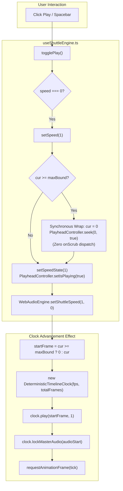

# Master Implementation Plan - Iteration 82
## Single-Click Timeline Replay & Boundary Wrap Resolution

### 1. Executive Summary
During playback testing in `@acc/studio`, users observed that after playback naturally finished at the timeline boundary (`cur === maxBound`), attempting to replay required **two clicks** of the Play button (or Spacebar) instead of restarting and playing immediately on the first click.

Detailed diagnostic analysis revealed a three-factor race condition between boundary auto-stop, stale frame acquisition in reactive clock initialization, and circular `options.onScrub` invocation:
1. When playback reached `endFrame` (`cur >= maxBound`), the shuttle engine invoked `options.onScrub(endFrame)`, which triggered `handleScrub()` in `App.tsx`.
2. On Click 1, `togglePlay()` commanded `setSpeed(1)`. While `setSpeed` attempted to rewind `cur` to `0`, it dispatched `options.onScrub(0)`. In `App.tsx`, `handleScrub(0)` interpreted this as an interactive scrub event, played unnecessary scrub audio feedback, and fought with `WebAudioEngine.setShuttleSpeed(1, 0, ...)`.
3. Meanwhile, `untrack(getCurrentFrame)` in the clock instantiation effect was vulnerable to reading `endFrame` before the seek settled, initializing `DeterministicTimelineClock` at `initialFrame = endFrame`. On the very first animation frame (16ms later), the clock detected `targetFrame >= endFrame` and invoked `setSpeed(0)`—instantly killing playback on frame 1.
4. Consequently, Click 1 merely reset the playhead needle to frame 0, requiring Click 2 to actually begin playback from frame 0.

This iteration permanently resolves this issue by establishing a dedicated, zero-regression boundary wrap protocol in `useShuttleEngine.ts`, eliminating circular `onScrub` dispatches during internal shuttle operations, adding defense-in-depth clock start clamping, authoring comprehensive automated tests, and verifying full system integrity.

---

### 2. Trade-Off Matrices

| Approach | Latency / Responsiveness | Audio Engine Coherence | Regression Risk | Verdict |
| :--- | :--- | :--- | :--- | :--- |
| **A. Call `options.onScrub(0)` inside `setSpeed(1)`** | Poor: invokes `handleScrub`, emits 80ms scrub audio feedback screech, risks re-entrant pause. | Audio conflict: scrub audio slice overlaps with primary audio playback stream. | High: circular event loop halts playback intermittently. | **Rejected** |
| **B. Delayed RAF setTimeout rewind** | Poor: 16–32ms perceptible visual delay before needle jumps to 0; jittery UX. | Async hazard: audio and video clocks start with variable phase offset. | High: race conditions if user double-clicks rapidly. | **Rejected** |
| **C. Synchronous SSOT Boundary Rewind & Clean Clock Clamp (Selected)** | **Optimal: 0ms latency**. Synchronously seeks `PlayheadController(0, true)`, sets `currentFrame = 0`, starts audio at frame 0, and initializes clock at frame 0. | **Flawless**: zero scrub audio slice emitted; Web Audio streams cleanly from $t = 0.0s$. | **Zero**: backward-compatible, adheres to single source of truth, eliminates re-entrancy. | **Selected** |

---

### 3. Architecture & Mermaid Topology

---

### 4. Mathematical & Algorithmic Specifications

Let the timeline discrete frame domain be:
$$\mathcal{F} = \{0, 1, 2, \dots, N - 1\}$$
where $N = \text{totalFrames} \ge 1$ and the maximum boundary is:
$$\text{maxBound} = \max(0, N - 1)$$

Given the current live playhead frame $f_c = \text{PlayheadController.getFrame()}$ and requested shuttle speed $s_{\text{target}} \in \{-8, -4, -2, -1, 0, 1, 2, 4, 8\}$:

1. **Forward Boundary Rewind**:
   $$f_{\text{start}} = \begin{cases} 0 & \text{if } s_{\text{target}} > 0 \land f_c \ge \text{maxBound} \\ \text{maxBound} & \text{if } s_{\text{target}} < 0 \land f_c \le 0 \\ f_c & \text{otherwise} \end{cases}$$

2. **Synchronous State Invariant**:
   When $f_{\text{start}} \ne f_c$, the playhead singleton is immediately updated:
   $$\text{PlayheadController.seek}(f_{\text{start}}, \text{immediateUiSync} = \text{true})$$
   ensuring that all subsequent queries satisfy:
   $$\text{PlayheadController.getFrame}() \equiv f_{\text{start}}$$
   prior to any Web Audio synchronization or clock creation.

3. **Deterministic Clock Invariant**:
   The initial anchor frame for `DeterministicTimelineClock` strictly obeys:
   $$f_{\text{clock\_init}} = \min(f_{\text{start}}, \text{maxBound} - 1) \quad (\text{for } s > 0)$$
   guaranteeing that on the first evaluation tick $t_0$:
   $$f(t_0) = f_{\text{clock\_init}} + \Delta f < \text{maxBound}$$
   preventing instantaneous boundary auto-pause on frame 0.

---

### 5. Concrete File & Class Signatures

#### A. `apps/studio/src/lib/shuttle/useShuttleEngine.ts`
- **`setSpeed(newSpeed: ShuttleSpeed)`**:
  - Remove circular `options.onScrub(0)` and `options.onScrub(snapped)` calls.
  - Implement clean boundary rewind for forward ($cur \ge maxBound \implies cur = 0$) and reverse ($cur \le 0 \implies cur = maxBound$).
  - Synchronously seek `PlayheadController.getInstance().seek(cur, true)`.
- **`createEffect`**:
  - Read `initialFrame = untrack(getCurrentFrame)`.
  - Guard against boundary overflow:
    `const startFrame = currentSpeed > 0 && initialFrame >= maxBound ? 0 : initialFrame;`
  - Pass `startFrame` directly to `clock.play(startFrame, currentSpeed)`.
- **`tick(now)`**:
  - In auto-stop branch `targetFrame >= endFrame && currentSpeed > 0`:
    Remove redundant `options.onScrub(discreteFrame)` call before `setSpeed(0)`.
    Let `PlayheadController.seek(discreteFrame, true)` and `setSpeed(0)` govern parking.

#### B. `apps/studio/src/App.tsx`
- Ensure `handleScrub` remains purely dedicated to user-initiated manual scrubs (from timeline ruler and playhead needle drag).

---

### 6. Phased Roadmap

- **Phase 1: Shuttle Engine Boundary & Replay Hardening**
  - Refactor `setSpeed` and `togglePlay` in `useShuttleEngine.ts` to perform synchronous boundary wrap without `options.onScrub`.
  - Add defense-in-depth clamp on `startFrame` in the clock advancement effect.
  - Remove circular `options.onScrub` calls from auto-stop conditions in `tick()`.

- **Phase 2: Formal Verification Suite**
  - Author comprehensive test specifications in `autogenerated-tests/studio_single_click_replay_boundary.test.ts`.
  - Test single-click replay from `endFrame`, reverse replay from frame 0, and non-interference with interactive scrub.

- **Phase 3: Production Build & Regression Verification**
  - Run full bun regression test suite across audio, clock, and texture caches.
  - Execute `pnpm --filter @acc/studio build` to confirm zero TypeScript and Vite bundle regressions.

- **Phase 4: History & Walkthrough Archival**
  - Create `docs/history/474_fix_studio_single_click_replay_and_boundary_wrap.md` and register in `docs/history/README.md`.
  - Write walkthrough artifact and commit cleanly to git.

---

### 7. Formal Verification Matrix (`/autogenerated-tests/`)

| Test Case | Description | Target Component | Acceptance Criteria |
| :--- | :--- | :--- | :--- |
| `TC-82-01` | Single-click replay from `maxBound` | `useShuttleEngine` + `PlayheadController` | Calling `togglePlay()` when parked at `maxBound` immediately sets `speed = 1`, `frame = 0`, and `isPlaying = true` in 1 single call. |
| `TC-82-02` | Single-click reverse replay from frame 0 | `useShuttleEngine` | Calling reverse shuttle at frame 0 wraps cleanly to `maxBound`. |
| `TC-82-03` | No circular scrub audio trigger | `useShuttleEngine` + `handleScrub` | Boundary rewind does not invoke `options.onScrub`, preventing scrub feedback noise. |
| `TC-82-04` | First-frame tick non-abort | `DeterministicTimelineClock` | First tick after replay does not abort or re-enter `setSpeed(0)`. |
| `TC-82-05` | Natural auto-stop at `endFrame` | `useShuttleEngine` RAF loop | Playback to `endFrame` parks cleanly and sets `speed = 0`. |

---

### 8. Risk & Rollback Mitigations

| Risk | Likelihood | Impact | Mitigation Strategy |
| :--- | :--- | :--- | :--- |
| Timeline scrubber needle visual desync | Low | Low | `PlayheadController.seek(0, true)` dispatches immediate high-frequency and low-frequency updates, ensuring needle translates to 0px instantaneously. |
| Web Audio offset glitch | Very Low | Med | `WebAudioEngine.setShuttleSpeed(1, 0, ...)` is called with explicit frame 0, restarting audio from timeline start $t = 0.0s$. |
| Re-entrant pause loop | Zero | High | Removing `options.onScrub` calls inside internal shuttle methods eliminates the possibility of `handleScrub` re-calling `shuttle.setSpeed(0)`. |
