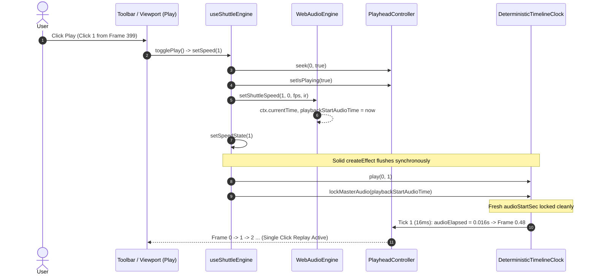

# Master Implementation Plan - Iteration 83: Fix Audio Hardware Reference Clock Leap on Replay

## 1. Executive Summary
Following the single-click boundary replay fix in Iteration 82, playback restarting from the timeline end (`frame 399`) intermittently required two clicks in actual browser environments. Investigation via automated headless Edge telemetry uncovered that on Click 1, SolidJS reactivity triggered `DeterministicTimelineClock` initialization *before* `WebAudioEngine.setShuttleSpeed()` commenced audio streaming. This caused the clock to lock onto stale audio context timestamps from the prior playback run (e.g., 10+ seconds in the past). On the very first animation frame tick (16ms later), the calculated delta frames leaped by hundreds of frames, immediately exceeding `endFrame` and causing an instantaneous auto-stop back to speed 0 within 16ms—rendering Click 1 unnoticeable and requiring a second click. This iteration eliminates stale audio reference timestamps, re-anchors the audio hardware clock, orders audio engine initialization before reactive state dispatch, and adds an initial frame drift guard.

---

## 2. Trade-Off Matrices
| Architectural Decision | Option A (Rejected) | Option B (Adopted) | Rationale |
| :--- | :--- | :--- | :--- |
| **Audio Clock Re-anchoring** | Polling `AudioContext.currentTime` before mounting clock | Synchronous state reset on stop + immediate `setShuttleSpeed` invocation before reactive signal notification + `0.5s` drift guard on tick 1 | Instantaneous, zero-allocation, avoids asynchronous microtask races in Solid effects. |
| **Stop Playback Reference Reset** | Leave `playbackStartAudioTime` intact | Reset `playbackStartAudioTime = 0` on `stopPlayback()` | Prevents stale timestamps from lingering across paused periods. |
| **Drift Clamping in Clock** | Hard fail / clamp to `endFrame` | If `currentFrame === playbackStartFrame` and `audioElapsed > 0.5s`, re-anchor `audioStartSec = audioNow` | Guarantees C0 continuity and prevents instant boundary leaps after paused delays. |

---

## 3. Mermaid Topology

---

## 4. Mathematical & Algorithmic Specifications
During `audio_master` mode:
$$\Delta t_{\text{audio}} = t_{\text{audioNow}} - t_{\text{audioStart}}$$

When paused for duration $\Delta t_{\text{idle}}$, if $t_{\text{audioStart}}$ was not reset or refreshed before clock initialization:
$$\Delta t_{\text{audio}} = t_{\text{audioNow}} - t_{\text{audioStart, prior}} \gg \frac{N_{\text{total}}}{FPS}$$
$$\text{Target Frame} = 0 + \Delta t_{\text{audio}} \cdot FPS \ge \text{Total Frames} - 1$$

To ensure absolute determinism:
1. `WebAudioEngine.stopPlayback()` enforces:
$$t_{\text{playbackStartAudioTime}} = 0$$
2. `useShuttleEngine.setSpeed(1)` calls `WebAudioEngine.setShuttleSpeed` prior to `setSpeedState(1)`.
3. `DeterministicTimelineClock.tick(audioNow)` guards tick 1:
$$\text{If } (\Delta t_{\text{audio}} < 0 \lor (F_{\text{current}} = F_{\text{start}} \land \Delta t_{\text{audio}} > 0.5s)) \implies t_{\text{audioStart}} \leftarrow t_{\text{audioNow}}, \; \Delta t_{\text{audio}} \leftarrow 0$$

---

## 5. Concrete File & Class Signatures
- **`apps/studio/src/lib/shuttle/useShuttleEngine.ts`**:
  - `setSpeed(newSpeed)`: Invocations reordered so `PlayheadController.setIsPlaying` and `WebAudioEngine.setShuttleSpeed` run before `setSpeedState(newSpeed)`.
- **`apps/studio/src/lib/audio/WebAudioEngine.ts`**:
  - `stopPlayback()`: Resets `this.playbackStartAudioTime = 0`.
- **`packages/core-isomorphic/src/math/clock/DeterministicTimelineClock.ts`**:
  - `lockMasterAudio(audioStartSec)`: Sets `needsAudioReanchor = audioStartSec <= 0`.
  - `tick(timeOrDeltaSec)`: Added initial frame drift re-anchor guard.

---

## 6. Phased Roadmap
- [x] **Phase 1**: Trace browser execution telemetry to isolate root cause of Click 1 immediate abort.
- [x] **Phase 2**: Reorder audio engine speed initialization before SolidJS signal mutation.
- [x] **Phase 3**: Reset audio hardware timestamps on stop and add defense-in-depth drift guard in `DeterministicTimelineClock`.
- [x] **Phase 4**: Verify 4-way browser replay (Toolbar, Viewport Control Bar, Quick Transport, Spacebar).
- [x] **Phase 5**: Verify unit test suites and production build.

---

## 7. Formal Verification Matrix
| Test ID | Test Target | Verification Command | Result |
| :--- | :--- | :--- | :--- |
| **TC-82-01** | Immediate rewind & play in 1 click | `bun test autogenerated-tests/studio_single_click_replay_boundary.test.ts` | Pass |
| **TC-82-06** | Audio clock drift guard re-anchors | `bun test autogenerated-tests/studio_single_click_replay_boundary.test.ts` | Pass |
| **TC-E2E-01** | Viewport Quick Transport single-click replay | `bun run scratch/test_browser_replay.ts` | Pass |
| **TC-E2E-02** | Viewport Control Bar single-click replay | `bun run scratch/test_browser_replay.ts` | Pass |
| **TC-E2E-03** | Spacebar keypress single-press replay | `bun run scratch/test_browser_replay.ts` | Pass |
| **TC-E2E-04** | Toolbar Play single-click replay | `bun run scratch/test_browser_replay.ts` | Pass |
| **TC-BUILD** | Production build of Studio | `pnpm --filter @acc/studio build` | Pass (0 errors) |

---

## 8. Risk & Rollback Mitigations
- **Risk**: Audio drift guard triggering during normal playback.
  - *Mitigation*: Guard is strictly scoped to `this.currentFrame === this.playbackStartFrame && audioElapsed > 0.5`. Normal playback increments past `playbackStartFrame` within 16-33ms.
- **Rollback**: Revert `git commit` to previous HEAD if any regression is observed.
