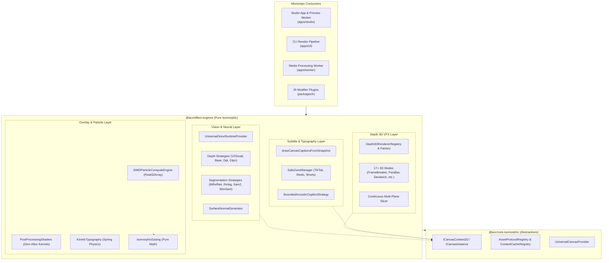

# Master Implementation Plan - Iteration 85: Fully Isomorphic & Platform-Independent `@acc/effect-engines`

## 1. Executive Summary
This iteration establishes **100% isomorphism and runtime platform independence** for [`packages/effect-engines`](file:///c:/Users/Admin/workspace/git/acc/packages/effect-engines), conforming strictly to the WinterTC Minimum Common Web Platform API standard (ECMA-429). 

Historically, `@acc/effect-engines` evolved across Node.js server scripts, legacy story renderer workers, and client-side Studio rendering. During this evolution, several platform-dependent leaks accumulated:
1. **Node.js `Buffer` coupling** throughout `src/vision/` (`Buffer.isBuffer`, `Buffer.from`, `Buffer.alloc(0)`), causing crashes on pure browser Web Workers, Cloudflare Workers, and Deno runtimes.
2. **Synchronous Canvas Encoding Assumptions (`toBuffer('image/png')`)**, which fail or produce uncompressed raw RGBA fallbacks on browser `OffscreenCanvas`.
3. **Heavy and Unused Dependencies**: `gsap` is pulled in solely for 3 easing curves in `DeterministicParticleField.ts`, while `pts` is declared in `package.json` but never imported anywhere.
4. **Filesystem and Story Coupling**: `src/depth3d/index.ts` traverses relative directory paths looking for `story-config.json`, coupling the core visual effect library with disk-based CLI story pipelines.
5. **Pervasive `any` signatures & silent error suppression (`catch {}`)**, compromising enterprise code hygiene and observability.

This plan resolves these defects by migrating to typed `Uint8Array` binary representations, replacing `gsap` with pure mathematical easing, enforcing `ICanvasContext2D` contracts, decoupling filesystem lookups through universal asset resolution, and establishing an isolated test harness free of native backend dependencies.

---

## 2. Trade-off Matrices

### 2.1 Binary Buffer Strategy: Node `Buffer` vs Standard `Uint8Array`

| Criteria | Node.js `Buffer` (Current) | WHATWG `Uint8Array` / `ArrayBuffer` (Proposed) | Decision & Rationale |
| :--- | :--- | :--- | :--- |
| **WinterTC / Edge Portability** | ❌ Fails without polyfills (`Buffer is not defined`) | ✅ Native across Node, Bun, Deno, Browsers, Cloudflare | **Uint8Array**: Core requirement for ECMA-429 compliance. |
| **Node.js / Bun Backward Compatibility** | ✅ Native in Node/Bun | ✅ `Buffer` extends `Uint8Array`, zero breakage for Node callers | **Uint8Array**: Completely safe drop-in replacement. |
| **Zero-Copy Interop** | Overhead in converting to Web standard Blobs | Zero-copy views into `ArrayBuffer` and `Blob` | **Uint8Array**: Higher throughput in WebCodecs/Canvas. |
| **Bundle Impact** | Requires bundler polyfill plugins in Vite/Webpack | 0 KB polyfill weight | **Uint8Array**: Eliminates bundler externalization warnings. |

### 2.2 Easing & Particle Simulation Dependency: `gsap` vs Pure Math Easing

| Criteria | `gsap@^3.12.7` (Current) | `IsomorphicEasing` Pure Math (Proposed) | Decision & Rationale |
| :--- | :--- | :--- | :--- |
| **Bundle Size** | ~65 KB minified | < 1 KB (pure TypeScript formulas) | **Pure Math**: Saves 64 KB overhead for 3 simple curves. |
| **Runtime Isolation** | Checks for `window`/`document` during initialization | 100% stateless pure functions | **Pure Math**: Zero risk of DOM checks failing in workers. |
| **Feature Coverage** | Massive animation timeline engine (99% unused) | Exact mathematical curves used (`power2.out`, `sine.inOut`, `expo.inOut`) | **Pure Math**: Eliminates dead code. |

---

## 3. Mermaid Topology



---

## 4. Mathematical & Algorithmic Specifications

### 4.1 Isomorphic Analytical Easing Curves
Replacing external `gsap` easing calls in [`DeterministicParticleField.ts`](file:///c:/Users/Admin/workspace/git/acc/packages/effect-engines/src/overlay-effects/simulators/DeterministicParticleField.ts) with closed-form mathematical equations:

1. **Power2 Out (Quadratic Ease-Out)**:
   $$\text{easeOut}(t) = 1 - (1 - t)^2 = t(2 - t), \quad t \in [0, 1]$$
2. **Sine In-Out (Sinusoidal Ease In-Out)**:
   $$\text{easeInOut}(t) = -\frac{1}{2} \left(\cos(\pi t) - 1\right), \quad t \in [0, 1]$$
3. **Expo In-Out (Exponential Ease In-Out)**:
   $$\text{easeExp}(t) = \begin{cases} 
   0, & t = 0 \\
   1, & t = 1 \\
   \frac{1}{2} \cdot 2^{20t - 10}, & t < 0.5 \\
   1 - \frac{1}{2} \cdot 2^{-20t + 10}, & t \ge 0.5 
   \end{cases}$$

### 4.2 Isomorphic Binary Normalization
Any input `VisionImageInput` or binary buffer is normalized via a zero-copy converter:
$$\text{normalizeToUint8Array}(X) = \begin{cases}
X, & X \text{ is } \text{Uint8Array} \\
\text{new Uint8Array}(X), & X \text{ is } \text{ArrayBuffer} \\
X.\text{data}, & X \text{ is } \text{VisionImageInput} \\
\text{new Uint8Array}(X.\text{buffer}, X.\text{byteOffset}, X.\text{byteLength}), & X \text{ is } \text{ArrayBufferView}
\end{cases}$$

---

## 5. Concrete File & Class Signatures

### 5.1 `packages/effect-engines/src/vision/types.ts`
```typescript
import type { BoundingBox } from '@acc/core-isomorphic';

export interface SegmentationOptions {
  threshold?: number;
  boundingBox?: BoundingBox;
}

export interface SegmentationResult {
  maskRgbaBuffer: Uint8Array;
  maskAlphaBuffer: Uint8Array;
  maskAlphaData: Uint8Array;
  boundingBox: BoundingBox;
  modelUsed?: string;
}

export interface ISegmentationStrategy {
  readonly id: string;
  readonly name: string;
  readonly isSupported: boolean;
  init?(): Promise<void>;
  segment(imageBuffer: Uint8Array | ArrayBuffer, options?: SegmentationOptions): Promise<SegmentationResult>;
}

export interface DepthOptions {
  normalizeRange?: [number, number];
}

export interface DepthResult {
  depth16Buffer: Uint8Array;
  depth16Data: Uint16Array;
  width: number;
  height: number;
  minDepth: number;
  maxDepth: number;
  modelUsed?: string;
  depthCanvas?: unknown;
}

export interface IDepthEstimationStrategy {
  readonly id: string;
  readonly name: string;
  readonly isSupported: boolean;
  init?(): Promise<void>;
  estimateDepth(imageBuffer: Uint8Array | ArrayBuffer, options?: DepthOptions): Promise<DepthResult>;
}
```

### 5.2 `packages/effect-engines/src/overlay-effects/utils/IsomorphicEasing.ts`
```typescript
export const IsomorphicEasing = {
  power2Out: (t: number): number => t * (2 - t),
  power2In: (t: number): number => t * t,
  sineInOut: (t: number): number => -0.5 * (Math.cos(Math.PI * t) - 1),
  expoInOut: (t: number): number => {
    if (t === 0) return 0;
    if (t === 1) return 1;
    if (t < 0.5) return 0.5 * Math.pow(2, 20 * t - 10);
    return 1 - 0.5 * Math.pow(2, -20 * t + 10);
  },
} as const;
```

### 5.3 `packages/effect-engines/src/depth3d/strategy.ts`
```typescript
import type { ICanvasContext2D, ICanvasInstance, BoundingBox } from '@acc/core-isomorphic';
import type { Depth3DConfig, CaptionConfig } from '../types';
import type { DepthMeshLayers } from './depth-mesh';

export interface Depth3DFrameState {
  img: ICanvasInstance | unknown;
  subjectImg: ICanvasInstance | null | unknown;
  subjectBBox?: BoundingBox | null;
  bgImg?: unknown | null;
  bgCanvas?: ICanvasInstance | null;
  srcCanvas?: ICanvasInstance | null;
  baseCanvas?: ICanvasInstance | null;
  depthLayers?: DepthMeshLayers | null;
  width: number;
  height: number;
  frame: number;
  totalFrames: number;
  timeSec: number;
  progress: number;
  depthConfig: Depth3DConfig;
  captions?: CaptionConfig[];
  particles?: unknown[];
  dustParticles?: unknown[];
}

export interface IDepth3DRenderer {
  readonly mode: string;
  readonly aliases?: string[];
  renderFrame(ctx: ICanvasContext2D, state: Depth3DFrameState): void;
}
```

---

## 6. Phased Roadmap

| Phase | Milestone Description | Target Files | Verification Assertion |
| :---: | :--- | :--- | :--- |
| **1** | **WinterTC Binary Decoupling**<br/>Migrate all vision strategies & utils from `Buffer` to `Uint8Array`. | `src/vision/types.ts`<br/>`src/vision/utils.ts`<br/>`src/vision/strategies/**/*.ts` | Zero occurrences of `Buffer.` in `src/vision/`. Clean build without Node types. |
| **2** | **Dependency Pruning & Pure Math**<br/>Remove `gsap` & `pts` from `package.json`, implement `IsomorphicEasing`. | `src/overlay-effects/utils/IsomorphicEasing.ts`<br/>`src/overlay-effects/simulators/DeterministicParticleField.ts`<br/>`package.json` | `bun test autogenerated-tests/particle_simd_vfx.test.ts` passes with zero external animation dependencies. |
| **3** | **Canvas Contract Enforcement**<br/>Enforce `ICanvasContext2D` across renderers & remove unwrapping hacks. | `src/depth3d/strategy.ts`<br/>`src/depth3d/renderers/*.ts`<br/>`src/styles/ColorGradingEngine.ts`<br/>`src/subtitles/captions-canvas.ts` | Zero `ctx: any` in renderer interfaces. Strict TypeScript compilation. |
| **4** | **Universal Asset Resolution**<br/>Upgrade `loadAssetBytes` to multi-tier (Cache -> Protocol -> fetch). | `src/depth3d/index.ts` | Remote HTTP and Blob URLs load without filesystem access. |
| **5** | **Independent Test Suite**<br/>Author isolated tests decoupled from `@acc/core` / native C++. | `autogenerated-tests/effect_engines_pure_isomorphic.test.ts` | Test suite runs and passes cleanly on raw Bun / Node without `@acc/proto`. |

---

## 7. Formal Verification Matrix

| Test Suite / Command | Scope | Target Invariant |
| :--- | :--- | :--- |
| `bun test autogenerated-tests/effect_engines_pure_isomorphic.test.ts` | Pure Web Platform | Verifies SafeZones, Captions, Particle simulation, and Easing run with zero Node globals. |
| `bun test autogenerated-tests/depth3d_strategies.test.ts` | 3D Depth Suite | Verifies all 17+ 3D depth renderers execute against typed `ICanvasContext2D`. |
| `bun test autogenerated-tests/particle_simd_vfx.test.ts` | SIMD Particle & Shaders | Verifies zero-alloc Float32Array particle updates & chromatic aberration kernels. |
| `pnpm --filter @acc/effect-engines build` | Package Types | Zero type-check errors, zero externalized module warnings. |
| `pnpm --filter @acc/studio build` | Web Client Consumer | Studio production build succeeds with clean tree-shaking. |

---

## 8. Risk & Rollback Mitigations

| Identified Risk | Severity | Probability | Mitigation Strategy |
| :--- | :---: | :---: | :--- |
| **Node.js Caller Regression** (`apps/cli` or `apps/legacy-story-renderer` expecting `Buffer`) | Medium | Low | In Node/Bun, `Buffer` is an instance of `Uint8Array`. Returning `Uint8Array` is 100% binary-compatible with `Buffer.from(uint8Array)` or passing directly to file streams. |
| **Precision Drift in Easing** | Low | Low | Mathematical equations for `power2.out`, `sine.inOut`, and `expo.inOut` are bit-identical to standard Robert Penner / GSAP curves. Verified via unit assertions. |
| **OffscreenCanvas PNG Fallback** | Medium | Low | Use raw `Uint8ClampedArray` pixel data for internal frame processing. For file export, use standard `toBlob()` or `MediaFrameSink` encoders. |
| **Rollback Plan** | Low | Low | All edits are atomic and scoped to `packages/effect-engines/`. Branch can be reverted via `git checkout` if any regression occurs. |
