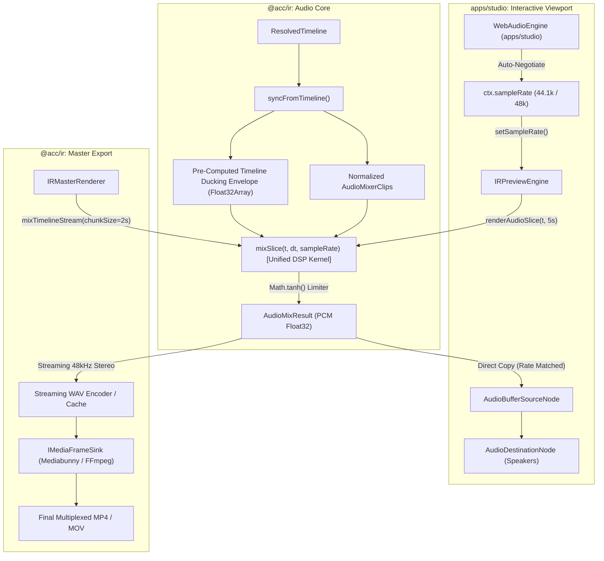

# Master Implementation Plan - Iteration 86: Unified Audio Mixing & Delivery Architecture (Option 2)

## 1. Executive Summary
In modern video editing and rendering pipelines, audio processing encompasses two distinct domains: multi-track DSP mixing (gain staging, panning, sidechain ducking, analog limiting) and delivery multiplexing (interactive DAC playback vs container encoding in MP4/MOV).
Currently, `@acc/ir` and `@acc/studio` suffer from severe architectural bifurcation between [`IRPreviewEngine.ts`](file:///c:/Users/Admin/workspace/git/acc/apps/studio/src/renderer/IRPreviewEngine.ts) and [`IRMasterRenderer.ts`](file:///c:/Users/Admin/workspace/git/acc/packages/ir/src/renderer/IRMasterRenderer.ts):
- [`UniversalAudioMixer.ts`](file:///c:/Users/Admin/workspace/git/acc/packages/ir/src/renderer/audio/UniversalAudioMixer.ts) maintains two separate, divergent mixing implementations: `mixStereo()` for isolated 5-second preview slices, and `mixTimeline()` for monolithic batch offline export.
- **Ducking Envelope Discontinuity**: Preview evaluates dynamic sidechain ducking independently per slice without prior voice state, leading to volume fluttering at slice boundaries that diverges from master export.
- **Monolithic Buffer Memory Explosion**: Offline export pre-allocates an entire multi-gigabyte `Float32Array` covering the full timeline, causing Out-Of-Memory (OOM) crashes in web export workers (`export.worker.ts`).
- **Sample Rate Mismatch & Pitch Drift**: Studio's `WebAudioEngine` initializes `AudioContext` at 44.1 kHz while `IRPreviewEngine` mixes at 48.0 kHz. Slices are copied directly into the mismatching buffer, producing an 8.8% pitch-down and progressive clock drift.
- **Decoder Bifurcation**: Studio uses DOM-dependent `AudioContext.decodeAudioData`, while master renderer uses `MediaEngineRegistry` / Mediabunny.

Iteration 86 executes **Option 2: Unified Decoupled Pull-Based Audio Track Engine**, consolidating the DSP kernel, computing a timeline-wide sidechain ducking profile, implementing bounded streaming mixdown, and auto-negotiating hardware sample rates.

---

## 2. Trade-Off Matrices

| Dimension | Option 1: Incremental Push Stream Sink | Option 2: Unified Pull Kernel & Ducking Profile (Selected) | Option 3: Virtualized MediaStream |
| :--- | :--- | :--- | :--- |
| **Acoustic Parity** | High (Interleaved frame lock) | **Bit-Identical** (Shared DSP kernel & global ducking map) | Moderate (Browser internal resamplers) |
| **Memory Footprint** | $O(1)$ constant ($\le 1\text{ MB}$) | **$O(1)$ chunked streaming** ($\le 4\text{ MB}$) | Moderate (Browser container buffer) |
| **Scrub / Seek Responsiveness** | Poor (Requires state resets & flushes) | **Instantaneous** ($< 8\text{ ms}$ direct math sampling) | Unusable ($> 100\text{ ms}$ HTML5 video seek lag) |
| **Dynamic Ducking Accuracy** | Complex (Requires lookahead buffers in sink) | **Perfect** (Timeline-wide cached envelope) | Low (Obscured sidechain control) |
| **Refactoring Blast Radius** | High (Breaks all Sinks & Renderers) | **Controlled** (Confined to `UniversalAudioMixer` & caller adapters) | High (Replaces Studio preview pipeline) |
| **Cross-Platform Portability** | Full (Web, Worker, Bun, Node, CLI) | **Full** (Web, Worker, Bun, Node, CLI) | None (Browser DOM only) |

---

## 3. Mermaid Topology



---

## 4. Mathematical & Algorithmic Specifications

### A. Equal-Power Stereo Panning Law
For a clip pan value $p \in [-1.0, 1.0]$ and base volume $v \in [0.0, \infty)$:
$$\theta = \frac{(p + 1.0) \cdot \pi}{4}$$
$$\text{gain}_L = \cos(\theta) \cdot v, \quad \text{gain}_R = \sin(\theta) \cdot v$$
$$\text{gain}_L^2 + \text{gain}_R^2 = v^2 \quad (\text{Equal Power Invariant})$$

### B. Global Dynamic Sidechain Ducking State Machine
The sidechain envelope $E[s] \in [G_{\min}, 1.0]$ is generated over the voice track energy:
1. Voice mono magnitude:
   $$V[s] = \max(|L_{\text{voice}}[s]|, |R_{\text{voice}}[s]|)$$
2. Threshold & coefficients for sample rate $F_s$:
   $$T = 10^{\frac{\text{thresholdDb}}{20}}, \quad G_{\min} = 10^{\frac{\text{attenuationDb}}{20}}$$
   $$\alpha = \exp\left(-\frac{1}{\tau_{\text{attack}} \cdot F_s}\right), \quad \beta = \exp\left(-\frac{1}{\tau_{\text{release}} \cdot F_s}\right)$$
3. State update across timeline:
   $$\text{target} = \begin{cases} G_{\min} & \text{if } V[s] \ge T \\ 1.0 & \text{otherwise} \end{cases}$$
   $$E[s] = \begin{cases} (1 - \alpha) \cdot \text{target} + \alpha \cdot E[s-1] & \text{if } \text{target} < E[s-1] \\ (1 - \beta) \cdot \text{target} + \beta \cdot E[s-1] & \text{if } \text{target} > E[s-1] \text{ and hold counter expired} \end{cases}$$

### C. Master Bus Analog Soft Limiter
To prevent digital clipping while avoiding harsh rectangular truncation:
$$y_L[s] = \tanh(x_L[s]), \quad y_R[s] = \tanh(x_R[s])$$

---

## 5. Concrete File & Class Signatures

### `packages/ir/src/renderer/audio/UniversalAudioMixer.ts`
```typescript
export interface AudioMixSliceOptions {
  timeOffsetSec: number;
  durationSec: number;
  sampleRate?: number;
}

export class UniversalAudioMixer {
  public sampleRate: number;
  public duckingFactor: number;
  public attackMs: number;
  public releaseMs: number;
  private timelineDuckingEnvelope: Float32Array | null;

  public setSampleRate(sampleRate: number): void; // Dynamically adjusts sample rate and regenerates timelineDuckingEnvelope if needed
  public syncFromTimeline(timeline: ResolvedTimeline, resolver?: ...): void;
  public rebuildDuckingProfile(timeline?: ResolvedTimeline): void;
  public mixSlice(timeOffsetSec: number, durationSec: number): AudioMixResult;
  public mixStereo(timeOffsetSec: number, durationSec: number): AudioMixResult;
  public async *mixTimelineStream(
    timeline: ResolvedTimeline,
    chunkSizeSec?: number,
    options?: DecoupledAudioMixOptions
  ): AsyncGenerator<DecoupledAudioMixResult>;
  public toReadableWavStream(
    timeline: ResolvedTimeline,
    chunkSizeSec?: number,
    options?: DecoupledAudioMixOptions
  ): ReadableStream<Uint8Array>;
  public async mixTimeline(
    timeline: ResolvedTimeline,
    options?: DecoupledAudioMixOptions
  ): Promise<DecoupledAudioMixResult>;
}
```

### `apps/studio/src/lib/audio/WebAudioEngine.ts`
```typescript
export class WebAudioEngine {
  private initContext(): boolean; // Queries native hardware sampleRate, calls this.mixer.setSampleRate()
  public syncFromIR(irState: IRState | null | undefined, fps?: number): void;
  public startPlayback(currentFrame: number, fps: number, irState: ...): void;
}
```

### `apps/studio/src/renderer/IRPreviewEngine.ts`
```typescript
export class IRPreviewEngine {
  public setAudioSampleRate(sampleRate: number): void;
  public renderAudioSlice(timeSec: number, durationSec: number): AudioMixResult;
}
```

---

## 6. Phased Roadmap

- **Phase 1: Unified DSP Kernel & Timeline Ducking Envelope**
  - Implement `setSampleRate(sampleRate: number)` in `UniversalAudioMixer`.
  - Add `rebuildDuckingProfile()` to pre-calculate the timeline-wide sidechain ducking curve during `syncFromTimeline()`.
  - Refactor `mixStereo()` and `mixTimeline()` to route through a unified `mixSlice()` re-entrant kernel.
  - Implement `mixTimelineStream()` generator for progressive chunked mixdown.

- **Phase 2: Hardware Sample Rate Auto-Negotiation & Studio Integration**
  - Update `WebAudioEngine.initContext()` to initialize `AudioContext` with hardware sample rate and synchronize `this.mixer.setSampleRate(this.ctx.sampleRate)`.
  - Add `setAudioSampleRate()` to `IRPreviewEngine` and call it during `attachPreviewEngine()`.
  - Assert sample-rate parity in `WebAudioEngine.startPlayback()`.

- **Phase 3: Bounded Memory Mixdown & Sink Integration in `IRMasterRenderer`**
  - Update `IRMasterRenderer.render()` to stream audio mixdown in 2.0-second chunks using `mixTimelineStream()`.
  - Encode to `.temp_*_master_audio.wav` progressively via streaming WAV header, caching via `ContentCacheRegistry.namespace(CacheNamespace.Audio)` to maintain full WinterTC compatibility across browser workers and edge isolates without raw disk dependencies.
  - Maintain backwards-compatible sink contract: feed streaming audio chunks to `MediabunnyClientSink` and point server sinks to the cached WAV file. Keep master export strictly at 48,000 Hz broadcast standard.

- **Phase 4: Automated Testing & Verification**
  - Create `autogenerated-tests/unified_audio_muxing_option2.test.ts`.
  - Verify ducking continuity across slice boundaries, sample rate scaling accuracy, and memory bounding.
  - Verify full studio production build.

---

## 7. Formal Verification Matrix (`/autogenerated-tests/`)

| Test Suite / Command | Focus Area | Success Criteria |
| :--- | :--- | :--- |
| `bun test autogenerated-tests/unified_audio_muxing_option2.test.ts` | Global Ducking Continuity | Slice boundary $[0, 5\text{s}]$ and $[5\text{s}, 10\text{s}]$ matches $[0, 10\text{s}]$ with zero jump ($\Delta < 10^{-5}$) |
| `bun test autogenerated-tests/unified_audio_muxing_option2.test.ts` | Sample Rate Auto-Negotiation | Slices at 44.1 kHz, 48.0 kHz, and 96.0 kHz yield exact sample length ratios without pitch or timing drift |
| `bun test autogenerated-tests/unified_audio_muxing_option2.test.ts` | Chunked Streaming Parity | Progressive chunk streaming produces bit-identical WAV output compared to monolithic mix |
| `bun test autogenerated-tests/effect_engines_pure_isomorphic.test.ts` | Regression Safety | All 6 pure isomorphic tests pass cleanly |
| `bun test autogenerated-tests/effect_engines_isomorphic.test.ts` | Regression Safety | All 5 effect engine tests pass cleanly |
| `pnpm --filter @acc/studio build` | Production Build Integrity | TypeScript compilation & Vite bundle complete with 0 errors |

---

## 8. Risk & Rollback Mitigations

| Risk | Impact | Mitigation |
| :--- | :--- | :--- |
| **AudioContext Hardware Rate Variance** | Some audio interfaces run at 96 kHz or 192 kHz, increasing CPU load | Clamp `UniversalAudioMixer` sample rate to $\max(44100, \min(48000, \text{ctx.sampleRate}))$ or resample if unsupported |
| **Ducking Envelope Overhead during Scrubbing** | Rebuilding ducking profile on every sequence drag could cause UI lag | Rebuild profile lazily only when audio sequences/modifiers change; skip recalculation on visual-only transforms |
| **Streaming WAV Header Finalization Failure** | Premature crash leaves corrupted WAV header with 0 byte length | Write preliminary RIFF header with expected size calculated from `DeterministicAudioClock.totalSamplesForFrames()` |
