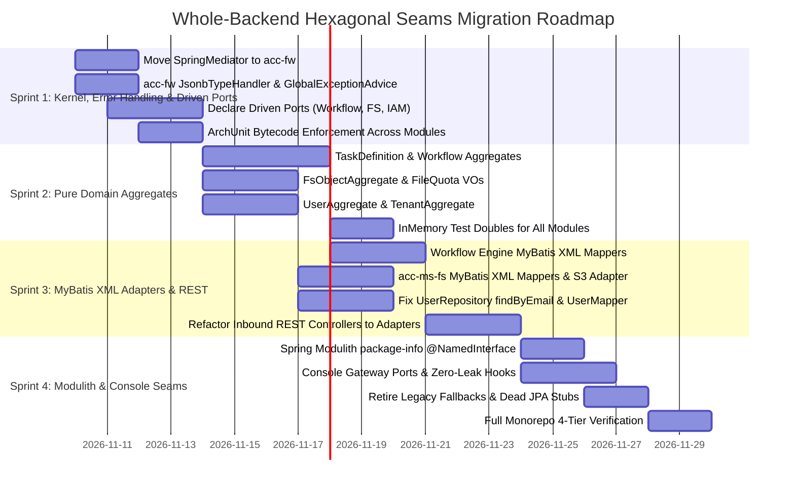

# Master Implementation Plan - Iteration 87
# Enterprise Hexagonal Architecture & DDD Migration across Entire Backend and Console

**Status:** Completed | Fully Verified (Commits `e4d77685`, `4b1897d9`, `9ed21275`, `12fcba0a`, `ef3e2a48`)  
**Author:** Principal Software Architect (DDD & Hexagonal Architecture)  
**Standard:** [`document-reviewing`](file:///c:/Users/Admin/workspace/git/acc/.agents/skills/document-reviewing/SKILL.md) & [`code-reviewing`](file:///c:/Users/Admin/workspace/git/acc/.agents/skills/code-reviewing/SKILL.md)  
**Target Systems:** Whole `@acc/backend` ecosystem ([`apps/backend`](file:///c:/Users/Admin/workspace/git/acc/apps/backend)) and `@acc/console` ([`apps/console`](file:///c:/Users/Admin/workspace/git/acc/apps/console))  
**Companion App Plans:**
- Backend Plan: [`apps/backend/doc/implementation_plan_166.md`](file:///c:/Users/Admin/workspace/git/acc/apps/backend/doc/implementation_plan_166.md)
- Console UI Plan: [`apps/console/doc/implementation_plan_176.md`](file:///c:/Users/Admin/workspace/git/acc/apps/console/doc/implementation_plan_176.md)
- Plan Artifact: [`hexagonal_architecture_and_ddd_migration_plan.md`](file:///c:/Users/Admin/.gemini/antigravity/brain/f10cce1a-c362-4eb9-b89a-360213e357f4/hexagonal_architecture_and_ddd_migration_plan.md)

---

## 1. Executive Summary

This master plan establishes strict **Ports-and-Adapters seams** (Hexagonal Architecture / Alistair Cockburn) and **Domain-Driven Design (DDD)** principles across the **entire `apps/backend` monorepo**, covering all 4 core Bounded Contexts, the Platform Kernel, and the Frontend Console client:

1. **Workflow & Orchestration Context (`workflow-engine` & `acc-ms-aio`):** Pure `TaskDefinitionAggregate` & `WorkflowExecutionAggregate`; Driven ports via MyBatis XML mappers with `JsonbTypeHandler`.
2. **File Storage & Asset Management Context (`acc-ms-fs`):** Pure `FsObjectAggregate` isolating file metadata and quota rules; Driven ports for MyBatis persistence and S3 / FileSystem `BlobStoragePort`, eliminating all `HttpServletRequest` and Jakarta Servlet imports from business services.
3. **Identity, User & Multi-Tenancy Context (`acc-fw` IAM):** Pure `UserAggregate` & `TenantAggregate` replacing legacy JPA/Hibernate base models (`UserBaseModel`); Driven ports for MyBatis persistence and BCrypt / JWT token generation; fixing the live stub in `UserRepositoryImpl.findByEmail`.
4. **Worker, Sagas & Outbox Delivery Context (`acc-ms-worker`):** Scheduled Driving Adapters (Quartz, cron, Postgres `LISTEN/NOTIFY`) delegating to Driving Ports for transactional outbox dispatch and distributed sagas (`UserRegistrationSaga`).
5. **Platform Kernel & Composition Root (`acc-core`, `acc-fw`, `acc-ms-aio`):** Pure DDD primitives in `acc-core`, relocating `SpringMediator` to `acc-fw`, shared MyBatis type handlers and centralized `GlobalExceptionHandler` in `acc-fw`, and Spring Modulith root assembly in `acc-ms-aio`.
6. **Frontend Driven Gateway Ports (`apps/console`):** Pure production HTTP clients with zero `useSandboxStore` checks; transparent dev-only mock interception at the network layer.

---

## 2. Whole-Backend Bounded Context Map & Ports Matrix

| Bounded Context | Module | Pure Aggregates & Invariants | Driving Ports (Primary Use Cases) | Driven Ports (Secondary SPIs) | Outbound Adapters (Prod vs Test) |
|---|---|---|---|---|---|
| **Workflow Engine** | `workflow-engine` `acc-ms-aio` | `TaskDefinitionAggregate` `WorkflowExecutionAggregate` `PureDecider` | `CreateTaskDefinitionUseCase` `StartWorkflowExecutionUseCase` `PollTaskLeaseUseCase` | `TaskDefinitionRepositoryPort` `WorkflowExecutionPort` `WorkerTransportPort` | **Prod:** `MyBatisTaskDefinitionAdapter` **Test:** `InMemoryTaskDefAdapter` |
| **File Storage (FS)** | `acc-ms-fs` | `FsObjectAggregate` `FileQuota` `ChecksumValueObject` | `UploadFileObjectUseCase` `DownloadFileObjectQuery` `DeleteFileObjectUseCase` | `FsObjectRepositoryPort` `BlobStoragePort` `AntivirusScannerPort` | **Prod:** `MyBatisFsObjectAdapter` & `S3BlobStorageAdapter` **Test:** `InMemoryBlobStorageAdapter` |
| **Identity & IAM** | `acc-fw` (user/tenant) | `UserAggregate` `TenantAggregate` `Role & Permission VOs` | `RegisterUserUseCase` `AuthenticateUserUseCase` `CreateTenantWorkspaceUseCase` | `UserRepositoryPort` `TenantRepositoryPort` `PasswordEncoderPort` | **Prod:** `MyBatisUserAdapter` & `BCryptPasswordEncoderAdapter` **Test:** `InMemoryUserAdapter` |
| **Worker & Sagas** | `acc-ms-worker` | `SagaInstanceAggregate` `OutboxMessageAggregate` | `ProcessOutboxQueueUseCase` `AdvanceUserSagaUseCase` `DeliverWebhookUseCase` | `OutboxRepositoryPort` `SagaStateRepositoryPort` `HttpTransportPort` | **Prod:** `ModulithOutboxDispatcher` & `HttpClientWebhookAdapter` **Test:** `InMemoryOutboxAdapter` |

---

## 3. Whole-Backend Inward Dependency Blueprint

```mermaid
flowchart TD
    subgraph DrivingAdapters["Driving Adapters (Inbound Protocols)"]
        REST_WF["TaskDefinitionRestController<br/>WorkflowExecutionRestController"]
        REST_FS["FileSystemRestController<br/>ObjectCommandRestController"]
        REST_IAM["UserCQRSController<br/>AuthRestController"]
        CRON_WRK["ScheduledLeaseSweeper<br/>QuartzOutboxDispatcher"]
    end

    subgraph DrivingPorts["Driving Ports (Primary Use Case APIs)"]
        UC_WF["CreateTaskDefinitionUseCase<br/>StartWorkflowExecutionUseCase"]
        UC_FS["UploadFileObjectUseCase<br/>DownloadFileObjectQuery"]
        UC_IAM["RegisterUserUseCase<br/>AuthenticateUserUseCase"]
        UC_WRK["ProcessOutboxQueueUseCase<br/>AdvanceUserSagaUseCase"]
    end

    subgraph ApplicationServices["Application Layer (Shell & Orchestration)"]
        SVC_WF["TaskDefinitionApplicationService (@Transactional)"]
        SVC_FS["FileStorageApplicationService (@Transactional)"]
        SVC_IAM["UserApplicationService (@Transactional)"]
        SVC_WRK["WorkerApplicationService"]
    end

    subgraph PureDomain["Pure Domain Core (ZERO Framework Dependencies)"]
        DOM_WF["TaskDefinitionAggregate<br/>WorkflowExecutionAggregate"]
        DOM_FS["FsObjectAggregate<br/>FileQuota & Checksum VOs"]
        DOM_IAM["UserAggregate<br/>TenantAggregate"]
        DOM_WRK["SagaInstanceAggregate<br/>OutboxMessageAggregate"]
    end

    subgraph DrivenPorts["Driven Ports (Secondary SPI Interfaces)"]
        SPI_WF["TaskDefinitionRepositoryPort<br/>WorkflowExecutionPort"]
        SPI_FS["FsObjectRepositoryPort<br/>BlobStoragePort (S3/Disk)"]
        SPI_IAM["UserRepositoryPort<br/>PasswordEncoderPort"]
        SPI_WRK["OutboxRepositoryPort<br/>HttpTransportPort"]
        SPI_EVT["DomainEventPublisherPort (Modulith Outbox)"]
    end

    subgraph DrivenAdapters["Driven Adapters (Outbound Infrastructure)"]
        ADPT_MB_WF["TaskDefinitionMapper.xml (MyBatis)"]
        ADPT_MB_FS["FsObjectMapper.xml (MyBatis) & S3BlobStorageAdapter"]
        ADPT_MB_IAM["UserMapper.xml (MyBatis) & BCryptAdapter"]
        ADPT_MOD_WRK["SpringModulithOutboxAdapter & HttpWebhookAdapter"]
        ADPT_MEM["InMemory Test Doubles (0ms Suite)"]
    end

    %% Driving Flow
    REST_WF --> UC_WF
    REST_FS --> UC_FS
    REST_IAM --> UC_IAM
    CRON_WRK --> UC_WRK

    UC_WF --> SVC_WF
    UC_FS --> SVC_FS
    UC_IAM --> SVC_IAM
    UC_WRK --> SVC_WRK

    SVC_WF --> DOM_WF
    SVC_FS --> DOM_FS
    SVC_IAM --> DOM_IAM
    SVC_WRK --> DOM_WRK

    %% Driven Flow
    SVC_WF --> SPI_WF
    SVC_FS --> SPI_FS
    SVC_IAM --> SPI_IAM
    SVC_WRK --> SPI_WRK
    SVC_WF --> SPI_EVT
    SVC_FS --> SPI_EVT
    SVC_IAM --> SPI_EVT

    SPI_WF --> ADPT_MB_WF
    SPI_FS --> ADPT_MB_FS
    SPI_IAM --> ADPT_MB_IAM
    SPI_WRK --> ADPT_MOD_WRK
    SPI_WF -.-> ADPT_MEM
    SPI_FS -.-> ADPT_MEM
    SPI_IAM -.-> ADPT_MEM

    style PureDomain fill:#e1f5fe,stroke:#0288d1,stroke-width:2px;
    style ApplicationServices fill:#ede7f6,stroke:#512da8,stroke-width:2px;
    style DrivingPorts fill:#e8f5e9,stroke:#2e7d32,stroke-width:1px;
    style DrivenPorts fill:#fff3e0,stroke:#e65100,stroke-width:1px;
```

---

## 4. Phased Whole-Backend Implementation Roadmap

---

## 5. Formal 4-Tier Verification Matrix

| Tier | Test Suite / Target | Command | Pass Criteria |
|---|---|---|---|
| **Tier 1** | **Domain Invariant Suites** (`TaskDefinitionAggregateTest`, `FsObjectAggregateTest`, `UserAggregateTest`) | `mvn test -Dtest=*AggregateTest -q` | 100% pass; execution < 100ms; zero Spring boots; pure business invariant validation. |
| **Tier 2** | **ArchUnit Architecture Guardrails** (`HexagonalArchitectureEnforcementTest`) | `mvn test -pl :acc-core -Dtest=HexagonalArchitectureEnforcementTest -q` | Enforces zero framework imports across `com.acc..domain..` across all monorepo modules. |
| **Tier 3** | **Outbound Persistence Parity Tests** (`*RepositoryContractTest`) | `mvn test -Dtest=*RepositoryContractTest -q` | 100% behavioral parity between MyBatis XML adapters and InMemory test doubles. |
| **Tier 4** | **Spring Modulith & Console Suites** (`ModuleStructureTests`, Vitest, `tsc`) | `mvn test -pl :acc-ms-aio -Dtest=ModuleStructureTests -q` `pnpm --filter @acc/console test run` `pnpm --filter @acc/console exec tsc -b --noEmit` | Zero circular module dependencies; clean Spring Modulith boundaries; 0 TypeScript errors. |
