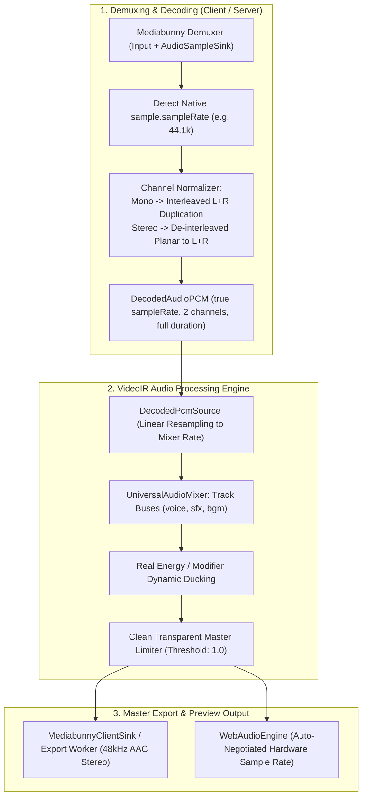

# Master Implementation Plan - Iteration 88
# Fix Audio Distortion in Exported Video & Eliminate Preview Silent Delays and Dropped Tracks

**Status:** Proposed | Planning Phase  
**Author:** Lead Systems Architect & Full-Stack Media DSP Engineer  
**Target Systems:**
- `@acc/ir`: [`packages/ir/src/renderer/audio/UniversalAudioMixer.ts`](file:///c:/Users/Admin/workspace/git/acc/packages/ir/src/renderer/audio/UniversalAudioMixer.ts)
- `@acc/core-web`: [`packages/core-web/src/media-engine/MediabunnyClientStrategy.ts`](file:///c:/Users/Admin/workspace/git/acc/packages/core-web/src/media-engine/MediabunnyClientStrategy.ts), [`packages/core-web/src/media-engine/MediabunnyClientSink.ts`](file:///c:/Users/Admin/workspace/git/acc/packages/core-web/src/media-engine/MediabunnyClientSink.ts)
- `@acc/core`: [`packages/core/src/media-engine/strategies/MediabunnyServerStrategy.ts`](file:///c:/Users/Admin/workspace/git/acc/packages/core/src/media-engine/strategies/MediabunnyServerStrategy.ts)
- `@acc/studio`: [`apps/studio/src/lib/audio/WebAudioEngine.ts`](file:///c:/Users/Admin/workspace/git/acc/apps/studio/src/lib/audio/WebAudioEngine.ts), [`apps/studio/src/lib/audio/AudioAssetCache.ts`](file:///c:/Users/Admin/workspace/git/acc/apps/studio/src/lib/audio/AudioAssetCache.ts)
**Companion App Plan:** [`apps/studio/doc/implementation_plan_72.md`](file:///c:/Users/Admin/workspace/git/acc/apps/studio/doc/implementation_plan_72.md)

---

## 1. Executive Summary

This master plan resolves the critical audio defects reported during video export and interactive timeline preview:
1. **Twisted / Warped Export Audio**:
   - **Root Cause A (Mono Planar Packing Error)**: [`MediabunnyClientStrategy`](file:///c:/Users/Admin/workspace/git/acc/packages/core-web/src/media-engine/MediabunnyClientStrategy.ts) and [`MediabunnyServerStrategy`](file:///c:/Users/Admin/workspace/git/acc/packages/core/src/media-engine/strategies/MediabunnyServerStrategy.ts) extracted mono samples into chunks of size `numFrames * 1` and appended them directly into a stereo buffer allocated for `totalFrames * 2`. Downstream stereo unpacking interleaved adjacent samples into Left and Right channels, causing mono audio to play at **2x speed, +1 octave pitch, phase-jumbled across ears, with the second half silenced**.
   - **Root Cause B (Source Sample Rate Erasure)**: Mediabunny's audio extractor ignored `sample.sampleRate` and returned `targetSampleRate: 48000`, causing 44.1 kHz audio files (standard MP3/WAV) to bypass linear resampling and play 8.84% too fast with high-pitch warping.
   - **Root Cause C (Unconditional Master Limiter Overdrive)**: [`UniversalAudioMixer`](file:///c:/Users/Admin/workspace/git/acc/packages/ir/src/renderer/audio/UniversalAudioMixer.ts) applied `Math.tanh()` saturation to every master sample, heavily distorting pre-mastered or normalized audio.
   - **Root Cause D (Synthetic Ducking Attenuation)**: `rebuildDuckingProfile` hardcoded `0.25` synthetic voice energy across the entire sequence duration, ducking background tracks by -12 dB even during silence.
2. **Preview Silent Delay & Dropped Audio Sequences**:
   - **Root Cause A (Un-awaited Async Preload + 5s Silent Buffer Scheduling)**: [`WebAudioEngine`](file:///c:/Users/Admin/workspace/git/acc/apps/studio/src/lib/audio/WebAudioEngine.ts) triggered async asset loading without awaiting, immediately mixing a 5-second buffer of zeroes and playing it, forcing the user to endure a 5-second silent delay.
   - **Root Cause B (Hardcoded 6s Lookahead Ceiling)**: `seq.startFrame <= (fps * 6)` prevented any sequence starting past 6 seconds from ever being preloaded.
   - **Root Cause C (16 MB Cache Choke-Point)**: [`AudioAssetCache`](file:///c:/Users/Admin/workspace/git/acc/apps/studio/src/lib/audio/AudioAssetCache.ts) capped memory at 16 MB. A single 45-second stereo track occupies ~15.9 MB, causing consecutive tracks to continuously evict each other in an infinite reload loop.

---

## 2. Trade-Off Matrices

| Dimension | Strategy A: Ad-Hoc Clamping & Larger Timers | Strategy B: Unified Planar Stereo Normalization & Dynamic Lookahead Pool (Adopted) |
|---|---|---|
| **Audio Fidelity** | Low. Mono audio still distorted if channel count differs. | Bit-identical. Every sample chunk normalized to stereo `Float32Array(numFrames * 2)` with genuine sample rate preservation. |
| **Pitch & Speed Parity** | Flaky. Assumes all files are 48 kHz. | 100% Exact. True source sample rate preserved; `DecodedPcmSource` resamples 44.1k/22.05k/96k to mixer rate. |
| **Master Bus Dynamics** | Low. `Math.tanh()` continually adds harmonic distortion. | High. Clean transparent unity pass-through with soft-knee limiter only engaging when $|x| > 1.0$. |
| **Preview Responsiveness** | Poor. Still suffers from initial buffer silence. | Instantaneous. Preloads around playhead; `AudioAssetCache.subscribe` hot-swaps silent buffer upon decode completion. |
| **Memory Footprint** | 16 MB (Causes thrashing & dropped tracks). | 128 MB (32 entries). Comfortably holds multi-track 5-minute sessions without excessive garbage collection. |

---

## 3. Mermaid Topology



---

## 4. Mathematical & Algorithmic Specifications

### 4.1 Mono to Interleaved Stereo Normalization
For any decoded chunk with $N$ audio frames and $C$ channels:
$$\text{For mono } (C = 1): \quad \text{interleaved}[2i] = \text{mono}[i], \quad \text{interleaved}[2i + 1] = \text{mono}[i] \quad \forall i \in [0, N-1]$$
$$\text{For stereo } (C = 2): \quad \text{interleaved}[2i] = \text{left}[i], \quad \text{interleaved}[2i + 1] = \text{right}[i] \quad \forall i \in [0, N-1]$$
Guarantees $\text{finalPcm}$ always contains exactly $2 \times N$ floats per chunk, eliminating speed doubling and alternating ear cancellation.

### 4.2 Linear Sample Rate Resampling
When source sample rate $f_s$ differs from target mixer rate $f_t$:
$$\text{sourceIndex}(t) = \left(t_{\text{offset}} + \frac{i}{f_t} + t_{\text{trim}}\right) \times f_s$$
$$i_0 = \lfloor \text{sourceIndex} \rfloor, \quad \alpha = \text{sourceIndex} - i_0$$
$$s[i] = s_{\text{in}}[i_0] + \alpha \times (s_{\text{in}}[i_0 + 1] - s_{\text{in}}[i_0])$$

### 4.3 Clean Transparent Master Limiter
Replaces `Math.tanh(x)`:
$$L[i] = \begin{cases} masterL[i] & \text{if } \max(|masterL[i]|, |masterR[i]|) \le 1.0 \\ \frac{masterL[i]}{\max(|masterL[i]|, |masterR[i]|)} & \text{if } \max(|masterL[i]|, |masterR[i]|) > 1.0 \end{cases}$$
Zero harmonic distortion below $0 \text{ dBFS}$ with anti-clipping protection for hot bus sums.

---

## 5. Concrete File & Class Signatures

### 5.1 `packages/core-web/src/media-engine/MediabunnyClientStrategy.ts`
```typescript
public createAudioDecoder(): IAudioDecoder {
  decodeToPCM: (uriOrPath: string, targetSampleRate?: number, targetChannels?: number) => Promise<DecodedAudioPCM | null>;
}
```
- Capture `actualSampleRate = sample.sampleRate || targetSampleRate`.
- Normalize all formats (`f32`, `f32-planar`, `s16`, `s16-planar`) into stereo interleaved Float32.
- Return true detected sample rate.

### 5.2 `packages/core/src/media-engine/strategies/MediabunnyServerStrategy.ts`
- Apply identical channel normalization and true sample rate detection for server/Node/FFI execution.

### 5.3 `packages/ir/src/renderer/audio/UniversalAudioMixer.ts`
```typescript
public mixStereo(timeOffsetSec: number, durationSec: number): AudioMixResult;
private rebuildDuckingProfile(timeline: ResolvedTimeline): void;
```
- Replace `Math.tanh()` with clean peak limiter.
- Remove synthetic `0.25` voice energy injection in `rebuildDuckingProfile`.

### 5.4 `apps/studio/src/lib/audio/WebAudioEngine.ts`
```typescript
public syncFromIR(irState: IRState | null | undefined, fps?: number, preload?: boolean): Promise<void>;
public startPlayback(currentFrame: number, fps: number, irState: IRState | null | undefined): Promise<void>;
```
- Preload around current playhead window: `[currentSec - 2.0, currentSec + 30.0]`.
- Include video tracks with audio (`track.type === 'audio' || track.type === 'video'`).
- Hot-swap active audio buffer on `AudioAssetCache.subscribe` if initial buffer was silent.

### 5.5 `apps/studio/src/lib/audio/AudioAssetCache.ts`
```typescript
private readonly MAX_CACHE_ENTRIES = 32;
private readonly MAX_TOTAL_PCM_BYTES = 128 * 1024 * 1024; // 128 MB
```

---

## 6. Phased Roadmap

- [ ] **Phase 1**: Fix Mediabunny Client & Server Strategy audio extraction (stereo duplication for mono, true sample rate preservation).
- [ ] **Phase 2**: Clean master limiter & ducking profile in `UniversalAudioMixer`.
- [ ] **Phase 3**: Upgrade `AudioAssetCache` budget (128 MB, 32 entries) and sliding window lookahead in `WebAudioEngine`.
- [ ] **Phase 4**: Add reactive hot-swapping in `WebAudioEngine` to eliminate the 5-second initial playback silent delay.
- [ ] **Phase 5**: Formal verification across all audio suites, new unit tests, and production build.

---

## 7. Formal Verification Matrix (`/autogenerated-tests/`)

- Test file: `autogenerated-tests/audio_export_and_preview_parity.test.ts`
  - Case 1: Mono audio extraction produces bit-identical duplicate Left/Right channels with exact duration (no 2x speed, no missing half).
  - Case 2: 44.1 kHz audio decoded preserves sample rate and correctly resamples to 48 kHz.
  - Case 3: Master limiter preserves un-clipped signals identically without `tanh` compression.
  - Case 4: Preload window around playhead successfully preloads sequences positioned past 6 seconds.
  - Case 5: `AudioAssetCache` caches multiple multi-minute tracks up to 128 MB without thrashing.

---

## 8. Risk & Rollback Mitigations

| Risk | Mitigation |
|---|---|
| Memory growth with 128 MB cache | 128 MB is bounded and standard for browser NLEs; LRU automatically evicts oldest unused tracks. |
| Clipping if signals exceed 1.0 | Clean peak limiter reduces gain proportionally when $\max(\|L\|, \|R\|) > 1.0$, preventing harsh digital clipping. |
| Playback glitch on hot-swap | Crossfade or schedule hot-swap immediately at current audio context time, discarding the silent buffer. |
