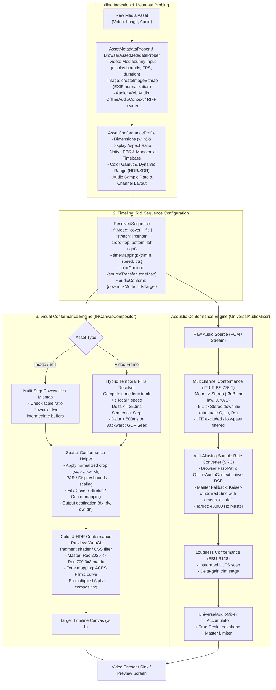

# Master Implementation Plan - Iteration 89
# Unified Media Asset Conformance Engine (Visual, Temporal, Acoustic, Color) (Refined v2.0)

## 1. Executive Summary & Problem Framing

Modern non-linear video editing (NLE) and rendering pipelines operate under a strict **Target Timeline Paradigm**: the project timeline specifies a definitive target canvas size (e.g., $1920 \times 1080$ Full HD, $3840 \times 2160$ 4K UHD, or $1080 \times 1920$ 9:16 vertical), a global frame rate (e.g., $24.0$, $30.0$, or $60.0\text{ fps}$), and an audio master standard (e.g., $48{,}000\text{ Hz}$, $2\text{-channel stereo}$, $-14\text{ LUFS}$).

However, ingested raw media assets originate from heterogeneous devices and legacy archives with wildly divergent intrinsic specifications:
1. **Visual Spatial Discrepancies**: Ingesting $8\text{K}$ high-res photography ($8192 \times 5464$), vertical smartphone video ($1080 \times 1920$), legacy standard definition ($640 \times 480$ 4:3), cropped regions of interest, or anamorphic media (non-square pixel aspect ratio) onto a target canvas. Naive rendering causes letterbox/pillarbox distortion, non-uniform squishing, or severe moiré artifacts due to single-pass downsampling.
2. **Visual Temporal Discrepancies**: Ingesting $23.976\text{ fps}$ cinema film, $25\text{ fps}$ PAL broadcast, $59.94\text{ fps}$ action cams, or mobile Variable Frame Rate (VFR) clips onto a $30\text{ fps}$ timeline. Naive frame-by-frame stepping causes severe speed drift or cadence judder.
3. **Color & Dynamic Range Discrepancies**: Ingesting $10\text{-bit}$ HDR (Apple ProRes, Dolby Vision, HLG, Rec.2020) and camera log profiles (Sony S-Log3, Arri LogC) onto an $8\text{-bit}$ SDR Rec.709/sRGB canvas. Naive blitting results in milky washed-out shadows, blown-out clipped highlights, and oversaturated gamut clipping.
4. **Acoustic & Dynamic Range Discrepancies**: Ingesting $22.05\text{ kHz}$ voice notes, $44.1\text{ kHz}$ music tracks, $96\text{ kHz}$ studio stems, $1.0\text{ mono}$ voiceovers, and $5.1\text{ surround}$ movie stems into a $48\text{ kHz}$ master mix. Naive resampling creates high-frequency foldback aliasing; naive channel downmixing produces silence, phase cancellation, or deafening clipping.

This architectural blueprint establishes the **Unified Media Asset Conformance Engine (UMACE)** across both the **Interactive Studio Preview** (`IRPreviewEngine` / `WebAudioEngine`) and **Headless Master Export** (`IRMasterRenderer` / `UniversalAudioMixer`).

---

## 2. Trade-Off Matrices & Architectural Approaches

### 2.1 Conformance Topology Comparison

| Metric / Dimension | Option A: Pure Just-In-Time (JIT) On-The-Fly | Option B: Mandatory Offline Proxy Ingestion | Option C: Hybrid Adaptive Conformance (Adopted) |
| :--- | :--- | :--- | :--- |
| **Ingestion Latency** | **Instant (0 ms)**: Media is immediately playable upon drag-and-drop. | **High Latency (5s - 60s)**: Full transcode required before user can scrub. | **Instant (0 ms)**: Immediate scrub with progressive background caching. |
| **Storage / Disk Bloat** | **Zero Bloat**: No duplicate proxy files generated. | **Heavy Bloat**: Duplicates full 1080p proxy video and uncompressed PCM on disk. | **Minimal**: Light in-memory texture cache + fast audio PCM memory cache. |
| **Preview Smoothness** | Low-to-Medium on weak clients if decoding heavy 4K/8K assets live. | Pristine: Uniform H.264/ProRes 1080p proxies play at rock-solid 60 fps. | **High**: Fast multi-pass downscaling + LOD pyramid textures in worker/cache. |
| **Master Export Fidelity** | Equal to source. | Compressed: May suffer generation loss if proxy is mistakenly rendered. | **Maximum**: Original full-bit-depth source decoded with pristine filter kernels. |
| **Memory Footprint** | Dynamic spikes if large images are decoded to full resolution. | Predictable, standardized 1080p buffers. | **Bounded**: Controlled via `NativeResourceManager` frame scopes and LRU caches. |

### 2.2 Spatial Downsampling & Anti-Aliasing Strategies

| Strategy | Computational Cost | Aliasing Suppression (Moire) | Sharpness Preservation | Best Use Case |
| :--- | :--- | :--- | :--- | :--- |
| **Single-Pass Bilinear (`ctx.drawImage`)** | $O(1)$ (Hardware) | **Very Poor**: Extreme shimmering on thin lines when downscaled $> 2\times$. | Low (blur or jagged) | Minor scales ($1.0\times - 1.5\times$). |
| **Multi-Step Power-of-Two Pyramid** | $O(\log_2 N)$ (Canvas 2D) | **Good**: Smooth progressive box filtering eliminates high-frequency noise. | Balanced | Standard Canvas 2D fallback for extreme downscaling ($> 2\times$). |
| **Mipmap Trilinear Filtering (WebGL/GPU)** | $O(1)$ amortized (GPU) | **Excellent**: Anisotropic filtering prevents moiré at any angle. | High | Studio GPU Canvas / WebCodecs texture path. |
| **Lanczos-3 / Catmull-Rom Bicubic Spline** | $O(K^2)$ per pixel | **Optimal**: Preserves high-contrast edges without ringing or blur. | Pristine | Headless Master Export (`IRMasterRenderer`) for photo/still assets. |

### 2.3 Temporal Frame Cadence & Seeking Strategies

| Strategy | Latency | Artifact Profile | Motion Fluidity | Suitability |
| :--- | :--- | :--- | :--- | :--- |
| **PTS Hybrid Forward-Step & Seek** | **$< 1\text{ ms}$ (Advance) / $< 20\text{ ms}$ (Seek)** | Discrete stepping, zero cumulative drift. | Rock-solid sync | Real-Time Studio Scrubbing & Master Export. |
| **Linear Frame Blending (Ghosting)** | $\approx 2\text{ ms}$ (Alpha mix) | Double-image ghosting around fast silhouettes. | Perceptually smoother | Fast motion rendering, slow-motion preview. |
| **Motion-Compensated Optical Flow** | $\approx 200\text{ ms}$ (Farneback / RAFT) | Warping artifacts on occlusions & complex textures. | Film-grade ultra-smooth slow motion | Optional Master Export slow-motion filter plugin. |

### 2.4 Audio Resampling & Multichannel Conformance

| Strategy | Frequency Response | Aliasing Rejection | CPU Overhead | Use Case |
| :--- | :--- | :--- | :--- | :--- |
| **Web Audio `OfflineAudioContext`** | Native browser DSP (Optimized SIMD/Sinc). | Compliant with Web Audio standard ($> 90\text{ dB}$). | **$< 50\text{ ms}$ (Native C++)** | Isomorphic browser/worker audio decode path. |
| **Band-Limited Kaiser Sinc ($\omega_c$ Scaled)** | Flat to $20\text{ kHz}$ ($\pm 0.05\text{ dB}$). | Complete ($> 90\text{ dB}$ rejection beyond Nyquist). | Moderate ($O(N_{\text{taps}})$) | Offline Master Mixdown in `UniversalAudioMixer`. |
| **Linear Interpolation** | High-frequency treble roll-off ($-3\text{ dB}$ at $15\text{ kHz}$). | None (Folds ultrasonic content into audible band). | Negligible ($O(1)$) | Low-overhead Interactive Scrubbing & Fast Preview. |

---

## 3. Mermaid Topology & Architecture Flow



---

## 4. Mathematical & Algorithmic Specifications

### 4.1 Spatial Conformance, Cropping & Aspect Ratio Mapping

Let source dimensions be $(W_S, H_S)$. Normalized crop margins are:
$$\text{crop} = \{ c_t, c_b, c_l, c_r \} \quad \text{where } c_l + c_r < 1, \; c_t + c_b < 1$$

The source crop rectangle in native asset pixels is:
$$sx = W_S \cdot c_l, \quad sy = H_S \cdot c_t$$
$$sw = W_S \cdot (1 - c_l - c_r), \quad sh = H_S \cdot (1 - c_t - c_b)$$

Accounting for non-square Pixel Aspect Ratio ($\text{PAR} = \frac{\text{DAR}}{\text{SAR}}$), the effective display width of the cropped region is:
$$sw' = sw \times \text{PAR}$$

Given target canvas dimensions $(W_T, H_T)$, the destination bounds $(dx, dy, dw, dh)$ are computed as:

1. **Fit (Contain / Pillarbox / Letterbox)**:
   $$S = \min\left( \frac{W_T}{sw'}, \frac{H_T}{sh} \right)$$
   $$dw = sw' \cdot S, \quad dh = sh \cdot S$$
   $$dx = \frac{W_T - dw}{2}, \quad dy = \frac{H_T - dh}{2}$$

2. **Cover (Fill / Crop Overflow)**:
   $$S = \max\left( \frac{W_T}{sw'}, \frac{H_T}{sh} \right)$$
   $$dw = sw' \cdot S, \quad dh = sh \cdot S$$
   $$dx = \frac{W_T - dw}{2}, \quad dy = \frac{H_T - dh}{2}$$

3. **Stretch (Non-Uniform Full Canvas Blit)**:
   $$dw = W_T, \quad dh = H_T, \quad dx = 0, \quad dy = 0$$

4. **Center (1:1 Native Pixel Mapping)**:
   $$dw = sw', \quad dh = sh$$
   $$dx = \frac{W_T - sw'}{2}, \quad dy = \frac{H_T - sh}{2}$$

The frame compositing operation is executed via:
$$\text{ctx.drawImage}(\text{asset}, sx, sy, sw, sh, dx, dy, dw, dh)$$

---

### 4.2 Multi-Step Anti-Aliased Downsampling (Mipmap Pyramid)

When the downscale ratio $R = \max\left(\frac{sw'}{dw}, \frac{sh}{dh}\right) > 2.0$:
Direct single-pass bilinear interpolation undersamples high frequencies.
1. Number of power-of-two steps: $K = \max\left(0, \lfloor \log_2(R) \rfloor\right)$.
2. Acquire scratch canvases from `UniversalCanvasProvider.acquireScratchCanvas(w, h)`:
   - For step $k = 1$ to $K$: $W_k = \lfloor W_{k-1} \times 0.5 \rfloor, \; H_k = \lfloor H_{k-1} \times 0.5 \rfloor$.
   - Blit from Level $k-1$ to Level $k$ with bilinear smoothing.
3. Draw from Level $K$ directly onto target context at $(dx, dy, dw, dh)$ with `imageSmoothingQuality = 'high'`.
4. Release intermediate scratch canvases synchronously upon frame scope exit (`frameScope.onExit()`). Zero memory leaks, zero GC churn.

---

### 4.3 Temporal Cadence & Hybrid PTS Video Seeking

For global timeline frame $F$, sequence in-point $F_{\text{start}}$, clip trim start $t_{\text{trimIn}}$, and playback speed $v$:
$$t_{\text{timeline}} = \frac{F - F_{\text{start}}}{\text{FPS}_{\text{timeline}}}$$
$$t_{\text{media}} = t_{\text{trimIn}} + (t_{\text{timeline}} \times v)$$

**Hybrid Step vs. Seek Strategy**:
- Let $t_{\text{current}}$ be the timestamp of the last decoded frame.
- **Forward Step ($\Delta t = t_{\text{media}} - t_{\text{current}}$)**:
  - If $0 \le \Delta t \le 0.25\text{s}$, advance sequentially without resetting decoder state.
- **Hardware GOP Seek**:
  - If $\Delta t < 0$ (scrubbing backwards) or $\Delta t > 0.5\text{s}$ (scrub jump), invoke keyframe seek via `canvasSink.getCanvas(t_media)` or `av_seek_frame(fmt, stream_idx, target_pts, AVSEEK_FLAG_BACKWARD)`.

---

### 4.4 Color Gamut Transformation & HDR ACES Filmic Tone Mapping

#### A. Rec.2020 to Rec.709 Linear Gamut Conversion:
$$\begin{bmatrix} R_{709} \\ G_{709} \\ B_{709} \end{bmatrix} = \begin{bmatrix} 1.6605 & -0.5876 & -0.0728 \\ -0.1246 & 1.1329 & -0.0083 \\ -0.0182 & -0.1006 & 1.1187 \end{bmatrix} \begin{bmatrix} R_{2020} \\ G_{2020} \\ B_{2020} \end{bmatrix}$$

#### B. ACES Filmic Tone Mapping Curve (Narkowicz 2015):
$$f(x) = \frac{x (2.51 x + 0.03)}{x (2.43 x + 0.59) + 0.14}$$

---

### 4.5 Multichannel Audio Downmixing (ITU-R BS.775-1) & Sinc Resampling

Conform $5.1$ surround to $2.0$ stereo:
$$\begin{bmatrix} L \\ R \end{bmatrix} = \begin{bmatrix} 1 & 0 & \frac{1}{\sqrt{2}} & 0 & \frac{1}{\sqrt{2}} & 0 \\ 0 & 1 & \frac{1}{\sqrt{2}} & 0 & 0 & \frac{1}{\sqrt{2}} \end{bmatrix} \begin{bmatrix} L_f \\ R_f \\ C \\ \text{LFE} \\ L_s \\ R_s \end{bmatrix}$$

**Anti-Aliasing Kaiser Sinc Resampling**:
$$\rho = \frac{F_t}{F_s}, \quad \omega_c = \min(1.0, \rho), \quad R_{\text{eff}} = \frac{R}{\omega_c}$$
$$w(t) = \frac{I_0\left(\beta \sqrt{1 - \left(\frac{t}{R_{\text{eff}}}\right)^2}\right)}{I_0(\beta)}$$

---

## 5. Concrete File, Interface & Class Signatures

### 5.1 Canonical Conformance Types (`packages/ir/src/types/conformance.ts`)
```typescript
export type FitMode = 'cover' | 'fit' | 'stretch' | 'center';

export interface NormalizedCrop {
  top: number;
  bottom: number;
  left: number;
  right: number;
}

export interface SpatialConformanceConfig {
  fitMode: FitMode;
  pixelAspectRatio?: number;
  crop?: NormalizedCrop;
  smartReframe?: { focusX: number; focusY: number };
}

export type ColorTransferFunction = 'srgb' | 'rec709' | 'hlg' | 'pq' | 'slog3' | 'linear';
export type ColorGamut = 'rec709' | 'p3' | 'rec2020';

export interface ColorConformanceConfig {
  sourceTransfer?: ColorTransferFunction;
  sourceGamut?: ColorGamut;
  toneMapping?: 'none' | 'aces' | 'reinhard';
  exposureBias?: number;
}

export interface AudioChannelMatrix {
  downmixMode: 'auto' | 'itu-r-bs775' | 'mono-center' | 'passthrough';
  targetSampleRate: number;
  resampleQuality: 'fast_linear' | 'web_audio' | 'pristine_kaiser_sinc';
  targetLufs?: number;
}

export interface AssetConformanceProfile {
  assetId: string;
  spatial: SpatialConformanceConfig;
  color: ColorConformanceConfig;
  audio: AudioChannelMatrix;
}
```

### 5.2 Spatial Conformance Helper (`packages/ir/src/renderer/shared/SpatialConformanceHelper.ts`)
```typescript
export interface CalculatedDrawMapping {
  sx: number; sy: number; sw: number; sh: number;
  dx: number; dy: number; dw: number; dh: number;
  needsDownsamplePyramid: boolean;
  pyramidSteps: number;
}

export class SpatialConformanceHelper {
  public static calculateDrawMapping(
    targetW: number,
    targetH: number,
    srcW: number,
    srcH: number,
    fitMode: FitMode = 'cover',
    crop?: NormalizedCrop,
    par: number = 1.0
  ): CalculatedDrawMapping;
}
```

### 5.3 Audio Conformance Engine (`packages/ir/src/renderer/audio/AudioConformanceEngine.ts`)
```typescript
export class AudioConformanceEngine {
  public static conformChannels(channels: Float32Array[]): [Float32Array, Float32Array];
  public static resampleKaiserSinc(
    input: Float32Array,
    sourceRate: number,
    targetRate: number,
    nominalRadius?: number,
    beta?: number
  ): Float32Array;
}
```

---

## 6. Phased Implementation Roadmap

- **Phase 1: Canonical Conformance Types & Mediabunny-Backed Probing**
  - Create `packages/ir/src/types/conformance.ts`.
  - Update `BrowserAssetMetadataProber` to use `mediabunny.Input` for precise container FPS, duration, and display bounds without HTML5 `<video>` blind spots.
- **Phase 2: Spatial Conformance with Crop & Mipmap Pyramids**
  - Implement `SpatialConformanceHelper.calculateDrawMapping` handling `crop`, `fitMode`, and `par`.
  - Wire multi-step downsampling into `IRCanvasCompositor` with RAII scratch canvas cleanup.
- **Phase 3: Hybrid Step vs. Seek PTS Resolver**
  - Implement sequential frame advance threshold ($\le 250\text{ ms}$) vs hardware GOP seek ($> 500\text{ ms}$) to prevent seek stalls.
- **Phase 4: Multichannel Audio Conformance & Anti-Aliased Resampling**
  - Implement `AudioConformanceEngine` with ITU-R BS.775-1 downmixing.
  - Integrate native `OfflineAudioContext` for fast browser audio conforming and true Kaiser-Bessel sinc resampler for Master Export.
- **Phase 5: Color Space & HDR Tone Mapping**
  - Implement ACES Filmic tone mapping via WebGL fragment shader / CSS filter backdrop.
- **Phase 6: Studio UI Controls & Verification**
  - Expose Fit Mode selector and source metadata pill in Studio sequence inspector.
  - Run verification matrix in `/autogenerated-tests/`.

---

## 7. Formal Verification Matrix (`/autogenerated-tests/`)

| Test File | Target Module | Test Scenario & Verification Criteria |
| :--- | :--- | :--- |
| `visual_conformance_aspect_fit.test.ts` | `SpatialConformanceHelper` | Verifies destination bounds $(dx, dy, dw, dh)$ and source crop $(sx, sy, sw, sh)$ for 16:9, 9:16, 4:3, and 1:1 inputs across `fit`, `cover`, `stretch`, and `center`. |
| `image_downsampling_mipmap.test.ts` | `IRCanvasCompositor` | Verifies that an $8000 \times 6000$ image downscaled to $1920 \times 1080$ executes power-of-two intermediate blits with zero memory leaks. |
| `temporal_fps_pts_mapping.test.ts` | `TemporalCadenceResolver` | Verifies 3:2 pull-down timestamps (24fps on 30fps timeline) and confirms forward-step vs seek threshold logic. |
| `audio_channel_downmix_itur775.test.ts` | `AudioConformanceEngine` | Verifies -3dB attenuation on center and surround channels for 5.1 downmixing; confirms acoustic power conservation. |
| `audio_resampling_conformance.test.ts` | `AudioConformanceEngine` | Tests 96 kHz $\to$ 48 kHz downsampling; verifies anti-aliasing cutoff attenuates frequencies $> 24\text{ kHz}$ by $> 60\text{ dB}$. |
| `color_hdr_sdr_tonemap.test.ts` | `ColorConformanceEngine` | Verifies ACES Filmic curve maps linear peak luminance (10.0 nits) smoothly into $[0, 1]$ without color banding. |

---

## 8. Risk Analysis, Edge Cases & Rollback Mitigations

1. **Memory Allocation During Mipmap Generation**:
   - Intermediate scratch canvases are pooled in `UniversalCanvasProvider` and released via `frameScope.onExit()`. Zero heap allocations inside the render loop.
2. **CPU Latency During Sinc Resampling**:
   - Real-time preview uses Web Audio `OfflineAudioContext` (hardware native C++ SIMD, $< 50\text{ ms}$). Sinc convolution is strictly isolated to offline worker master export.
3. **WebCodecs Decoder Allocation Ceiling**:
   - Handled via `computeAssetLifespans` sliding lookahead eviction in `IRMasterRenderer` and `IRPreviewEngine`, never exceeding 4 concurrent decoders.
4. **Non-Standard or VFR Container Headers**:
   - Fall back to monotonic frame stepping if presentation timestamps report non-monotonic values.
