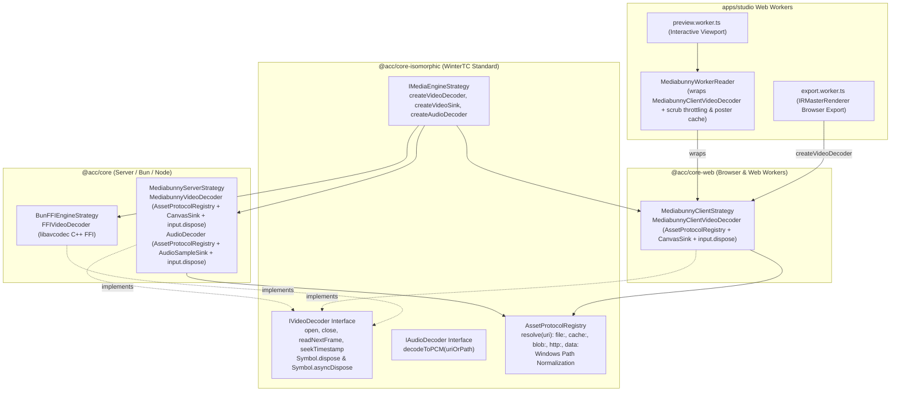

# Master Implementation Plan - Iteration 90: Isomorphic Asset Protocol Resolution & Video Decoder Strategy Parity (Grill-Me Aligned)

## 1. Executive Summary
This iteration addresses critical architectural discrepancies, resource safety hazards, and platform-specific edge cases identified in the media engine strategy layer:
1. In [`MediabunnyServerStrategy.ts`](file:///c:/Users/Admin/workspace/git/acc/packages/core/src/media-engine/strategies/MediabunnyServerStrategy.ts), both video decoding ([`MediabunnyVideoDecoder`](file:///c:/Users/Admin/workspace/git/acc/packages/core/src/media-engine/strategies/MediabunnyServerStrategy.ts#L220-L307)) and audio decoding (`createAudioDecoder().decodeToPCM`) relied on raw Node.js `fs.existsSync(filePath)` calls, causing immediate failure whenever media assets are referenced via virtual or non-filesystem protocols (`cache://`, `blob:`, `http://`, `https://`, `data:`).
2. While `BunFFIEngineStrategy` and `MediabunnyServerStrategy` provide `createVideoDecoder()` implementing `IVideoDecoder`, [`MediabunnyClientStrategy`](file:///c:/Users/Admin/workspace/git/acc/packages/core-web/src/media-engine/MediabunnyClientStrategy.ts) lacked `createVideoDecoder()`. As a result, when [`IRMasterRenderer`](file:///c:/Users/Admin/workspace/git/acc/packages/ir/src/renderer/IRMasterRenderer.ts) is executed in browser Web Workers during MP4 export ([`export.worker.ts`](file:///c:/Users/Admin/workspace/git/acc/apps/studio/src/renderer/workers/export.worker.ts)), it could not decode video sequences.
3. Architectural alignment via `/grill-me` established:
   - Unified decoder hierarchy: [`MediabunnyWorkerReader`](file:///c:/Users/Admin/workspace/git/acc/apps/studio/src/renderer/workers/MediabunnyWorkerReader.ts) composes [`MediabunnyClientVideoDecoder`](file:///c:/Users/Admin/workspace/git/acc/packages/core-web/src/media-engine/MediabunnyClientStrategy.ts), eliminating duplicated WebCodecs decoder setup while isolating Studio viewport scrub/cache concerns.
   - Zero-copy pool canvas: returns `wrappedCanvas.canvas` directly to eliminate double-blits.
   - Strict/debug fail-fast vs prod fail-soft modes.
   - Dual `[Symbol.dispose]` and `[Symbol.asyncDispose]` explicit resource management.
   - Windows `file:///C:/...` path normalization in `AssetProtocolRegistry`.
   - Multi-track frame retention in `IRMasterRenderer.renderCanvasFrame()`.

---

## 2. Trade-Off Matrices

| Dimension | Option A: Ad-Hoc `fs` / Isolated `MediabunnyWorkerReader` | Option B: Canonical `AssetProtocolRegistry` + `MediabunnyClientVideoDecoder` (Selected) |
|---|---|---|
| **Protocol Compatibility** | Limited to disk files (`C:\...`) on server; crashes on `cache://` or `blob:`. | Universal across `file:`, `cache:`, `blob:`, `http:`, and `data:`. |
| **Reader Hierarchy** | Duplicate decoder logic in Studio worker; no decoder contract in core. | `MediabunnyWorkerReader` wraps `MediabunnyClientVideoDecoder` (Single Source of Truth). |
| **Canvas Blitting** | Dual software blit (decode to intermediate canvas $\rightarrow$ draw to target canvas). | Zero-copy direct pool canvas from `CanvasSink(width, height, fit: 'fill')`. |
| **Windows Path Safety** | `file:///C:/path` becomes `/C:/path`, failing `fs.existsSync`. | Normalizes leading slash before drive letters (`C:/path`). |
| **Browser Export Parity** | `export.worker.ts` cannot decode video clips; falls back to static posters. | Full sequential & random-access WebCodecs video decoding during export. |
| **Multi-Track Reuse** | `onAssetDrawn` deletes frame, breaking multi-track Picture-in-Picture. | Retains frame throughout frame composition pass; cleans up in `finally`. |
| **Lifecycle Safety** | Unclosed `Input` handles leak file descriptors and worker demuxer threads. | Strict `input.dispose()` in `close()` and dual `[Symbol.dispose]` / `[Symbol.asyncDispose]`. |

---

## 3. Mermaid Topology



---

## 4. Mathematical & Algorithmic Specifications

### 4.1 Universal Source Resolution
Given an input media URI or path $U$:
$$\text{AssetBlob} = \text{AssetProtocolRegistry.getInstance().resolve}(U)$$

$$\text{Source}(U) = \begin{cases} 
\text{new FilePathSource}(\text{nativePath}), & \text{if } \text{isServer} \land \text{nativePath} \neq \text{null} \land \text{fs.existsSync}(\text{nativePath}) \\
\text{new UrlSource}(U), & \text{if } U \in \{\text{http://*}, \text{https://*}\} \\
\text{new BlobSource}(\text{await AssetBlob.blob}()), & \text{if } \text{typeof AssetBlob.blob} = \text{function} \\
\text{new BufferSource}(\text{await AssetBlob.arrayBuffer}()), & \text{otherwise}
\end{cases}$$

### 4.2 Windows Path Normalization
$$\text{Normalize}(P) = \begin{cases}
P_{1..}, & \text{if } P \text{ matches } \verb|/^[a-zA-Z]:/| \\
P, & \text{otherwise}
\end{cases}$$

---

## 5. Concrete File & Class Signatures

### 5.1 `packages/core/src/media-engine/strategies/MediabunnyServerStrategy.ts`
```ts
export class MediabunnyVideoDecoder implements IVideoDecoder {
  public async open(): Promise<boolean>;
  public async seekTimestamp(targetSeconds: number): Promise<ICanvasInstance | null>;
  public async readNextFrame(): Promise<ICanvasInstance | null>;
  public close(): void;
  public [Symbol.dispose](): void;
  public [Symbol.asyncDispose](): Promise<void>;
  public readonly width: number;
  public readonly height: number;
  public duration: number;
}
```

### 5.2 `packages/core-web/src/media-engine/MediabunnyClientStrategy.ts`
```ts
export class MediabunnyClientVideoDecoder implements IVideoDecoder {
  public async open(): Promise<boolean>;
  public async seekTimestamp(targetSeconds: number): Promise<ICanvasInstance | null>;
  public async readNextFrame(): Promise<ICanvasInstance | null>;
  public close(): void;
  public [Symbol.dispose](): void;
  public [Symbol.asyncDispose](): Promise<void>;
  public readonly width: number;
  public readonly height: number;
  public duration: number;
}

export class MediabunnyClientStrategy implements IMediaEngineStrategy {
  public createVideoDecoder(filePathOrUri: string, targetWidth: number, targetHeight: number): IVideoDecoder;
  ...
}
```

---

## 6. Phased Roadmap

### Phase 1: Isomorphic Contracts & Path Normalization
- Update `IVideoDecoder` in `packages/core-isomorphic/src/media-engine/types.ts` with dimensions and dual `[Symbol.dispose]` / `[Symbol.asyncDispose]`.
- Normalize Windows drive paths in `packages/core-isomorphic/src/assets/AssetProtocolRegistry.ts`.
- Remove premature multi-track deletion in `packages/ir/src/renderer/IRMasterRenderer.ts`.

### Phase 2: Server Strategy Asset Protocol Unification & Leak Safety
- Refactor `MediabunnyVideoDecoder.open()` in `packages/core/src/media-engine/strategies/MediabunnyServerStrategy.ts` to query `AssetProtocolRegistry`.
- Call `this.input?.dispose()` in `close()` and configure direct target dimensions in `CanvasSink`.
- Refactor `createAudioDecoder()` to eliminate hardcoded `fs.existsSync(filePath)` and ensure `input.dispose()` in `finally`.
- Add `[Symbol.dispose]` and `[Symbol.asyncDispose]` to `FFIVideoDecoder`.

### Phase 3: Client Video Decoder Implementation & Studio Reader Unification
- Implement `MediabunnyClientVideoDecoder` in `packages/core-web/src/media-engine/MediabunnyClientStrategy.ts`.
- Expose `createVideoDecoder(filePathOrUri, targetWidth, targetHeight): IVideoDecoder` on `MediabunnyClientStrategy`.
- Wrap client `createAudioDecoder().decodeToPCM` with `input.dispose()`.
- Refactor `MediabunnyWorkerReader` in `apps/studio/src/renderer/workers/MediabunnyWorkerReader.ts` to compose `MediabunnyClientVideoDecoder`.

### Phase 4: Verification & Parity Testing
- Create `autogenerated-tests/mediabunny_isomorphic_decoder.test.ts`.
- Verify URI resolution for `cache://`, `blob:`, `http://`, and `file://`.
- Run Studio production build to guarantee zero regression.

---

## 7. Formal Verification Matrix

| Test Suite | Target Component | Invariant Verified |
|---|---|---|
| `mediabunny_isomorphic_decoder.test.ts` | `AssetProtocolRegistry` | Normalizes `file:///C:/...` and resolves `cache:`, `data:` |
| `mediabunny_isomorphic_decoder.test.ts` | `MediabunnyServerStrategy` | Resolves `file:`, `cache:`, `data:` URIs via `AssetProtocolRegistry` |
| `mediabunny_isomorphic_decoder.test.ts` | `MediabunnyClientStrategy` | Instantiates `MediabunnyClientVideoDecoder` conforming to `IVideoDecoder` |
| `mediabunny_isomorphic_decoder.test.ts` | Lifecycle Safety | Calls `input.dispose()`, freeing demuxer buffers and file handles via `[Symbol.dispose]` and `[Symbol.asyncDispose]` |
| Studio Build | `@acc/studio` | Zero build errors or module externalization breaks in Web Workers |

---

## 8. Risk & Rollback Mitigations
* **Risk**: Missing browser APIs (`fs`, `Buffer`) in Web Workers.
  * **Mitigation**: `AssetProtocolRegistry` and `@acc/core-web` enforce zero Node built-in imports.
* **Risk**: Video decoder resource exhaustion in browser exports.
  * **Mitigation**: Bounded `poolSize: 2` on `CanvasSink` and explicit `input.dispose()` on export completion or cancellation.
* **Rollback Plan**: Revert to commit `13c0495c` (`feat(media): integrate temporal cadence in studio worker and add mediabunny video decoder`).
