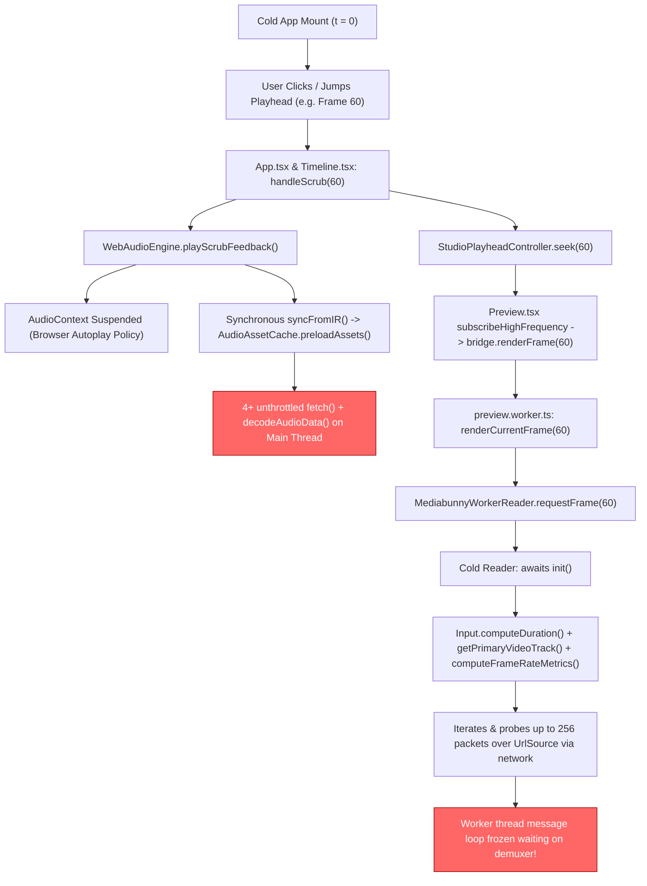

# 233. Root Cause Analysis: Cold-Start Playhead Jump/Scrub Application Hang

## Problem Description
On cold startup of `@acc/studio`, immediately clicking or scrubbing the playhead across the timeline ruler causes the entire application (main thread and UI) to freeze or hang. Conversely, if the user starts playback even briefly (pressing Space/Play) and *then* scrubs or jumps the playhead, seeking is completely smooth without any lag or freezes.

---

## Detailed Root Cause Analysis

Investigation traced this issue to two interconnected bottlenecks across the Web Worker video decoding pipeline and the main thread audio feedback engine:



### 1. Web Worker Video Pipeline: Blocking Network Packet Demuxing in `MediabunnyWorkerReader.init()`
When jumping directly to a frame (such as frame 60) on cold startup:
- `MediabunnyWorkerReader.requestFrame()` observes `!this.isInitialized` and awaits `this.init()`.
- Inside `this.init()`:
  ```ts
  const duration = await this.input.computeDuration().catch(() => 0); // Scans packets sequentially
  ...
  const metrics = await track.computeFrameRateMetrics().catch(() => null); // Probes up to 256 packets over UrlSource
  ```
- Because the asset is an HTTP URL (`UrlSource`), `computeDuration()` and `computeFrameRateMetrics()` perform sequential range requests over the network while parsing the video container.
- While this demuxing is running, multiple high-frequency scrub events arrive at `preview.worker.ts`, keeping `isRendering = true` or piling up promises.
- **Why playing preview once fixes it**:
  When the user clicks "Play", the worker initiates playback sequentially starting at frame 0. Playback timing allows `init()` to complete asynchronously in the background. Once initialized, `CanvasSink` is ready and subsequent seeks only query `canvasSink.getCanvas()`, which is fast.

### 2. Main Thread: AudioContext Autoplay Suspension & Synchronous Preloading in `playScrubFeedback()`
- In `App.tsx` and `Timeline.tsx`:
  - `handleScrub()` calls `WebAudioEngine.getInstance().playScrubFeedback()`.
  - In `Timeline.tsx`, `handleScrub()` called `playScrubFeedback()`, and then passed the event to `App.tsx:handleScrub()`, which *also* called `playScrubFeedback()`—triggering **duplicate audio processing** per scrub tick.
- On cold start:
  - `playScrubFeedback()` initializes `AudioContext`. Under modern browser autoplay policies, the context is created in a `'suspended'` state because no explicit user gesture (such as a Play button click) has unlocked it.
  - Calling buffer creation and scheduling on a suspended context while calling `syncFromIR(irState, fps)` causes `AudioAssetCache.getInstance().preloadAssets(assets)` to fire multiple simultaneous `fetch()` calls and `ctx.decodeAudioData()` operations on the main UI thread.
  - Combined with synchronous Float32 DSP calculations in `UniversalAudioMixer.mixStereo()`, this overwhelms the main thread event loop.

---

## Architectural Safeguards & Resolution Strategy

To ensure this issue never resurfaces:

1. **Non-Blocking Fast Initialization for `MediabunnyWorkerReader`:**
   - Remove `computeDuration()` and `computeFrameRateMetrics()` from the critical path of `init()`.
   - Initialize `CanvasSink(track)` immediately as soon as the primary video track is acquired.
   - Guard `requestFrame()`: if `!this.isInitialized`, trigger `init()` in the background and return `null` immediately. The renderer will hold the existing frame or draw the placeholder without stalling the worker message loop.

2. **Defensive Autoplay Guard for `WebAudioEngine`:**
   - In `playScrubFeedback()`, check `if (this.ctx?.state === 'suspended') return;`.
   - If the audio context has not been unlocked by user playback, scrub audio DSP is safely skipped.
   - Decouple `preloadAssets()` from the interactive scrub feedback loop.

3. **Scrub Event Deduplication:**
   - Remove redundant calls to `playScrubFeedback()` in child components (`Timeline.tsx`), standardizing single-point dispatch in `App.tsx`.

---

## Related Files
- `apps/studio/src/workers/MediabunnyWorkerReader.ts`
- `apps/studio/src/workers/preview.worker.ts`
- `apps/studio/src/lib/audio/WebAudioEngine.ts`
- `apps/studio/src/lib/audio/AudioAssetCache.ts`
- `apps/studio/src/components/Timeline.tsx`
- `apps/studio/src/App.tsx`
