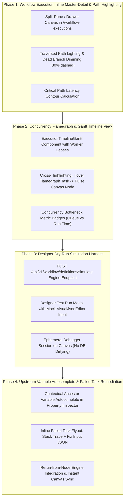

# Integration Master Plan: Iteration 14 — Visual DAG Studio Dual-Mode Architecture & Runtime Operations Experience

## 1. Executive Summary & Vision

Iteration 14 focuses on elevating **Visual DAG Studio** across both **Workflow Definition Authoring (`/workflows`)** and **Workflow Execution Operations (`/workflow-executions`)**. By establishing a strict **Dual-Persona Mental Model** (The Workflow Architect vs. The SRE/Operator), this iteration eliminates design-time clutter while equipping operators with deep runtime observability, inline master-detail inspection, traversed-path lighting, execution flamegraphs, upstream variable auto-completion, and single-click failure remediation.

---

## 2. Decided Architecture & Invariants

| Domain Area | Architectural Invariant & Design Decisions |
| :--- | :--- |
| **1. Dual-Persona Operational Modes** | **Strict Separation of Authoring vs. Execution Control Planes:** - **Authoring Mode (`mode="full"`, `executionId=undefined`)**: Exclusively presents design capabilities (23-node categorized palette, auto-layout LR/TB, undo/redo, Kahn/Tarjan topological cycle validation, import/export IR, save to catalog). Debugger controls (Pause, Step Over, Resume, Watch) and node breakpoint dots are completely hidden. - **Execution Mode (`mode="execution" \| "readonly"`, `executionId` present)**: Hides designer mutation tools; activates real-time SSE stream, node breakpoint traps, time-travel scrubber, flamegraph timeline tab, and live Variable Watch drawer. |
| **2. Inline Execution Master-Detail Ergonomics** | **Zero Context-Switch Execution Inspection:** In `/workflow-executions`, operators can toggle a **Split-Pane / Slide-over Drawer** directly adjacent to the DataTable. Clicking an execution row immediately streams its live DAG status, traversed execution path, and task logs without navigating away or losing table filters. |
| **3. Traversed Path & Dead Branch Contrast** | **Dynamic Edge & Node Traversal Optics:** - **Traversed Edges**: Rendered with glowing animated pulses (`stroke-emerald-500` / `stroke-sky-500`). - **Bypassed / Dead Branches**: When a `SWITCH` or conditional fork evaluates to a specific branch, untraversed paths and downstream nodes are automatically dimmed (30% opacity, dashed strokes) to clearly reveal the true execution path. - **Critical Path Highlighting**: Highlights the longest latency sequential chain of tasks contributing to total wall-clock duration. |
| **4. Concurrency Flamegraph & Gantt Timeline** | **Horizontal Waterfall Visualization for Parallel Tasks:** A synchronized **Gantt / Flamegraph View** rendered alongside or tabbed within Visual DAG Studio in execution mode. Visualizes queue wait time, worker lease acquisition, execution duration, and retries for parallel branches (`FORK_JOIN`, `DYNAMIC_FORK`). |
| **5. Designer Dry-Run / Test Harness** | **Ephemeral Local Simulation in Authoring Mode:** Allows workflow designers to test run their DAG before deployment. Designers provide a test input JSON via `VisualJsonEditor`; the engine simulates decision tree paths and expression evaluations, highlighting would-be traversed branches without writing dirty records to the production database. |
| **6. Contextual Upstream Variable Autocomplete** | **Intelligent Interpolation Helper:** When editing node inputs in `DagPropertyInspector` or `VisualJsonEditor`, typing `${` or clicking a pill dynamically inspects topological ancestor outputs and suggests exact dot-paths (e.g. `${checkInventory.output.sku}`) with instant validation against dead references. |
| **7. Inline Task Remediation & Partial Re-Run** | **Single-Click Fix & Resume for Failed Tasks:** Failed nodes (`FAILED` state with red halo) offer an inline **"Edit & Retry"** dialog. Operators can adjust input parameters using `VisualJsonEditor` and trigger `POST /api/v1/workflow/executions/{id}/tasks/{ref}/rerun` without restarting upstream completed tasks. |

---

## 3. Four-Phase Execution Roadmap

---

## 4. Phase Breakdown & Implementation Details

### Phase 1: Workflow Execution Inline Master-Detail & Path Highlighting
- **Objective:** Enable operators to inspect live workflow graphs without losing table context in `/workflow-executions`, and visually distinguish traversed routes from bypassed decision branches.
- **Components to Modify/Create:**
  - `apps/console/src/features/workflow-executions/components/workflow-executions-table.tsx`: Add split-pane / sheet toggle for selected execution row.
  - `apps/console/src/features/workflow-executions/components/workflow-execution-detail-drawer.tsx`: Slide-over drawer embedding `VisualDagStudio` in `mode="execution"` with live SSE streaming.
  - `apps/console/src/features/metadata/components/studio/visual-dag-studio.tsx`: Calculate traversed vs bypassed edges using completed task outputs and switch decision values; dim unvisited nodes/edges.
- **Verification:** Vitest unit tests asserting edge styling classes for traversed vs bypassed branches; Playwright verification of split-pane toggle.

### Phase 2: Concurrency Flamegraph & Gantt Timeline View
- **Objective:** Provide visual timeline profiling for parallel workflows (`FORK_JOIN` and `DYNAMIC_FORK`) to instantly identify worker lag and task duration.
- **Components to Modify/Create:**
  - `apps/console/src/features/metadata/components/studio/workflow-execution-flamegraph.tsx`: Render horizontal bars sorted by start timestamp with queue wait duration (striped) and execution duration (solid).
  - Synchronize hover state between flamegraph bars and DAG canvas nodes (`activeHoveredTaskRef`).
  - Add tab toggle (`Graph View` vs `Timeline View`) in `visual-dag-studio.tsx` execution toolbar.
- **Verification:** Unit tests verifying bar width/offset calculations from task timestamps; theme token compliance with Liquid Glass.

### Phase 3: Designer Dry-Run Simulation Harness
- **Objective:** Enable workflow designers in `/workflows` to simulate their DAG locally with custom mock JSON inputs before publishing.
- **Components to Modify/Create:**
  - `apps/backend/workflow-engine/src/main/java/com/acc/workflow/application/WorkflowEngineService.java`: Add `simulateExecution(WorkflowDefinition def, Map<String, Object> input)` returning simulated execution events without database writes.
  - `apps/backend/acc-ms-aio/src/main/java/com/acc/aio/controller/workflow/WorkflowDefinitionController.java`: Expose `POST /api/v1/workflow/definitions/simulate`.
  - `apps/console/src/features/metadata/components/studio/workflow-dry-run-modal.tsx`: Modal with `VisualJsonEditor` for input parameters and "Run Simulation" button.
  - Update `VisualDagStudio` authoring toolbar to add "Dry Run" action button.
- **Verification:** Sliced `@WebMvcTest` for `/simulate`; Vitest tests for modal submission and canvas simulation preview.

### Phase 4: Upstream Variable Autocomplete & Failed Task Remediation
- **Objective:** Accelerate workflow authoring with variable autocomplete and provide single-click error remediation for failed tasks.
- **Components to Modify/Create:**
  - `apps/console/src/features/metadata/components/studio/dag-variable-autocomplete.tsx`: Popover suggesting available upstream variables matching `${prefix`.
  - `apps/console/src/features/metadata/components/studio/dag-property-inspector.tsx`: Integrate autocomplete into input parameter fields.
  - `apps/console/src/features/metadata/components/studio/task-remediation-dialog.tsx`: Modal appearing on failed nodes offering JSON parameter overrides and "Rerun from This Node" execution.
- **Verification:** Unit tests verifying ancestor output resolution and rerun mutation dispatch; `tsc --noEmit` exits 0.

---

## 5. Definition of Done & Quality Gates
- **Zero Orphaned Code:** All components wired into active routes and control drawers.
- **WCAG 2.2 AA Compliance:** Keyboard accessible flamegraph and drawer, visible focus indicators, explicit ARIA announcements.
- **Zero Stubs:** Pure decider simulation in backend without mocks; real REST endpoints wired via TanStack Query.
- **History Log & Archival:** Sequential history documentation in `docs/history/` and commit per conventional commits standard.
