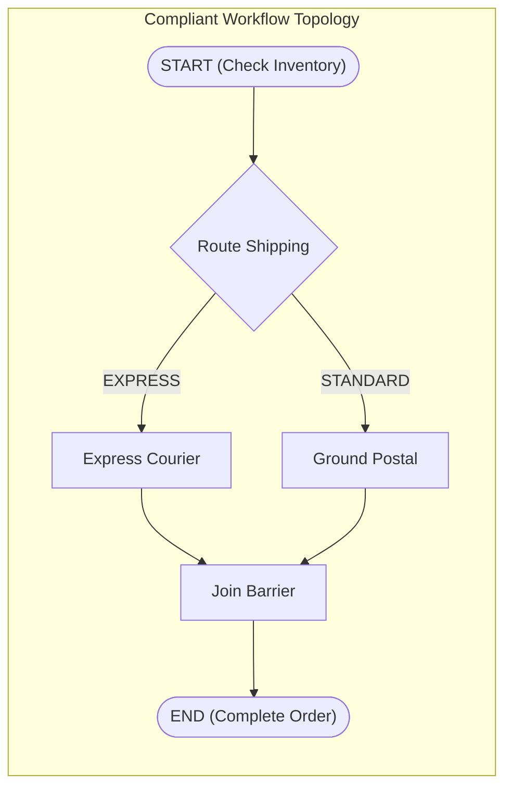

# Integration Master Plan: Iteration 15
## DAG Graph Topology Invariants (Conventional Single-Start & Single-End), Canvas Authoring & Existing Visual Debugger Alignment

> **Monorepo Target:** `@acc/console` (`apps/console`) & `@acc/backend` (`apps/backend/workflow-engine`, `apps/backend/acc-ms-aio`)  
> **Status:** Final Aligned Specification  
> **Author:** Lead Systems Architect & Full-Stack Engineer  

---

## Executive Summary & Core Decisions

Following the architectural interview and grill-me session, Iteration 15 establishes strict graph topological invariants, enhances the canvas authoring experience, and tightly aligns the existing Visual DAG Studio Debugger with the backend execution state machine.

### Key Architectural Decisions:
1. **Conventional Single Start & Single End Nodes**:
   - **No new artificial node types**: Start and End nodes are regular conventional tasks (e.g. `SIMPLE`, `NOOP`, or `TERMINATE`).
   - **Single Entry ($\text{inDegree} = 0$) & Single Exit ($\text{outDegree} = 0$)**: The graph must strictly have exactly ONE node with $\text{inDegree} = 0$ and exactly ONE node with $\text{outDegree} = 0$.
   - **Parallel Logic via Fork/Join**: When parallel logic or branching occurs (`SWITCH`, `FORK_JOIN`), all paths must converge via `JOIN` nodes before reaching the single terminal End node.
   - **Protected Initial Nodes**: When creating a new workflow, a default Start node and End node are pre-populated with `isPermanent: true`. Users cannot delete them (via UI Delete button, Backspace, or Clear action). They are visually distinguished with "START" (emerald) and "END" (purple/violet) boundary badges.
   - **Strict Hard Blocking**: Both Frontend (Save DAG button disabled + error banners) and Backend (`AcyclicityGuard.java` returning HTTP 400 ProblemDetail) reject multi-start, multi-end, or disconnected graphs.
2. **Visual DAG Canvas Authoring & Edge Condition Editor**:
   - **Interactive Custom Edge (`DagConditionEdge`)**: Clickable edge connectors displaying branch/decision labels (e.g., `EXPRESS`, `STANDARD`, `${condition}`).
   - **Edge Condition Modal (`DagEdgeConditionModal`)**: Visual dialog to configure transition expressions and `SWITCH` case mapping directly from the canvas without manual JSON editing.
   - **Node Palette & Drag-and-Drop**: Categorized palette for all 23 task types with drag-and-drop onto canvas and auto-layout alignment.
3. **Existing Visual DAG Studio Debugger Alignment**:
   - Rather than creating a separate disconnected debugger, align and polish the **existing Visual DAG Studio Debugger toolbar and controls**:
     - **Breakpoint Sync**: Node breakpoint toggles dynamically sync with `POST /api/v1/workflow/executions/{id}/breakpoints`.
     - **Pause / Resume / Step Over**: Wire buttons directly to `POST /pause`, `POST /resume`, and `POST /step`, synchronizing with live SSE stream events (`WORKFLOW_PAUSED`, `WORKFLOW_RESUMED`, `BREAKPOINTS_UPDATED`).
     - **Variable Watch Drawer**: Connect the "Watch" button to `WorkflowVariableWatchDrawer` displaying input variables, task output payloads, and step diffs via `VisualJsonEditor`.

---

## 1. Graph Topology Invariant Specification

### 1.1 Mathematical Definition
Let $G = (V, E)$ be the directed acyclic graph of a workflow definition:
1. **Single Source (Start)**:
   $$\big| \{ v \in V \mid \text{inDegree}(v) = 0 \} \big| = 1$$
2. **Single Sink (End)**:
   $$\big| \{ v \in V \mid \text{outDegree}(v) = 0 \} \big| = 1$$
3. **Global Connectivity**: Every node $u \in V$ must be reachable from the Start node ($s \leadsto u$) and must be able to reach the End node ($u \leadsto t$).

### 1.2 Frontend Topology Validation (`workflow-ir-converter.ts`)
- `validateGraphTopology(nodes, edges)` will enforce:
  - If `nodes.length === 0`: report `EMPTY_GRAPH`.
  - If `nodes.length === 1`: allowed (the single node is both entry and exit).
  - If `nodes.length > 1`:
    - Count nodes with `inDegree === 0`. If $>1$, flag `MULTIPLE_START_NODES` with the list of node labels. If $0$, flag `NO_START_NODE` (cycle).
    - Count nodes with `outDegree === 0`. If $>1$, flag `MULTIPLE_END_NODES` with the list of node labels. If $0$, flag `NO_END_NODE`.
    - Traverse reachable set from Start node and reverse reachable set from End node. Any unvisited nodes trigger `DISCONNECTED_GRAPH` / `UNREACHABLE_NODE`.
- Decorate nodes with `isStartNode` and `isEndNode` flags so `DagWorkflowNodeComponent` renders the visual boundary badges.

### 1.3 Canvas Protection for Start and End Nodes
- In `DagStudioCanvas`:
  - When initializing a blank canvas or creating a new workflow, seed:
    - `node-start`: `{ taskReferenceName: 'start', taskType: 'SIMPLE', label: 'Start Flow', isPermanent: true }`
    - `node-end`: `{ taskReferenceName: 'end', taskType: 'TERMINATE', label: 'End Flow', isPermanent: true }`
    - Connected by an initial edge `node-start -> node-end`.
  - In `handleDeleteSelected` and keyboard event listeners (`Backspace`, `Delete`), filter out any node with `data.isPermanent === true`.
  - Disable delete button in the Property Inspector if `selectedNode?.data.isPermanent`.

### 1.4 Backend Enforcement (`AcyclicityGuard.java` & `WorkflowDefinitionController.java`)
- Update `AcyclicityGuard.validateAndSort(definition)`:
  - Compute in-degree and out-degree across all `tasks` and their transition/join dependencies.
  - If more than 1 task has in-degree 0, throw `WorkflowTopologyException("Workflow must have exactly one start node, found: " + startNodes)`.
  - If more than 1 task has out-degree 0, throw `WorkflowTopologyException("Workflow must have exactly one end node, found: " + endNodes)`.
- `WorkflowDefinitionController` handles `WorkflowTopologyException` by returning HTTP 400 Bad Request with RFC-7807 `ProblemDetail`.

---

## 2. Visual Edge Condition Editor

### 2.1 Custom ReactFlow Edge: `DagConditionEdge`
- Registered in ReactFlow `edgeTypes` as `dagEdge`.
- Built using `BaseEdge` + `EdgeLabelRenderer`:
  - Displays a pill badge centered on the edge path with Liquid Glass styling (`backdrop-blur-md bg-background/80 border text-[11px] font-mono px-2 py-0.5 rounded-full cursor-pointer hover:border-primary`).
  - Displays edge label (e.g., `EXPRESS`, `amount > 500`, or `DEFAULT`).
  - Clicking the edge or its badge opens the condition editor modal.

### 2.2 Modal Dialog: `DagEdgeConditionModal`
- Allows setting:
  - **Condition Expression**: `${workflow.input.speed == 'express'}`.
  - **Switch Decision Case**: String key mapping to parent switch node's `decisionCases`.
  - **Is Default Path**: Designates the edge as `defaultCase`.
- On submit:
  - Updates the edge `label` and `data.condition`.
  - Updates the source node's `decisionCases` and `defaultCase` accordingly in the nodes state array.

---

## 3. Visual DAG Studio Debugger Alignment

### 3.1 Unifying UI Controls with Backend Engine State
The existing debugger in `VisualDagStudio` is polished to be 100% reactive to backend SSE events:
- **Breakpoints**:
  - Toggling breakpoint on a node updates local node state and issues `POST /api/v1/workflow/executions/{id}/breakpoints`.
  - When backend reaches breakpoint, execution pauses with `PAUSED_AT_BREAKPOINT`.
  - SSE broadcasts `WORKFLOW_PAUSED` -> UI highlights the paused node with an amber pulsing glow and updates the toolbar status.
- **Step Over**:
  - Clicking "Step Over" issues `POST /api/v1/workflow/executions/{id}/step`.
  - Backend executes only the paused task, auto-arms a breakpoint on the next frontier task, and suspends again.
  - UI receives SSE update, shifts the paused badge to the next task, and updates duration/output in real time.
- **Resume**:
  - Issues `POST /api/v1/workflow/executions/{id}/resume`. Execution runs normally until the next breakpoint or completion.
- **Variable Watch Drawer (`WorkflowVariableWatchDrawer`)**:
  - Toggled via the "Watch" button on the Debugger Toolbar.
  - Renders:
    - **Current Workflow Input & Variables**: Live accumulator snapshot.
    - **Task Outputs**: Chronological output payloads from each executed task.
    - **State Diff Inspector**: Side-by-side JSON diff using `VisualJsonEditor` showing changes caused by the last stepped task.

---

## 4. Implementation Plan & Workstreams

### Workstream 1: Single-Start / Single-End Invariant Enforcement
1. **Frontend**:
   - Update `workflow-ir-converter.ts`: add degree calculations, `MULTIPLE_START_NODES`, `MULTIPLE_END_NODES`, `DISCONNECTED_GRAPH` errors.
   - Update `dag-node.tsx`: render `START` badge (emerald) and `END` badge (purple) when node is marked as entry/exit or permanent.
   - Update `visual-dag-studio.tsx`: seed permanent Start and End nodes on new graphs, prevent deletion of permanent nodes, disable "Save DAG" when validation errors exist.
   - Update `workflow-ir-converter.test.ts` & `visual-dag-studio-modes.test.tsx` with tests for start/end validation.
2. **Backend**:
   - Update `AcyclicityGuard.java`: calculate in-degree and out-degree, throw `WorkflowTopologyException` when start/end counts $\neq 1$.
   - Update `WorkflowDefinitionController.java`: handle `WorkflowTopologyException` and return HTTP 400.
   - Add/update backend tests in `AcyclicityGuardTest.java` and `WorkflowIteration13ControllersTest.java`.

### Workstream 2: Visual Edge Condition Editor
1. Create `dag-condition-edge.tsx`: custom interactive edge component.
2. Create `dag-edge-condition-modal.tsx`: modal for branch expression & switch case editing.
3. Wire into `visual-dag-studio.tsx`: register edge type and handle edge clicks.

### Workstream 3: Debugger UI & Backend Alignment
1. Create `workflow-variable-watch-drawer.tsx`: slide-out inspector for execution variables, outputs, and diffs.
2. Update `visual-dag-studio.tsx`: wire "Watch" button to open the drawer with real-time SSE stream data.
3. Verify `stepOverExecution` in `WorkflowEngineService.java` to ensure proper single-step execution and temporary breakpoint setting.

---

## 5. Verification & Test Plan

1. **Automated Unit & Integration Tests**:
   - Vitest: `pnpm --filter @acc/console exec vitest run src/features/metadata/components/studio/`
   - TypeScript: `pnpm --filter @acc/console exec tsc --noEmit`
   - Backend Maven: `node mvnw.cjs test -pl workflow-engine,acc-ms-aio -Dtest=AcyclicityGuardTest,WorkflowIteration13ControllersTest -q`
2. **Manual Verification**:
   - Verify attempt to delete Start or End node is blocked and visually disabled.
   - Verify adding multiple start or end nodes shows validation error and disables Save.
   - Verify clicking an edge opens condition modal, updates label, and updates connected node routing.
   - Verify clicking Step Over advances one task and refreshes the variable watch drawer.
