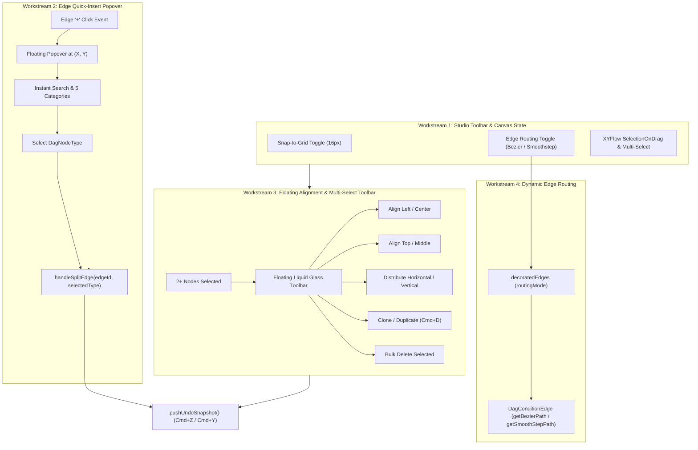

# Integration Master Plan - Iteration 17: Visual DAG Studio Canvas Ergonomics, Quick-Insert & Edge Routing

## 1. Executive Summary & Objectives
Iteration 17 elevates the user experience and authoring ergonomics of **Visual DAG Studio 2.0** in `@acc/console`. Following the successful completion of Iteration 16 (strictly single `START` -> `END` blank workflows, edge quick-split, Control Flow pairing, and `joinOn` contract alignment), Iteration 17 focuses on precision editing workflows, friction-free node insertion, and visual clarity:

1. **Edge Quick-Insert Type Picker Popover**:
   - Replaces the default `SIMPLE` task insertion on edge `+` split with a floating, keyboard-navigable type picker anchored at the click coordinates.
   - Instant search filtering across all 23 nodes with category filtering and keyboard arrow-key selection.
2. **Global Edge Routing Toggle (Bezier Curves vs Orthogonal Smoothstep)**:
   - Studio toolbar toggle allowing authors to switch edge visual routing between organic Bezier curves and structured Orthogonal Smoothstep lines.
3. **Multi-Node Selection & Floating Alignment Toolbar**:
   - Marquee multi-selection (`Shift + drag` or drag-to-select).
   - Floating Liquid Glass mini-toolbar when 2+ nodes are selected providing 1-click Align Left, Align Center, Align Top, Align Middle, Distribute Evenly, Duplicate (`Cmd+D`), and Bulk Delete.
4. **Snap-to-Grid Calibration**:
   - 16px magnetic snap-to-grid toggle (`Snap: On/Off`) with aligned background dot grid.
5. **Full Undo/Redo & State Safety**:
   - All bulk alignment, distribution, duplication, and edge splits push undo snapshots for seamless `Cmd+Z` / `Cmd+Y` restoration.

---

## 2. Workstream Architecture

---

## 3. Detailed Workstream Specifications

### Workstream 1: Edge Quick-Insert Popover Component
- **File**: `apps/console/src/features/metadata/components/studio/dag-quick-insert-popover.tsx`
- **Features**:
  - Anchored at click position `{ x: number; y: number }` with viewport overflow clamping.
  - Search input with auto-focus.
  - Category pill filters: `All`, `Control Flow`, `Data`, `Connectors`, `Human`, `AI`.
  - Grid list of matching items showing node icon, label, and description snippet.
  - Keyboard navigation: Arrow Up/Down, Enter to select, Escape to close.
  - On select: invokes `onSelectNodeType(type: DagNodeType)`.

### Workstream 2: Dynamic Edge Routing (Bezier Curves vs Orthogonal Smoothstep)
- **Files**:
  - `apps/console/src/features/metadata/components/studio/dag-condition-edge.tsx`
  - `apps/console/src/features/metadata/components/studio/visual-dag-studio.tsx`
- **Specification**:
  - Add state `edgeRoutingMode: 'bezier' | 'smoothstep'` (default: `'bezier'`) to `visual-dag-studio.tsx`.
  - Pass `routingMode` in `decoratedEdges` data payload.
  - In `dag-condition-edge.tsx`:
    - If `edgeData?.routingMode === 'smoothstep'`, use `getSmoothStepPath({ sourceX, sourceY, sourcePosition, targetX, targetY, targetPosition, borderRadius: 8 })`.
    - Else use `getBezierPath(...)`.
    - Both functions return `[edgePath, labelX, labelY]`, preserving exact centering for label and `+` split button!
  - Add routing toggle button in studio top toolbar (`Spline` / `Route` icons).

### Workstream 3: Multi-Node Selection & Floating Alignment Toolbar
- **Files**:
  - `apps/console/src/features/metadata/components/studio/dag-selection-toolbar.tsx`
  - `apps/console/src/features/metadata/components/studio/visual-dag-studio.tsx`
- **Specification**:
  - Enable ReactFlow multi-selection props:
    - `selectionOnDrag={true}` (marquee box selection).
    - `panOnDrag={false}` or space-to-pan when marquee is enabled, or standard XYFlow drag selection.
  - Maintain `selectedNodeIds: string[]` derived from ReactFlow nodes `n.selected`.
  - When `selectedNodeIds.length >= 2`, render floating `<DagSelectionToolbar>` anchored above the bounding box of selected nodes.
  - **Alignment Actions**:
    - **Align Left**: `x = min(x_i)`
    - **Align Center**: `x = avg(x_i)`
    - **Align Top**: `y = min(y_i)`
    - **Align Middle**: `y = avg(y_i)`
    - **Distribute Horizontal**: evenly space nodes between minimum and maximum X.
    - **Distribute Vertical**: evenly space nodes between minimum and maximum Y.
    - **Duplicate (`Cmd+D`)**: clone selected nodes with unique reference names, offset `(+30, +30)`.
    - **Delete**: delete selected non-boundary nodes.
  - All actions wrap in `pushUndoSnapshot()`.

### Workstream 4: Snap-to-Grid Calibration
- **Specification**:
  - Add `isSnapToGrid` state (default: `true`).
  - ReactFlow props: `snapToGrid={isSnapToGrid}` and `snapGrid={[16, 16]}`.
  - Add toolbar toggle button `Magnet` icon (`Snap: On` / `Snap: Off`).
  - Calibrate `<Background gap={16} size={1} />` to match grid intervals.

---

## 4. Verification Plan

### Automated Tests
1. **Unit Tests (`dag-quick-insert-popover.test.tsx`)**:
   - Verify popover renders filtered list of node types on search input.
   - Verify selecting a type calls `onSelectNodeType`.
   - Verify `Escape` key dismisses popover.
2. **Unit Tests (`dag-selection-toolbar.test.tsx`)**:
   - Verify alignment calculations (Align Left, Center, Top, Middle, Distribute).
   - Verify duplicate creates cloned nodes with offset coordinates.
3. **Integration Tests (`dag-condition-edge.test.tsx`)**:
   - Verify path computation switches between Bezier and Smoothstep based on `routingMode`.
   - Verify `+` split button emits click coordinates.
4. **Studio Integration Tests (`visual-dag-studio-modes.test.tsx`)**:
   - Verify Edge Routing toggle, Snap-to-Grid toggle, and multi-node selection toolbar rendering.
5. **Monorepo Compiler Verification**:
   - `pnpm --filter @acc/console exec tsc --noEmit` exits with 0 errors.
   - `pnpm --filter @acc/console test -- src/features/metadata/components/studio/` passes 100%.
