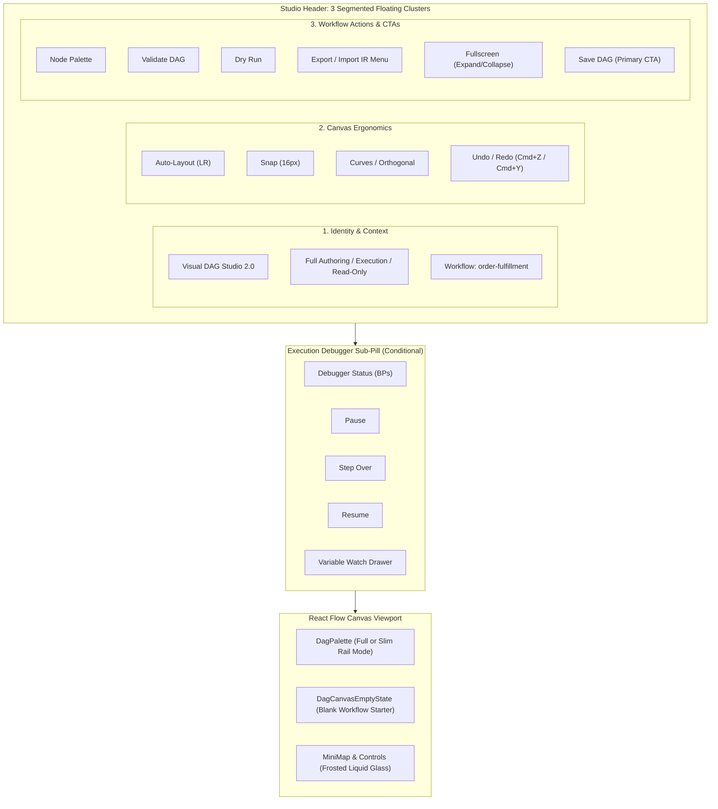

# Integration Master Plan - Iteration 18: Visual DAG Studio Professional-Grade Layout & UI/UX Overhaul

## 1. Executive Summary & Objectives
Iteration 18 transforms **Visual DAG Studio** (`apps/console/src/features/workflows/components/studio/visual-dag-studio.tsx`) into an enterprise, professional-grade visual workflow orchestration IDE following the design alignment finalized during our `/grill-me` architecture session.

Key objectives:
1. **Segmented Floating Command Bar**:
   - Replaces the crowded, flat 22-button container with 3 distinct floating Liquid Glass pill clusters across the top of the canvas:
     - **Left (Identity & Context)**: Studio title, Mode badge (Authoring / Execution / Read-Only), Workflow Name indicator.
     - **Center (Ergonomics & Canvas Tools)**: Topological Auto-Layout, Snap-to-Grid toggle (16px), Edge Routing toggle (Curves vs Orthogonal), Undo/Redo pair with shortcut hints.
     - **Right (Workflow Actions & CTAs)**: Node Palette toggle, Validate DAG, Dry-Run simulation, Export/Import IR dropdown menu, 1-click Fullscreen toggle, and primary Save DAG CTA.
2. **Contextual Floating Sub-Pill for Execution & Debugger**:
   - In Execution mode, render a dedicated amber Liquid Glass sub-pill floating beneath the center/left bar containing Pause, Step Over, Resume, Breakpoints indicator, and Live Variable Watch trigger.
3. **Collapsible Node Palette (`DagPalette`) with Slim Rail Mode**:
   - Snapped beneath the left toolbar cluster with dynamic `maxHeight` bounding (avoiding React Flow panel collision).
   - Collapse toggle button in the palette header so users can toggle between the full 23-node categorized view and a sleek slim icon rail (48px wide) to maximize canvas authoring space.
4. **Starter Onboarding Liquid Glass Prompt**:
   - When a workflow is blank (START and END connected by a single edge with zero intermediate nodes), render a gentle frosted helper card centered on the canvas with 1-click starter actions: "Add Simple Task", "Add HTTP Connector", "Open Palette", or "Dismiss".
5. **1-Click Fullscreen Canvas**:
   - Provide a Fullscreen toggle button (`Maximize2` / `Minimize2`) with browser Fullscreen API and fallback `fixed inset-0 z-50` styling, including `Escape` key listener.
6. **5-State Matrix & WCAG 2.2 AA Compliance**:
   - Contrast calibration across all glass layers, keyboard focus rings (`focus-visible:ring-2`), and polite ARIA live regions.

---

## 2. Architecture & Layout Specification



---

## 3. Detailed Component Workstreams

### Workstream 1: Studio Header & Command Bar Segmentation
- **File**: `apps/console/src/features/workflows/components/studio/visual-dag-studio.tsx`
- Replace single header toolbar with 3 floating pill containers (`top-4 left-4`, `top-4 left-1/2 -translate-x-1/2`, `top-4 right-4`).
- Group Export IR and Import IR into an accessible `DropdownMenu` (`DropdownMenuTrigger`, `DropdownMenuItem`).
- Implement 1-click Fullscreen toggle with `Escape` keyboard listener and backdrop transition.
- Support `className?: string` prop on `VisualDagStudioProps` allowing full-height expansion (`h-full min-h-[600px]`) when rendered in full-bleed routes like `/workflows`.

### Workstream 2: Contextual Floating Debugger Sub-Pill
- Render floating below the center/left bar at `top-16 left-4` when `isExecutionMode` is true.
- Liquid Glass styling: `bg-amber-500/10 border-amber-500/20 backdrop-blur-xl shadow-lg`.
- Keeps primary authoring toolbar completely clean and focused when designing.

### Workstream 3: Collapsible Node Palette (`DagPalette`) with Slim Rail Mode
- **File**: `apps/console/src/features/workflows/components/studio/dag-palette.tsx`
- Add `isCollapsed` state with toggle button in header (`ChevronLeft` / `ChevronRight`).
- In collapsed mode: width shrinks to `w-14` showing icon-only vertical rail with tooltips, preserving maximum canvas space.
- In expanded mode: full 23-node categorized accordion with search filter and quick `Expand All` / `Collapse All` toggle.

### Workstream 4: Blank Canvas Onboarding Prompt
- **File**: `apps/console/src/features/workflows/components/studio/dag-canvas-empty-state.tsx` [NEW]
- Display centered floating frosted card when workflow only has START and END with no tasks.
- 1-click starter buttons: "Add Simple Task", "Add HTTP Connector", "Open Palette", or "Dismiss".
- Disappears automatically as soon as any node is added to the canvas.

---

## 4. Verification Plan

### Automated Unit & Integration Tests
```bash
# 1. Studio test suite (layout, empty state, palette)
pnpm --filter @acc/console test -- src/features/workflows/components/studio/

# 2. TypeScript compilation
pnpm --filter @acc/console exec tsc --noEmit

# 3. Full console test suite
pnpm --filter @acc/console test:run
```

### Manual Verification
1. Inspect 3-cluster segmented command bar across viewports (1920px desktop, 1366px laptop, 1024px tablet).
2. Verify Fullscreen mode expansion and `Escape` key dismissal.
3. Test palette collapse to slim icon rail (48px) and re-expansion.
4. Verify blank canvas helper prompt on a new blank workflow.
5. Trigger execution mode and verify amber debugger sub-pill docking.
