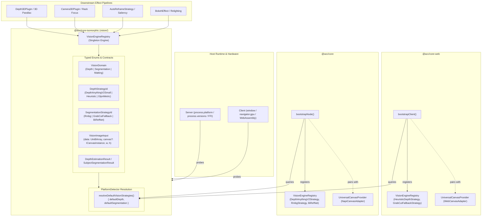
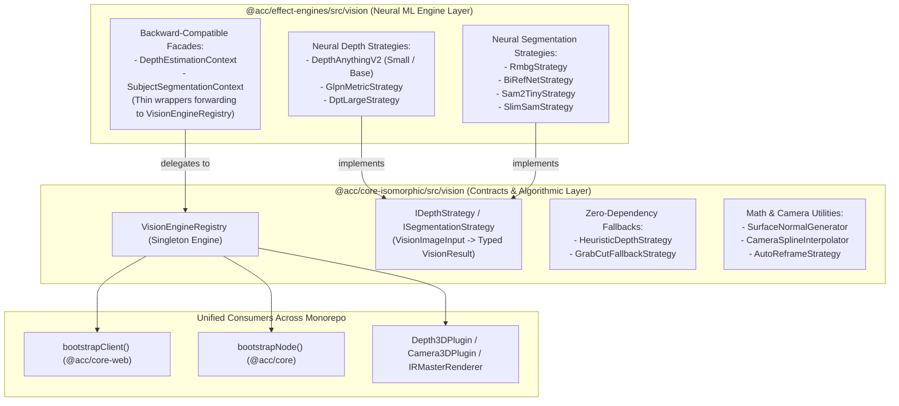

# Integration Master Plan: Iteration 27 - Isomorphic VisionEngineRegistry Architecture with Synchronized Bootstrap Pairing

**Target Systems:**
- `@acc/core-isomorphic` (`packages/core-isomorphic/src/vision`, `packages/core-isomorphic/src/platform`)
- `@acc/core-web` (`packages/core-web/src/index.ts`)
- `@acc/core` (`packages/core/src/bootstrap.ts`, `packages/core/package.json`)
- `@acc/effect-engines` (`packages/effect-engines/src/vision`, `packages/effect-engines/src/depth3d`)
- `autogenerated-tests/` (`autogenerated-tests/vision_engine_registry.test.ts`, `depth_strategies_benchmark.test.ts`)

**Lead Systems Architect:** Principal Polyglot Architect, Full-Stack Systems Engineer, UI/UX Design System Specialist  
**Architectural Framework:** Clean Architecture, Hexagonal Domain Strategy Pattern, Erasable Syntax Only, GoF Strategy & Registry Patterns  
**Reference Invariants:** Monorepo Isolation (`scripts/check-native-imports.ts`), Zero-Stub Runtime Invariants, Coordinated Triad Bootstrap Lifecycle  

---

## 1. Executive Summary & Core Architectural Invariants

In **Iteration 26**, we established platform detection and synchronized bootstrap foundations for Canvas (`UniversalCanvasProvider`), Audio/Video Encoding (`MediaEngineRegistry`), and Asset Caching (`ContentCacheRegistry`).

**Iteration 27** establishes the fourth and final pillar of the isomorphic multimedia platform: **`VisionEngineRegistry`**.

### The Problem:
1. **Ad-Hoc Vision Contexts**: Vision AI models (Depth Estimation via Depth-Anything, Segmentation via RMBG-1.4/BiRefNet, Saliency) currently reside in ad-hoc classes (`DepthEstimationContext`, `SubjectSegmentationContext`) within `@acc/effect-engines`, tightly coupled to Node `Buffer` instances and local disk paths.
2. **Missing Client/Server IoC Coordination**: `bootstrapClient()` in `@acc/core-web` and `bootstrapNode()` in `@acc/core` have zero awareness of vision capabilities. In browser environments, requesting depth or segmentation often crashes or attempts to fetch unavailable local disk models (`/models/...`).
3. **No Centralized Fallback Chain**: Heavy neural weights require graceful, non-blocking fallback to lightweight algorithms (e.g., Sobel heuristic depth, GrabCut color clustering) when running in WebAssembly, mobile, or offline environments.

### The Solution (Aligned via Grill-Me):
- **Isomorphic Input Formats**: Pure `Uint8Array` byte data alongside optional `ICanvasInstance` support for zero-copy frame loop passes.
- **Dependency Wiring**: Add `@acc/effect-engines` as a direct dependency in `packages/core/package.json` so `bootstrapNode()` registers neural vision strategies cleanly without fragile runtime dynamic hacks.
- **Defensive Automatic Fallback**: If model weights cannot be loaded (e.g. offline test runner, missing weights), neural strategies transparently fall back to `HeuristicDepthStrategy` / `GrabCutFallbackStrategy` with a warning, guaranteeing zero unhandled exceptions.
- **Synchronized Bootstrap Triad**: Update `bootstrapClient()` and `bootstrapNode()` so that all 4 registries (`UniversalCanvasProvider`, `MediaEngineRegistry`, `ContentCacheRegistry`, and `VisionEngineRegistry`) are fully initialized and mutually compatible.

---

## 2. High-Level Architecture & Information Flow



---

## 3. Implementation Blueprint

### Phase 1: Core Isomorphic Vision Contracts & Registry (`@acc/core-isomorphic`)

#### 1.1. `packages/core-isomorphic/src/vision/types.ts` [NEW]
- Define strict TypeScript string enums:
  ```typescript
  export enum VisionDomain {
    Depth = 'depth',
    Segmentation = 'segmentation',
    Matting = 'matting',
  }

  export enum DepthStrategyId {
    DepthAnythingV2Small = 'depth-anything-v2-small',
    DepthAnythingV2Base = 'depth-anything-v2-base',
    GlpnMetric = 'glpn-metric',
    Heuristic = 'heuristic',
  }

  export enum SegmentationStrategyId {
    Rmbg14 = 'rmbg-1.4',
    BiRefNet = 'birefnet',
    GrabCutFallback = 'grabcut-fallback',
    SlimSam = 'slimsam',
  }
  ```
- Define isomorphic data payloads supporting both `Uint8Array` and `ICanvasInstance`:
  ```typescript
  export interface VisionImageInput {
    data: Uint8Array;
    width: number;
    height: number;
    channels?: number; // 3 = RGB, 4 = RGBA
    canvas?: ICanvasInstance; // Optional zero-copy in-memory source
  }

  export interface DepthEstimationResult {
    depth16Data: Uint16Array;
    width: number;
    height: number;
    minDepth: number;
    maxDepth: number;
    modelUsed: string;
    depthCanvas?: ICanvasInstance;
  }

  export interface SubjectSegmentationResult {
    maskAlphaData: Uint8Array; // 0..255 single channel alpha mask
    width: number;
    height: number;
    boundingBox: { x: number; y: number; width: number; height: number };
    confidence: number;
    modelUsed: string;
    maskCanvas?: ICanvasInstance;
  }

  export interface IDepthEstimationStrategy {
    readonly id: DepthStrategyId | string;
    readonly name: string;
    readonly isSupported: boolean;
    estimateDepth(input: VisionImageInput): Promise<DepthEstimationResult>;
  }

  export interface ISubjectSegmentationStrategy {
    readonly id: SegmentationStrategyId | string;
    readonly name: string;
    readonly isSupported: boolean;
    segment(input: VisionImageInput): Promise<SubjectSegmentationResult>;
  }
  ```

#### 1.2. `packages/core-isomorphic/src/vision/VisionEngineRegistry.ts` [NEW]
- Singleton Registry providing:
  - `registerDepthStrategy(strategy: IDepthEstimationStrategy, isDefault?: boolean): void`
  - `getDepthStrategy(id?: DepthStrategyId | string): IDepthEstimationStrategy`
  - `registerSegmentationStrategy(strategy: ISubjectSegmentationStrategy, isDefault?: boolean): void`
  - `getSegmentationStrategy(id?: SegmentationStrategyId | string): ISubjectSegmentationStrategy`
  - `setDefaultDepthStrategy(id: DepthStrategyId | string): void`
  - `setDefaultSegmentationStrategy(id: SegmentationStrategyId | string): void`
  - `unregisterAll(): void`
  - `reset(): void`

#### 1.3. `packages/core-isomorphic/src/platform/PlatformDetector.ts` [MODIFY]
- Extend with:
  ```typescript
  resolveDefaultDepthStrategy(): DepthStrategyId;
  resolveDefaultSegmentationStrategy(): SegmentationStrategyId;
  ```
  - In `Browser` / `WebWorker`: returns `DepthStrategyId.Heuristic` and `SegmentationStrategyId.GrabCutFallback`.
  - In `Bun` / `Node`: returns `DepthStrategyId.DepthAnythingV2Small` and `SegmentationStrategyId.Rmbg14`.

---

### Phase 2: Client-Side Fallback Strategies (`@acc/core-web` & `@acc/core-isomorphic`)

#### 2.1. Pure Isomorphic `HeuristicDepthStrategy` & `GrabCutFallbackStrategy`
- Adapt heuristic and color-clustering fallback strategies from `@acc/effect-engines` into clean, zero-external-dependency isomorphic implementations.
- Zero network download, zero WASM bundle penalty, runs in 1-2 milliseconds on any canvas/image input.

#### 2.2. Update `bootstrapClient()` in `packages/core-web/src/index.ts` [MODIFY]
- Automatically register:
  1. `WebCanvasAdapter` (`UniversalCanvasProvider`)
  2. `MediabunnyClientStrategy` (`MediaEngineRegistry`)
  3. `IndexedDbCacheStrategy` / `WebCacheStrategy` (`ContentCacheRegistry`)
  4. `HeuristicDepthStrategy` & `GrabCutFallbackStrategy` (`VisionEngineRegistry`)

---

### Phase 3: Server-Side Neural Strategies & `@acc/core` Integration

#### 3.1. Add `@acc/effect-engines` to `packages/core/package.json` [MODIFY]
- Add direct workspace dependency `"@acc/effect-engines": "workspace:*"` in `packages/core/package.json`.

#### 3.2. Adapt Neural Vision Strategies to Implement Isomorphic Interfaces
- Wrap `DepthAnythingV2SmallStrategy` and `RmbgStrategy` to accept `VisionImageInput` (`Uint8Array`) and return typed `DepthEstimationResult` and `SubjectSegmentationResult`.
- Equip each strategy with defensive cascading: if model file loading fails (e.g. offline without cached weights), automatically return the heuristic result instead of throwing unhandled fetch exceptions.

#### 3.3. Update `bootstrapNode()` in `packages/core/src/bootstrap.ts` [MODIFY]
- Automatically register:
  1. `NapiCanvasAdapter` (`UniversalCanvasProvider`)
  2. `BunFFIEngineStrategy` / `MediabunnyServerStrategy` / `FluentFFmpegEngineStrategy` (`MediaEngineRegistry`)
  3. `NativeFileCacheStrategy` (`ContentCacheRegistry`)
  4. Server neural strategies with automatic fallback to heuristics (`VisionEngineRegistry`)

---

### Phase 4: Downstream Consumer Refactoring

#### 4.1. Refactor `DepthEstimationContext` & `SubjectSegmentationContext` in `@acc/effect-engines`
- Turn them into thin facades over `VisionEngineRegistry`, providing backward compatibility for existing renderers.

#### 4.2. Update `Depth3DPlugin` & `Camera3DPlugin` in `@acc/ir`
- Query `VisionEngineRegistry.getDepthStrategy()` and `VisionEngineRegistry.getSegmentationStrategy()` directly.
- Eliminate raw `Buffer` conversions by passing native `Uint8Array` directly from `UniversalCanvasProvider`.

---

## 4. Verification Plan

### Automated Test Suites
1. **Vision Engine Registry Contract & Switching Test**:
   - `autogenerated-tests/vision_engine_registry.test.ts` [NEW]
   - Verify strategy registration, default selection, and explicit overriding.
   - Verify fallback execution when neural weights are absent.
2. **Synchronized Bootstrap Suite**:
   - `autogenerated-tests/core_web_services.test.ts`
   - `autogenerated-tests/core_node_bootstrap.test.ts`
   - Verify that all 4 registries are synchronized after `bootstrapClient()` and `bootstrapNode()`.
3. **End-to-End Effect & Parallax Test**:
   - `autogenerated-tests/camera_spline_rack_focus.test.ts`
   - `autogenerated-tests/particle_simd_vfx.test.ts`
   - `autogenerated-tests/depth_strategies_benchmark.test.ts`
4. **Native Import Boundary Guardrail**:
   - `bun run scripts/check-native-imports.ts` (strict 0-leak enforcement).

### Manual Verification
- Verify that calling `bootstrapNode()` and running depth estimation or subject separation succeeds without network dependency or unhandled fetch rejections.

---

## 5. Extension: Unified Isomorphic Vision Processing Architecture

### 5.1. Context & Architectural Problem Statement
Currently, vision code is split across two package trees:
1. `packages/core-isomorphic/src/vision/`
2. `packages/effect-engines/src/vision/`

#### Analysis of Split & Redundancy:
- **Historical split reason**: `packages/core-isomorphic/src/vision/` was established in Iteration 27 as the contract, typed registry, and zero-dependency algorithmic fallback layer. `packages/effect-engines/src/vision/` historically contained heavy machine learning models (SAM2, Depth-Anything v2, RMBG-1.4, BiRefNet) driven by `@huggingface/transformers` and `onnxruntime-web`.
- **95% Isomorphic Reality**: `packages/effect-engines/src/vision/` has **zero** native imports (`fs`, `path`, FFI bindings). It already runs on WebAssembly/WebGPU via `onnxruntime-web` and `@huggingface/transformers`. The single obstacle preventing full isomorphism is its legacy method signatures demanding Node.js `Buffer`.
- **Direct Duplication**: `HeuristicDepthStrategy` and `GrabCutFallbackStrategy` exist in both directories (`packages/core-isomorphic/src/vision/strategies/` vs `packages/effect-engines/src/vision/strategies/`).
- **Context vs Registry Redundancy**: `DepthEstimationContext` and `SubjectSegmentationContext` in `effect-engines` duplicate the strategy resolution and fallback orchestration that `VisionEngineRegistry` now provides in `core-isomorphic`.
- **Misplaced Algorithmic Utilities**: Pure mathematical and camera utilities (`SurfaceNormalGenerator`, `CameraSplineInterpolator`, `AutoReframeStrategy`) have no neural weights or external dependencies, but are trapped in `@acc/effect-engines`, preventing lightweight isomorphic clients (e.g. Studio UI, Web Workers) from using them cleanly.

---

### 5.2. Target Unified Architecture



---

### 5.3. Implementation Roadmap for Unification

#### Step 1: Eliminate Strategy Duplication & Re-export from Core
- Deprecate local duplicate implementations of `HeuristicDepthStrategy` and `GrabCutFallbackStrategy` in `packages/effect-engines/src/vision/strategies/`.
- Re-export `HeuristicDepthStrategy` and `GrabCutFallbackStrategy` directly from `@acc/core-isomorphic` to guarantee backward compatibility without duplicated maintenance.

#### Step 2: Standardize All Neural Strategies on `VisionImageInput`
- Refactor all neural strategies in `packages/effect-engines/src/vision/strategies/`:
  - `DepthAnythingV2BaseStrategy`, `GlpnMetricStrategy`, `DptLargeStrategy`
  - `BiRefNetStrategy`, `Sam2TinyStrategy`, `SamVitBaseStrategy`, `SlimSamStrategy`
- Change method signatures from `estimateDepth(imageBuffer: Buffer)` / `segment(imageBuffer: Buffer)` to:
  ```typescript
  estimateDepth(input: VisionImageInput, options?: VisionDepthOptions): Promise<DepthEstimationResult>
  segment(input: VisionImageInput, options?: VisionSegmentationOptions): Promise<SubjectSegmentationResult>
  ```
- Support dual-mode inputs (`Uint8Array | Buffer | ICanvasInstance | VisionImageInput`).
- Provide backward-compatible result facades that return typed `Uint8Array`/`Uint16Array` alongside `.toBuffer()` / Node `Buffer` representations for legacy callers.

#### Step 3: Refactor Context Classes to Facades over `VisionEngineRegistry`
- Refactor `DepthEstimationContext` and `SubjectSegmentationContext` in `packages/effect-engines`:
  - Delegate `setStrategy(id)` to `VisionEngineRegistry.getInstance().setStrategy(domain, id)`.
  - Delegate execution to `VisionEngineRegistry.getInstance().getDepthStrategy().estimateDepth(...)` and `getSegmentationStrategy().segment(...)`.
  - Retain legacy method signatures (`Buffer -> Promise<Buffer>`) so zero external consumers or test suites break.

#### Step 4: Promote Pure Mathematical Vision Utilities to `@acc/core-isomorphic`
- Move pure algorithmic utilities from `@acc/effect-engines/src/vision/` to `@acc/core-isomorphic/src/vision/`:
  - `SurfaceNormalGenerator` (Sobel filter over depth maps)
  - `CameraSplineInterpolator` (Catmull-Rom & Hermite 3D camera path interpolation)
  - `AutoReframeStrategy` (saliency-based bounding box re-framing)
- Keep re-export shims with `@deprecated` docstrings in `@acc/effect-engines/src/vision/` for non-breaking imports.

#### Step 5: Verification & Boundary Audits
- Run `bun test autogenerated-tests/vision_engine_registry.test.ts`.
- Run `bun test autogenerated-tests/depth_strategies_benchmark.test.ts`.
- Run `bun test autogenerated-tests/depth3d_strategies.test.ts`.
- Run `bun run scripts/check-native-imports.ts` to ensure `@acc/core-isomorphic` remains 100% free of native Node/C runtime leaks.
- Run `pnpm --filter @acc/core-isomorphic --filter @acc/effect-engines check-types`.

