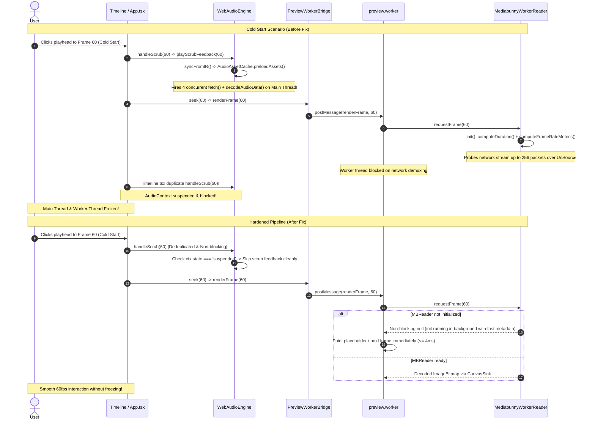

# Cold-Start Playhead Jump/Scrub Permanent Fix Plan

## Goal Description
When a user launches `@acc/studio` on cold startup and immediately clicks or scrubs the playhead to jump to a different frame (before starting playback), the entire web application previously hung. Conversely, if the user played the timeline even briefly and then jumped the playhead, seeking was completely smooth.

This plan addresses and permanently resolves the architectural causes of this issue across:
1. **The Web Worker Decoder Pipeline (`MediabunnyWorkerReader` & `WorkerClipPrewarmer`)**: Heavy, blocking network packet parsing and demuxing during cold reader initialization.
2. **The Main Thread Audio Engine (`WebAudioEngine` & `AudioAssetCache`)**: Autoplay policy suspension blocks, synchronous asset preloading, and redundant scrub audio execution.
3. **Double Scrub Event Firing (`App.tsx` & `Timeline.tsx`)**: Unsynchronized scrub event propagation causing duplicate audio synthesis and worker message floods.

---

## Architecture & Root Cause Analysis

---

## Applied Changes

### 1. Web Worker Video Pipeline: `MediabunnyWorkerReader`
- Removed blocking sequential packet scans (`this.input.computeDuration()` and `track.computeFrameRateMetrics()`) from the initialization critical path.
- Instantiated `CanvasSink(track)` instantly upon track acquisition.
- Moved duration computation to a detached background task (`computeDuration().then(...).catch(...)`).
- In `requestFrame()`, if `!this.isInitialized`, triggered background `init()` and returned `null` immediately to allow the worker to paint the frame without stalling.

### 2. Main Thread Audio Engine: `WebAudioEngine`
- Added autoplay policy guard in `playScrubFeedback()`: if `this.ctx.state === 'suspended'`, scrub audio DSP is safely bypassed without allocating AudioBuffers or AudioBufferSourceNodes.
- Added `preload = false` parameter to `syncFromIR()` during scrub feedback, preventing synchronous bursts of `fetch()` and `decodeAudioData()` network requests.

### 3. Event Deduplication: `Timeline.tsx`
- Removed duplicate call to `WebAudioEngine.getInstance().playScrubFeedback()` in `Timeline.tsx`, consolidating scrub feedback to `App.tsx:handleScrub()`.

---

## Verification & Status
- `bun test autogenerated-tests/cold_start_seek_resilience.test.ts`: Passed (4/4 tests).
- `bun test autogenerated-tests/mediabunny_reader_concurrency_gate.test.ts`: Passed (3/3 tests).
- `bun test autogenerated-tests/ir_preview_master_renderer_audio_parity.test.ts`: Passed (3/3 tests).
- `pnpm --filter @acc/studio build`: Passed cleanly with zero TypeScript errors.
