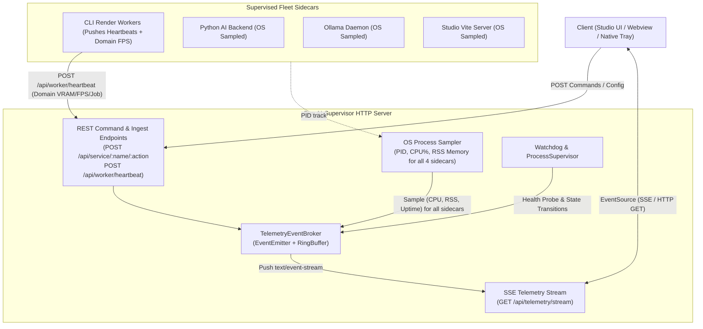

# Backlog 039: AI-Supervisor REST+SSE Fleet Control Plane & Studio Universal Video IR Preview Synchronization

**Status:** `[ ] Planned`  
**Component:** `apps/ai-supervisor` / `apps/studio` / `packages/ir`  
**Created Date:** 2026-10-24  
**Completed Date:** -  
**Linked History:** -  

---

## 1. Context & Problem Statement
The ACC desktop suite requires seamless fleet telemetry and interactive timeline preview:
1. **AI-Supervisor IPC & Fleet Management**:
   The current AI-Supervisor communicates via ad-hoc HTTP endpoints (`/api/service/:name/:action`) and polling. We need a standard, firewall-friendly, resilient mechanism using **REST API** for deterministic commands and **Server-Sent Events (SSE)** for continuous real-time telemetry (CPU, RAM, VRAM, render FPS, task progress) with automatic reconnection.
2. **Universal Video IR Preview Engine in Studio**:
   Rather than reinventing preview logic, Studio must directly reuse and integrate `@acc/ir`'s existing production engines:
   - Reuse `IRPreviewEngine`, `ModifierPluginRegistry`, `IntervalTreeIndex`, `DeterministicMotionEvaluator`, and `IRCanvasCompositor` from `packages/ir`.
   - Leverage `PreviewWorkerBridge` and `preview.worker.ts` in `apps/studio` without duplicating rendering maths.
   - Wire live telemetry into `TelemetryCompanionCard` via native browser `EventSource`.

---

## 2. Proposed Architecture & Design

### 2.1 AI-Supervisor REST + SSE Architecture

- **Scope of Telemetry Across All Sidecars**:
  - **All 4 Supervised Sidecars** (`python-backend`, `worker`, `studio`, `ollama`):
    - Monitored automatically by `SupervisorEngine`'s OS process sampler via child PID (`cpuPercent`, `memoryRssMb`, `uptimeSeconds`, `status`).
    - Works out-of-the-box for blackbox services (Ollama, Vite Studio) without code modifications.
  - **Specialized Worker Domain Telemetry**:
    - Render workers and inference runners push domain-specific metrics via `POST /api/worker/heartbeat` (`activeJobId`, `currentFrame`, `totalFrames`, `renderFps`, `vramUsedMb`).
  - **Aggregated Real-Time Stream**:
    - Unified into a single SSE payload pushed via `GET /api/telemetry/stream` every 500ms–1000ms.

### 2.2 Studio Universal Video IR Preview Synchronization
- **Zero-Wheel-Reinvention Policy**:
  - Directly instantiate and drive `IRPreviewEngine` (from `@acc/ir`) inside `apps/studio/src/workers/preview.worker.ts`.
  - Pass resolved timeline changes via `updateTimeline` to `IRPreviewEngine.seek(frame)`.
  - Reuse `AssetTextureCache` and `MediabunnyWorkerReader` for decoded frame extraction.
  - Expose adaptive Level-of-Detail (`IRPreviewEngine.setLODScale(scale)`) during fast scrubbing.
- **Live Telemetry in Studio**:
  - `TelemetryCompanionCard.tsx` opens an `EventSource('/api/telemetry/stream')` connecting to AI-Supervisor.
  - Visualizes real-time FPS, worker memory, and VRAM without polling.

---

## 3. Acceptance Criteria

- [ ] **AI-Supervisor REST & SSE Control Plane**:
  - [ ] Implement `TelemetryEventBroker` to broadcast events to connected SSE HTTP response streams.
  - [ ] Implement `GET /api/telemetry/stream` returning `text/event-stream` with keep-alive comments (`: ping\n\n`).
  - [ ] Implement `POST /api/worker/heartbeat` with Zod/TypeBox validation accepting worker metrics.
  - [ ] Exponential backoff auto-recovery for crashing services with backoff penalty ceiling.
  - [ ] Update Tray Bridge runners to consume SSE stream or subscribe to local broker events.
- [ ] **Studio Preview & @acc/ir Component Reuse**:
  - [ ] Refactor `apps/studio/src/workers/preview.worker.ts` to execute `IRPreviewEngine` from `@acc/ir` directly on OffscreenCanvas.
  - [ ] Verify modifier rendering for `transform`, `color_grade`, `filter`, and text cues using existing plugins in `@acc/ir`.
  - [ ] Enable adaptive LOD (0.5x resolution) in `IRPreviewEngine` when shuttle speed $|v| \ge 2\times$.
  - [ ] Wire `EventSource` in `TelemetryCompanionCard` with 5-state handling (Connected, Reconnecting, Disconnected, Error, Disabled).
- [ ] **Automated Testing & QA Verification**:
  - [ ] Unit tests for `TelemetryEventBroker` and SSE stream responses in `autogenerated-tests/ai_supervisor_sse.test.ts`.
  - [ ] Integration tests verifying `IRPreviewEngine` offscreen rendering in `autogenerated-tests/studio_ir_preview_worker.test.ts`.
  - [ ] Monorepo typecheck and build pass clean (`tsc --noEmit` and Vite build).
