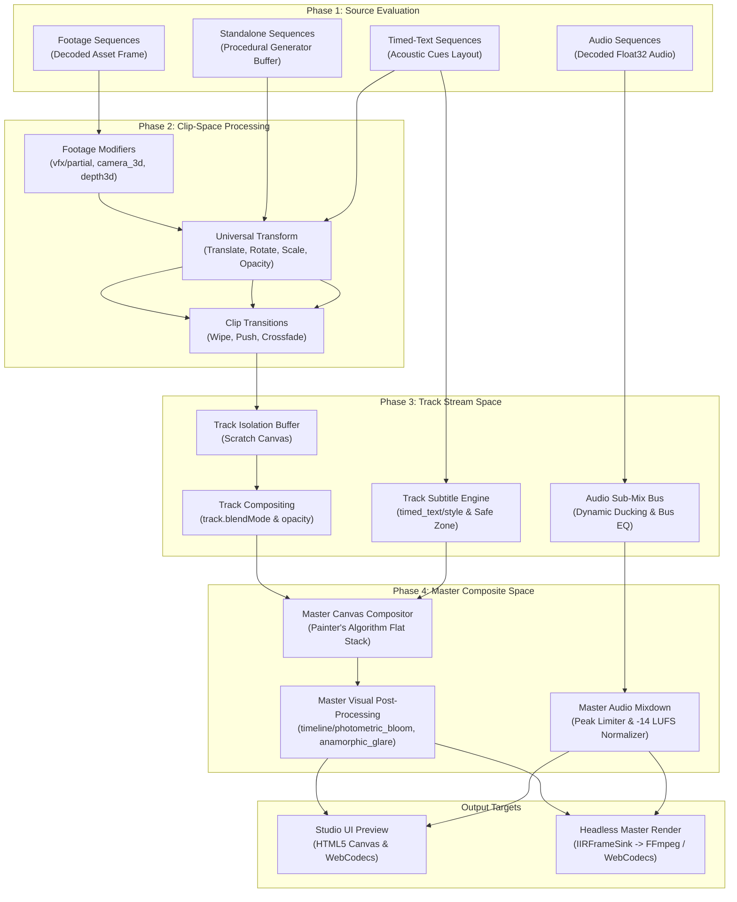
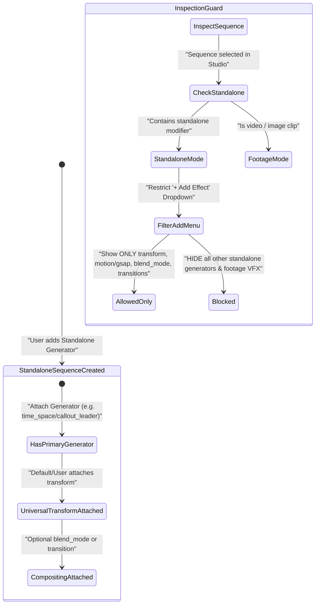
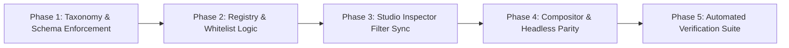

# Multi-Tier Modifier Architecture: [Sequence, Track, Timeline], Standalone Generators, UI Preview & Headless Rendering

> **Revision Note**: Updated per review feedback to eliminate loose `requestAnimationFrame` coupling (establishing pure **Deterministic Integer Frame Clock** parity) and introducing the **Declarative Plugin Manifest Architecture (SSOT)** for frictionless modifier expansion.

## Executive Summary & Architectural Brainstorm

The Universal Video IR and NLE Studio architecture requires a definitive, mathematically sound, and rigorously enforced multi-tier modifier taxonomy. Previously, modifiers operated with ambiguous target boundaries, where standalone procedural generators (e.g. `time_space/*`, `overlay/hologram_hud`, `overlay/canvas_particles`) could be conflated with clip-space filters (e.g. `vfx/color_grading`, `vfx/camera_3d`), track-level stream aggregators (e.g. `timed_text/style`), or master timeline composites (e.g. `timeline/photometric_bloom`).

This design establishes three invariant levels of modifier application—**Sequence**, **Track**, and **Timeline**—and formalizes the lifecycle of **Standalone Generator Sequences**:

1. **Standalone Generator Sequences**:
   - A modifier whose `targetScope === 'standalone'` represents a **Source Provider** (Phase 1), not a downstream filter.
   - On the timeline, a standalone generator resides on its own dedicated `overlay` sequence without requiring an external asset (`assetId`).
   - **Single Generator Invariant**: A sequence may possess at most **one** primary standalone generator. Attaching a second standalone generator is prohibited.
   - **Footage Filter Prohibition**: Standalone generators do not possess decoded raster footage with depth layers or facial landmarks; therefore, footage-dependent modifiers (`vfx/depth3d`, `vfx/camera_3d`, `vfx/depth_relighting`, `vfx/auto_reframe`, `vfx/partial`) are strictly rejected.
   - **Universal Modifier Whitelist**: A standalone sequence accepts **only** a preconfigured set of universal canvas modifiers:
     - `transform`: Universal 2D affine spatial placement (X, Y, Scale, Rotation, Opacity, Anchor). **Mandatory & universal for any visual entity in the canvas.**
     - `motion/gsap`: Deterministic keyframe and curve interpolation for transform coordinates.
     - `overlay/blend_mode`: Composite blend mode (`screen`, `multiply`, `add`, `overlay`, `soft_light`).
     - `transition/*`: Clip boundary transitions (`crossfade`, `wipe`, `push`, `zoom`, `dip`).

2. **Hierarchical 3-Level Execution Pipeline**:
   - **Sequence Level (`targetScope: 'sequence' | 'standalone'`)**: Operates strictly within the clip's local lifespan `[seq.startFrame, seq.endFrame]` and normalized clip space `[0, 1]`.
   - **Track Level (`targetScope: 'track'`)**: Operates on the composited track stream across `[0, doc.totalDuration]`. Enforces modality-wide consistency (e.g. `timed_text/style` subtitle typography, track opacity, audio bus routing and ducking).
   - **Timeline Level (`targetScope: 'timeline'`)**: Operates on the final aggregated master buffer after all visual and audio tracks are composited. Enforces global post-processing (e.g. `timeline/photometric_bloom`, `timeline/anamorphic_glare`, master audio ceiling limiter).

3. **Rendering Parity: UI Preview vs. Headless Mode (Zero `requestAnimationFrame` Drift)**:
   - **Deterministic Integer Frame Clock**: Both preview rendering and headless rendering operate strictly on an integer frame counter $t \in [0, N_{\text{total}} - 1]$ with frame time $t_{\text{sec}} = t / \text{fps}$. **`requestAnimationFrame` is never used to drive the frame timeline**, avoiding browser display refresh rate mismatches (e.g. 60Hz/120Hz/144Hz monitors drifting against 24/30/60fps timelines) and wall-clock jitter.
   - **UI Preview Rendering (`IRCanvasCompositor`)**: Evaluated synchronously or via discrete Promise batches per integer frame index $t$. The playhead integer step is driven by `DeterministicAudioClock` during playback, and by scrub integer indices during editing. Viewport gizmos manipulate universal `transform` in clip space; track and master effects execute in separate compositing passes with zero-jitter scratch canvas pooling.
   - **Headless Mode (`IRMasterRenderer`)**: High-throughput integer frame evaluation ($t = 0, 1, \dots, N-1$) with synchronous hardware backpressure via `FrameBackpressureLock`, piping raw pixel buffers directly to FFmpeg or WebCodecs MP4 muxers, guaranteeing bit-identical frame hash parity across platforms.

---

## User Review Required

> [!IMPORTANT]
> **Strict Standalone Modifier Enforcement**:
> Any existing Video IR document that declares multiple standalone generators on a single sequence, or applies footage modifiers (such as `vfx/depth3d` or `vfx/color_grading`) onto an `overlay` sequence containing a standalone generator, will fail `VideoIRSchemaValidator.validate()` with explicit schema errors.
> A defensive migration step will be introduced in `IRStateManager.migrateLegacyModifiers()` to auto-prune conflicting secondary generators.

> [!WARNING]
> **Inspector Dropdown Filtering Boundary**:
> When a user selects a sequence in Studio:
> - If the sequence already contains a standalone generator, the "+ Add Effect" dropdown will disable all other standalone generators and footage filters, displaying only `transform`, `motion/gsap`, `overlay/blend_mode`, and transitions.
> - If the sequence is standard video footage, standalone generators will be excluded from the sequence effect menu (they must be created via track/sequence insertion).

---

## Architectural Taxonomy & Trade-off Matrix

### Multi-Level Domain Responsibility Matrix

| Feature / Modifier | Sequence Level (`sequence`) | Standalone Sequence (`standalone`) | Track Level (`track`) | Timeline Level (`timeline`) |
| :--- | :--- | :--- | :--- | :--- |
| **Primary Source** | Raw Decoded Footage (`video`, `image`) | Procedural Code / Shader Generator | Aggregated Track Stream | Master Flattened Canvas Buffer |
| **Temporal Coordinate** | Local Clip Frame: `localFrame = t - startFrame` | Local Clip Frame: `localFrame = t - startFrame` | Global Frame: `t ∈ [0, totalFrames]` | Global Frame: `t ∈ [0, totalFrames]` |
| **Spatial Coordinate** | Clip-Space Affine Matrix | Clip-Space Affine Matrix | Track-Space Viewport | Master Viewport Resolution (`w x h`) |
| **Allowed Generators** | Prohibited | Exactly 1 (`time_space/*`, `overlay/*`) | Prohibited | Prohibited |
| **Allowed Footages VFX** | `vfx/color_grading`, `vfx/partial`, `vfx/camera_3d`, `vfx/depth3d`, `motion/vector_blur` | **Prohibited** | Prohibited | Prohibited |
| **Universal Spatial** | `transform` (Position, Scale, Rotation, Anchor, Opacity) | `transform` (Position, Scale, Rotation, Anchor, Opacity) | Track-wide Style Transform | Master Crop / Letterbox |
| **Universal Motion** | `motion/gsap` | `motion/gsap` | Prohibited | Prohibited |
| **Compositing** | `overlay/blend_mode`, `seq.blendMode` | `overlay/blend_mode`, `seq.blendMode` | `track.blendMode`, `track.style.opacity` | `timeline/photometric_bloom`, `timeline/anamorphic_glare` |
| **Subtitles / Timed Text**| Local Cue Overrides | Prohibited | `timed_text/style` (Unified Typography & Karaoke) | Prohibited |
| **Audio Processing** | Clip Volume, Clip Pan, Clip Pitch | Procedural Audio SFX | Audio Bus Routing, Track EQ, Dynamic Ducking | Master Limiter, Loudness Normalization (-14 LUFS) |

### Developer Workflow: Self-Describing Declarative Plugin Manifest (SSOT)

To guarantee that this taxonomy matrix remains strictly maintained **without requiring developers to manually edit multiple hardcoded tables, switch statements, or static catalogs** across packages, we introduce the **Declarative Plugin Manifest Architecture**:

#### 1. The Plugin Manifest as the Single Source of Truth
Every modifier plugin declares its complete structural capabilities directly in its class definition via typed fields on `ModifierPlugin`:
- `targetScope: 'standalone' | 'sequence' | 'track' | 'timeline'`: Establishes the execution tier.
- `allowedSequenceTypes?: readonly SequenceType[]`: Sequence modalities permitted to host this plugin (e.g. `['video', 'image']` for footage VFX, `['overlay']` for standalone graphics, `['audio']` for audio DSP).
- `isUniversal?: boolean`: **The Universal Canvas Tool Flag**.
  - When `true`: Indicates that this modifier is an in-canvas geometric/compositing primitive (e.g. `transform`, `motion/gsap`, `overlay/blend_mode`, `transition/*`) that is universally permitted on *any* visual sequence—including standalone procedural generator clips.
  - When `false` or omitted: The modifier requires underlying media/raster footage, and is **automatically prohibited** from standalone generator sequences.
- `supportedTrackTypes: readonly TrackType[]`: Modality routing (`['video']`, `['audio']`, `['timed_text']`).
- `instancePolicy?: 'single' | 'multiple'`: Enforces whether an entity can attach multiple instances (default `'single'` for transforms and generators; `'multiple'` for regional partial VFX masks).
- `targetPhase: PluginTargetPhase`: Integer phase (1: Source Generator, 2: Clip Space, 3: Track Stream, 4: Master Composite).
- `schema: ModifierParameterSchema`: UI descriptor declaring fields, control types (sliders, pickers, toggles), units, and defaults.

#### 2. The 3-Step Zero-Friction Developer Guide for Adding New Modifiers
When adding any new modifier (e.g. `vfx/neon_edge` or `time_space/quantum_field`):
1. **Step 1: Implement `ModifierPlugin` with Declarative Capabilities**:
   ```typescript
   export class NeonEdgePlugin implements ModifierPlugin<NeonEdgeParams> {
     public readonly type = 'vfx/neon_edge';
     public readonly targetScope = 'sequence';
     public readonly allowedSequenceTypes = ['video', 'image'] as const;
     public readonly isUniversal = false; // Requires decoded media raster; forbidden on standalone generator clips
     public readonly supportedTrackTypes = ['video'] as const;
     public readonly targetPhase = 2; // Clip space
     public readonly schema = {
       displayName: 'Neon Edge Detection',
       category: 'vfx',
       fields: { ... }
     };

     public renderClipSpace(ctx: ClipRenderContext, params: NeonEdgeParams) {
       // Pure frame rendering math
     }
   }
   ```
2. **Step 2: Register in `registerCoreModifierPlugins()`**:
   ```typescript
   registry.register(new NeonEdgePlugin());
   ```
3. **Step 3: ZERO Other Files to Edit!**:
   - `ModifierPluginRegistry` automatically categorizes, caches, and exposes the plugin in `registry.getCapabilityMatrix()`.
   - `VideoIRSchemaValidator` automatically validates it against target entities and enforces standalone sequence boundaries using `plugin.isUniversal`.
   - `RightSidebar.tsx` automatically displays it in the "+ Add Effect" dropdown for video sequences, and automatically hides/disables it on standalone clips or tracks.

#### 3. Automated Matrix Audit & Self-Enforcing Test Suite
To prevent human error (such as a developer forgetting to declare `supportedTrackTypes` or leaving `targetScope` ambiguous), an automated contract test `autogenerated-tests/modifier_plugin_contract_audit.test.ts` runs on every CI/build pass:
- Inspects every registered plugin in `ModifierPluginRegistry`.
- Asserts that all capability metadata is defined and mathematically consistent (e.g., if `targetScope === 'standalone'`, `isUniversal` must not be `true`; if `isUniversal === true`, `allowedSequenceTypes` must permit `overlay`).
- Automatically exports the compiled capability matrix table into documentation.

---

## Mermaid Architectural Topologies

### 1. Rendering Lifecycle: 4-Phase Execution Pipeline



### 2. Standalone Sequence Invariant & Whitelist Enforcement



---

## Mathematical & Algorithmic Specifications

### 1. Universal Clip-Space Affine Transform Derivation
Every visual sequence on the timeline (whether decoded video footage or procedural standalone generator) must pass through the universal 2D affine spatial transformation matrix $M_{\text{clip}}(t)$ before being drawn onto the track scratch canvas.

Given anchor coordinates $(\alpha_x, \alpha_y) \in [0, 1]$, sequence resolution $(W, H)$, motion translation $(\Delta x(t), \Delta y(t))$, rotation $\theta(t)$ in radians, and uniform scale $S(t)$:

$$
A_x = W \cdot \alpha_x, \quad A_y = H \cdot \alpha_y
$$

$$
M_{\text{clip}}(t) = T(A_x + \Delta x(t), A_y + \Delta y(t)) \cdot R(\theta(t)) \cdot S(S(t), S(t)) \cdot T(-A_x, -A_y)
$$

$$
\begin{bmatrix} x' \\ y' \\ 1 \end{bmatrix} = \begin{bmatrix}
S(t)\cos\theta(t) & -S(t)\sin\theta(t) & A_x + \Delta x(t) - S(t)(A_x\cos\theta(t) - A_y\sin\theta(t)) \\
S(t)\sin\theta(t) & S(t)\cos\theta(t) & A_y + \Delta y(t) - S(t)(A_x\sin\theta(t) + A_y\cos\theta(t)) \\
0 & 0 & 1
\end{bmatrix} \begin{bmatrix} x \\ y \\ 1 \end{bmatrix}
$$

Effective clip opacity is modulated strictly by:
$$
\alpha_{\text{eff}}(t) = \text{clamp}(0, 1, \alpha_{\text{base}} \cdot \alpha_{\text{motion}}(t) \cdot \alpha_{\text{track}})
$$

### 2. Standalone Generator Procedural Phase Function
Standalone procedural generators (e.g. `time_space/*`, `overlay/hologram_hud`) compute pixel values as pure closed-form functions of normalized sequence time $\tau \in [0, 1]$ and integer frame index $k \in [0, N_{\text{duration}}]$:

$$
\tau = \frac{t_{\text{global}} - t_{\text{start}}}{t_{\text{duration}}}, \quad k = \lfloor \tau \cdot N_{\text{duration}} \rfloor
$$

Because standalone generators execute in Phase 1 before $M_{\text{clip}}(t)$ is applied, the generator renders into a pristine, un-transformed bounding box of size $(W, H)$. The universal `transform` modifier in Phase 2 subsequently scales, rotates, and positions the generator output without polluting the generator's internal coordinate math.

### 3. Master Photometric Bloom & Lens Flare Convolution
In Phase 4 (Master Composite), the master canvas buffer $I_{\text{master}}(x, y)$ is filtered across luminance threshold $L_{\text{th}}$:

$$
I_{\text{bright}}(x, y) = \begin{cases}
I_{\text{master}}(x, y) \cdot \frac{L(x, y) - L_{\text{th}}}{1 - L_{\text{th}}} & \text{if } L(x, y) > L_{\text{th}} \\
0 & \text{otherwise}
\end{cases}
$$

Where luminance $L(x, y) = 0.2126R + 0.7152G + 0.0722B$.
The bloom output is derived via dual-pass separable Gaussian convolution kernels with kernel radius $\sigma$:

$$
B(x, y) = (I_{\text{bright}} * G_{\sigma_x} * G_{\sigma_y})(x, y)
$$

$$
I_{\text{final}}(x, y) = \text{clamp}(0, 1, I_{\text{master}}(x, y) + \gamma_{\text{intensity}} \cdot B(x, y) \odot C_{\text{tint}})
$$

---

## Concrete Class & Interface Signatures

### 1. `ModifierPlugin` Target Scope & Allowed Modifiers Specification

```typescript
// packages/ir/src/types/modifiers.ts

export type ModifierTargetScope = 'standalone' | 'sequence' | 'track' | 'timeline';

export interface ModifierAllowedContext {
  target: 'sequence' | 'track' | 'timeline';
  sequenceType?: SequenceType;
  /** True if the target sequence already contains a standalone generator */
  hasStandaloneGenerator?: boolean;
  /** Existing modifier types already attached to the entity */
  attachedModifierTypes?: readonly string[];
}

export interface ModifierCompatibilityResult {
  allowed: boolean;
  reason?: string;
}
```

### 2. Universal Whitelist Contract for Standalone Sequences

```typescript
// packages/ir/src/plugins/ModifierPluginRegistry.ts

export const STANDALONE_SEQUENCE_ALLOWED_MODIFIERS: ReadonlySet<string> = new Set([
  'transform',
  'motion/gsap',
  'overlay/blend_mode',
  'transition/crossfade',
  'transition/wipe',
  'transition/push',
  'transition/zoom',
  'transition/dip',
  'transition/glitch',
  'transition/light_leak',
  'transition/radial_wipe',
  'transition/iris',
]);
```

### 3. Studio Inspector Entity State

```typescript
// apps/studio/src/components/inspector/modifierCatalog.ts

export interface InspectorEntityTarget {
  mode: 'sequence' | 'track' | 'timeline';
  id: string;
  type: SequenceType | TrackType | 'timeline';
  hasStandaloneGenerator: boolean;
  attachedModifiers: readonly ModifierNode[];
}
```

---

## Proposed Changes Across Components

### 1. Core IR Package (`packages/ir`)

#### [MODIFY] `packages/ir/src/plugins/ModifierPluginRegistry.ts`
- Enhance `isModifierAllowedOnEntity` to accept `hasStandaloneGenerator` and `attachedModifierTypes`.
- Enforce the standalone sequence constraint:
  - If a sequence contains a standalone generator, reject any secondary modifier whose `type` is not in `STANDALONE_SEQUENCE_ALLOWED_MODIFIERS`.
  - Reject any secondary standalone generator (`targetScope === 'standalone'`) on a sequence that already contains one.
  - Reject footage-centric modifiers (`vfx/*`, `motion/vector_blur`) on standalone sequences.

#### [MODIFY] `packages/ir/src/schema/VideoIRSchemaValidator.ts`
- In `validateModifiers()`, inspect all modifiers attached to a sequence.
- Check:
  1. `count(targetScope === 'standalone') <= 1`. If $> 1$, emit schema violation: `Sequence "${seq.id}" contains multiple standalone generators`.
  2. If sequence contains a standalone generator, verify that every other modifier on the sequence is in `STANDALONE_SEQUENCE_ALLOWED_MODIFIERS`. If not, emit violation: `Modifier "${mod.type}" cannot be applied to standalone generator sequence "${seq.id}"`.

#### [MODIFY] `packages/ir/src/renderer/shared/IRCanvasCompositor.ts`
- Ensure standalone generator sequences cleanly execute their `renderClipSpace` as the base canvas producer, followed immediately by universal `transform` matrix transformation, without attempting to draw non-existent footage assets.

---

### 2. Studio Application (`apps/studio`)

#### [MODIFY] `apps/studio/src/components/RightSidebar.tsx`
- Refactor the "+ Add Effect" dropdown filter:
  - Detect if `selectedSeq` is a standalone sequence (`selectedSeq.modifiers?.some(m => registry.get(m.type)?.targetScope === 'standalone')`).
  - If standalone, filter `relevantModifiers` strictly to `STANDALONE_SEQUENCE_ALLOWED_MODIFIERS`.
  - Disable any standalone generator item if one is already present on the sequence.
- Maintain separate, clean views for Track and Timeline inspector modes.

#### [MODIFY] `apps/studio/src/components/inspector/SequenceInspector.tsx`
- For standalone generator sequences, render a dedicated **Primary Generator** card at the top of the inspector with high visual fidelity, followed by the universal **Transform** controls.
- Display an informative Liquid Glass badge: `Standalone Generator Clip`.

#### [MODIFY] `apps/studio/src/lib/ir/irState.ts`
- In `migrateLegacyModifiers()`, auto-repair any legacy sequences that accidentally acquired footage modifiers on top of standalone generators.

---

## Phased Implementation Roadmap



### Phase 1: Taxonomy & Schema Enforcement
1. Update `packages/ir/src/types/modifiers.ts` with `ModifierAllowedContext`.
2. Update `schema/video-ir.schema.json` and `VideoIRSchemaValidator.ts` to enforce single-generator and standalone whitelist constraints.

### Phase 2: Registry & Whitelist Logic
1. Implement `STANDALONE_SEQUENCE_ALLOWED_MODIFIERS` in `ModifierPluginRegistry.ts`.
2. Refactor `isModifierAllowedOnEntity` to evaluate `hasStandaloneGenerator` and enforce strict whitelisting.

### Phase 3: Studio Inspector Filter Synchronization
1. Update `RightSidebar.tsx` to detect standalone sequences and filter the dropdown menu strictly against `STANDALONE_SEQUENCE_ALLOWED_MODIFIERS`.
2. Update `SequenceInspector.tsx` to present standalone generator parameters cleanly above universal `transform`.

### Phase 4: Compositor & Headless Parity
1. Verify `IRCanvasCompositor.ts` order of operations: Standalone Generator -> Universal Transform -> Blend Mode.
2. Verify `IRMasterRenderer.ts` headless frame generation and deterministic parity.

### Phase 5: Automated Verification Suite
1. Author formal tests in `autogenerated-tests/standalone_generator_hierarchy_and_whitelist.test.ts`.
2. Verify all existing tests in `autogenerated-tests/` pass with zero regressions.

---

## Formal Verification Plan

### Automated Tests
1. **Single-Generator Invariant**:
   - Verify that adding a second standalone generator to an `overlay` sequence is rejected by schema validator and registry.
2. **Footage Modifier Prohibition on Standalone**:
   - Verify that applying `vfx/depth3d`, `vfx/camera_3d`, `vfx/color_grading`, `vfx/partial` to a standalone sequence fails with descriptive errors.
3. **Universal Transform Whitelist**:
   - Verify that `transform`, `motion/gsap`, `overlay/blend_mode`, and `transition/*` validate cleanly on standalone sequences.
4. **Hierarchy Isolation Across [Sequence, Track, Timeline]**:
   - Verify that track modifiers (`timed_text/style`) cannot reside on sequences or timeline.
   - Verify that timeline modifiers (`timeline/photometric_bloom`) cannot reside on sequences or tracks.
5. **Headless & Preview Parity**:
   - Compile a timeline with a standalone generator sequence + universal `transform`, a `timed_text` track with `timed_text/style`, and a `timeline/photometric_bloom` master effect. Assert that frame output renders without errors in both preview and headless modes.

Exact test commands:
```bash
bun test autogenerated-tests/standalone_generator_hierarchy_and_whitelist.test.ts
bun test autogenerated-tests/modifier_targets_dynamic_sync.test.ts
```

### Manual Verification
1. Open Studio: select a video sequence and verify standard footage modifiers are available.
2. Add a standalone generator (e.g. `time_space/callout_leader`).
3. Select the standalone generator sequence in the inspector:
   - Verify the "+ Add Effect" dropdown ONLY offers `transform`, `motion/gsap`, `overlay/blend_mode`, and transitions.
   - Verify adjusting X, Y, Scale, and Rotation via the Transform slider or Viewport Gizmo directly transforms the standalone motion graphic in real time.
4. Select a `timed_text` track: verify track typography controls are available in `TrackInspector`.
5. Select Timeline master: verify photometric bloom and anamorphic glare are available in `ProjectInspector`.
