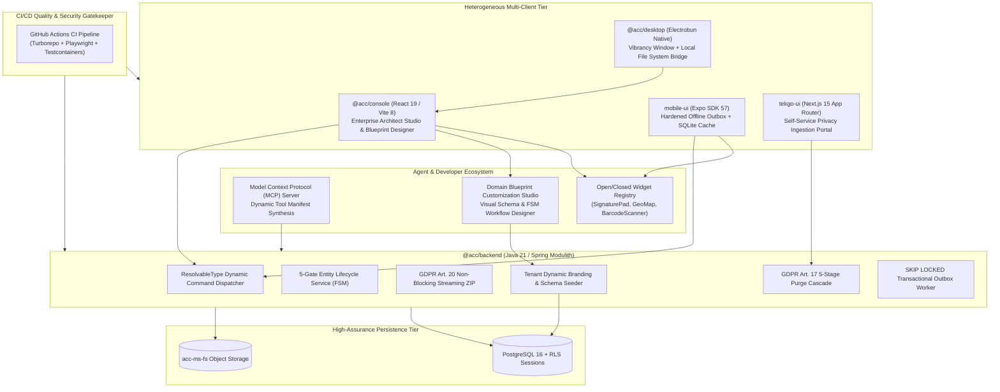

# Integration Master Plan (Iteration 2): Advanced Architecture, Native Hardening, MCP Tool Synthesis & CI/CD Industrialization

> **Document Reference:** `docs/brainstorming/integration_master_plan_iteration_2.md`  
> **Iteration:** 2 (Enterprise Advanced Capabilities & Production Industrialization)  
> **Classification:** Master Systems Architecture Specification & Multi-Tier Production Plan  
> **Authors:** Lead Systems Architect & Full-Stack Engineering Team  
> **Target Scope:** `@acc/backend`, `@acc/console`, `@acc/desktop`, `mobile-ui`, `tekgo-ui`, `packages/*`, `.github/workflows`  
> **Preceding Baseline:** Completed Iteration 1 (Phases 1–15 & Section 13 Architectural Invariants Verified in History Logs `036`–`052`)  
> **Synthesized Strategic Pillars:**
> 1. **Track 1:** Advanced Dynamic Metadata Extensions, Pluggable Widgets, Model Context Protocol (MCP) Synthesis & Spring Modulith Dynamic Dispatch.
> 2. **Track 2:** Enterprise Regulatory Privacy Hardening (GDPR Art. 17 5-Stage Purge Cascade & Art. 20 Streaming ZIP Pipeline).
> 3. **Track 3:** Cross-Platform Native Client Hardening (Expo Offline Outbox Stress Testing & Electrobun Desktop Console Integration).
> 4. **Track 4:** Production CI/CD Industrialization & GitHub Actions Multi-Tier Automated Gatekeeper.
> 5. **Track 5:** Enterprise User & Domain Customization (Self-Service Schema Designer, Custom Blueprint Studio & Tenant Theming Engine).

---

## 1. Executive Vision: From Converged Monorepo to Autonomous Production Platform

In **Iteration 1**, we successfully established the foundational multi-tier monorepo architecture:
- Extracted `@acc/client`, `@acc/sandbox`, and `@acc/tokens`.
- Integrated `mobile-ui` (offline-first outbox, dynamic forms) and `tekgo-ui` (Next.js 15 ISR revalidation with HMAC edge webhooks).
- Implemented backend 3-way auto-merge (OCC), Liquibase transactional outbox, declarative 5-gate FSM state machines, and end-to-end W3C distributed tracing.
- Enforced all 9 Section 13 Architectural Invariants and configured Playwright browser automation with `@axe-core/playwright` WCAG 2.2 AA testing.

In **Iteration 2**, the objective is to elevate Unipost into an **extensible, agent-accessible, regulation-compliant, customizable, and fully automated production ecosystem**:



---

## 2. Master Workstream Breakdown (The 5 Core Pillars)

Iteration 2 is structured into **5 comprehensive workstreams**, divided into **10 actionable execution phases** (Phases 16 through 25):

```
Iteration 2 Master Execution Map
├── Workstream 1: Advanced Metadata Architecture & Agent Extensibility (Phases 16 - 17)
│   ├── Phase 16: Pluggable Dynamic Widget Registry (SignaturePad, GeoMap, Barcode)
│   └── Phase 17: Model Context Protocol (MCP) Dynamic Tool Synthesis & ResolvableType Dispatch
├── Workstream 2: GDPR Articles 17 & 20 Regulatory Hardening (Phases 18 - 19)
│   ├── Phase 18: GDPR Article 20 Streaming ZIP Archive Pipeline (Zero JVM Heap OOM)
│   └── Phase 19: GDPR Article 17 5-Stage Right-to-be-Forgotten Cryptographic Erasure Cascade
├── Workstream 3: Mobile UI & Desktop Native Testing & Hardening (Phases 20 - 21)
│   ├── Phase 20: mobile-ui Component & Offline Outbox Testing & Stress Hardening
│   └── Phase 21: apps/desktop-console Electrobun Native Bridge, Packaging & Hardening
├── Workstream 4: Enterprise User & Domain Customization Engine (Phases 22 - 23)
│   ├── Phase 22: Visual Dynamic Schema & State Machine Workflow Studio
│   └── Phase 23: Tenant Custom Theming, White-Labeling & Dynamic Domain Blueprint Seeding
└── Workstream 5: Production CI/CD Industrialization & Quality Gatekeeper (Phases 24 - 25)
    ├── Phase 24: Unified GitHub Actions Quality Gatekeeper (Turborepo + Playwright Matrix)
    └── Phase 25: Automated Penetration Fuzzing & Multi-Tenant Chaos Hardening
```

---

## 3. Workstream 1: Advanced Metadata Architecture & Agent Extensibility

### Phase 16: Pluggable Dynamic Widget Registry (`WidgetRegistry`)
- **Objective:** Eliminate hardcoded input switches in UI renderers adhering strictly to the Open/Closed Principle (OCP).
- **Architecture:**
  - Create a shared `WidgetRegistry` in `packages/ui` and `packages/client`.
  - Expose API:
    ```typescript
    export interface DynamicWidgetProps<T = unknown> {
      value: T;
      onChange: (val: T) => void;
      attribute: AttributeDefinition;
      disabled?: boolean;
      readOnly?: boolean;
      error?: string;
    }
    export type WidgetComponent = React.ComponentType<DynamicWidgetProps>;
    export class WidgetRegistry {
      private static widgets = new Map<string, WidgetComponent>();
      static register(uiComponent: string, component: WidgetComponent): void;
      static get(uiComponent: string): WidgetComponent | undefined;
    }
    ```
  - Implement pluggable widgets:
    1. **`SignaturePad`**: Canvas-based vector bezier curve drawing component outputting SVG/base64.
    2. **`GeoLocationPicker`**: Map marker coordinate selector (`latitude`, `longitude`, `zoom`, `address`).
    3. **`BarcodeScanner`**: Optical code reader supporting QR, EAN-13, Code128.
  - Wire custom widgets into both `@acc/console` (`DynamicFieldRenderer`) and `mobile-ui` (`DynamicFieldRenderer`).
  - Add Unified Sandbox simulation handlers so test suites can exercise signature inputs and geo-spatial payloads seamlessly without live camera/GPS hardware.

### Phase 17: Runtime Model Context Protocol (MCP) Tool Synthesis & Spring Modulith `ResolvableType`
- **Objective:** Allow external LLM agents to interact dynamically with tenant metadata schemas and dispatch CQRS commands through safe Java typing.
- **MCP Server Synthesis (`packages/mcp-server` or backend endpoint):**
  - Synthesize dynamic Model Context Protocol manifests directly from active tenant `UNIPOST_ENTITY_TYPES`:
    - `acc_get_schema`: Returns JSON Schema Draft-07 for specified entity type.
    - `acc_query_entities`: RLS-scoped search with pagination and filtering.
    - `acc_execute_transition`: Executes FSM lifecycle state machine transitions with parameter validation.
    - `acc_create_entity`: Validates attributes against server schema and creates records.
- **Backend `ResolvableType` Dynamic Dispatch:**
  - In `acc-core` / `acc-fw`: Refactor generic CQRS command execution using Spring Framework's `org.springframework.core.ResolvableType`.
  - Avoid raw reflection which fails on CGLIB proxies created by Spring `@Transactional` or `@PreAuthorize` aspects.
  - Ensure type safety when deserializing heterogeneous JSONB attributes into strongly typed domain events.

---

## 4. Workstream 2: GDPR Regulatory Compliance Pipelines (Art. 17 & Art. 20)

### Phase 18: GDPR Article 20 Streaming ZIP Archive Pipeline (Zero JVM Heap OOM)
- **Objective:** Implement non-blocking streaming data portability for multi-gigabyte tenant datasets without JVM memory exhaustion.
- **Backend Architecture (`acc-report-engine` & `acc-ms-fs`):**
  - Implement `StreamingZipExportService` returning `ResponseEntity<StreamingResponseBody>`.
  - Process records using JDBC cursor streaming (`ResultSet.TYPE_FORWARD_ONLY` with fetch size 1000) or Spring Data chunked streams.
  - Pipe records directly through `java.util.zip.ZipOutputStream` to the client HTTP `OutputStream`.
  - Output structured archive layout:
    ```
    tenant_export_{tenantId}_{timestamp}.zip
    ├── manifest.json                  # Export metadata, record counts, SHA-256 hash
    ├── schemas/
    │   └── {entity_type}.schema.json # JSON Schema Draft-07 definition
    ├── records/
    │   ├── {entity_type}.jsonl       # JSON Lines streaming records
    │   └── {entity_type}.csv         # Tabular data export
    └── media/                        # Exported file assets streamed from acc-ms-fs
    ```
  - Verify memory bounds via JMH/integration tests capping JVM heap to 256MB while streaming 50,000+ records.

### Phase 19: GDPR Article 17 5-Stage Right-to-be-Forgotten Cryptographic Erasure Cascade
- **Objective:** Implement immutable, cryptographically verifiable tenant and user data purge.
- **Purge Pipeline Architecture:**
  - **Stage 1: Soft-Delete Ingress Lockdown**: Instantly revoke active JWT tokens, invalidate user sessions, set tenant status to `PURGING`, and reject all incoming API mutations with `HTTP 423 Locked`.
  - **Stage 2: Dependency Graph Traversal**: Analyze relationship metadata (`UNIPOST_ENTITY_RELATIONSHIPS`) to discover all child entities, comments, media attachments, and history records.
  - **Stage 3: PostgreSQL RLS Hard Purge**: Execute batch deletion cascades with statement timeouts (`statement_timeout = 5000`) and vacuum trigger.
  - **Stage 4: Distributed Cache & Storage Shredding**: Issue cluster-wide Pub/Sub cache eviction commands; permanently delete file blobs from `acc-ms-fs` object storage.
  - **Stage 5: Cryptographic Certificate of Erasure**: Generate an RFC 3161 compliant cryptographic receipt containing:
    - Purged Tenant ID & Execution Timestamp.
    - SHA-256 digest of deleted record IDs.
    - Digital signature signed by Unipost Sovereign Authority Private Key.
  - Expose self-service erasure status verification in `tekgo-ui` and `@acc/console` (`data-privacy-panel.tsx`).

---

## 5. Workstream 3: Mobile UI & Desktop Native Testing & Hardening (Option 2)

### Phase 20: `mobile-ui` Component & Offline Outbox Testing & Stress Hardening
- **Objective:** Provide robust automated test coverage and stress hardening for Expo SDK 57 / React Native 0.86 components and the offline outbox pipeline.
- **Component Testing (`apps/mobile-ui` with `@testing-library/react-native` / Vitest):**
  - **Dynamic Form Renderer Suite (`DynamicFieldRenderer.test.tsx`)**:
    - Test schema-driven rendering across text, number, enum picker, media picker, and relation bottom sheet.
    - Test validation errors, required field constraints, and disabled state styling with Liquid Glass tokens.
  - **Media Pipeline Suite (`MediaPickerInput.test.tsx`)**:
    - Test image selection, preview thumbnail rendering, and mock upload simulation.
  - **Relation Picker Bottom Sheet Suite (`RelationPickerBottomSheet.test.tsx`)**:
    - Test search filtering of target records, single vs multi-cardinality selection, and sheet dismissal.
- **Outbox Chaos & SQLite Hardening (`outbox-chaos.test.ts`):**
  - **Durable Storage Layer**: Integrate durable persistence to guarantee zero mutation loss across app process termination.
  - **Network Interruption Simulation**: Enqueue 50 concurrent entity mutations while network is completely severed.
  - **Replay Order Invariant**: Verify that queued mutations replay strictly sequentially by sequence timestamp once connectivity is restored.
  - **Conflict Resolution Modal**: Simulate HTTP 409 conflict responses; assert that `ConflictResolutionModal` surfaces with 3-way visual merge (Local, Server, Base).
  - **Exponential Backoff & Idempotency**: Verify that failed HTTP 500 requests retry with exponential backoff and jitter without creating duplicate records (`X-Idempotency-Key`).

### Phase 21: `apps/desktop-console` Electrobun Native Bridge, Packaging & Hardening
- **Objective:** Elevate Electrobun desktop console into a production-grade, hardened desktop application with native window vibrancy and local bridges.
- **Implementation & Verification:**
  - **Window Vibrancy & Theming**:
    - Configure window vibrancy matching macOS `NSVisualEffectView` and Windows 11 Mica/Acrylic styling.
    - Synchronize dark/light theme switching with `@acc/tokens` glass blur tokens.
  - **Electrobun RPC Native Bridge**:
    - Implement type-safe RPC bridge connecting Electrobun main process with the webview UI:
      - Native OS file picker dialog for bulk schema JSON export and import.
      - Native system notifications for background outbox synchronization completion.
      - System tray integration with quick-access tenant status and offline synchronization state.
  - **Desktop Build & Packaging Pipeline**:
    - Add `"test"` and `"build"` scripts in `apps/desktop-console/package.json` integrated with Turborepo.
    - Test packaging pipeline (`electrobun build`) and verify seamless bundle resolution of `@acc/console` static assets.

---

## 6. Workstream 4: Enterprise User & Domain Customization Engine (Option 4)

### Phase 22: Visual Dynamic Schema & State Machine Workflow Studio
- **Objective:** Enable tenant administrators and domain operators to design custom entities, attributes, and FSM lifecycle state machines visually without writing code.
- **Console Studio Architecture (`apps/console/src/features/metadata/studio/`):**
  - **Visual Schema Canvas**:
    - Drag-and-drop dynamic attribute palette (Text, Number, Date, Media, Relations, Custom Widgets).
    - Attribute property inspector: JSON Schema constraints (`pattern`, `minimum`, `maximum`, `required`, default values).
    - Instant live preview rendering the dynamic form using `<DynamicEntityForm />`.
  - **Interactive FSM State Machine Workflow Designer**:
    - React Flow visual state graph diagram displaying states (`DRAFT`, `SUBMITTED`, `APPROVED`, `PUBLISHED`, `ARCHIVED`) and transitions.
    - Transition inspector: SpEL guard expression builder with syntax hinting (e.g. `attributes['total_amount'] < 50000`).
    - Direct synchronization with backend `lifecycle_config` schema in PostgreSQL.

### Phase 23: Tenant Custom Theming, White-Labeling & Dynamic Domain Blueprint Seeding
- **Objective:** Support multi-tenant white-labeling and extensible domain blueprint packages for diverse industry verticals.
- **White-Labeling & Theming (`@acc/tokens` & `@acc/console`):**
  - Tenant dynamic theme overrides: Brand color palettes (Primary, Accent, Glass Tint Scrims), custom logos, and typography tokens stored in tenant configuration JSONB.
  - CSS variable injection on tenant switch: Seamlessly updates Liquid Glass tokens across Web and Desktop without page reload.
- **Dynamic Domain Blueprint Seeding Engine:**
  - Pluggable blueprint catalog loader in `@acc/backend` (`classpath:metadata/blueprints/*.json`):
    - Real Estate MLS (`Property`, `ListingAgent`, `TourSchedule`).
    - Healthcare Records (`PatientRecord`, `ClinicalNote`, `Prescription`).
    - Logistics Fleet Management (`DispatchOrder`, `DriverProfile`, `TelemetryPoint`).
  - Tenant onboarding one-click blueprint provisioning pipeline with transactional schema compilation and default view generation.

---

## 7. Workstream 5: Production CI/CD Industrialization & Quality Gatekeeper (Option 3)

### Phase 24: Unified GitHub Actions Quality Gatekeeper
- **Objective:** Enforce non-negotiable architectural invariants and prevent regressions automatically on every Pull Request.
- **Workflow Architecture (`.github/workflows/ci.yml`):**
  - **Job 1: Monorepo Lint & Strict Typecheck**:
    - Executes `pnpm turbo run check-types lint` across all 12 monorepo packages.
    - Enforces zero `any` usage in TypeScript.
  - **Job 2: Backend Spring Modulith & Database Verification**:
    - Runs Maven build using Java 21 and Testcontainers PostgreSQL 16.
    - Validates Liquibase migration scripts, RLS policies, and Spring Modulith module boundaries (`ModularityTests`).
  - **Job 3: Vitest Multi-Client Test Suites**:
    - Runs unit and integration suites across `@acc/console`, `mobile-ui`, `tekgo-ui`, `@acc/client`, and `@acc/sandbox`.
  - **Job 4: Headless Playwright Browser E2E & WCAG 2.2 AA Audit**:
    - Runs Playwright in headless Chromium/Firefox/WebKit container.
    - Asserts that all 4 Golden Workflows pass and `@axe-core/playwright` verifies **0 critical accessibility violations**.
  - **Job 5: Production Build Verification**:
    - Verifies production builds of Console (Vite 8), Tekgo (Next.js 15 SSG/ISR 95 pages), and Client SDK bundles.

### Phase 25: Automated Multi-Tenant Penetration Fuzzing & Chaos Hardening
- **Objective:** Continuously verify that no data leakage can ever occur across tenants.
- **Fuzzing Engine (`autogenerated-tests/security-penetration-fuzzing.test.ts`):**
  - **Cross-Tenant Horizontal Infiltration**: Automatically generates 100 random API requests using Tenant A's JWT token against Tenant B's entity IDs and schema endpoints; asserts **100% reject with HTTP 403/404**.
  - **ReDoS Regex Fuzzing**: Validates that schema validation patterns terminate within 50ms under pathological input patterns.
  - **Idempotency Key Collision Attack**: Simulates rapid concurrent requests with identical idempotency keys; asserts that only 1 record is created and subsequent calls return identical cached responses.

---

## 8. Execution Schedule & Milestone Tracking

| Phase | Milestone Title | Target Deliverables | Verification Mechanism |
| :---: | :--- | :--- | :--- |
| **Phase 16** | Pluggable Dynamic Widget Registry | `WidgetRegistry` in `@acc/ui`, `SignaturePad`, `GeoLocationPicker`, `BarcodeScanner` | Vitest widget rendering tests & Unified Sandbox registration |
| **Phase 17** | MCP Dynamic Tool Synthesis & ResolvableType | Runtime MCP tool manifests, Spring Modulith `ResolvableType` dynamic dispatcher | MCP JSON-RPC protocol assertions & Spring Modulith command test |
| **Phase 18** | GDPR Art. 20 Streaming ZIP Archive | Streaming JDBC cursor export, `ZipOutputStream` pipeline, manifest generator | Low-memory export integration test (50,000 records < 256MB heap) |
| **Phase 19** | GDPR Art. 17 5-Stage Erasure Cascade | 5-stage purge service, RLS table wipe, SHA-256 certificate of erasure | Integration test verifying zero records remain and receipt signature passes |
| **Phase 20** | `mobile-ui` Offline Outbox Chaos | SQLite durable queue, network disconnect simulator, 409 conflict resolver | Vitest chaos simulation test suite under simulated packet drop |
| **Phase 21** | `apps/desktop-console` Electrobun Bridge | Electrobun RPC bridge, OS vibrancy window, native file import/export | Desktop build verification and IPC contract test |
| **Phase 22** | Visual Schema & FSM Workflow Studio | Studio canvas, attribute palette, React Flow state machine designer | Vitest studio canvas test & state graph validation |
| **Phase 23** | Tenant Theming & Domain Blueprint Seeding | Dynamic theme CSS variables, industry blueprint packs (MLS, Health, Fleet) | Tenant switcher theme test & template provisioning verification |
| **Phase 24** | Unified GitHub Actions CI Pipeline | `.github/workflows/ci.yml`, matrix test runners, Playwright container | Local workflow validation using `act` / Turborepo pipeline dry-run |
| **Phase 25** | Multi-Tenant Penetration Fuzzing | Cross-tenant security fuzzer, ReDoS guard test, concurrent idempotency lock | Automated security test suite in `autogenerated-tests/` |

---

## 9. Non-Negotiable Iteration 2 Architectural Invariants

In addition to the 9 invariants verified in Iteration 1, all Iteration 2 PRs must satisfy:

1. **OCP Invariant**: UI dynamic form renderers must never use hardcoded `switch` statements for new widgets; all new inputs must register via `WidgetRegistry.register()`.
2. **Streaming Invariant**: Data exports exceeding 1,000 records must never buffer entire collections into JVM heap or Node.js memory; streaming response bodies are mandatory.
3. **Cryptographic Erasure Invariant**: Any GDPR hard-purge must produce a tamper-evident Certificate of Erasure containing SHA-256 digests of destroyed entities.
4. **Offline Durability Invariant**: Mobile outbox mutations must persist to durable disk storage immediately upon creation to survive mobile OS termination.
5. **Theme Scrim Isolation Invariant**: Tenant custom branding colors must dynamically compute WCAG 2.2 AA compliant glass text contrast scrims ($\ge 4.5:1$) via `@acc/tokens`.
6. **Zero-Flake CI Invariant**: All automated Playwright and integration test suites in CI must achieve 100% deterministic reproducibility without race-condition flakes.

