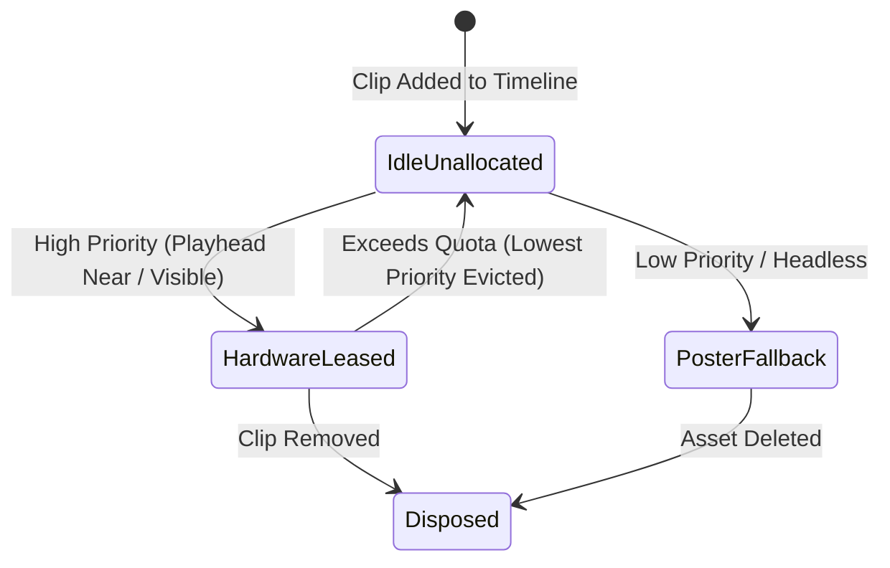
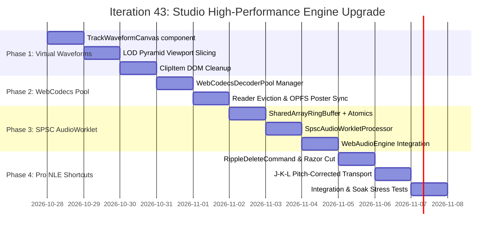

# Deep Research Synthesis & Comprehensive Implementation Plan: Studio High-Performance NLE Engine Upgrade

## Executive Mental Model

Modern web-based non-linear video editors (NLEs) face 4 foundational browser platform boundaries when scaling to broadcast-grade timelines:
1. **DOM & Canvas Density Ceiling**: Hundreds of clip-level DOM nodes and canvas instances cause layout recalculations, composite layer bloat, and GPU context memory exhaustion.
2. **Audio Thread Scheduling Jitter**: Main-thread chunk scheduling via `AudioBufferSourceNode` or `postMessage` suffers from micro-task queuing jitter and GC pauses during interactive scrubbing.
3. **WebCodecs Hardware Session Quotas**: Operating systems and browser graphics stacks strictly bound concurrent hardware video decoders ($\sim 16$ instances), throwing uncatchable quota errors or dropping frames when timelines exceed that ceiling.
4. **Editor Velocity & Interaction Friction**: Broadcast editors require muscle-memory keyboard transport (J-K-L shuttle, Blade/Razor split, Ripple Delete gap closure) with immediate pitch-corrected auditory feedback.

Solving these requires transitioning from ad-hoc component rendering to **virtualized canvas viewport projection**, **lock-free shared-memory audio pipelines**, and **priority-leased hardware decoder management**.

---

## Decision & Trade-off Matrix

| Dimension | Option A: Per-Clip WaveSurfer Instances (Current) | Option B: Track-Level Virtualized Canvas (Selected) | Option C: WebGL Multi-Track Shader Canvas |
|---|---|---|---|
| **DOM Overhead** | $O(N)$ DOM nodes and resize observers | $O(T)$ where $T = \text{audio tracks}$ | 1 master canvas for entire viewport |
| **GPU Memory** | 1 canvas per clip ($50 \times \sim 2\text{ MB} = 100\text{ MB}$) | 1 viewport canvas per track ($\sim 10\text{ MB}$ total) | Single shared WebGL context ($\sim 15\text{ MB}$) |
| **Render Latency** | High (DOM layout thrash on zoom/pan) | Low ($< 1\text{ ms}$ 2D batched paths per frame) | Ultra-low ($< 0.5\text{ ms}$ instanced quads) |
| **Implementation Complexity** | Minimal (existing prototype) | Moderate (pure 2D Canvas frustum slicing) | High (GLSL shaders, vertex buffers, texturing) |
| **Verdict** | **Deprecated** due to DOM scaling bottleneck | **Adopted for Iteration 43** | Future evolution for 1,000+ clips |

| Dimension | Chunk Scheduling via `AudioBufferSourceNode` (Current) | SPSC RingBuffer via `SharedArrayBuffer` + `Atomics` (Selected) | Web Worker Transferable `Float32Array` |
|---|---|---|---|
| **Audio Latency** | 50–150ms buffer lead time | $< 3\text{ ms}$ (128-sample real-time pull) | 10–25ms `postMessage` jitter |
| **GC Pressure** | High (allocating buffer nodes per chunk) | **Zero (pre-allocated static circular memory)** | Moderate (allocating transfer buffers) |
| **Cross-Origin Security** | Works anywhere | Requires COOP/COEP or fallback | Works anywhere |
| **Verdict** | **Deprecated** for interactive playback | **Adopted with graceful fallback** | Fallback for non-isolated origins |

| Dimension | Unbounded `Input` / `VideoDecoder` per Clip (Current) | Playhead-Proximity Decoder Quota Pool (Selected) | Single Worker Decoder with Sequential Seek |
|---|---|---|---|
| **Concurrent Limit** | Crashes / drops frames beyond 16 clips | Strictly caps hardware decoders at $\le 8$ | Exactly 1 hardware decoder |
| **Multi-Track Preview** | Unstable on multi-track transitions | Smooth PIP & transitions via leased slots | Cannot preview PIP/overlays simultaneously |
| **Fallback Strategy** | None (black frame on quota crash) | OPFS-cached poster frames & thumbnails | Dropped frames on seek queue lag |
| **Verdict** | **Violates browser invariants** | **Adopted for Iteration 43** | Insufficient for multi-track NLE |

---

## Architectural Pillar Specifications

### 1. Timeline Waveform Virtualization

#### Mathematical Model for Frustum Culling & Viewport Projection
Given timeline horizontal scroll position $X_{\text{scroll}}$, visible timeline viewport width $W_{\text{viewport}}$, and pixels per frame $S_{px}$:

$$\text{Visible Frame Range}: [F_{\text{start}}, F_{\text{end}}] = \left[ \max\left(0, \left\lfloor \frac{X_{\text{scroll}}}{S_{px}} \right\rfloor \right), \left\lceil \frac{X_{\text{scroll}} + W_{\text{viewport}}}{S_{px}} \right\rceil \right]$$

For each clip $C_k$ on audio track $T_j$:
$$\text{Intersection Condition}: [C_k.\text{startFrame}, C_k.\text{endFrame}] \cap [F_{\text{start}}, F_{\text{end}}] \neq \emptyset$$

#### Canvas Batch Drawing
```typescript
const dpr = window.devicePixelRatio || 1;
ctx.save();
ctx.scale(dpr, dpr);
ctx.beginPath();
ctx.strokeStyle = trackColor;
ctx.lineWidth = 1.5;

// Batch all vertical waveform lines in a single path
for (let x = localStartPx; x < localEndPx; x += barSpacing) {
  const peak = samplePyramidPeak(clip, x, pxPerFrame);
  const amplitudePx = peak * (laneHeight * 0.45);
  ctx.moveTo(x, centerY - amplitudePx);
  ctx.lineTo(x, centerY + amplitudePx);
}
ctx.stroke();
ctx.restore();
```

---

### 2. Lock-Free SPSC RingBuffer (`SharedArrayBuffer` + `Atomics`)

#### Memory Layout (Planar Stereo 44.1 kHz, 5 Seconds Capacity)
```
Total Allocation: 64-byte Header + (44100 * 5 * 4 * 2) bytes = 1,764,064 bytes (~1.68 MB)

[Offset 0..63]: Control Block (Int32Array view)
  - Index 0: READ_POINTER (Updated by AudioWorkletProcessor)
  - Index 1: WRITE_POINTER (Updated by Main Thread / UniversalAudioMixer)
  - Index 2: CAPACITY_SAMPLES (220,500)
  - Index 3: STATE_FLAGS (0 = Normal, 1 = Underflow, 2 = Seek Reset)

[Offset 64..882,063]:      Left Channel (Float32Array view, 220,500 elements)
[Offset 882,064..1,764,063]: Right Channel (Float32Array view, 220,500 elements)
```

#### Lock-Free SPSC Producer & Consumer Algorithm
- **Producer (Mixer / Engine)**:
  1. `readPtr = Atomics.load(control, READ_POINTER)`
  2. `writePtr = Atomics.load(control, WRITE_POINTER)`
  3. `availableSpace = (readPtr - writePtr - 1 + capacity) % capacity`
  4. Write `Math.min(chunkSize, availableSpace)` samples into planar float views.
  5. `Atomics.store(control, WRITE_POINTER, (writePtr + written) % capacity)`
- **Consumer (`AudioWorkletProcessor.process`)**:
  1. `readPtr = Atomics.load(control, READ_POINTER)`
  2. `writePtr = Atomics.load(control, WRITE_POINTER)`
  3. `availableSamples = (writePtr - readPtr + capacity) % capacity`
  4. If `availableSamples < 128`: Fill output with zeros, mark underrun flag.
  5. Else: Read 128 samples into `outputChannel[0]` and `outputChannel[1]`.
  6. `Atomics.store(control, READ_POINTER, (readPtr + 128) % capacity)`

---

### 3. WebCodecs Hardware Decoder Quota Pool

#### Priority Scoring Formulation
Every playhead movement evaluates all clips across active tracks:
$$P(C_k) = \begin{cases}
  10,000 - (\text{trackIndex} \times 100) & \text{if } F_{\text{playhead}} \in [C_k.\text{start}, C_k.\text{end}] \land \neg \text{track.isMuted} \\
  1,000 - \frac{|F_{\text{playhead}} - C_k.\text{start}|}{FPS} \times 50 & \text{if within } \pm 3 \text{ seconds of playhead} \\
  10 & \text{if visible on screen but outside active scrub window} \\
  0 & \text{if track is hidden / muted or clip is off-screen}
\end{cases}$$

#### Lifecycle State Machine


---

### 4. Professional NLE Editing Workflows

#### Ripple Delete Mathematical Algorithm
When deleting clip $C_{\text{target}}$ with start frame $S$ and duration $D$:
1. Remove $C_{\text{target}}$ from track $T$.
2. For all clips $C_i \in T$ where $C_i.\text{startFrame} > S$:
   $$C_i.\text{startFrame} \leftarrow C_i.\text{startFrame} - D$$
   $$C_i.\text{endFrame} \leftarrow C_i.\text{endFrame} - D$$
3. If "Ripple All Unlocked Tracks" is enabled, apply duration shift $-D$ to all unlocked tracks at or after $S$.
4. Wrap in `RippleDeleteCommand` with inverted state for single-step `undo()` / `redo()`.

---

## Comprehensive Implementation Plan



### Verification Suite Matrix
1. `autogenerated-tests/track_waveform_virtual_canvas.test.ts`: Verify viewport slicing, Retina scaling, and peak sampling accuracy.
2. `autogenerated-tests/shared_array_ring_buffer.test.ts`: SPSC concurrent reader/writer stress test with 1,000,000 simulated audio samples.
3. `autogenerated-tests/webcodecs_decoder_pool.test.ts`: 30-clip concurrent decode simulation asserting max active decoders $\le 8$.
4. `autogenerated-tests/timeline_ripple_delete.test.ts`: Multi-track gap closure, track lock adherence, and undo/redo parity.
