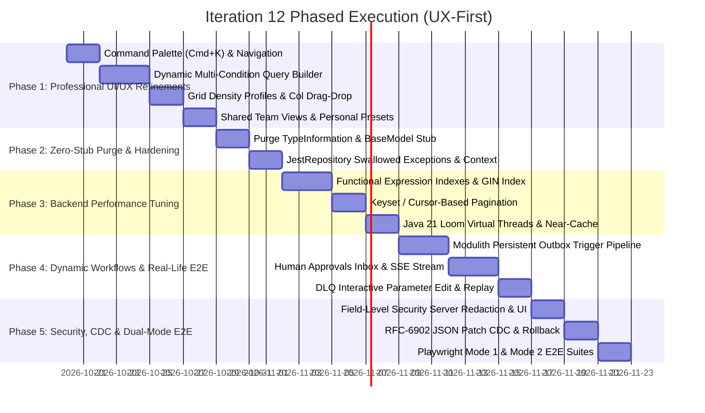

# Integration Master Plan: Iteration 12 - Enterprise Production Readiness: Professional UI/UX Refinement, High-Performance Dynamic Metadata Engine, Autonomous Workflow Orchestration, End-to-End Real-World Workflows & Complete Zero-Stub Hardening

## 1. Executive Summary & Vision

Iteration 12 transforms the **unipost** enterprise platform from a robust, accessible foundation into a battle-tested, high-performance, and consumer-grade operational suite. Following collaborative alignment, this iteration executes with a **User-Experience First** delivery staging: delivering immediate tangible visual ergonomics (Global Command Palette, Dynamic Multi-Condition Query Builder, Grid Density profiles, Drag-and-drop column customization, and Shared Team Views), followed by systematic Zero-Stub elimination, backend performance tuning (PostgreSQL functional expression indexing + GIN, keyset pagination, Java 21 Loom Virtual Threads), and event-driven dynamic entity business workflows with Spring Modulith persistent outbox and real-time Server-Sent Events (SSE).

---

## 2. Decided Architecture & Design Invariants

Based on deep technical alignment, the following design decisions govern Iteration 12:

1. **UX-First Staging**: Phase 1 immediately equips `@unipost/console` with professional-grade interactive ergonomics, providing rapid feedback before deeper backend and data migration phases.
2. **Dynamic Metadata Indexing**: PostgreSQL Functional Expression Indexes (`CREATE INDEX CONCURRENTLY idx_... ON UNIPOST_ENTITY_RECORDS ((data->>'field')) WHERE "deletedDate" IS NULL`) combined with a global GIN index (`jsonb_path_ops`). This eliminates disruptive table-locking DDL migrations while guaranteeing sub-millisecond query performance at 100,000+ records.
3. **Event-Driven Workflow Triggers**: Transactional Persistent Outbox powered by Spring Modulith (`UNIPOST_EVENT_PUBLICATIONS`). Entity mutations commit an event in the same DB transaction; asynchronous listeners dispatch workflow executions with guaranteed at-least-once delivery and auto-recovery on server crash.
4. **Real-Time Notification Pipeline**: Server-Sent Events (SSE) stream (`/api/v1/notifications/stream`) combined with TanStack Query optimistic invalidation. Clean, HTTP/2 multiplexed, firewall-friendly, automatic browser reconnection, minimal server overhead.
5. **Change Data Capture (CDC) & Time-Travel**: RFC-6902 JSON Patch audit records stored in `UNIPOST_RECORD_AUDIT_LOGS`, exposed in a dedicated "History" tab in the row inspector drawer with visual before/after diffs and one-click rollback (`PATCH /api/v1/metadata/records/{id}/revert/{version}`).
6. **Field-Level Security (FLS) & PII Redaction**: Server-side dynamic serialization redaction based on user tenant roles (Admin = unmasked, Operator = partial mask, Viewer = omitted). The client renders visual lock icons and permission badges.
7. **Table Customization & Presets**: Shared Team Views + Personal Presets. Tenant admins can publish default saved views (column order, density, pinned columns, filters) to all workspace members, while individual users can save personal presets synced to their profile with offline `localStorage` fallback.

---

## 3. Five Strategic Workstreams

```
┌──────────────────────────────────────────────────────────────────────────────────────────────────┐
│                             UNIPOST ENTERPRISE PLATFORM - ITERATION 12                           │
└──────────────────────────────────────────────────────────────────────────────────────────────────┘
       │                                 │                                  │
       ▼                                 ▼                                  ▼
┌───────────────────────────┐     ┌───────────────────────────┐     ┌───────────────────────────┐
│ Workstream 1: UI/UX Elite │     │ Workstream 2: Zero-Stub   │     │ Workstream 3: Backend     │
│ - Global Command (Cmd+K)  │     │   Hardening & Integrity   │     │   Performance & Scale     │
│ - Dynamic Query Builder   │     │ - Purge TypeInformation   │     │ - Functional Expr Indexes │
│ - Density (36/48/60px)    │     │ - Purge BaseModel TODO    │     │ - Keyset / Cursor Seek    │
│ - Drag & Drop Col Reorder │     │ - Fix JestRepo Exceptions │     │ - Java 21 Loom Virtuals   │
│ - Shared & Personal Views │     │ - Multi-Instance Context  │     │ - Hazelcast Near-Caching  │
└───────────────────────────┘     └───────────────────────────┘     └───────────────────────────┘
               │                                                 │
               ▼                                                 ▼
┌───────────────────────────────────────────┐     ┌───────────────────────────────────────────┐
│ Workstream 4: Real-Life E2E Workflows     │     │ Workstream 5: Dynamic Metadata & Security │
│ - Modulith Persistent Outbox Triggers     │     │ - Server-Side Dynamic Redaction (FLS)     │
│ - Human Approvals Inbox                   │     │ - RFC-6902 JSON Patch CDC Audit Trail     │
│ - Real-Time SSE Notification Pipeline     │     │ - Visual Time-Travel Rollback             │
│ - DLQ Triage, Edit & Partial Replay       │     │ - Dynamic Expression Evaluation (SpEL)    │
└───────────────────────────────────────────┘     └───────────────────────────────────────────┘
```

---

## 4. Workstream Deep Dive & Architectural Specifications

### Workstream 1: Enterprise UI/UX Refinement & Professional Design System (UX-First)

#### 1.1 Global Command Palette (`Cmd+K` / `Ctrl+K`)
- **Component**: `@/components/command-palette/command-palette.tsx` using `cmdk` + Liquid Glass dialog overlay.
- **Search Scope**:
  - Global navigation (Routes, Settings, Documentation, Admin panels).
  - Quick Entity Type switcher & dynamic entity search across active tenant.
  - Workflow templates & execution trigger shortcuts.
  - Immediate action execution (Theme toggle, Export data, Clear cache, Switch persona).
- **Aesthetic**: `backdrop-blur-2xl bg-white/75 dark:bg-slate-900/80 border border-white/20 dark:border-white/10 shadow-2xl rounded-2xl`.

#### 1.2 Dynamic Multi-Condition Query Builder
- **Component**: `@/features/metadata/components/data-explorer/query-builder/`.
- **Capabilities**:
  - Recursive nested boolean grouping (`AND`, `OR`, `NOT`).
  - Dynamic operator resolution based on attribute type:
    - *Text*: `equals`, `contains`, `starts_with`, `ends_with`, `in`, `is_empty`, `regex`.
    - *Number*: `=`, `!=`, `>`, `>=`, `<`, `<=`, `between`.
    - *Date/Timestamp*: `is_today`, `in_last_n_days`, `before`, `after`, `between`.
    - *Select/Enum*: `one_of`, `none_of`.
    - *Relation*: `linked_to`, `not_linked`.
  - Serializes to standardized JSON criteria payload parsed by backend specification engine.

#### 1.3 Advanced Table Ergonomics: Density Switching & Column Drag-and-Drop
- **Grid Density Profiles**:
  - `compact`: row height 36px, text-xs, py-1, tight padding for 100+ row scanning.
  - `comfortable`: row height 48px, text-sm, py-2.5 (default).
  - `spacious`: row height 60px, text-sm, py-4, multi-line preview badges.
- **Column Reordering & Visibility**:
  - Drag-and-drop column headers via `@dnd-kit/core` with smooth layout transitions.
  - Pinned state: Left column `#` and right column `Actions` remain strictly anchored while intermediate columns are freely draggable.
- **Shared Team Views & Personal Presets**:
  - Tenant Admins can publish default saved views (`is_default_team_view: true`).
  - Individual users can save personal presets synced to their user profile with offline `localStorage` fallback.

#### 1.4 Master-Detail Split Pane & Slide-Over Inspector
- **Master-Detail Layout**: Inline expandable drawer or resizable split pane (`react-resizable-panels`).
- **Ergonomics**: Keyboard row navigation with `j` / `k` (or `Up` / `Down` arrows), `Enter` to expand inspector drawer, `Escape` to close.
- **Micro-Interactions**: Fluid framer-motion transitions, tactile hover sheens, caustic radial glows on card selection.

---

### Workstream 2: Complete Zero-Stub Hardening & Full-Stack Integrity

#### 2.1 Purge All Backend Stubs & Orphaned Code
- **Target 1: Remove `org.springframework.data.util.TypeInformation` Stub**:
  - Replace temporary stub with standard Springdoc OpenAPI 3.1 configuration that disables obsolete Spring Data reflection introspection natively.
- **Target 2: Complete `BaseModelService.java` Method Implementations**:
  - Implement real persistence, audit population, and tenant isolation logic; eliminate `// TODO Auto-generated method stub`.
- **Target 3: Resolve Swallowed Exceptions in `JestRepository.java`**:
  - Replace lines 119, 142, 166, 236, 257, 289, 313 with standardized domain exceptions (`ElasticsearchOperationException`) wrapped in localized context.
- **Target 4: Refactor `WebLoginAttemptService.java`**:
  - Implement active TTL cache or scheduled `@Scheduled(cron = "0 0 * * * *")` eviction for expired login attempts.
- **Target 5: Multi-Instance `WebContext.java` Refactoring**:
  - Migrate single-instance thread-local state to Scoped Proxy / Reactor-aware context to support multi-instance cluster deployments and virtual thread hand-offs without context leakage.

#### 2.2 Real Production Auth & Cryptographic Assurance
- Ensure all token generation, Argon2 password hashing, tenant context enforcement, and permission evaluation operate against real production classes and database tables in all test suites and staging pipelines.

---

### Workstream 3: Backend Performance Tuning & Scalability

#### 3.1 PostgreSQL Functional Expression Indexing & Global GIN
- **Index Architecture**:
  1. **Global GIN Index**:
     ```sql
     CREATE INDEX idx_entity_records_gin ON UNIPOST_ENTITY_RECORDS USING gin (data jsonb_path_ops);
     ```
  2. **Dynamic Functional Expression Indexes**:
     - When an attribute is marked `indexed: true`, dynamically provision a functional B-tree index without locking the table:
       ```sql
       CREATE INDEX CONCURRENTLY idx_entity_records_<entity>_<field> 
       ON UNIPOST_ENTITY_RECORDS ((data->>'field')) 
       WHERE "deletedDate" IS NULL AND entity_type_id = :typeId;
       ```
  3. **Selective Projection Querying**:
     - Enhance `MetadataRecordRepository` to support projecting only requested fields using `jsonb_build_object` rather than hydrating complete megabyte-sized JSON payloads into memory.

#### 3.2 Keyset / Cursor-Based Pagination (`Seek Method`)
- Keyset cursor format: `base64(last_sort_value + ":" + last_record_id)`.
- SQL generation: `WHERE (col_val, id) > (:cursor_val, :cursor_id) ORDER BY col_val ASC, id ASC LIMIT :pageSize`.
- Guaranteed sub-millisecond response times regardless of page depth.

#### 3.3 Java 21 Virtual Threads (Project Loom) & Execution Pooling
- Configure `spring.threads.virtual.enabled=true` for non-blocking I/O dispatch.
- Workflow step execution engine (`WorkflowStepExecutor`) migrated to unpooled virtual thread executors (`Executors.newVirtualThreadPerTaskExecutor()`).
- Configure HikariCP connection pool optimization with explicit 5000ms leak detection.

#### 3.4 Hazelcast L2 Distributed Cache & Near-Cache Tiering
- Enable Hazelcast in-process Near-Cache on client instances for `schema:{id}:v{version}` with `in-memory-format: OBJECT` and local invalidation listeners.
- Schema lookups drop to direct memory pointer reference (< 1μs).

---

### Workstream 4: Real-World End-to-End Business Workflows

#### 4.1 Persistent Outbox Event-Driven Dynamic Entity Lifecycle Hooks
- Dynamic entity mutations commit an event to `UNIPOST_EVENT_PUBLICATIONS` in the same database transaction.
- Asynchronous Spring Modulith listeners evaluate trigger rules and dispatch automated DAG `WorkflowExecution`.

#### 4.2 Human-in-the-Loop Approvals Inbox & Real-Time SSE
- **UI Screen**: `@/features/workflows/approvals/approvals-inbox.tsx` (DataTable unified).
- **SSE Stream**: Server-Sent Events stream (`/api/v1/notifications/stream`) pushes approval task notifications.
- Displays dynamic entity context diffs; supports Approve, Reject, and Request Changes with mandatory audit rationale.
- Resolving the task sends resume signal to `WorkflowOrchestrator`, continuing DAG execution.

#### 4.3 Dead-Letter Queue (DLQ) Operational Triage & Partial Replay
- Failed step exceeds max retry limit -> moved to DLQ table `UNIPOST_DLQ_MESSAGES`.
- `DlqInspectorSheet` allows editing failed step payload parameters directly in an interactive Monaco/JSON editor and triggering partial step re-execution with exponential backoff.

---

### Workstream 5: Dynamic Metadata & Workflow Engine Deep Integration

#### 5.1 Field-Level Security (FLS) & PII Data Masking
- Backend Jackson serializers dynamically redact or mask fields based on requesting user's tenant roles (`Admin` = unmasked, `Operator` = partial mask `****-1234`, `Viewer` = omitted).
- Console UI renders visual lock badges and permission tooltips on protected columns.

#### 5.2 RFC-6902 JSON Patch Change Data Capture (CDC) Audit Trail
- Table: `UNIPOST_RECORD_AUDIT_LOGS` (`id`, `entity_type_id`, `record_id`, `tenant_id`, `changed_by`, `action`, `patch_json`, `created_date`).
- Expose "History / Time-Travel" tab in `EntityDataGrid` row details drawer, displaying visual before/after diffs with one-click rollback (`PATCH /api/v1/metadata/records/{id}/revert/{version}`).

#### 5.3 Dynamic Expressions & Computed Attributes (SpEL)
- Sandboxed Spring Expression Language (SpEL) evaluation for computed attributes (`#{data.quantity * data.unitPrice}`).
- Real-time client preview with authoritative server-side evaluation.

---

## 5. Phased Execution Roadmap (UX-First Staging)



---

## 6. Document Governance & Historical Tracking
- **Author**: Lead Systems Architect & Full-Stack Principal Engineer
- **Status**: Aligned & Approved via /grill-me session
- **Target Artifacts**:
  - Monorepo Plan: `docs/integration_master_plan_iteration12.md`
  - App Plan: `apps/console/doc/implementation_plan_131.md`
  - Planning Artifact: `C:\Users\Admin\.gemini\antigravity\brain\744424a4-e40a-4317-8ab7-d589b773b44e/implementation_plan_iteration12.md`
