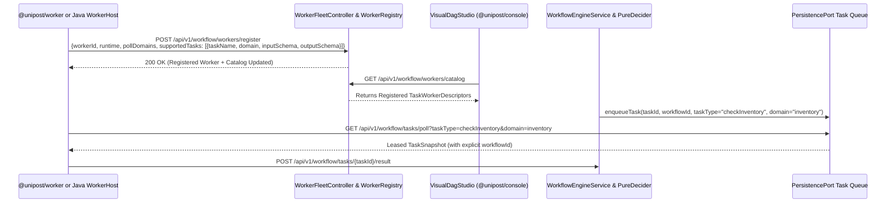

# Integration Master Plan: Iteration 13 — Workstream 4 & 5 Full-Stack Alignment, Advanced Visual JSON Editor, Autonomous Workflow Orchestration, `@unipost/worker` & Java Worker SDK Registration Protocol, Refined DAG Studio, Deterministic Schema Synthesis & Engine-Level Workflow Visual Debugger

## 1. Executive Summary & Vision

Iteration 13 elevates the **unipost** enterprise platform by closing all backend-frontend contract gaps from Iteration 12 Workstreams 4 & 5, equipping `VisualJsonEditor` with schema-aware linting and deep search/reordering ergonomics, establishing a production-grade 4-layer **SIMPLE Task Worker Registration & Polyglot SDK Architecture** (`@unipost/worker`, `@unipost/sandbox`, `@unipost/backend`, and `@unipost/console`), refining the **Visual DAG Workflow Designer**, introducing **Deterministic AI-Assisted Schema Generation**, and delivering an interactive **Engine-Level Workflow Visual Debugger** with breakpoints, step-over execution, and live node replay.

---

## 2. Decided Architecture & Design Invariants (`/grill-me` Alignment)

| Decision Area | Agreed Architecture & Invariants |
| :--- | :--- |
| **1. Workstream 4 & 5 Full-Stack Alignment** | 1. **Human Approvals REST API**: Expose `WorkflowApprovalsController` (`/api/v1/workflows/approvals` and `/api/v1/workflow/approvals`) in `unipost-ms-aio` matching the exact `ApprovalTask` contract used by `@unipost/console`. 2. **System/Human Task Upsert**: Fix `WorkflowEngineService.applyCommands` so `EngineCommand.UpdateTaskStatus` upserts new task executions via `saveTaskExecution` when a task does not yet exist in `PersistencePort`. 3. **Recursive JSONB FLS Masking**: Upgrade `FieldLevelSecuritySerializer` to recursively mask PII fields inside nested `Map` and `List` (`jsonb`) structures and honor schema-level sensitivity flags (`isSensitive` / `validationRules.pii`). 4. **DLQ & CDC Diff Ergonomics**: Embed `VisualJsonEditor` in `dlq-inspector-sheet.tsx` for interactive override editing and wire `usePreviewRestoreRecord` diff confirmation into `master-detail-row-inspector.tsx`. |
| **2. Visual JSON Editor Schema Linting & Ergonomics** | **Non-Blocking Inline Linting + `onValidationChange`**: `VisualJsonEditor` emits `onChange` whenever JSON syntax is valid while evaluating `jsonSchema` constraints (`type`, `required`, `enum`, `minLength`, `maxLength`, `minimum`, `maximum`, `pattern`) to surface inline error badges on offending `JsonTreeNode` / `JsonFormRow` items and a toolbar validation summary. Includes real-time key/value search with automatic ancestor expansion and array element Move Up / Move Down reordering. |
| **3. `SIMPLE` Task Routing Identity** | `TaskDefinition` and `DagNodeData` support `taskDefName` (defaulting to `taskReferenceName`). `SimpleTaskStrategy` enqueues tasks with `effectiveTaskName = taskDefName \|\| taskReferenceName`. Workers polling for a specific task name (e.g., `checkInventory`) match that task name, while generic domain workers polling `"SIMPLE"` act as fallback handlers. `TaskSnapshot` and `TaskSnapshotDto` explicitly carry `workflowId` so workers never rely on `taskId.split("_")[0]`. |
| **4. `@unipost/worker` (`packages/worker`) 4-Layer Separation of Concerns** | 1. **`@unipost/console` (`apps/console`)**: Strictly Control Plane UI. Never imports `@unipost/worker`; queries `GET /api/v1/workflow/workers` (Fleet) and `GET /api/v1/workflow/workers/catalog` (Registered `SIMPLE` Task Definitions + Input/Output JSON Schemas). 2. **`@unipost/worker` (`packages/worker`)**: Pure TypeScript Worker SDK (`WorkflowWorkerHost`, `TaskPoller`, `HttpWorkerTransportClient`, Middlewares) upgraded with `/register` capability handshake, periodic `/heartbeat` telemetry, fixed `workflowId` resolution, and a runnable CLI worker entrypoint (`packages/worker/src/runner.ts`). 3. **`@unipost/sandbox` (`packages/sandbox`)**: Wires `@unipost/worker` with `InMemorySandboxWorkerTransport` so offline dev mode runs real `WorkflowWorkerHost` pipelines in-memory. 4. **`@unipost/backend` (`workflow-engine` & `unipost-ms-aio`)**: Java `WorkerHost` + `@WorkflowTaskWorker` annotation + `SimpleTaskWorkerRegistrar` + `RegistryAwareInProcessTransportAdapter` + `HttpWorkerTransportAdapter`. |
| **5. Deterministic Schema Generation Engine** | **100% Local Deterministic JSON AST & Domain Heuristics Only**: Zero external LLM HTTP calls. Combines a deterministic domain keyword parser (E-Commerce, FinTech, Healthcare, Logistics, HR, CMS) with a recursive JSON sample AST inference engine (`TEXT`, `NUMBER`, `BOOLEAN`, `DATETIME`, `ENUM`, `JSON`, `RELATION`, `uiComponent`, `validationRules`, FLS PII flags, and recommended FSM `LifecycleConfig`). |
| **6. Workflow Visual Debugger Breakpoints** | **Server-Side & Sandbox Engine Breakpoints**: Active breakpoints (`Set<String> breakpoints`) are stored on the execution; `PureDecider` halts before scheduling a breakpointed `taskReferenceName` and transitions execution to `PAUSED_AT_BREAKPOINT` until `POST /api/v1/workflow/executions/{id}/step` (Step Over) or `/resume` is invoked. Includes **"Edit Input & Re-Run From Node"** (`POST .../tasks/{taskRef}/rerun`) and a **Time-Travel Variable Watch & State Diff** drawer. |

---

## 3. Seven-Phase Execution Roadmap

```mermaid
flowchart TD
    subgraph P1["Phase 1: Workstream 4 & 5 Backend-Frontend Alignment"]
        W4A["WorkflowApprovalsController (/api/v1/workflows/approvals)"]
        W4B["Fix System/HUMAN Task Upsert in WorkflowEngineService"]
        W4C["EntityWorkflowTriggerDispatcher -> Auto-Start DAG & SSE"]
        W5A["Recursive JSONB & Schema-Aware FLS Redaction"]
        W5B["CDC Restore Preview Diff & Rollback Alignment"]
    end

    subgraph P2["Phase 2: Visual JSON Editor Advanced Capabilities"]
        J1["Search & Filter Bar with Deep Auto-Expand"]
        J2["Array Element Reordering (Move Up / Down)"]
        J3["Non-Blocking JSON Schema Inline Linting & Error Badges"]
    end

    subgraph P3["Phase 3: Core Workflow Engine Orchestration"]
        E1["Explicit workflowId on TaskSnapshot & taskDefName Routing"]
        E2["WAIT Timer Advancement & System Node Execution Loop"]
        E3["Real-Time ExecutionStreamBroadcaster SSE Integration"]
    end

    subgraph P4["Phase 4: SIMPLE Task Worker Registration & 4-Layer SDK"]
        S1["@unipost/worker: /register Handshake, /heartbeat & Runner"]
        S2["@unipost/sandbox: InMemorySandboxWorkerTransport Bridge"]
        S3["@unipost/backend: @WorkflowTaskWorker & SimpleTaskWorkerRegistrar"]
        S4["WorkerFleetController: POST /register & GET /catalog"]
    end

    subgraph P5["Phase 5: Workflow Designer Refinements"]
        D1["Topological Auto-Layout (LR / TB) & Undo/Redo Stack"]
        D2["Bind to Registered Worker Selector (/workers/catalog)"]
        D3["Upstream Output Variable Autocomplete & VisualJsonEditor"]
    end

    subgraph P6["Phase 6: Deterministic AI-Assisted Schema Generation"]
        A1["Domain Keyword Heuristics -> Schema & FSM Synthesizer"]
        A2["Sample JSON Document AST -> Attribute & JSONB Inference"]
        A3["AiSchemaGeneratorModal Interactive Preview & Batch Apply"]
    end

    subgraph P7["Phase 7: Workflow Visual Debugger"]
        B1["Engine-Level Breakpoints (PAUSED_AT_BREAKPOINT) & Step-Over API"]
        B2["Edit Input Payload & Re-Run From Node Action"]
        B3["Time-Travel Variable Watch & Step-to-Step State Diff"]
    end

    P1 --> P2 --> P3 --> P4 --> P5 --> P6 --> P7
```

---

## 4. Phase-by-Phase Technical Specifications

### Phase 1: Re-Verify & Align Workstream 4 & Workstream 5 (Backend ↔ Frontend)

1. **`WorkflowEngineService.java` (`apps/backend/workflow-engine`)**:
   - In `applyCommands(...)`: When handling `EngineCommand.UpdateTaskStatus`, check if `persistencePort.getTaskExecution(ut.taskId())` is empty; if empty, insert via `persistencePort.saveTaskExecution(...)` so `HUMAN` (`WAITING_FOR_APPROVAL`), `HTTP`, `SET_VARIABLE`, `INLINE`, and `SWITCH` tasks are durably persisted in both `InMemoryPersistenceAdapter` and `PostgresJdbcPersistenceAdapter`.
   - Add `resolveHumanApprovalTask(String workflowId, String taskIdOrRef, String action, String actor, String rationale, WorkflowDefinition definition, long nowEpochMs)` to complete/fail a `WAITING_FOR_APPROVAL` task, append `HUMAN_APPROVAL_RESOLVED` to the cryptographic audit ledger, and advance `PureDecider`.
2. **`WorkflowApprovalsController.java` (`apps/backend/unipost-ms-aio`)**:
   - Expose `@RequestMapping({"/api/v1/workflows/approvals", "/api/v1/workflow/approvals"})`:
     - `GET /`: Returns pending and resolved `ApprovalTask` items for the active tenant.
     - `POST /{taskId}/resolve`: Resolves an approval task (`APPROVED`, `REJECTED`, `CHANGES_REQUESTED`), advances the workflow execution if linked, and broadcasts `APPROVAL_RESOLVED` via `NotificationSseController`.
3. **`EntityWorkflowTriggerDispatcher.java` (`apps/backend/unipost-fw`)**:
   - Enrich `APPROVAL_REQUESTED` SSE broadcasts with complete `ApprovalTask` fields (`id`, `title`, `entityType`, `entityName`, `recordId`, `beforeContext`, `afterContext`, `status: "PENDING"`) so `ApprovalsInbox` renders live tasks immediately.
4. **`FieldLevelSecuritySerializer.java` (`apps/backend/unipost-fw`)**:
   - Recursively traverse nested `Map<String, Object>` and `List<Object>` values (`jsonb` attributes) to mask PII keys at any nesting depth, and support explicit schema-level `isSensitive` / `validationRules.pii` flags.
5. **`dlq-inspector-sheet.tsx` & `master-detail-row-inspector.tsx` (`apps/console`)**:
   - Replace the raw `<Textarea>` in `dlq-inspector-sheet.tsx` with `VisualJsonEditor` for interactive override payload editing before DLQ replay.
   - Add restore-preview diff inspection (`usePreviewRestoreRecord`) in `master-detail-row-inspector.tsx` before version rollback.

---

### Phase 2: Visual JSON Editor Advanced Capabilities (`@unipost/console`)

1. **Real-Time Search & Filter Bar (`visual-json-editor.tsx`)**:
   - Add a compact search input in the `VisualJsonEditor` toolbar (`Search keys or values...`) with a live match count badge (`N matches`), clear button, substring highlighting, and automatic ancestor path expansion in both `Tree` and `Form` views.
2. **Array Element Reordering (`json-tree-node.tsx` & `json-form-row.tsx`)**:
   - When `isArrayItem` is true and `!readOnly`, render keyboard-accessible Move Up (`ArrowUp`) and Move Down (`ArrowDown`) buttons (`aria-label="Move item up"` / `"Move item down"`) to swap array elements cleanly in-place.
3. **Non-Blocking JSON Schema Inline Linting (`visual-json-editor.tsx`)**:
   - Extend `VisualJsonEditorProps` with `jsonSchema?: Record<string, unknown>` and `onValidationChange?: (errors: JsonValidationError[]) => void`.
   - Validate `type`, `required`, `enum`, `minLength`, `maxLength`, `minimum`, `maximum`, and `pattern` rules against `parsedValue` without blocking `onChange`.
   - Pass `validationErrorsByPath: Record<string, string>` to `JsonTreeNode` and `JsonFormRow` to render inline warning/error badges and display a summary badge in the editor header.

---

### Phase 3: Core Workflow Engine Orchestration (`@unipost/backend`)

1. **Explicit `workflowId` Propagation (`TaskSnapshot.java` & Storage Adapters)**:
   - Add `workflowId` to `TaskSnapshot` (retaining a backward-compatible constructor overload) and populate it across `InMemoryPersistenceAdapter`, `PostgresJdbcPersistenceAdapter`, and `SqliteJdbcPersistenceAdapter` so workers and engine services never rely on `taskId.split("_")[0]`.
2. **Task Definition Name Routing (`TaskDefinition.java` & `SimpleTaskStrategy.java`)**:
   - Add optional `taskDefName` to `TaskDefinition` (defaulting to `taskReferenceName`).
   - Update `SimpleTaskStrategy` and `PersistencePort.pollTasks` so `SIMPLE` tasks are enqueued with `effectiveTaskName = taskDefName || taskReferenceName` and matched when a worker polls for that specific task name (e.g., `checkInventory`) or wildcard `"SIMPLE"`.
3. **Timer & System Node Progression (`WorkflowEngineConfiguration.java`)**:
   - Enhance `ScheduledLeaseSweeper` to automatically advance elapsed `WAIT` timer nodes and broadcast real-time SSE events via `ExecutionStreamBroadcaster`.

---

### Phase 4: `SIMPLE` Task Worker Registration Protocol & 4-Layer SDK (`@unipost/worker`, `@unipost/sandbox`, `@unipost/backend`)

1. **Layer 1 — `@unipost/worker` (`packages/worker`) TypeScript SDK**:
   - Add `workflowId?: string` to `TaskSnapshotDto` and update `TaskPoller.ts` to resolve `workflowId` safely (`task.workflowId ?? extractWorkflowId(task.taskId, task.taskReferenceName)`).
   - Add `TaskWorkerDescriptor` (`taskName`, `domain`, `description`, `inputSchema`, `outputSchema`, `maxConcurrency`, `timeoutSeconds`) and extend `WorkerConfig`.
   - Add `registerWorker(...)` (`POST /api/v1/workflow/workers/register`) and `sendFleetHeartbeat(...)` (`POST /api/v1/workflow/workers/heartbeat`) to `WorkerTransportClient` and `HttpWorkerTransportClient`.
   - Update `WorkflowWorkerHost.start()` to perform capability registration handshake on startup and emit periodic fleet heartbeats until `shutdown()`.
   - Add a runnable reference worker entrypoint (`packages/worker/src/runner.ts`) registering standard domain workers (`checkInventory`, `expressCourier`, `groundPostal`, `cancelCourierBooking`, `validateOrder`, `chargePayment`, `publishCmsArticle`).
2. **Layer 2 — `@unipost/sandbox` (`packages/sandbox`) Offline Simulation Bridge**:
   - Create `InMemorySandboxWorkerTransport` implementing `WorkerTransportClient` from `@unipost/worker` so offline Sandbox mode executes real `WorkflowWorkerHost` task handlers and middlewares in-memory.
   - Expose `POST /api/v1/workflow/workers/register` and `GET /api/v1/workflow/workers/catalog` in `worker-sandbox-handler.ts` / `workflow-handler.ts`.
3. **Layer 3 — `@unipost/backend` (`workflow-engine` & `unipost-ms-aio`) Java SDK & Auto-Registrar**:
   - Create `@WorkflowTaskWorker` annotation, `TaskWorkerDescriptor` record, `HttpWorkerTransportAdapter`, and `RegistryAwareInProcessTransportAdapter`.
   - Implement `SimpleTaskWorkerRegistrar` in `unipost-ms-aio` to auto-discover `@WorkflowTaskWorker` Spring beans/methods, register their descriptors in `WorkerRegistry`, and mount them into the embedded virtual-thread `WorkerHost`.
   - Expose `POST /api/v1/workflow/workers/register` and `GET /api/v1/workflow/workers/catalog` in `WorkerFleetController.java`.
4. **Layer 4 — `@unipost/console` (`apps/console`) Control Plane UI**:
   - Remains strictly a UI client with zero direct dependency on `@unipost/worker`, consuming `/api/v1/workflow/workers` and `/api/v1/workflow/workers/catalog`.

---

### Phase 5: Refine Workflow Designer (`VisualDagStudio`)

1. **"Bind to Registered Worker" Selector (`dag-property-inspector.tsx`)**:
   - When a `SIMPLE` node is selected, display a searchable selector populated from `GET /api/v1/workflow/workers/catalog` that auto-populates `taskReferenceName` / `taskDefName`, `domain`, `timeoutSeconds`, and sample `inputParameters` matching the worker's `inputSchema`.
2. **Topological Auto-Layout (`LR` / `TB`) & Undo/Redo Stack (`visual-dag-studio.tsx`)**:
   - Add one-click topological auto-layout (Kahn's rank assignment + barycentric ordering) for Horizontal (`LR`) and Vertical (`TB`) orientations.
   - Maintain a bounded undo/redo history stack with `Cmd+Z` / `Cmd+Y` keyboard shortcuts and toolbar controls.
3. **Upstream Variable Autocomplete Pills & `VisualJsonEditor` (`dag-property-inspector.tsx`)**:
   - Compute upstream ancestor task reference names for the selected node and render clickable variable reference pills (`${workflow.input.*}`, `${<upstreamRef>.output.*}`).
   - Replace raw JSON `<Textarea>` fields in `DagPropertyInspector` with `VisualJsonEditor` configured with `jsonSchema` from the bound worker descriptor.

---

### Phase 6: Deterministic AI-Assisted Schema Generation (`VisualSchemaStudio` & Backend)

1. **Deterministic Backend Synthesizer (`AiSchemaSynthesizerService.java` & `AiSchemaSynthesizerController.java`)**:
   - Expose `POST /api/v1/metadata/ai/synthesize-schema` (and matching handler in `metadata-sandbox-adapter.ts`):
     - **Mode A — Domain Keyword Heuristics**: Parses domain prompts (E-Commerce/Order, FinTech/Loan/Payment, Healthcare/Patient, Logistics/Shipment, HR/Employee, CMS/Article) and attribute tokens to synthesize `AttributeDefinition` blueprints (`dataType`, `uiComponent`, `isRequired`, `validationRules`, FLS `isSensitive` flags) and recommended FSM `LifecycleConfig`.
     - **Mode B — Sample JSON AST Inference**: Recursively inspects sample JSON objects/arrays to infer attribute definitions, nested `jsonb` schemas, format regexes (email, UUID, ISO timestamp, URL, phone), and PII classifications.
2. **Interactive Studio Modal (`ai-schema-generator-modal.tsx` & `visual-schema-studio.tsx`)**:
   - Add an **"AI Assist / Infer from JSON"** button in `VisualSchemaStudio` opening `AiSchemaGeneratorModal` with **Prompt Synthesizer** and **Sample JSON Inference** tabs (powered by `VisualJsonEditor`), attribute selection checkboxes, and one-click batch creation.

---

### Phase 7: Workflow Visual Debugger (Server-Side & Sandbox Engine Breakpoints)

1. **Engine-Level Breakpoints & Step Execution (`PureDecider.java`, `WorkflowStatus.java`, `WorkflowEngineService.java`, `WorkflowExecutionController.java`)**:
   - Add `PAUSED_AT_BREAKPOINT` to `WorkflowStatus`.
   - In `PureDecider.decide(...)`: Check active breakpoints stored in `snapshot.variables().get("__breakpoints")`. If the next ready node's `taskReferenceName` is in `__breakpoints` (and not cleared by `__stepOverNode`), halt progression before scheduling the node and emit `EngineCommand.TransitionWorkflow(WorkflowStatus.PAUSED_AT_BREAKPOINT, ...)`.
   - Expose debugger control endpoints on `WorkflowExecutionController` (and Unified Sandbox parity):
     - `POST /api/v1/workflow/executions/{id}/breakpoints`: Updates active breakpoint `taskReferenceNames`.
     - `POST /api/v1/workflow/executions/{id}/pause` & `POST /api/v1/workflow/executions/{id}/resume`
     - `POST /api/v1/workflow/executions/{id}/step`: Steps over and executes the breakpointed node, pausing at the next frontier node.
     - `POST /api/v1/workflow/executions/{id}/tasks/{taskRef}/rerun`: Accepts `{ inputOverrides: Map<String, Object> }`, resets the specified node and its downstream dependents, and re-evaluates the workflow.
2. **Visual Debugger UI (`visual-dag-studio.tsx`, `dag-node.tsx`, `task-telemetry-inspector.tsx`)**:
   - **Breakpoint Gutter Toggle**: Clickable red dot (`●`) on `DagWorkflowNodeComponent` with amber pulsing halo when `PAUSED_AT_BREAKPOINT`.
   - **Debugger Toolbar**: **Pause**, **Step Over**, **Resume**, **Clear Breakpoints**, and **Variables Watch** controls.
   - **Edit Input & Re-Run Node**: Interactive `VisualJsonEditor` in `TaskTelemetryInspector` (`Payloads` tab) with **"Edit Input & Re-Run Node"** button.
   - **Time-Travel Variable Watch & State Diff**: Collapsible drawer synced with `TimeTravelScrubber` showing variable diffs between step $N-1$ and step $N$.

---

## 5. Verification & Quality Gates

1. **Worker & Sandbox Suites**:
   - `pnpm --filter @unipost/worker test:run`
   - `pnpm --filter @unipost/sandbox test:run`
2. **Backend JUnit 5 Suites**:
   - `node mvnw.cjs test -pl workflow-engine,unipost-fw,unipost-ms-aio -q`
3. **Console Vitest & TypeScript Check**:
   - `pnpm --filter @unipost/console test:run`
   - `pnpm --filter @unipost/console exec tsc --noEmit`
