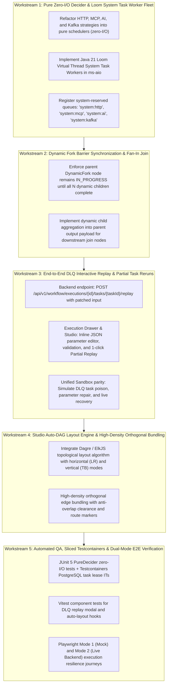

# Integration Master Plan: Iteration 20 - Enterprise Hardening & High-Resilience Workflow Orchestration Engine

**Target Systems:**  
- `@unipost/backend` (`apps/backend/workflow-engine`, `apps/backend/unipost-ms-aio`)  
- `@unipost/console` (`apps/console/src/features/workflows`, `apps/console/src/features/workflow-executions`)  
**Lead Systems Architect:** Principal Polyglot Architect, Spring Boot Backend Specialist & UI/UX Systems Specialist  
**Standards:** Java 21 LTS Virtual Threads (Loom), Spring Modulith, React 19, `@xyflow/react`, WCAG 2.2 AA, Liquid Glass Optical Tokens  
**Reference SSOT:** [`docs/workflow_orchestration_engine_architecture.md`](workflow_orchestration_engine_architecture.md)  

---

## 1. Executive Summary & Problem Analysis

Following our architectural audit of the Workflow Orchestration Engine across Java backend services, strategy evaluators, and frontend studio components, we identified four critical architectural gaps that must be resolved to achieve true enterprise production-grade quality, resilience, and strict determinism:

```
+---------------------------------------------------------------------------------------------------+
|                        WORKFLOW ENGINE ENTERPRISE DEFECT & RESILIENCE AUDIT                       |
+------------------------------------+--------------------------------+-----------------------------+
| 1. PURGE SYNCHRONOUS I/O IN DECIDER| 2. DYNAMIC FORK BARRIER RACE   | 3. DLQ INTERACTIVE REPLAY   |
| HTTP, MCP, and AI strategies       | Dynamic fork currently marks   | Operators can view DLQ but  |
| execute synchronous HttpClient calls| parent COMPLETED on spawn,     | cannot edit parameters and  |
| inside PureDecider, breaking       | bypassing barrier sync for     | trigger atomic partial      |
| zero-I/O & connection pool safety. | dynamic child sub-tasks.       | re-execution from Studio.   |
+------------------------------------+--------------------------------+-----------------------------+
```

---

## 2. Decided Architectural Decisions from `/grill-me` Alignment

> [!IMPORTANT]
> **Key Architectural Anchors Ratified for Iteration 20:**
> 1. **System Task Execution Topology**:
>    - Embedded Java 21 Loom Virtual Thread workers in `@unipost/ms-aio` (`SystemTaskWorkerPool`) polling reserved system queues (`system:http`, `system:mcp`, `system:llm`, `system:jdbc`, `system:kafka`). Zero external process overhead and zero blocking of the database connection pool.
> 2. **Dynamic Fork Barrier Failure Policy**:
>    - **Fail-Fast & Halt**: If any dynamic child sub-task fails, the parent `DYNAMIC_FORK` task fails immediately, cancels pending in-flight children, and triggers distributed Saga reverse compensation if configured.
> 3. **DLQ Interactive Replay Execution Model**:
>    - **In-Place Node Rerun**: Re-enqueue the poisoned task with modified input parameters preserving the original `executionId`. Downstream nodes are re-evaluated from the failed node, preserving all completed upstream states.
> 4. **Visual DAG Studio Auto-Layout Engine Architecture**:
>    - **Strategy Pattern (`DagLayoutEngineStrategy`)**: Implement a modular layout strategy interface supporting both:
>      - `DagreRankLayoutStrategy` (lightweight, zero bundle bloat, tuned for 240x90px nodes).
>      - `ElkJsLayoutStrategy` (dynamic / pluggable for ultra-dense hierarchical graphs).
>      - Configurable via user preference with instant hot-toggle in the Studio toolbar.
> 5. **Staging Order**:
>    - **Backend-First Execution**:
>      - Phase 1: Pure Zero-I/O Decider & Loom System Task Worker Fleet.
>      - Phase 2: Dynamic Fork Barrier Synchronization & Fan-In Join.
>      - Phase 3: DLQ Interactive Replay API & In-Place State Rerun.
>      - Phase 4: Studio Auto-DAG Layout Strategy Pattern & DLQ Repair UI.
>      - Phase 5: Automated QA, Sliced Testcontainers & Dual-Mode E2E Verification.

---

## 3. Master Workstreams Breakdown



---

## 3. Detailed Workstream Specifications

### Workstream 1: Pure Zero-I/O Decider & Loom System Task Worker Fleet
- **Backend Refactoring (`apps/backend/workflow-engine`)**:
  - Refactor `HttpNodeStrategy`, `CallMcpToolStrategy`, `LlmChatCompleteStrategy`, `JdbcNodeStrategy`, and `KafkaPublishStrategy`.
  - Remove all embedded `HttpClient`, `DataSource`, or thread operations from `com.unipost.workflow.core.decider.strategy.*`.
  - In `evaluate(...)`, if the task has not started, emit `EngineCommand.ScheduleTask` targeting reserved system domains (`system:http`, `system:mcp`, `system:llm`, `system:jdbc`, `system:kafka`).
- **System Task Workers (`apps/backend/unipost-ms-aio`)**:
  - Implement `SystemTaskWorkerPool` managed by Spring Boot using Java 21 Loom virtual threads (`Executors.newVirtualThreadPerTaskExecutor()`).
  - Workers poll reserved system task queues, execute I/O outside database transactions, and call `reportTaskResult`.

### Workstream 2: Dynamic Fork Barrier Synchronization & Fan-In Join
- **Core Engine (`DynamicForkStrategy.java`)**:
  - When dynamic tasks are spawned ($N$ sub-tasks), transition parent `DYNAMIC_FORK` task to `IN_PROGRESS` and record expected sub-task reference list in task execution metadata.
  - On subsequent decider evaluations, check all dynamic child snapshots.
  - Transition parent `DYNAMIC_FORK` task to `COMPLETED` only when **all child tasks reach terminal state**. If any child task fails, trigger failure or compensation based on workflow policy.

### Workstream 3: End-to-End DLQ Interactive Parameter Edit & Partial Task Replay
- **Backend API (`WorkflowExecutionController.java` & `WorkflowEngineService.java`)**:
  - Endpoint: `POST /api/v1/workflow/executions/{id}/tasks/{taskId}/replay`
  - Accepts modified `inputParameters` JSON payload.
  - Validates caller permissions, updates task input, removes DLQ record, resets status to `SCHEDULED`, and triggers `decider.decide()`.
- **Frontend Console (`@unipost/console`)**:
  - In `ExecutionRunDrawer` and `DagPropertyInspector`, when a node is in `FAILED` status, display a prominent **"Repair & Replay Task"** action.
  - Opens `VisualJsonEditor` with inline schema validation.
  - Re-triggers execution stream and live updates the DAG canvas.
- **Unified Sandbox Platform**:
  - Update `workflowSandboxHandler` in `apps/console/src/core/sandbox/` to support DLQ repair and replay dispatches offline.

### Workstream 4: Studio Auto-DAG Layout Engine & Ergonomics
- **Frontend Studio (`apps/console/src/features/workflows/components/studio/`)**:
  - Upgrade `handleAutoLayout` in `use-dag-studio-state.ts` using topological rank assignment with proper node dimensions (width: 240px, height: 90px) and branch spacing.
  - Support dual direction: Left-to-Right (`LR`) and Top-to-Bottom (`TB`).
  - Refine `DagConditionEdge` with high-density orthogonal routing to prevent edge collisions on complex multi-branch graphs.

### Workstream 5: Automated QA, Sliced Testcontainers & Dual-Mode E2E Verification
- **Backend Testing**:
  - Unit tests verifying `PureDecider` executes zero I/O across all 23 strategies.
  - Integration tests with PostgreSQL Testcontainers verifying task lease polling, heartbeat renewal, and DLQ quarantine.
- **Frontend Testing**:
  - Vitest tests for DLQ replay dialog, auto-layout ranking, and inspector updates.
- **End-to-End Testing**:
  - Playwright spec covering: create workflow -> trigger execution -> simulate failure -> inspect in drawer -> edit payload -> partial replay -> verify completion.

---

## 4. Verification & Handoff Criteria

1. **Compilation**:
   - `mvnw.cmd test-compile -q` exits 0 with zero warnings.
   - `pnpm --filter @unipost/console exec tsc --noEmit` exits 0.
2. **Test Suites**:
   - Backend: `./mvnw test -Dtest=com.unipost.workflow.** -q` exits 0.
   - Frontend: `pnpm --filter @unipost/console test -- run src/features/workflows src/features/workflow-executions` exits 0.
3. **Artifacts & Documentation**:
   - Walkthrough artifact in `apps/console/doc/walkthrough_151.md`.
   - History log in `docs/history/193_*.md`.
