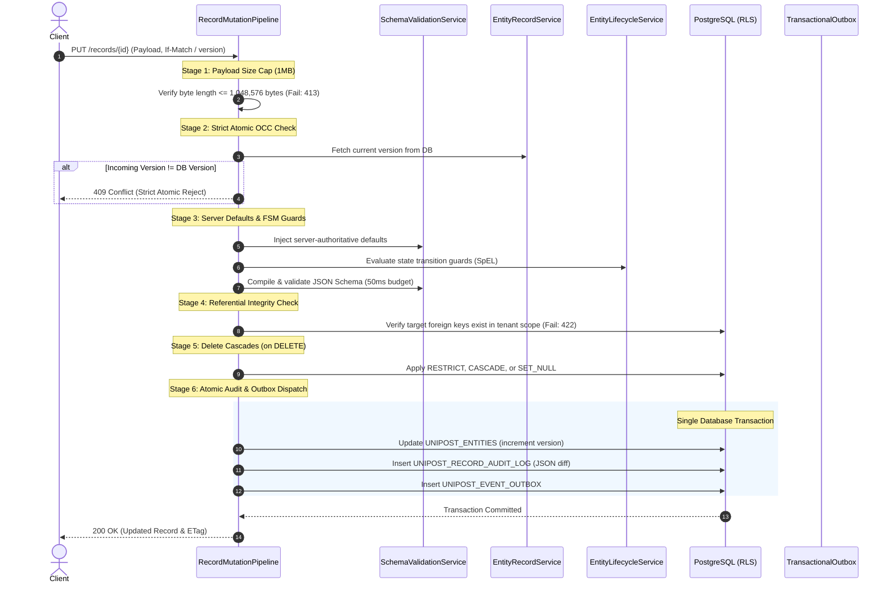

# Integration Master Plan: Iteration 22 - Enterprise Hardening & Resilience Architecture for Master Database Schema & Metadata Engine

**Target Systems:**  
- `@unipost/backend` (`apps/backend/unipost-fw`, `apps/backend/unipost-ms-aio`, `apps/backend/unipost-db`)  
- `@unipost/console` (`apps/console/src/features/metadata`, `apps/console/src/core/sandbox`)  
**Lead Systems Architect:** Principal Polyglot Architect, Spring Boot Backend Specialist & UI/UX Systems Specialist  
**Standards:** PostgreSQL 16+ RLS, Liquibase Unified Master, Spring Modulith, React 19, WCAG 2.2 AA, Liquid Glass Design Tokens  
**Reference SSOT:** [`docs/master_database_schema_architecture.md`](master_database_schema_architecture.md) (v1.2.0)  

---

## 1. Executive Summary & Problem Statement

This master plan elevates [`docs/master_database_schema_architecture.md`](master_database_schema_architecture.md) from a static schema reference to an **Enterprise-Grade, Resilient, and Regression-Free Architectural Master Specification (v1.2.0)**. 
It captures the active, production-grade resilience mechanisms implemented across `apps/backend/unipost-fw` and `@unipost/console` that prevent catastrophic regressions, security exploits, and performance bottlenecks in dynamic metadata execution.

```
+---------------------------------------------------------------------------------------------------+
|                        ENTERPRISE METADATA RESILIENCE & RUNTIME HARDENING                         |
+------------------------------------+--------------------------------+-----------------------------+
| 1. 6-STAGE RECORD MUTATION PIPELINE| 2. 3-TIER DEFENSE-IN-DEPTH     | 3. HYBRID COMPOSITE ENGINE  |
| Payload cap, dual-mode OCC ETag,   | Token bucket, static ReDoS     | Native SQL pushdown with    |
| 3-way auto-merge, FSM evaluation,  | analysis, 50ms budget ceiling, | DataLoader batch fallback,  |
| referential guards, delete cascades| statement timeout & GIN tuning.| and cycle detection guards. |
+------------------------------------+--------------------------------+-----------------------------+
```

---

## 2. Ratified Architectural Invariants (From `/grill-me` Alignment)

> [!IMPORTANT]
> - **The 6-Stage Record Mutation Pipeline Rationale**: In dynamic metadata platforms with polymorphic JSONB storage (`UNIPOST_ENTITIES.attributes`), PostgreSQL cannot natively enforce typed schemas, foreign keys, or lifecycle transitions. The 6-stage pipeline replaces missing RDBMS engine guards with deterministic, fail-fast software barriers.
> - **Strict Atomic Optimistic Concurrency Control (OCC)**: Version increments on every write (`version`). If incoming version != current DB version, the pipeline aborts immediately with `HTTP 409 Conflict` (Strict Atomic Rejection). Silent overwrites (LWW) and uncoordinated field merges are strictly prohibited.
> - **Boundary Defense (1MB Payload Ceiling)**: Enforced at Stage 1 before byte decoding or JSON deserialization to protect against Garbage Collection thrashing, heap exhaustion, and memory denial-of-service.
> - **Server-Authoritative Defaults & FSM Guards**: Server injects attribute defaults and evaluates declarative SpEL transition guards (e.g. `DRAFT -> SUBMITTED`) *before* JSON Schema validation in Stage 3, preventing client state forgery.
> - **Tenant-Scoped Referential Integrity**: Evaluated at Stage 4 prior to database write. Foreign entity references inside JSONB must exist within the caller's PostgreSQL RLS tenant scope, failing with `HTTP 422 Unprocessable Entity` if deleted or inaccessible.
> - **Zero-Data-Loss Atomic Audit & Outbox**: In Stage 6, computing forward/backward JSON deltas, inserting into `UNIPOST_RECORD_AUDIT_LOG`, and enqueuing into `UNIPOST_EVENT_OUTBOX` execute within the **exact same database transaction** as the entity update.
> - **ReDoS & Resource Quota Hardening**: Formally specify the 3-tier defense system (1MB payload cap, static nested quantifier pre-flight inspection, 50ms JSON Schema validation budget, and 3000ms database statement timeout) as non-negotiable architectural constraints.
> - **Hybrid Composite Architecture**: Document the dual execution model of `DynamicQueryCompiler` (SQL pushdown via `jsonb_build_object`/`jsonb_agg`) with automatic fallback to `DataLoaderBatchResolver` during SQL execution failures or complex relationship graphs.
> - **Provider-Agnostic Multi-Gateway Billing**: Abstract `UNIPOST_TENANT_BILLING` away from provider-specific columns (`payos_customer_id`), replacing them with generic references and `billing_metadata JSONB` via the Strategy & Adapter pattern.
> - **Sovereign SYSTEM Tenant Workflows**: Resolve the PostgreSQL RLS write paradox via dual-scope RLS and codify the 4 sovereign custodial workflows (Canonical Blueprints, Dual-Context Assume-Tenant, Infinity Quotas, and Sovereign Version Restore).

---

## 3. Architectural Gaps & Implementation Alignment

| Domain / Engine Component | Previous Document State | Actual Monorepo Implementation | Required Architectural Enhancement |
| :--- | :--- | :--- | :--- |
| **Write Plane Mutation Pipeline** | Only simple sequential flow diagram in Section 5. | Dedicated 6-stage `RecordMutationPipeline` replacing missing RDBMS guards on JSONB. | Add comprehensive specification of the **6-Stage Record Mutation Pipeline** with exact stage responsibilities and error handling contracts. |
| **Concurrency & Concurrency Model** | Mentioned only as JPA `@Version`. | Strict Optimistic Concurrency Control (OCC) comparing incoming version vs DB version with atomic `HTTP 409 Conflict` rejection. | Formalize **Strict Atomic OCC Concurrency Model** and version increment contract. |
| **Resource Quotas & ReDoS Defense** | Mentioned briefly in history logs, omitted from master doc. | 3-tier defense: 1MB payload cap, pre-flight ReDoS static analysis (`DANGEROUS_REGEX_PATTERN`), 50ms validation timeout ceiling via `Future.get(50, ms)`, and DB statement timeouts. | Add Section 6: **Enterprise Resilience & Resource Protection (3-Tier Defense-in-Depth)**. |
| **Composite Entity Engine** | Tables defined in Section 3, but query execution omitted. | High-performance SQL pushdown compiler (`DynamicQueryCompiler`) compiling recursive JSON documents via `jsonb_build_object` with automatic fallback to in-memory `DataLoaderBatchResolver`. | Add Section 7: **Composite Virtual Schemas & Hybrid Query Execution Engine**. |
| **Composite Referential Guards** | Absent. | `MetadataService` enforces cycle detection and blocks deleting/archiving base attributes or models referenced in composite specifications. | Document **Composite Dependency & Cycle Detection Invariants**. |
| **Composite Caching Fabric** | Mentioned briefly as Hazelcast. | Composite multi-tenant cache keys (`schema:{tid}:{id}:v{tVer}_s{sVer}`), L1 in-memory `JsonSchema` concurrent maps, and cluster-wide topic invalidation. | Formalize the **Dual-Layer Versioned Caching Fabric**. |

---

## 4. Detailed Architectural Specifications

### 4.1. The 6-Stage Record Mutation Pipeline


### 4.2. 3-Tier Defense-in-Depth Resource Protection
1. **Tier 1 (Per-Tenant Token Bucket)**: In-memory sliding window rate limiting returning HTTP 429 Retry-After.
2. **Tier 2 (Schema Complexity & ReDoS Defense)**:
   - Static inspection via regex rejecting nested quantifiers (`(\\(.*[+*]\\)[+*]|\\([a-zA-Z0-9_\\[\\]|-]+[+*]\\)[+*])`).
   - Hard **50ms computational budget ceiling** per validation execution via dedicated thread pool and `Future.get(50, TimeUnit.MILLISECONDS)`.
   - Quota cap of maximum 100 attributes per dynamic entity model.
3. **Tier 3 (Database Statement Timeout & Connection Protection)**:
   - Session-level `statement_timeout = '3000ms'`.
   - Aggressive GIN autovacuum scale factor (`0.05`) for `UNIPOST_ENTITIES.attributes` JSONB index maintenance.

### 4.3. Composite Virtual Schemas & Hybrid Query Engine
- **Direct SQL Pushdown**: `DynamicQueryCompiler` builds deeply nested JSON hierarchies in a single database round-trip via recursive SQL and `jsonb_build_object` / `jsonb_agg`.
- **Resilient Fallback**: In case of pushdown statement timeout (>1500ms) or SQL syntax limits, the system falls back seamlessly to `DataLoaderBatchResolver` in-memory graph assembly.
- **DAG Cycle Detection**: Validated at specification definition time; cyclic paths are rejected with `HTTP 400 Bad Request`.
- **Referential Delete Blocking**: Base entity attributes referenced by active composite specifications cannot be deleted or archived (`HTTP 409 Conflict`).

### 4.4. Composite Caching Fabric (Dual-Layer Versioning)
- Versioned Cache Key: `schema:{tenant_id}:{entity_type_id}:v{tenant_version}_s{system_version}`.
- L1 in-memory Caffeine cache (`JsonSchema` compiled instances).
- L2 distributed Hazelcast cache with cluster invalidation topics broadcasting on attribute or model mutation.

---

## 5. Verification Matrix

| Verification Step | Command / Target | Success Criteria |
| :--- | :--- | :--- |
| **Backend Compilation** | `mvnw.cmd test-compile -q` | Clean compilation exit code 0 |
| **Metadata Resilience Tests** | `mvnw.cmd test -pl unipost-fw -Dtest=RecordMutationPipelineTest,SchemaValidationServiceTest,CompositeRecordServiceTest -q` | All test assertions pass exit code 0 |
| **Console Type Safety** | `pnpm --filter @unipost/console exec tsc --noEmit` | Zero type errors |
| **Console Metadata Tests** | `pnpm --filter @unipost/console test src/features/metadata/` | All unit tests pass |
| **Living Documentation** | [`docs/master_database_schema_architecture.md`](master_database_schema_architecture.md) | Synchronized to v1.2.0 |
