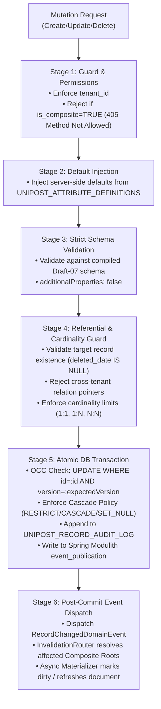
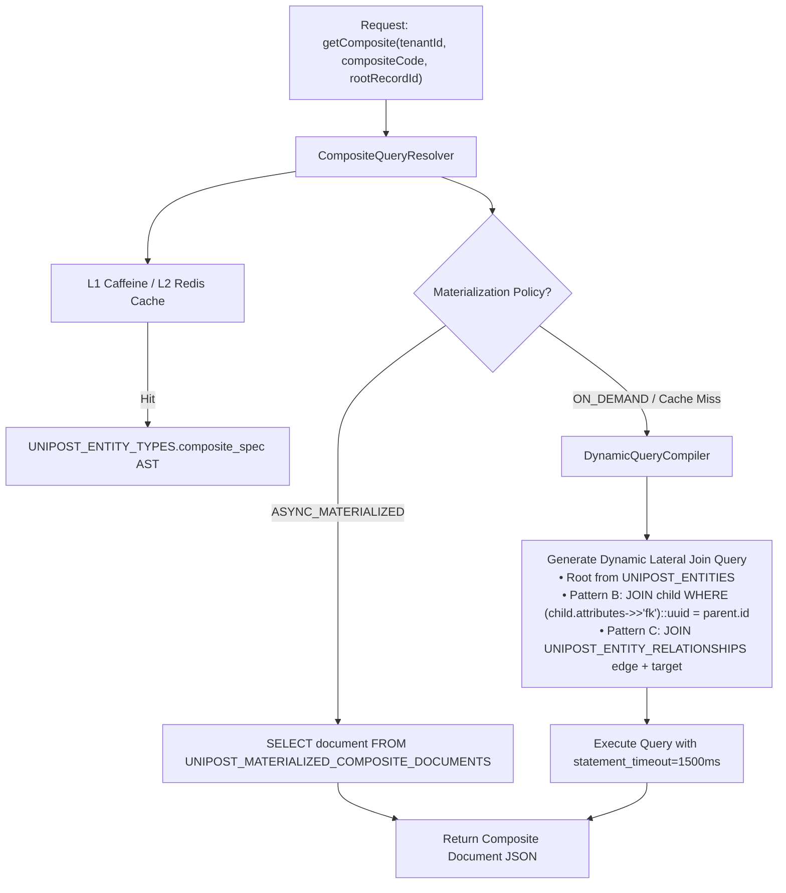

# Integration Master Plan (Iteration 6)
## Workstream 9: Autonomous Dynamic Metadata Architecture, Composite Entities Engine, Adaptive Read-Time Resolution & Transaction-Bound Asynchronous Denormalization Pipeline

---

## 1. Executive Summary & Vision

**Iteration 6 (Workstream 9: Phases 41–45)** establishes the foundational, autonomous data substrate of the Unipost platform: the **Dynamic Metadata Architecture & Composite Entities Engine**.

In strict adherence to the canonical architecture defined in `docs/hybrid_metadata_architecture_guide.md`, `docs/metadata_management_user_and_technical_guide.md`, and the core system rules:
- **No Redundant View Tables**: There is **no separate `UNIPOST_COMPOSITE_VIEWS` table**. A Composite Entity **IS** a first-class entity type in `UNIPOST_ENTITY_TYPES` where `is_composite = true`.
- **Relational Symmetry**: Composite entities share identical identity, multi-tenant isolation, versioning (`schema_version`), permissions, and caching mechanics as base entity types.
- **Strict Read-Only Composite Projections**: Composite entities are purely queryable, denormalized aggregate projections. Direct mutations on composite entities are strictly prohibited (`405 Method Not Allowed`).
- **Maximum-Care CRUD Pipeline on Base Records**: All write operations (Create, Update, Delete) target base entity records and execute through a hardened, 6-stage transaction-bound pipeline with strict Optimistic Concurrency Control (OCC), pre-commit schema and referential validation, declarative cascade policies, an immutable in-transaction audit ledger (`UNIPOST_RECORD_AUDIT_LOG`), and zero-loss domain event publishing.
- **3-Pattern Relationship Model**: Traverses Unipost's canonical relationship architecture:
  - **Pattern A (Hard Foreign Key)**: Infrastructure-level ownership (`tenant_id`, `created_by_user_id`, `entity_type_id`).
  - **Pattern B (Entity Reference 🔗)**: Inline JSONB attribute pointers (`record.attributes->>'target_id'`).
  - **Pattern C (Connected Edges ᛦ)**: Dedicated graph edge table (`UNIPOST_ENTITY_RELATIONSHIPS`) with multi-cardinality, edge context metadata, and lifecycle cascade deletes.

---

## 2. Architectural Invariants (Non-Negotiable)

| # | Invariant | Description |
| :-: | :--- | :--- |
| **1** | **Zero Static Business Schemas & Zero View Table Sprawl** | No static DDL tables or ORM classes for business concepts. Composite entities derive directly from `UNIPOST_ENTITY_TYPES` with `is_composite = true`. |
| **2** | **Strict Read-Only Composite Projections** | Composite entities are strictly query-only read models. Direct `POST`/`PUT`/`DELETE` calls on composite entities are rejected with `405 Method Not Allowed`. |
| **3** | **Strict Optimistic Concurrency Control (OCC)** | All base record mutations require a monotonically increasing `version` check (HTTP `If-Match` / ETag), failing fast with `409 Conflict` on race conditions to prevent lost updates. |
| **4** | **Pre-Commit Validation & Referential Integrity** | Server-side defaults are applied prior to JSON Schema validation (`additionalProperties: false`). Relationship pointers (Pattern B & C) must pass target existence, cross-tenant rejection, and cardinality validation before write. |
| **5** | **Declarative Delete Cascades & Referential Guards** | Soft-deletes enforce relationship cascade policies (`RESTRICT`, `CASCADE`, `SET_NULL`) across Pattern B JSONB references and Pattern C edge tables in the same atomic transaction. |
| **6** | **Immutable In-Transaction Audit Ledger** | Every base record Create, Update, and Soft-Delete writes an append-only row to `UNIPOST_RECORD_AUDIT_LOG` capturing before/after deltas, actor, and version within the same DB transaction. |
| **7** | **Existing 3-Pattern Relationship Fidelity** | Must strictly leverage Unipost's established relationship model: Pattern A (relational columns), Pattern B (inline JSONB `attributes` pointers), and Pattern C (`UNIPOST_ENTITY_RELATIONSHIPS` edge table). |
| **8** | **Transaction-Bound Event Ingestion** | Entity mutations publish domain events via Spring Modulith's Event Publication Registry in the exact same database transaction, eliminating 2PC overhead and guaranteeing zero event loss. |
| **9** | **Strict Multi-Tenancy & Soft Deletion** | All registry queries, generic record scans, lateral joins, and materialized caches MUST enforce `tenant_id = :tenantId` and `deleted_date IS NULL` with partial unique indexes. |
| **10** | **Zero Synthetic Mocks in Verification** | All integration tests execute against real production classes, real database engines, and actual transactional listeners. |

---

## 3. Iteration 6 Phase Roadmap (Phases 41 through 45)

| Phase | Milestone Title | Target Deliverables | Verification Mechanism |
| :---: | :--- | :--- | :--- |
| **Phase 41** | **Composite Entity Type Registry & Specification DSL** | Extend `UNIPOST_ENTITY_TYPES` with `composite_spec JSONB`; AST compiler supporting Pattern B & C relationships; versioned L1 Caffeine / L2 Redis cache (`schema:{id}:v{version}`). | JUnit 5 tests asserting AST compilation, relationship type validation, cycle detection, and L1/L2 cache invalidation. |
| **Phase 42** | **Maximum-Care Base Entity CRUD Pipeline & In-Transaction Audit Ledger** | 6-stage mutation pipeline for base entities; strict OCC (`version` / ETag); Draft-07 validation with `additionalProperties: false`; Pattern B & C referential existence & cardinality checks; declarative delete cascade engine (`RESTRICT`, `CASCADE`, `SET_NULL`); append-only `UNIPOST_RECORD_AUDIT_LOG`. | JUnit 5 integration tests asserting concurrent update collision handling (`409 Conflict`), cross-tenant referential rejection, cascade delete propagation, and audit log delta capture. |
| **Phase 43** | **Adaptive Read-Time Resolution Engine (Dynamic SQL Pushdown & DataLoader)** | `DynamicQueryCompiler` compiling composite view ASTs into single-roundtrip PostgreSQL queries with `jsonb_build_object`, `jsonb_agg`, and `LEFT JOIN LATERAL` traversing Pattern B inline keys or Pattern C edge tables; bounded guardrails (max recursion depth 4, statement timeout 1,500ms); `DataLoaderBatchResolver` fallback. | Integration tests asserting query execution plan, zero N+1 round trips, sub-15ms latency for 3-level nested graphs, and graceful statement timeout handling. |
| **Phase 44** | **Transaction-Bound Asynchronous Denormalization Pipeline** | Spring Modulith Event Publication integration; Inverted Dependency Graph (`DependencyGraph`) indexing Pattern B & C relations; `InvalidationRouter` reverse-resolving root record IDs; idempotent `CascadingMaterializerWorker` with optimistic locking in `UNIPOST_MATERIALIZED_COMPOSITE_DOCUMENTS`. | Concurrency tests validating correct root document recalculation under rapid parallel child updates without deadlocks or missed invalidations. |
| **Phase 45** | **Enterprise Resilience, Performance Benchmarking & Chaos Verification** | Stress testing with 100,000 generic records and 1,000 concurrent composite queries; chaos injection (worker crash during materialization, transaction rollback, Redis cache failure); full monorepo build and lint verification. | Performance benchmark reporting p95/p99 query latencies under load; chaos test verifying 100% recovery of pending events via Modulith event publication log. |

---

## 4. Deep Dive Technical Specifications & Architecture

### 4.1 Schema Consolidation & Audit Ledger DDL

```sql
-- 1. Base Entity Types Registry (Unified for both Base and Composite Entities)
CREATE TABLE IF NOT EXISTS UNIPOST_ENTITY_TYPES (
    id UUID PRIMARY KEY DEFAULT gen_random_uuid(),
    tenant_id VARCHAR(64) NOT NULL,
    code VARCHAR(64) NOT NULL,
    name VARCHAR(255) NOT NULL,
    description TEXT,
    schema_version INT NOT NULL DEFAULT 1,
    is_composite BOOLEAN NOT NULL DEFAULT FALSE,
    json_schema JSONB NOT NULL DEFAULT '{}'::jsonb,
    composite_spec JSONB NULL, -- NULL for base entities; populated when is_composite = TRUE
    created_at TIMESTAMPTZ NOT NULL DEFAULT clock_timestamp(),
    updated_at TIMESTAMPTZ NOT NULL DEFAULT clock_timestamp(),
    deleted_date TIMESTAMPTZ NULL,
    CONSTRAINT uq_entity_type_tenant_code UNIQUE (tenant_id, code)
);

CREATE INDEX idx_entity_types_tenant_composite 
    ON UNIPOST_ENTITY_TYPES(tenant_id, is_composite) 
    WHERE deleted_date IS NULL;

-- 2. Base Generic Records Table (With Monotonic Version for OCC)
CREATE TABLE IF NOT EXISTS UNIPOST_ENTITIES (
    id UUID PRIMARY KEY DEFAULT gen_random_uuid(),
    tenant_id VARCHAR(64) NOT NULL,
    entity_type_id UUID NOT NULL REFERENCES UNIPOST_ENTITY_TYPES(id),
    schema_version INT NOT NULL DEFAULT 1,
    version BIGINT NOT NULL DEFAULT 1, -- Monotonic version token for OCC
    attributes JSONB NOT NULL DEFAULT '{}'::jsonb,
    created_by VARCHAR(64) NOT NULL,
    updated_by VARCHAR(64) NOT NULL,
    created_at TIMESTAMPTZ NOT NULL DEFAULT clock_timestamp(),
    updated_at TIMESTAMPTZ NOT NULL DEFAULT clock_timestamp(),
    deleted_date TIMESTAMPTZ NULL
);

CREATE INDEX idx_entities_tenant_type 
    ON UNIPOST_ENTITIES(tenant_id, entity_type_id) 
    WHERE deleted_date IS NULL;
CREATE INDEX idx_entities_attributes_gin 
    ON UNIPOST_ENTITIES USING GIN (attributes);

-- 3. Immutable In-Transaction Record Audit Log
CREATE TABLE IF NOT EXISTS UNIPOST_RECORD_AUDIT_LOG (
    id UUID PRIMARY KEY DEFAULT gen_random_uuid(),
    tenant_id VARCHAR(64) NOT NULL,
    record_id UUID NOT NULL,
    entity_type_id UUID NOT NULL REFERENCES UNIPOST_ENTITY_TYPES(id),
    operation VARCHAR(16) NOT NULL, -- CREATE, UPDATE, SOFT_DELETE
    actor VARCHAR(64) NOT NULL,
    version BIGINT NOT NULL,
    old_attributes JSONB NULL,
    new_attributes JSONB NULL,
    delta JSONB NULL,
    created_at TIMESTAMPTZ NOT NULL DEFAULT clock_timestamp()
);

CREATE INDEX idx_record_audit_lookup 
    ON UNIPOST_RECORD_AUDIT_LOG(tenant_id, record_id, created_at DESC);

-- 4. Materialized Composite Documents Store
CREATE TABLE IF NOT EXISTS UNIPOST_MATERIALIZED_COMPOSITE_DOCUMENTS (
    id UUID PRIMARY KEY DEFAULT gen_random_uuid(),
    tenant_id VARCHAR(64) NOT NULL,
    composite_entity_type_id UUID NOT NULL REFERENCES UNIPOST_ENTITY_TYPES(id),
    root_record_id UUID NOT NULL,
    document JSONB NOT NULL,
    lineage_hash VARCHAR(64) NOT NULL,
    is_dirty BOOLEAN NOT NULL DEFAULT FALSE,
    version BIGINT NOT NULL DEFAULT 1,
    materialized_at TIMESTAMPTZ NOT NULL DEFAULT clock_timestamp(),
    CONSTRAINT uq_mat_doc_tenant_entity_root UNIQUE (tenant_id, composite_entity_type_id, root_record_id)
);

CREATE INDEX idx_mat_doc_lookup 
    ON UNIPOST_MATERIALIZED_COMPOSITE_DOCUMENTS(tenant_id, composite_entity_type_id, root_record_id);
CREATE INDEX idx_mat_doc_dirty 
    ON UNIPOST_MATERIALIZED_COMPOSITE_DOCUMENTS(is_dirty) 
    WHERE is_dirty = TRUE;
```

---

### 4.2 Maximum-Care Base Entity CRUD Mutation Pipeline



---

### 4.3 Read Path: Dynamic SQL Pushdown with Pattern B & Pattern C Support



---

## 5. Verification & Automated Test Strategy

```powershell
# 1. Backend Core & Database Test Suite
cd apps/backend; ./mvnw.cmd clean test '-Dsurefire.failIfNoSpecifiedTests=false'

# 2. Maximum-Care CRUD & Concurrency Integration Tests
cd apps/backend; ./mvnw.cmd test -Dtest=RecordMutationPipelineTest,OptimisticLockingConcurrencyTest,ReferentialCascadeTest

# 3. Monorepo-Wide Integrity Check
pnpm check-types
pnpm build
```
