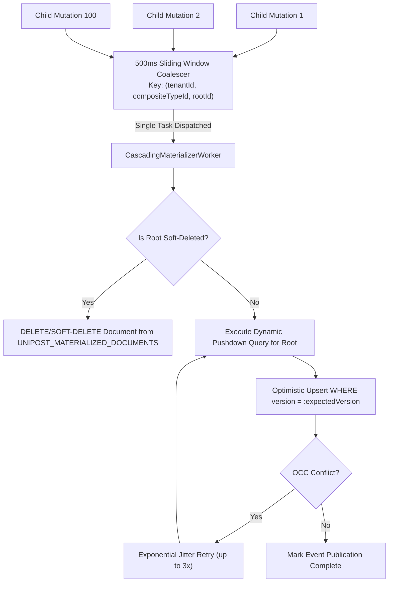

# Integration Master Plan (Iteration 6)
## Workstream 9: Autonomous Dynamic Metadata Architecture, Composite Entities Engine, Adaptive Read-Time Resolution & Transaction-Bound Asynchronous Denormalization Pipeline

---

## 1. Executive Summary & Vision

**Iteration 6 (Workstream 9: Phases 41–45)** establishes the foundational, autonomous data substrate of the Unipost platform: the **Dynamic Metadata Architecture & Composite Entities Engine**.

In strict adherence to the canonical architecture defined in `docs/hybrid_metadata_architecture_guide.md`, `docs/metadata_management_user_and_technical_guide.md`, and the core system rules:
- **No Redundant View Tables**: There is **no separate `UNIPOST_COMPOSITE_VIEWS` table**. A Composite Entity **IS** a first-class entity type in `UNIPOST_ENTITY_TYPES` where `is_composite = true`.
- **Relational Symmetry**: Composite entities share identical identity, multi-tenant isolation, versioning (`schema_version`), permissions, and caching mechanics as base entity types.
- **Strict Read-Only Composite Projections**: Composite entities are purely queryable, denormalized aggregate projections. Direct mutations on composite entities are strictly prohibited (`405 Method Not Allowed`).
- **Maximum-Care CRUD Pipeline on Base Records**: All write operations (Create, Update, Delete) target base entity records and execute through a hardened, 6-stage transaction-bound pipeline with strict Optimistic Concurrency Control (OCC), pre-commit schema and referential validation, declarative cascade policies, an immutable monthly-partitioned audit ledger (`UNIPOST_RECORD_AUDIT_LOG`), and zero-loss domain event publishing.
- **3-Pattern Relationship Model & Dynamic Indexing**:
  - **Pattern A (Hard Foreign Key)**: Infrastructure-level ownership (`tenant_id`, `created_by_user_id`, `entity_type_id`).
  - **Pattern B (Entity Reference 🔗)**: Inline JSONB attribute pointers (`record.attributes->>'target_id'`) with automated dynamic provisioning of partial B-Tree functional indexes.
  - **Pattern C (Connected Edges ᛦ)**: Dedicated graph edge table (`UNIPOST_ENTITY_RELATIONSHIPS`) with multi-cardinality, edge context metadata, and lifecycle cascade deletes.

---

## 2. Architectural Invariants (Non-Negotiable)

| # | Invariant | Description |
| :-: | :--- | :--- |
| **1** | **Zero Static Business Schemas & Zero View Table Sprawl** | No static DDL tables or ORM classes for business concepts. Composite entities derive directly from `UNIPOST_ENTITY_TYPES` with `is_composite = true`. |
| **2** | **Strict Read-Only Composite Projections** | Composite entities are strictly query-only read models. Direct `POST`/`PUT`/`DELETE` calls on composite entities are rejected with `405 Method Not Allowed`. |
| **3** | **Strict Optimistic Concurrency Control (OCC)** | All base record mutations require a monotonically increasing `version` check (HTTP `If-Match` / ETag), failing fast with `409 Conflict` on race conditions to prevent lost updates. |
| **4** | **Pre-Commit Validation & Referential Integrity** | Server-side defaults are applied prior to JSON Schema validation (`additionalProperties: false`). Relationship pointers (Pattern B & C) must pass target existence, cross-tenant rejection, and cardinality validation before write. |
| **5** | **Declarative Delete Cascades & Referential Guards** | Soft-deletes enforce relationship cascade policies (`RESTRICT`, `CASCADE`, `SET_NULL`) across Pattern B JSONB references and Pattern C edge tables in the same atomic transaction. |
| **6** | **Partitioned In-Transaction Audit Ledger** | Every base record Create, Update, and Soft-Delete writes an append-only row to `UNIPOST_RECORD_AUDIT_LOG` (monthly range partitioned by `created_at`) capturing before/after deltas, actor, and version. |
| **7** | **Automated Dynamic B-Tree Index Provisioning** | When a Pattern B relationship is registered in `UNIPOST_RELATIONSHIP_TYPES`, the backend automatically provisions a partial B-Tree functional index (`CREATE INDEX CONCURRENTLY IF NOT EXISTS (((attributes->>'fk')::uuid)) WHERE deleted_date IS NULL`). |
| **8** | **Native Child Collection Pagination & Safety Caps** | Dynamic SQL pushdown queries for 1:N relations natively support pagination parameters (`limit`, `offset` / `cursor`) with a default of 50 and hard ceiling of 250 to protect database `work_mem`. |
| **9** | **Sliding-Window Invalidation Coalescing** | Invalidation events for the same root record are coalesced over a 500ms sliding window, collapsing rapid child batch updates into exactly one composite document recalculation. |
| **10** | **Materialization OCC Retry with Jitter & Soft-Delete Skip** | On concurrent materialization collisions, workers retry up to 3 times with exponential backoff and jitter. If the root record is soft-deleted, the materialized document is safely purged. |
| **11** | **Strict Multi-Tenancy & Soft Deletion** | All registry queries, generic record scans, lateral joins, and materialized caches MUST enforce `tenant_id = :tenantId` and `deleted_date IS NULL` with partial unique indexes. |
| **12** | **Zero Synthetic Mocks in Verification** | All integration tests execute against real production classes, real database engines, and actual transactional listeners. |

---

## 3. Iteration 6 Phase Roadmap (Phases 41 through 45)

| Phase | Milestone Title | Target Deliverables | Verification Mechanism |
| :---: | :--- | :--- | :--- |
| **Phase 41** | **Composite Entity Type Registry & Specification DSL** | Extend `UNIPOST_ENTITY_TYPES` with `composite_spec JSONB`; AST compiler supporting Pattern B & C relationships; automated dynamic partial B-Tree index provisioner; versioned L1 Caffeine / L2 Distributed Hazelcast cache (`schema:{id}:v{version}`). | JUnit 5 tests asserting AST compilation, relationship type validation, cycle detection, automatic functional index generation, and Hazelcast cache invalidation. |
| **Phase 42** | **Maximum-Care Base Entity CRUD Pipeline & Partitioned Audit Ledger** | 6-stage mutation pipeline for base entities; strict OCC (`version` / ETag); Draft-07 validation with `additionalProperties: false`; Pattern B & C referential existence & cardinality checks; declarative delete cascade engine (`RESTRICT`, `CASCADE`, `SET_NULL`); monthly-partitioned `UNIPOST_RECORD_AUDIT_LOG`. | JUnit 5 integration tests asserting concurrent update collision handling (`409 Conflict`), cross-tenant referential rejection, cascade delete propagation, and audit log partition routing. |
| **Phase 43** | **Adaptive Read-Time Resolution Engine (Dynamic SQL Pushdown & Pagination)** | `DynamicQueryCompiler` compiling composite view ASTs into single-roundtrip PostgreSQL queries with `jsonb_build_object`, `jsonb_agg`, and `LEFT JOIN LATERAL` traversing Pattern B inline keys or Pattern C edge tables; native child pagination (`limit`, `offset`); bounded guardrails (max recursion depth 4, statement timeout 1,500ms); `DataLoaderBatchResolver` fallback. | Integration tests asserting query execution plan, zero N+1 round trips, sub-15ms latency for 3-level nested graphs, child slice pagination, and graceful statement timeout handling. |
| **Phase 44** | **Transaction-Bound Asynchronous Denormalization Pipeline with Coalescing** | Spring Modulith Event Publication integration; Inverted Dependency Graph (`DependencyGraph`) indexing Pattern B & C relations; 500ms sliding-window invalidation debouncer; reverse foreign-key path resolver; idempotent `CascadingMaterializerWorker` with OCC retries & jitter updating `UNIPOST_MATERIALIZED_COMPOSITE_DOCUMENTS`. | Concurrency tests validating storm coalescing (100 child writes $\to$ 1 recalculation), OCC retry resilience, and correct root document state without deadlocks. |
| **Phase 45** | **Enterprise Resilience, Performance Benchmarking & Chaos Verification** | Stress testing with 100,000 generic records and 1,000 concurrent composite queries; chaos injection (worker crash during materialization, transaction rollback, Hazelcast cache failure); full monorepo build and lint verification. | Performance benchmark reporting p95/p99 query latencies under load; chaos test verifying 100% recovery of pending events via Modulith event publication log. |

---

## 4. Deep Dive Technical Specifications & Architecture

### 4.1 Schema Consolidation & Partitioned Audit Ledger DDL

```sql
-- 1. Base Entity Types Registry (Unified for both Base and Composite Entities)
CREATE TABLE IF NOT EXISTS UNIPOST_ENTITY_TYPES (
    id UUID PRIMARY KEY DEFAULT gen_random_uuid(),
    tenant_id VARCHAR(64) NOT NULL,
    code VARCHAR(64) NOT NULL,
    name VARCHAR(255) NOT NULL,
    description TEXT,
    schema_version INT NOT NULL DEFAULT 1,
    is_composite BOOLEAN NOT NULL DEFAULT FALSE,
    json_schema JSONB NOT NULL DEFAULT '{}'::jsonb,
    composite_spec JSONB NULL, -- NULL for base entities; populated when is_composite = TRUE
    created_at TIMESTAMPTZ NOT NULL DEFAULT clock_timestamp(),
    updated_at TIMESTAMPTZ NOT NULL DEFAULT clock_timestamp(),
    deleted_date TIMESTAMPTZ NULL,
    CONSTRAINT uq_entity_type_tenant_code UNIQUE (tenant_id, code)
);

CREATE INDEX idx_entity_types_tenant_composite 
    ON UNIPOST_ENTITY_TYPES(tenant_id, is_composite) 
    WHERE deleted_date IS NULL;

-- 2. Base Generic Records Table (With Monotonic Version for OCC)
CREATE TABLE IF NOT EXISTS UNIPOST_ENTITIES (
    id UUID PRIMARY KEY DEFAULT gen_random_uuid(),
    tenant_id VARCHAR(64) NOT NULL,
    entity_type_id UUID NOT NULL REFERENCES UNIPOST_ENTITY_TYPES(id),
    schema_version INT NOT NULL DEFAULT 1,
    version BIGINT NOT NULL DEFAULT 1, -- Monotonic version token for OCC
    attributes JSONB NOT NULL DEFAULT '{}'::jsonb,
    created_by VARCHAR(64) NOT NULL,
    updated_by VARCHAR(64) NOT NULL,
    created_at TIMESTAMPTZ NOT NULL DEFAULT clock_timestamp(),
    updated_at TIMESTAMPTZ NOT NULL DEFAULT clock_timestamp(),
    deleted_date TIMESTAMPTZ NULL
);

CREATE INDEX idx_entities_tenant_type 
    ON UNIPOST_ENTITIES(tenant_id, entity_type_id) 
    WHERE deleted_date IS NULL;
CREATE INDEX idx_entities_attributes_gin 
    ON UNIPOST_ENTITIES USING GIN (attributes);

-- 3. Monthly Range-Partitioned Immutable Audit Log
CREATE TABLE IF NOT EXISTS UNIPOST_RECORD_AUDIT_LOG (
    id UUID NOT NULL DEFAULT gen_random_uuid(),
    tenant_id VARCHAR(64) NOT NULL,
    record_id UUID NOT NULL,
    entity_type_id UUID NOT NULL REFERENCES UNIPOST_ENTITY_TYPES(id),
    operation VARCHAR(16) NOT NULL, -- CREATE, UPDATE, SOFT_DELETE
    actor VARCHAR(64) NOT NULL,
    version BIGINT NOT NULL,
    old_attributes JSONB NULL,
    new_attributes JSONB NULL,
    delta JSONB NULL,
    created_at TIMESTAMPTZ NOT NULL DEFAULT clock_timestamp(),
    PRIMARY KEY (id, created_at)
) PARTITION BY RANGE (created_at);

-- Example initial monthly partition
CREATE TABLE IF NOT EXISTS acc_record_audit_log_2026_10 
    PARTITION OF UNIPOST_RECORD_AUDIT_LOG 
    FOR VALUES FROM ('2026-10-01 00:00:00+00') TO ('2026-11-01 00:00:00+00');

CREATE INDEX idx_record_audit_lookup 
    ON UNIPOST_RECORD_AUDIT_LOG(tenant_id, record_id, created_at DESC);

-- 4. Materialized Composite Documents Store
CREATE TABLE IF NOT EXISTS UNIPOST_MATERIALIZED_COMPOSITE_DOCUMENTS (
    id UUID PRIMARY KEY DEFAULT gen_random_uuid(),
    tenant_id VARCHAR(64) NOT NULL,
    composite_entity_type_id UUID NOT NULL REFERENCES UNIPOST_ENTITY_TYPES(id),
    root_record_id UUID NOT NULL,
    document JSONB NOT NULL,
    lineage_hash VARCHAR(64) NOT NULL,
    is_dirty BOOLEAN NOT NULL DEFAULT FALSE,
    version BIGINT NOT NULL DEFAULT 1,
    materialized_at TIMESTAMPTZ NOT NULL DEFAULT clock_timestamp(),
    CONSTRAINT uq_mat_doc_tenant_entity_root UNIQUE (tenant_id, composite_entity_type_id, root_record_id)
);

CREATE INDEX idx_mat_doc_lookup 
    ON UNIPOST_MATERIALIZED_COMPOSITE_DOCUMENTS(tenant_id, composite_entity_type_id, root_record_id);
CREATE INDEX idx_mat_doc_dirty 
    ON UNIPOST_MATERIALIZED_COMPOSITE_DOCUMENTS(is_dirty) 
    WHERE is_dirty = TRUE;
```

---

### 4.2 Phase 41 Deep Dive: Composite Entity Type Registry, Specification DSL & Visual Bento Builder

#### 4.2.1 Unified Model & Declarative Tree Specification DSL
- **First-Class Registry Entity**: Composite entities are stored directly in `UNIPOST_ENTITY_TYPES` with `is_composite = TRUE`.
- **Declarative Tree Specification Schema (`composite_spec`)**:
  ```json
  {
    "rootEntityType": "customer",
    "fields": ["name", "email", "tier"],
    "relations": [
      {
        "alias": "orders",
        "pattern": "PATTERN_B",
        "targetEntityType": "order",
        "joinKey": "customer_id",
        "cardinality": "ONE_TO_MANY",
        "fields": ["order_no", "total_amount", "status"],
        "filter": { "status": { "$ne": "CANCELLED" } },
        "orderBy": { "order_date": "DESC" },
        "pagination": { "defaultLimit": 20, "maxLimit": 100 },
        "relations": [
          {
            "alias": "items",
            "pattern": "PATTERN_B",
            "targetEntityType": "order_item",
            "joinKey": "order_id",
            "cardinality": "ONE_TO_MANY",
            "fields": ["sku", "quantity", "unit_price"],
            "pagination": { "defaultLimit": 50, "maxLimit": 100 },
            "relations": []
          }
        ]
      }
    ]
  }
  ```

#### 4.2.2 Console UX: Master-Detail Bento Builder in VisualSchemaStudio
- **Integrated Tab**: Embedded as a dedicated tab/mode inside `VisualSchemaStudio` (`apps/console/src/features/metadata/components/studio/visual-schema-studio.tsx`) when viewing or editing an entity type where `is_composite = true`.
- **Left Bento Rail (Relationship Catalog)**:
  - Automatically queries and categorizes available connections into:
    - **Inline References (Pattern B 🔗 `Link2`)**: Detected from inline JSONB reference attributes on the entity models.
    - **Connected Edges (Pattern C ᛦ `GitFork`)**: Discovered from registered `UNIPOST_RELATIONSHIP_TYPES` graph edges.
- **Center Bento Canvas (Hierarchical Projection Tree)**:
  - Interactive hierarchical tree cards representing root entity and joined relations.
  - Multi-select field pickers, custom alias text inputs, declarative filter builders (e.g. `status != CANCELLED`), sort orders, and pagination limit steppers (`defaultLimit`, `maxLimit`).
- **Right Bento Pane (Live Preview Hub)**:
  - **Live JSON Preview**: Real-time rendering of the projected composite document structure using mock or live tenant records.
  - **Pushdown SQL Preview**: Shows the dynamically generated PostgreSQL query (`LEFT JOIN LATERAL`, `jsonb_build_object`, `jsonb_agg`) for full operator transparency.

#### 4.2.3 Backend AST Compiler, Schema Generator & Cycle Guard
- **AST Compilation (`CompositeSpecCompiler`)**:
  - Compiles declarative JSON into an immutable, validated `CompositeSpecAst`.
  - Enforces strict cross-tenant isolation: validates that `rootEntityType` and all target entities exist strictly within the requesting tenant.
  - Automatically registers the corresponding JSON Schema (Draft-07) representing the composite output document structure.
- **Cycle Detection & Recursion Ceiling**:
  - **Hard Depth Ceiling**: Maximum tree nesting depth of **4 levels**.
  - **Path-Based Cycle Guard**: Recursively verifies that no entity type repeats along the same ancestor traversal path, completely preventing circular expansion.

#### 4.2.4 Strict Dependency Guard on Base Attributes
- **Integrity Validation**: When an operator attempts to delete or alter a base entity attribute definition in `UNIPOST_ATTRIBUTE_DEFINITIONS`:
  - An integrity checker queries active `composite_spec` definitions.
  - If the target attribute is actively projected or referenced in join/filter conditions, the mutation is **rejected immediately with `409 Conflict`**, requiring the composite specification to be updated first.

#### 4.2.5 Automated Dynamic Partial B-Tree Functional Index Provisioner
- **Zero Manual DBA Indexing**:
  - Whenever a Pattern B relationship is registered in `UNIPOST_RELATIONSHIP_TYPES` or referenced in a composite specification:
    ```sql
    CREATE INDEX CONCURRENTLY IF NOT EXISTS idx_patb_{tenant}_{attr} 
        ON UNIPOST_ENTITIES (((attributes->>'fk')::uuid)) 
        WHERE deleted_date IS NULL;
    ```
  - **Asynchronous Execution**: Dispatched on a dedicated background thread via a non-transactional connection with name sanitization and graceful fallback if DDL privileges are restricted.

#### 4.2.6 Unified Record Envelope & Strict Read-Only Invariants
- **Unified Envelope**: Read operations on composite entities return the standard Unipost entity envelope:
  ```json
  {
    "id": "root-uuid",
    "tenantId": "tenant-001",
    "entityTypeId": "composite-type-uuid",
    "schemaVersion": 1,
    "is_composite": true,
    "attributes": {
      "customerId": "root-uuid",
      "companyName": "Acme Corp",
      "orders": [ ... ]
    }
  }
  ```
- **Strict Read-Only Enforcement**: Composite entities are queryable aggregate projections only. Direct mutations (`POST`, `PUT`, `DELETE` on composite entity records) are strictly rejected with `405 Method Not Allowed`.

#### 4.2.7 Distributed Hazelcast Cache Invariants
- **Versioned Cache Keys**: `schema:{id}:v{schema_version}` stored in Distributed Hazelcast Cache (`IMap`).
- **Cluster-Wide Invalidation**: Schema mutations increment `schema_version` atomically in the database transaction and evict cached entries across all cluster nodes via Hazelcast topic/event listeners.
- **Fail-Safe Fallback**: Hazelcast connection timeouts or partition loss must NEVER fail in-process schema compilation or validation.

---

### 4.3 Dynamic Query Pushdown with Child Pagination (Phase 43)

When executing a dynamic pushdown query with child collection pagination:

```sql
SELECT 
    jsonb_build_object(
        'customerId', root.id,
        'companyName', root.attributes->>'company_name',
        'tier', root.attributes->>'tier',
        'orders', COALESCE(ord_agg.orders, '[]'::jsonb)
    ) AS composite_document
FROM UNIPOST_ENTITIES root
LEFT JOIN LATERAL (
    SELECT jsonb_agg(
        jsonb_build_object(
            'orderId', ord.id,
            'orderNo', ord.attributes->>'order_no',
            'totalAmount', (ord.attributes->>'total')::numeric,
            'items', COALESCE(item_agg.items, '[]'::jsonb)
        ) ORDER BY (ord.attributes->>'order_date') DESC
    ) AS orders
    FROM (
        SELECT ord_sub.* 
        FROM UNIPOST_ENTITIES ord_sub
        WHERE ord_sub.tenant_id = root.tenant_id
          AND ord_sub.entity_type_id = :orderEntityTypeId
          AND (ord_sub.attributes->>'customer_id')::uuid = root.id
          AND ord_sub.attributes->>'status' != 'CANCELLED'
          AND ord_sub.deleted_date IS NULL
        ORDER BY (ord_sub.attributes->>'order_date') DESC
        LIMIT :orderLimit OFFSET :orderOffset -- Native child slice pagination
    ) ord
    LEFT JOIN LATERAL (
        SELECT jsonb_agg(
            jsonb_build_object(
                'sku', itm.attributes->>'sku',
                'quantity', (itm.attributes->>'qty')::numeric,
                'unitPrice', (itm.attributes->>'unit_price')::numeric
            )
        ) AS items
        FROM UNIPOST_ENTITIES itm
        WHERE itm.tenant_id = ord.tenant_id
          AND itm.entity_type_id = :itemEntityTypeId
          AND (itm.attributes->>'order_id')::uuid = ord.id
          AND itm.deleted_date IS NULL
        LIMIT 50 -- Bounded sub-collection ceiling
    ) item_agg ON TRUE
) ord_agg ON TRUE
WHERE root.tenant_id = :tenantId
  AND root.entity_type_id = :customerEntityTypeId
  AND root.id = :rootRecordId
  AND root.deleted_date IS NULL;
```

---

### 4.4 Invalidation Debouncing & Coalescing Pipeline (Phase 44)



---

## 5. Verification & Automated Test Strategy

```powershell
# 1. Backend Core & Database Test Suite
cd apps/backend; ./mvnw.cmd clean test '-Dsurefire.failIfNoSpecifiedTests=false'

# 2. Maximum-Care CRUD, Pagination & Invalidation Storm Tests
cd apps/backend; ./mvnw.cmd test -Dtest=RecordMutationPipelineTest,DynamicQueryPaginationTest,InvalidationCoalescingTest

# 3. Monorepo-Wide Integrity Check
pnpm check-types
pnpm build
```
